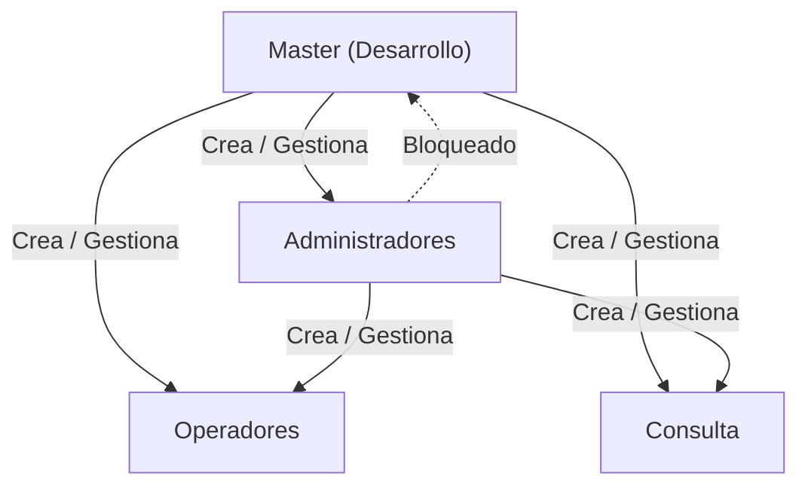
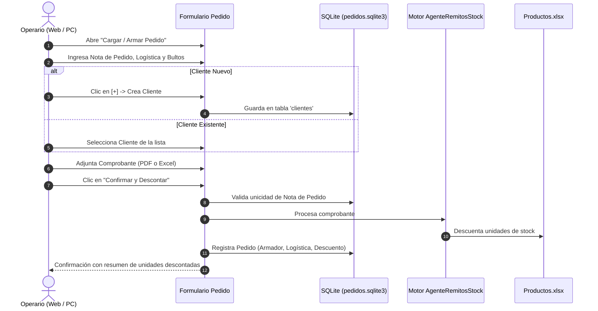

# StockAgent · Manual de Operación y Guía de Arquitectura

**StockAgent** es una plataforma integral para el control, auditoría y descuento de inventario en tiempo real a partir de comprobantes PDF (remitos mayoristas), planillas Excel (canjes) y documentos de Mercado Libre. Funciona tanto en modo escritorio nativo como en **Servidor Web Multi-Equipo (LAN)**, permitiendo que múltiples puestos de trabajo operen coordinadamente sobre el mismo stock sin inconsistencias.

---

## Índice

1. [Arquitectura y Modos de Ejecución](#1-arquitectura-y-modos-de-ejecución)
2. [Manual de Usuario por Roles](#2-manual-de-usuario-por-roles)
   - [Rol Master (`Desarrollo`)](#rol-master-desarrollo)
   - [Rol Administrador](#rol-administrador)
   - [Rol Operador](#rol-operador)
   - [Rol Consulta](#rol-consulta)
3. [Nuevo Módulo: Carga y Armado de Pedidos en Tiempo Real](#3-nuevo-módulo-carga-y-armado-de-pedidos-en-tiempo-real)
4. [Control de Concurrencia y Pestañas en Navegador](#4-control-de-concurrencia-y-pestañas-en-navegador)
5. [Manual del Programador y Mantenimiento](#5-manual-del-programador-y-mantenimiento)
   - [Estructura del Proyecto](#estructura-del-proyecto)
   - [Esquema de Bases de Datos SQLite](#esquema-de-bases-de-datos-sqlite)
   - [Compilación del Ejecutable (`.exe`)](#compilación-del-ejecutable-exe)
   - [Despliegue en Red Local (Servidor LAN)](#despliegue-en-red-local-servidor-lan)

---

## 1. Arquitectura y Modos de Ejecución

StockAgent opera sobre una arquitectura híbrida de alto rendimiento:

* **Motor Web ASGI / Flet:** Servidor web FastAPI / Starlette en el puerto por defecto `8550`.
* **Identidad Visual Web (Favicon):** La aplicación incluye en `assets/` el isotipo y favicon oficial (`ultratech.png` y `ultratech.ico`), visible en la pestaña del navegador, pantalla de carga y accesos directos PWA.
* **Bases de Datos SQLite (WAL Mode):** Persistencia transaccional concurrente para usuarios, clientes y pedidos en `data/`.
* **Plantilla Excel Maestra:** Archivo `Descuentos/Productos.xlsx` sincronizado atómicamente con los registros SQLite.

### Formas de Inicio

1. **Servidor Web en Red (Recomendado para depósito y administración):**
   * Doble clic en `iniciar_servidor_web.bat` o:
     ```powershell
     python main.py --host 0.0.0.0 --port 8550
     ```
   * En la PC principal se accede desde `http://127.0.0.1:8550`.
   * En las terminales secundarias de la red local se accede mediante la IP local (ej. `http://192.168.1.50:8550`).
2. **Modo Escritorio Monopuesto:**
   ```powershell
   python main.py --desktop
   ```
3. **Modo Automático por Consola (Headless):**
   ```powershell
   python main.py --auto
   ```

---

## 2. Manual de Usuario por Roles

El acceso está protegido por cuentas locales con contraseñas cifradas en PBKDF2 (SHA-256).



---

### Rol Master (`Desarrollo`)

El usuario **Master** es la máxima autoridad del sistema. Está precargado por defecto en la base de datos para garantizar la instalación y continuidad operativa.

* **Usuario precargado:** `Desarrollo`
* **Contraseña inicial:** `master1713`
* **Atributos y Seguridad:**
  * **Exclusividad:** Es el **único rol facultado para crear, modificar el rol o dar de baja a usuarios Administradores**.
  * **Visibilidad Total:** Desde la sesión del Master se visualizan **todos los usuarios existentes** en el sistema (Master, Administradores, Operadores y Consulta).
  * **Protección inviolable:** El usuario Master no puede ser desactivado ni degradado de rol por ningún usuario ni por sí mismo.
  * **Acceso de Configuración:** Tiene habilitadas todas las funciones de administración, catálogos, relevamiento físico y estadísticas.

---

### Rol Administrador

Pensado para jefes de depósito, encargados de stock y gerencia.

* **Gestión de Usuarios Operativos:** Puede crear y administrar cuentas con rol `Operador` y `Consulta`.
* **Historial de Pedidos Auditado:**
  * Acceso completo para auditar pedidos preparados por los operarios, con buscador por cliente, remito/nota, fecha o armador.
* **Privacidad del Master:** Desde la cuenta de Administrador **el usuario Master permanece completamente invisible** en la lista de usuarios y no puede ser alterado.
* **Gestión de Catálogo de Productos (`Productos.xlsx`):**
  * Alta, baja lógica y edición de productos, códigos, stocks mínimos y máximos de seguridad.
  * Detección y alerta de quiebres de stock.
* **Ajuste de Stock y Entrada de Fábrica:**
  * Carga manual o procesamiento de comprobantes de fábrica (`.xlsx`, `.xls`, `.pdf`) para reabastecimiento o ajuste directo de inventario.
* **Descuento Mercado Libre Full:**
  * Procesamiento específico de planillas de envíos Full con previsualización de impacto.
* **Descuento Mercado Libre (DOCX):**
  * Procesamiento directo de pedidos de Mercado Libre mediante archivos `.docx`, reconociendo los productos por nombre mediante coincidencia de texto y descontando las unidades en la base de datos central.
* **Comparativa de Stock Físico:**
  * Recepción de inventarios tomados por los operarios y generación del reporte unificado de diferencias (`COINCIDE`, `FALTANTE`, `SOBRANTE`).
* **Restauración de Documentos:**
  * Rollback seguro de lotes procesados organizados por fecha de descuento.
* **Estadísticas y Rotación:**
  * Métricas de productos con mayor salida y comportamiento de inventario.

---

### Rol Operador

Diseñado para los operarios de preparación de pedidos, empaquetado y control en depósito.

* **Carga y Armado de Pedidos en Tiempo Real (Exclusivo Operador):**
  * Formulario ordenado verticalmente para procesar comprobantes individuales al instante (PDF o Excel).
  * Incluye comprobante único (**Remito / Factura**), selector con alta rápida de cliente, bultos, logística con enum, armador automático, checkbox de agregado, fecha de retiro opcional con calendario interactivo y adjunto de archivo.
  * **Detección Inteligente Antiduplicado (SHA-256):** Bloquea de inmediato comprobantes cuyo contenido binario ya fue procesado con anterioridad, evitando duplicaciones de stock por error humano.
* **Descuento Mercado Libre (DOCX):**
  * Acceso al procesamiento de pedidos de Mercado Libre a partir de documentos `.docx`, con reconocimiento inteligente de productos por nombre, previsualización de impacto e integración inmediata al inventario.
  * **Blindaje Antifraude:** Detección de pedidos de Mercado Libre duplicados antes de confirmar el descuento.
* **Historial de Pedidos:**
  * Buscador interactivo en tiempo real para filtrar pedidos instantáneamente por **cliente**, **remito / factura**, **fecha (DD/MM/AAAA)**, **armador** o **logística**, con botón de limpieza y conteo de coincidencias.
  * Agrupación cronológica automática por día (`DD/MM/AAAA`) con conteo de pedidos armados en cada jornada.
  * Muestra comprobante (Remito / Factura), cliente, logística, bultos, badge de agregado y fecha de retiro si aplica.
* **Imprimir Descuento:**
  * Acceso directo al último comprobante PDF generado y lista de pedidos descontados con botón de impresión individual.
* **Cierre de Jornada:**
  * Acumula todos los pedidos armados pendientes de cierre.
  * Genera el **Informe Consolidado Oficial (PDF y Excel)** sumando las cantidades totales de todos los productos descontados en la jornada e identificando los remitos/clientes incluidos.
  * **Hoja de Ruta y Manifiesto de Despacho por Transporte (PDF):** Genera automáticamente un documento formal agrupado por logística/transporte (`Transporte`, `Centro de distribución`, `Domicilio`, `Comisionista`, etc.), detallando cada remito/factura, cliente, bultos, fecha de retiro, armador y casilleros de firma/recepción para choferes y transportistas.
  * **Envío Automático por Correo Electrónico:** Campo opcional para ingresar destinatarios (ej: gerencia, compras) con memoria de guardado automático para enviar el cierre e informar el manifiesto en el momento de confirmarlo.
  * Registra el cierre y libera el sistema para que los próximos pedidos armados comiencen a acumularse automáticamente para el siguiente cierre.
  * Permite consultar, reimprimir y **reenviar por correo** cualquier cierre anterior, así como abrir/imprimir la **Hoja de Ruta de Despacho** directamente desde el historial de cierres.

---

### Rol Consulta

Perfil restringido de solo lectura:

* Consulta de stock disponible y catálogo.
* Búsqueda por código o descripción.
* Visualización de informes históricos sin permisos de modificación ni descuento.

---

## 3. Nuevo Módulo: Carga y Armado de Pedidos en Tiempo Real

Este módulo elimina la necesidad de transferir archivos manualmente entre carpetas compartidas de red, permitiendo que cualquier operario conectado al sistema web procese un comprobante de inmediato.



### Campos del Formulario

1. **Nota de Pedido:** Número de remito o pedido. Es único; si se intenta ingresar una nota ya procesada, el sistema la rechaza para evitar duplicaciones.
2. **Cliente (Selector + Alta Rápida `[+]`):**
   * Desplegable con todos los clientes registrados.
   * Si es un cliente nuevo, se pulsa el botón `+`, se escribe el nombre y se guarda en el acto, quedando seleccionado de inmediato.
3. **Bultos:** Cantidad de bultos empaquetados (numérico, mínimo 1).
4. **Logística (Selector Estandarizado Enum):**
   * `Domicilio`
   * `Centro de distribución`
   * `Transporte`
   * `Comisionista`
   * `Mabel`
5. **Armador:** Campo automático y bloqueado que toma el nombre de usuario de la sesión activa (ej. `Operario`, `Desarrollo`).
6. **Adjuntar Comprobante:** Permite seleccionar archivos `.pdf` (pedidos mayoristas) o `.xlsx`/`.xls` (canjes).

Al confirmar, el sistema descuenta el stock de inmediato en `Productos.xlsx`, guarda el pedido en la base de datos y lo lista en el **Historial de Pedidos**.

---

## 4. Control de Concurrencia y Pestañas en Navegador

Para garantizar la integridad transaccional del inventario en entornos multi-usuario web:

* **Libre navegación en múltiples pestañas:** Los usuarios pueden tener abiertas varias pestañas para consultar stock, revisar el catálogo o ver el historial de forma simultánea.
* **Bloqueo atómico al procesar (Opción D):** Cuando una pestaña dispara un descuento o procesamiento, el sistema activa un bloqueo global (`PROCESAMIENTO_GLOBAL_ACTIVO`). Si otra pestaña o terminal intenta procesar en ese mismo instante, se le notifica amablemente:
  > *"Hay una operación de procesamiento de stock en curso desde otra sesión o pestaña. Por seguridad en los archivos, espera a que finalice."*
  >
* **Single Instance en Servidor:** Al iniciar el servidor web, si ya hay una instancia escuchando en el puerto, no abre pestañas duplicadas innecesarias.

---

## 5. Manual del Programador y Mantenimiento

### Estructura del Proyecto

```text
StockAgent/
├── assets/                       # Assets web (Favicons, logos, manifest PWA)
│   ├── favicon.ico
│   ├── favicon.png
│   ├── manifest.json
│   └── icons/                    # Iconos en múltiples resoluciones y loading
├── data/                         # Bases de datos SQLite y comprobantes
│   ├── usuarios.sqlite3          # Cuentas, roles y contraseñas
│   ├── pedidos.sqlite3           # Clientes y pedidos en tiempo real
│   ├── productos.sqlite3         # Catálogo sincronizado
│   └── pedidos_archivos/         # Backups de comprobantes procesados
├── Descuentos/                   # Plantillas y lotes tradicionales
│   ├── Productos.xlsx            # Planilla maestra de inventario
│   ├── Mayoristas/
│   ├── Canjes/
│   └── MercadoLibre/
├── src/                          # Código fuente modular
│   ├── agent.py                  # Orquestador del Agente de Stock
│   ├── flet_gui.py               # Interfaz gráfica Flet y endpoints web
│   ├── orders_store.py           # DAO SQLite para pedidos y clientes
│   ├── user_store.py             # DAO SQLite para usuarios y seguridad
│   ├── stock_manager.py          # Gestor de stock y manipulación Excel
│   ├── remito_parser.py          # Parser de remitos PDF
│   ├── canjes_parser.py          # Parser de canjes Excel
│   └── mercado_libre_parser.py   # Parser de pedidos DOCX
├── crear_exe.bat                 # Script de compilación a .exe independiente
├── iniciar_servidor_web.bat      # Lanzador del servidor web en LAN
├── configurar_firewall_red.bat   # Apertura de puerto 8550 en Firewall de Windows
├── main.py                       # Punto de entrada de la aplicación
├── StockAgent.spec               # Especificación PyInstaller
└── requirements.txt              # Dependencias de Python
```

### Esquema de Bases de Datos SQLite

#### `data/usuarios.sqlite3`

```sql
CREATE TABLE users (
    id INTEGER PRIMARY KEY,
    username TEXT NOT NULL COLLATE NOCASE UNIQUE,
    password_hash TEXT NOT NULL,
    role TEXT NOT NULL CHECK (role IN ('master', 'administrador', 'operador', 'consulta')),
    active INTEGER NOT NULL DEFAULT 1 CHECK (active IN (0, 1)),
    created_at TEXT NOT NULL DEFAULT CURRENT_TIMESTAMP
);
```

#### `data/pedidos.sqlite3`

```sql
CREATE TABLE clientes (
    id INTEGER PRIMARY KEY AUTOINCREMENT,
    nombre TEXT NOT NULL COLLATE NOCASE UNIQUE,
    activo INTEGER NOT NULL DEFAULT 1 CHECK (activo IN (0, 1)),
    created_at TEXT NOT NULL DEFAULT CURRENT_TIMESTAMP
);

CREATE TABLE pedidos (
    id INTEGER PRIMARY KEY AUTOINCREMENT,
    nota_pedido TEXT NOT NULL COLLATE NOCASE UNIQUE,
    numero_pedido TEXT NOT NULL DEFAULT '',
    cliente TEXT NOT NULL,
    bultos INTEGER NOT NULL DEFAULT 1 CHECK (bultos >= 1),
    logistica TEXT NOT NULL CHECK (
        logistica IN ('Domicilio', 'Centro de distribución', 'Transporte', 'Comisionista', 'Mabel')
    ),
    armador TEXT NOT NULL,
    tipo_archivo TEXT NOT NULL CHECK (tipo_archivo IN ('pdf', 'excel')),
    nombre_archivo TEXT NOT NULL,
    agregado INTEGER NOT NULL DEFAULT 0 CHECK (agregado IN (0, 1)),
    articulos_descontados INTEGER NOT NULL DEFAULT 0,
    resumen_items TEXT,
    created_at TEXT NOT NULL DEFAULT CURRENT_TIMESTAMP,
    estado TEXT NOT NULL DEFAULT 'descontado' CHECK (estado IN ('descontado', 'anulado')),
    fecha_retiro TEXT NOT NULL DEFAULT '',
    archivo_descuento TEXT NOT NULL DEFAULT '',
    cierre_id INTEGER DEFAULT NULL REFERENCES cierres_jornada(id)
);

CREATE TABLE cierres_jornada (
    id INTEGER PRIMARY KEY AUTOINCREMENT,
    usuario TEXT NOT NULL,
    cantidad_pedidos INTEGER NOT NULL,
    articulos_totales INTEGER NOT NULL,
    resumen_pedidos TEXT NOT NULL,
    archivo_pdf TEXT NOT NULL DEFAULT '',
    archivo_excel TEXT NOT NULL DEFAULT '',
    archivo_hoja_ruta TEXT NOT NULL DEFAULT '',
    created_at TEXT NOT NULL DEFAULT CURRENT_TIMESTAMP
);

CREATE TABLE pedido_items (
    id INTEGER PRIMARY KEY AUTOINCREMENT,
    pedido_id INTEGER NOT NULL REFERENCES pedidos(id) ON DELETE CASCADE,
    codigo TEXT NOT NULL,
    descripcion TEXT NOT NULL,
    cantidad INTEGER NOT NULL
);

CREATE TABLE logs_auditoria (
    id INTEGER PRIMARY KEY AUTOINCREMENT,
    usuario TEXT NOT NULL,
    accion TEXT NOT NULL,
    detalle TEXT NOT NULL,
    created_at TEXT NOT NULL DEFAULT CURRENT_TIMESTAMP
);
```

### Características Operativas Avanzadas

1. **Rótulos de Bulto con Código QR:**
   - Botón directo en cada pedido (en *Imprimir Descuento* y en *Historial de Pedidos*) para generar etiquetas de despacho (formato estándar de 10x15 cm).
   - Genera una etiqueta por bulto (`Bulto 1 de 3`, `Bulto 2 de 3`, etc.) con datos completos y código QR escaneable con celular o lector.
2. **Copia de Seguridad Automática y Manual:**
   - Respaldo automático `.zip` en `data/backups/` al confirmar cada Cierre de Jornada (incluye base SQLite, usuarios, configuraciones y Excel maestro con rotación de 30 copias).
   - Botón manual *"Copia de Seguridad"* en el menú de Administración.
3. **Alertas de Quiebre y Stock Crítico:**
   - Detección inmediata tras el descuento de productos con stock en cero/negativo (quiebres) o menor a 5 unidades (críticos).
   - Notificación visual al operario y desglose automático en el cuerpo del correo de cierre.
4. **Panel de Métricas y Rendimiento (Dashboard):**
   - Vista ejecutiva con KPIs: Total de pedidos y bultos, promedio de bultos por pedido y cierres realizados.
   - Desglose por transporte (% y bultos), rendimiento por armador y Top 10 productos más rotados.
5. **Registro de Auditoría y Trazabilidad:**
   - Registro cronológico inmutable de eventos sensibles (cargas de pedidos, anulaciones con motivo, cierres de jornada, altas de clientes y backups).
   - Buscador y filtro en tiempo real por usuario o tipo de acción para Administradores y Master.

### Compilación del Ejecutable (`.exe`)

Para empaquetar la aplicación en un `.exe` independiente para Windows:

1. Asegúrate de tener instalado el entorno virtual con las dependencias:
   ```powershell
   python -m pip install -r requirements.txt
   python -m pip install -r requirements-build.txt
   ```
2. Ejecuta el script de compilación:
   ```powershell
   .\crear_exe.bat
   ```
3. El resultado se generará en `dist\StockAgent.exe`, acompañado automáticamente de `Descuentos\Productos.xlsx`, la carpeta `assets\` y los scripts de red.

### Despliegue en Red Local (Servidor LAN)

1. En la máquina principal (servidor), ejecuta como Administrador:
   ```powershell
   .\configurar_firewall_red.bat
   ```
   Esto habilita el tráfico entrante TCP en el puerto `8550`.
2. Inicia el servidor con `iniciar_servidor_web.bat`.
3. La consola mostrará la IP asignada (por ejemplo `http://192.168.1.15:8550`).
4. Cualquier dispositivo (computadora, tablet o celular) conectado a la misma red WiFi o cableada puede ingresar con su navegador sin instalar ningún software adicional.
