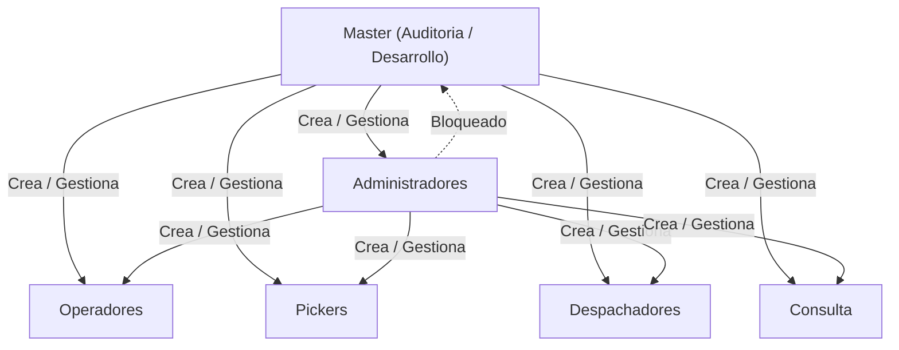
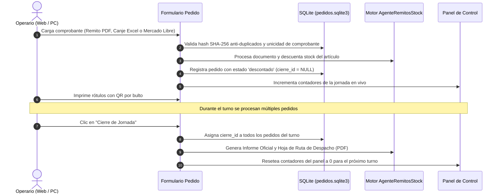
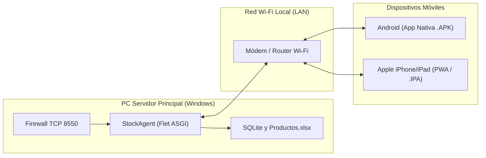
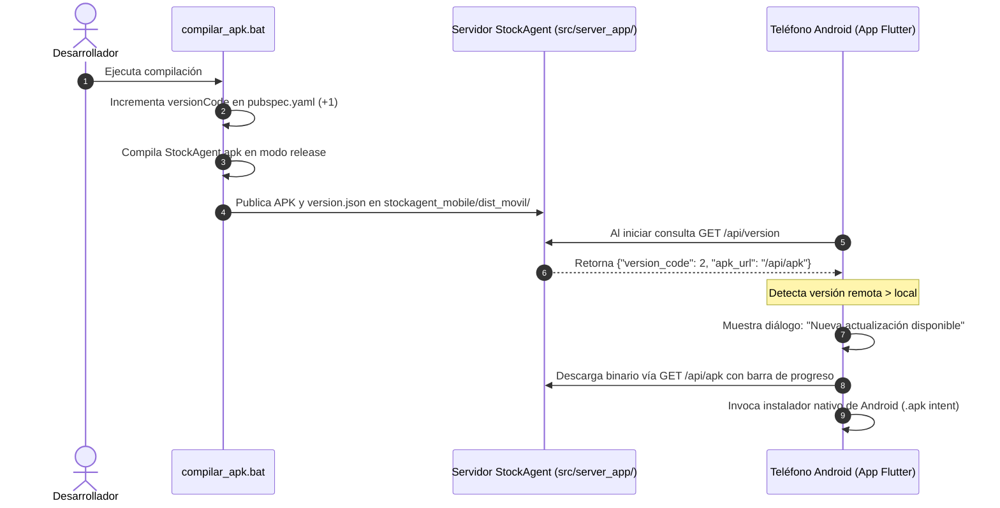

# StockAgent · Manual de Operación y Guía de Arquitectura

**StockAgent** es una plataforma integral para el control, auditoría y descuento de inventario en tiempo real a partir de comprobantes PDF (remitos mayoristas), planillas Excel (canjes) y documentos de Mercado Libre. Funciona tanto en modo escritorio nativo como en **Servidor Web Multi-Equipo (LAN)**, permitiendo que múltiples puestos de trabajo operen coordinadamente sobre el mismo stock sin inconsistencias y sin requerir transferencias manuales en carpetas compartidas.

---

## Índice

1. [Arquitectura y Modos de Ejecución](#1-arquitectura-y-modos-de-ejecución)
   - [Formas de Inicio y Detención](#formas-de-inicio-y-detención)
   - [Icono en la Bandeja del Sistema (System Tray de Windows)](#icono-en-la-bandeja-del-sistema-system-tray-de-windows)
   - [Parámetros de Línea de Comandos y Variables de Entorno](#parámetros-de-línea-de-comandos-y-variables-de-entorno)
   - [Progressive Web App (PWA) y Arquitectura Resiliente Offline-First](#progressive-web-app-pwa-y-arquitectura-resiliente-offline-first)
2. [Manual de Usuario por Roles](#2-manual-de-usuario-por-roles)
   - [Centro de Documentación y Botón "Manual de Uso" (SOPs por Botón)](#centro-de-documentación-y-botón-manual-de-uso-en-la-barra-lateral)
   - [Gestión de Perfil de Usuario ("Mi Perfil")](#gestión-de-perfil-de-usuario-mi-perfil)
   - [Autenticación, Seguridad y Bloqueo de Cuentas](#autenticación-seguridad-y-bloqueo-de-cuentas)
   - [Rol Master (`Auditoria`)](#rol-master-auditoria)
   - [Rol Picker](#rol-picker--preparación-de-pedidos-recepción-express-y-despachos)
   - [Rol Administrador](#rol-administrador)
   - [Rol Operador](#rol-operador)
   - [Rol Despachador](#rol-despachador--control-de-muelle-escaneo-qr-y-entregas)
   - [Rol Consulta](#rol-consulta)
   - [Matriz Oficial de Permisos por Rol (IAM / SoD)](#matriz-oficial-de-permisos-por-rol-iam--sod)
3. [Módulo de Carga Directa y Panel de Control de la Jornada](#3-módulo-de-carga-directa-y-panel-de-control-de-la-jornada)
   - [Botonera de Acceso Rápido: Entrada, Salida, Cargar Pedido y Mercado Libre](#botonera-dúo-ingreso-y-salida-rápida-con-pistoleo-continuo)
   - [Métricas en Tiempo Real de la Jornada](#métricas-en-tiempo-real-de-la-jornada)
   - [Formulario de Carga y Descuento Individual](#formulario-de-carga-y-descuento-individual)
   - [Módulo de Inventario en Vivo con Escáner Móvil y PC](#módulo-de-inventario-en-vivo-con-escáner-móvil-y-pc)
   - [Ciclo de Cierre de Jornada y Reseteo de Contadores](#ciclo-de-cierre-de-jornada-y-reseteo-de-contadores)
4. [Control de Concurrencia y Navegación Web](#4-control-de-concurrencia-y-navegación-web)
5. [Manual del Programador y Mantenimiento](#5-manual-del-programador-y-mantenimiento)
   - [Estructura del Proyecto](#estructura-del-proyecto)
   - [Esquema de Bases de Datos SQLite](#esquema-de-bases-de-datos-sqlite)
   - [Compilación del Ejecutable (`.exe`)](#compilación-del-ejecutable-exe)
   - [Despliegue e Implementación en Red Local (Servidor LAN sobre HTTPS)](#despliegue-e-implementación-en-red-local-servidor-lan-sobre-https)
   - [Acceso Remoto Seguro desde Fuera de la Oficina (Tailscale VPN)](#acceso-remoto-seguro-desde-fuera-de-la-oficina-tailscale-vpn)
   - [Instalación del Certificado SSL para Eliminar "No es Seguro"](#instalación-del-certificado-ssl-para-eliminar-no-es-seguro)
   - [Protección Integral Contra Ataques Maliciosos y Seguridad del Sistema](#protección-integral-contra-ataques-maliciosos-y-seguridad-del-sistema)
   - [Batería de Pruebas Unitarias y Aseguramiento de Calidad](#batería-de-pruebas-unitarias-y-aseguramiento-de-calidad)
6. [Ecosistema Móvil Nativo (Flutter - Android e iOS)](#6-ecosistema-móvil-nativo-flutter---android-e-ios)
   - [Arquitectura del Cliente Móvil](#arquitectura-del-cliente-móvil)
   - [Servidor Móvil HTTPS por Defecto y Opción HTTP (`iniciar_servidor_movil.bat`)](#servidor-móvil-https-por-defecto-y-opción-http-iniciar_servidor_movilbat)
   - [Compilación y Despliegue de APK para Android (`compilar_apk.bat`)](#compilación-y-despliegue-de-apk-para-android-compilar_apkbat)
   - [Actualizaciones Automáticas OTA (Over-The-Air) para Android](#actualizaciones-automáticas-ota-over-the-air-para-android)
   - [Diseño Responsive Integral y Experiencia Móvil](#diseño-responsive-integral-y-experiencia-móvil)
   - [Ejecución e Instalación en Apple iOS (iPhone / iPad)](#ejecución-e-instalación-en-apple-ios-iphone--ipad)
   - [Configuración Dinámica de IP y Resiliencia Wi-Fi](#configuración-dinámica-de-ip-y-resiliencia-wi-fi)

---

## 1. Arquitectura y Modos de Ejecución

StockAgent opera sobre una arquitectura híbrida de alto rendimiento:

* **Motor Web ASGI / Flet:** Servidor web FastAPI / Starlette en el puerto seguro por defecto `8550`.
* **Identidad Visual Web (Favicon y PWA):** La aplicación incluye en `assets/` el isotipo y favicon oficial (`ultratech.png` y `ultratech.ico`), visible en la pestaña del navegador, pantalla de carga y accesos directos instalables PWA.
* **Bases de Datos SQLite (WAL Mode):** Persistencia transaccional concurrente para usuarios, clientes, pedidos y auditoría en `data/`.
* **Plantilla Excel Maestra:** Archivo `Descuentos/Productos.xlsx` sincronizado atómicamente con los registros SQLite.
* **Bandeja del Sistema (System Tray):** Proceso en segundo plano acoplado al área de notificaciones de Windows para control rápido del servidor.

### Formas de Inicio y Detención

1. **Servidor Web Seguro en Red sobre HTTPS (Activo por defecto — Recomendado):**
   * Doble clic en `iniciar_servidor_web.bat` o desde terminal:
     ```powershell
     python main.py --host 0.0.0.0 --port 8550
     ```
   * **Detección Automática de Entorno:** `iniciar_servidor_web.bat` prioriza automáticamente el entorno virtual (`.venv`), entornos corporativos (`ttech`), el Python del sistema o el binario compilado `StockAgent.exe`.
   * **Instancia Única Inteligente (Single-Instance):** Si el servidor ya se encuentra en ejecución en el puerto 8550, el lanzador detecta la sesión activa mediante sondeo directo por socket y abre una nueva pestaña en el navegador predeterminado sin duplicar procesos ni trabarse en pantalla.
   * **Inmunidad a Estados Residuales (`TIME_WAIT`):** A diferencia de comprobaciones basadas en tablas netstat, el sondeo por socket no se bloquea por conexiones TCP cerradas recientemente, permitiendo reiniciar el servidor al instante.
   * En la PC principal se abre automáticamente **una única pestaña limpia** en `https://127.0.0.1:8550`.
   * En las terminales secundarias de la red local se accede mediante la IP local cifrada (ej. `https://192.168.1.50:8550`).
   * Si en algún entorno aislado se requiere desactivar HTTPS y correr en HTTP plano:
     ```powershell
     python main.py --http --host 0.0.0.0 --port 8550
     ```

2. **Ejecución Silenciosa en Segundo Plano:**
   * Doble clic en `iniciar_en_segundo_plano.vbs`: arranca el servidor sin abrir ventana de comandos ni consola en pantalla. El control queda disponible en el icono del System Tray.

3. **Inicio Automático con Windows:**
   * `scripts/operacion/configurar_inicio_automatico.bat`: registra StockAgent para que el servidor inicie automáticamente en segundo plano cada vez que se enciende o reinicia la PC.
   * `scripts/operacion/desactivar_inicio_automatico.bat`: remueve el inicio automático cuando ya no se requiera.

4. **Detención Rápida y Limpieza de Procesos:**
   * Doble clic en `detener_servidor.bat`: libera el puerto 8550 y finaliza de inmediato tanto ejecutables nativos `StockAgent.exe` como procesos Python ejecutando `main.py`, filtrando PIDs de sistema para un apagado limpio en segundos.
   * O bien, clic derecho en el icono de la bandeja del sistema $\to$ **"Cerrar y detener servidor"**.

5. **Modo Escritorio Monopuesto:**
   ```powershell
   python main.py --desktop
   ```

6. **Modo Automático por Consola (Headless):**
   ```powershell
   python main.py --auto
   ```

7. **Modo Simulación (Dry-Run):**
   ```powershell
   python main.py --dry-run
   ```

---

### Icono en la Bandeja del Sistema (System Tray de Windows)

Al arrancar el servidor web, StockAgent incorpora un controlador de bandeja del sistema (`src/tray/service.py` y `src/tray/tray_controller.py`) ejecutado mediante un hilo desacoplado con la biblioteca `pystray`:

* **Indicador Visual de Estado en Tiempo Real:**
  * 🟢 **Verde (Online):** Servidor activo y respondiendo peticiones.
  * 🟡 **Amarillo (Iniciando):** Inicializando dependencias, certificados o bases de datos.
  * 🔴 **Rojo (Error / Detenido):** Servidor sin conectividad o detenido.
* **Menú Contextual (Clic Derecho en el Icono):**
  * **🌐 Abrir StockAgent (Web):** Abre o enfoca la interfaz web en el navegador predeterminado (`https://127.0.0.1:8550`).
  * **📋 Copiar enlace de red (LAN):** Copia al portapapeles la dirección IP local lista para compartir con las demás terminales del depósito (`https://192.168.X.X:8550`).
  * **📁 Abrir carpeta del programa:** Abre el explorador de Windows en el directorio raíz de la aplicación.
  * **📄 Ver registro de eventos (Logs):** Abre de forma directa el archivo `data/logs/stockagent.log`.
  * **🛑 Cerrar y detener servidor:** Envía una notificación emergente de Windows, detiene el loop web y finaliza limpiamente el proceso liberando el puerto.
* **Notificaciones Nativas:** Emite notificaciones emergentes (Globos/Toasts de Windows) al iniciar el servidor, al copiar enlaces al portapapeles o al cerrar la aplicación.

---

### Parámetros de Línea de Comandos y Variables de Entorno

StockAgent permite parametrizar su ejecución tanto por flags de consola como mediante variables de entorno del sistema:

| Parámetro CLI | Variable de Entorno | Valor por Defecto | Descripción |
| :--- | :--- | :--- | :--- |
| `--host <IP>` | `STOCKAGENT_HOST` | `0.0.0.0` | Dirección IP de escucha del servidor web. |
| `--port <N>` | `STOCKAGENT_PORT` | `8550` | Puerto TCP de servicio. |
| `--https` | `STOCKAGENT_HTTPS=1` | Activo | Fuerza el protocolo seguro HTTPS/TLS. |
| `--http` | `STOCKAGENT_HTTPS=0` | Desactivado | Desactiva HTTPS y ejecuta en HTTP plano. |
| `--ssl-cert <RUTA>` | `STOCKAGENT_SSL_CERT` | Autogenerado | Ruta personalizada al certificado X.509 (`.crt` / `.pem`). |
| `--ssl-key <RUTA>` | `STOCKAGENT_SSL_KEY` | Autogenerado | Ruta personalizada a la clave privada (`.key` / `.pem`). |
| `--inactividad <MIN>` | `STOCKAGENT_INACTIVIDAD_MINUTOS` | `720` (12 horas) | Minutos de inactividad antes de cerrar sesión (`0` desactiva el cierre automático). |
| `--desktop` | — | Desactivado | Inicia en ventana nativa de escritorio (Flet App). |
| `--hide-console` | `STOCKAGENT_HIDE_CONSOLE=1` | Desactivado | Oculta la consola de Windows al arrancar. |
| `--no-browser` | `STOCKAGENT_NO_BROWSER=1` | Desactivado | Evita abrir automáticamente el navegador al iniciar. |
| `--no-tray` | `STOCKAGENT_NO_TRAY=1` | Desactivado | Desactiva el icono en la bandeja del sistema. |
| `--auto` / `--all` | — | Desactivado | Ejecuta el procesamiento de lotes por consola sin interfaz. |
| `--dry-run` | — | Desactivado | Simula el procesamiento sin modificar archivos ni bases de datos. |

---

### Progressive Web App (PWA) y Arquitectura Resiliente Offline-First

StockAgent opera como una **Progressive Web App (PWA)** completa de alta resiliencia para terminales móviles y puestos de depósito:
* **Instalación con 1 Clic:** Desde Google Chrome, Microsoft Edge o navegadores móviles (Android/iOS), se puede presionar el botón "Instalar aplicación" en la barra de direcciones para ejecutar StockAgent como aplicación de escritorio/móvil independiente sin barras del navegador.
* **Manifiesto Web (`assets/manifest.json`):** Configurado con el tema corporativo Ultratech (`#D32F2F`), modo de visualización `standalone`, orientación horizontal/vertical adaptativa y accesos directos (*shortcuts*) directos al escáner de códigos de barra (`/scanner.html`) y al panel principal.
* **Iconografía Multi-Resolución:** Iconos oficiales en 192x192, 512x512 y versiones maskable para Android y Windows en `assets/icons/`.
* **Service Worker con Caching Estratégico (`assets/sw.js`):** Implementa estrategias combinadas:
  * **Stale-While-Revalidate:** Carga instantánea de hojas de estilo (`.css`), scripts (`.js`), fuentes e imágenes desde caché mientras se actualizan en segundo plano.
  * **Network-First con Fallback a Caché:** Navegación HTML rápida que prioriza la versión más reciente del servidor y utiliza la copia en caché ante microcortes.
  * **Exclusión de WebSockets (`/ws`):** Tráfico en tiempo real canalizado sin interferencias de la capa de caché.
* **Pantalla de Contingencia Offline (`assets/offline.html`):** Interfaz oscura amigable que se despliega automáticamente ante caídas totales del enlace Wi-Fi, con detección y reconexión desatendida.
* **Búfer de Escaneo Offline para Depósito (`assets/js/scanner.js`):** Cola local persistente en `localStorage` (`stockagent_offline_scan_queue`). Si un operario escanea mercadería en una zona ciega de Wi-Fi, las lecturas se encolan de forma segura con un indicador visual ámbar y se sincronizan atómicamente con el servidor tan pronto como se detecta el evento `online`.
* **Banner de Microcortes de Red (`assets/index.html`):** Indicador superior no bloqueante que informa sobre el estado de la conexión en tiempo real sin entorpecer la operativa.
* **Pantalla de Carga Personalizada (`assets/index.html`):** Animación de carga con isotipo oficial y pre-conexión de tipografías para eliminar destellos en pantalla.

---

## 2. Manual de Usuario por Roles

El acceso está protegido por cuentas locales con contraseñas cifradas en PBKDF2 (SHA-256).



---

### Centro de Documentación y Botón "Manual de Uso" en la Barra Lateral

Para asegurar que cada miembro del equipo cuente con asistencia inmediata y documentación oficial estandarizada acorde a su nivel de autorización, **la barra lateral de navegación presenta en primer lugar la sección 'DOCUMENTACIÓN' con el botón directo 'Manual de Uso'**:

* **Estructura Normalizada por Procedimientos Operativos Estándar (SOP - Botón a Botón):**
  A partir de la versión **v3.0.0** (actualizada a **v3.3.0** en manuales operativos de rol y **v2.3.0** en el Compendio Maestro ISO/BPMN), cada manual se estructura de manera modular y exhaustiva con **Fichas de Procedimiento Oficiales** que cubren los comandos reales habilitados en el menú lateral de cada rol. Cada ficha contiene:
  1. **Encabezado y Metadatos:** Nombre del comando, icono del sistema, sección de pertenencia y atajo de teclado (`Ctrl + K` / `F2`).
  2. **Propósito y Alcance (Qué hace):** Definición clara del objetivo operativo o administrativo en el flujo de trabajo.
  3. **Requisitos y Perfil Autorizado:** Precondiciones, rol con permisos y reglas de segregación de funciones (*Separation of Duties - SoD*).
  4. **Procedimiento Paso a Paso (Cómo se hace):** Guía secuencial numerada desde la invocación del comando hasta la confirmación de la tarea.
  5. **Salidas y Documentos Emitidos:** Impacto transaccional en SQLite, archivos emitidos (PDF, Excel, Word), etiquetas QR y notificaciones.
  6. **Manejo de Errores, Excepciones y Buenas Prácticas:** Advertencias de seguridad, prevención de bloqueos y acciones correctivas.

* **Control de Versiones y Responsabilidad Documental Institucional:**
  Todos los manuales PDF generados incorporan en su portada formal dos tablas de control de calidad bajo normas ISO/UPEL:
  * **Tabla 1 (Control Documental):**
    * **Elaborado por:** `Gregory Rodriguez`
    * **Revisado por:** ` ` *(Espacio en blanco reservado para firma de supervisión institucional)*
    * **Aprobado por:** ` ` *(Espacio en blanco reservado para firma de gerencia o dirección general)*
  * **Tabla 2 (Historial de Versiones y Trazabilidad):**
    * `v1.0.0`: Versión inicial monolítica con arquitectura LAN y persistencia SQLite.
    * `v2.0.0`: Segregación estricta de funciones IAM (SoD), credenciales cifradas y PWA offline.
    * `v3.0.0`: Reestructuración integral botón a botón por fichas SOP para cada rol, módulo de auditoría de cierres descendente para administradores y visor documental Zero-Cache.
    * `v3.1.0` / `v2.2.0`: Arquitectura completamente modular (`src/` + `Documentacion/pdf_engine/` + `Documentacion/procedimientos/`), endurecimiento HTTPS por defecto, Firewall en perfil privado, cifrado DPAPI/Fernet en secretos, enlaces con token HMAC `?dt=`, Swagger deshabilitado por defecto y segregación SoD por roles.
    * `v3.3.0` / `v2.3.0`: Sistema completo de diseño de tarjetas 100% responsivas (`src/ui/design/responsive.py`) para móvil/tablet/PC, incorporación documental integral del **Rol Despachador**, baja diferenciada de pedidos (**Desarmar** lógico vs. **Eliminar** físico sin doble restitución de stock) y refactorización modular final (`pedidos_edicion`, `pedidos_baja`, `usuarios_modales`, `despacho_acciones`, `cierre/cierres_admin_cards`).

* **Manuales Oficiales Generados (10 PDFs / 6 Roles):**
  * **Manual del Operador (`Manual_Operador.pdf`):** Cubre la botonera rápida de carga y los comandos del operador: *Cargar / Armar Pedido*, *Gestión de Clientes*, *Descontar Mercado Libre*, *Descontar Mercado Full*, *Ingreso de Fábrica*, *Historial de Pedidos*, *Imprimir Descuento*, *Inventario en Vivo (Escáner)*, *Cierre de Jornada*, *Centro de Reportes / Abrir informe*, *Compartir por correo*, *WhatsApp Web* y *Manual de Uso*.
  * **Manual del Picker (`Manual_Picker.pdf`):** Alineado estrictamente con su menú lateral acotado por SoD: *Descontar Mercado Libre*, *Descontar Mercado Full*, *Ingreso de Mercadería*, *Ingreso de Fábrica*, *Egreso de Mercadería*, *Paleta de Comandos F2*, *Chat Interno* y *Manual de Uso* (acceso HTTPS `?dt=`).
  * **Manual del Despachador (`Manual_Despachador.pdf`):** Especializado en expedición y control de muelle: *Consola de Despacho de Pedidos*, *Escaneo de Rótulos QR Bulto a Bulto (`i/N`)*, *Despacho Manual con Confirmación de Bultos*, *App Móvil con Cola FIFO y Persistencia Offline*, *Modo Lector Láser / Modo Claro Alto Contraste*, *Chat Interno* y *Manual de Uso*.
  * **Manual del Administrador (`Manual_Administrador.pdf`):** Cubre los módulos de supervisión y operación gerencial: *Panel Express (Entrada, Salida, Gestionar Productos, Ver Stock)*, *Gestionar productos*, *Ajustar stock / Fábrica*, *Comparativa stock físico*, *Sincronizar con Excel*, *Generar pedido fábrica (Excel)*, *Historial de Pedidos*, *Cierres de Operarios*, *Gestión de Clientes*, *Descontar Mercado Libre*, *Mercado Libre API (Sync)*, *Descontar Mercado Full*, *Métricas y Rendimiento*, *Estadísticas de salida*, *Radar de anomalías*, *Heatmap y Picking*, *Abrir informe*, *Compartir por correo*, *WhatsApp Web*, *Copia de Seguridad*, *Gestionar usuarios (Operador / Picker / Despachador / Consulta)* y *Manual de Uso*.
  * **Manual Master (`Manual_Master.pdf`):** Cubre los comandos técnicos de infraestructura, IAM y seguridad SoD: *Panel Express (Gestionar Usuarios, Registro de Auditoría)*, *Documentación y Estado API* (`STOCKAGENT_ENABLE_API_DOCS=0` por defecto), *Gestión de API Keys*, *Sesiones Activas IAM*, *Copia de Seguridad*, *Restaurar documentos (Rollback)*, *Archivado Histórico*, *Configuración SMTP (TLS estricto + DPAPI/Fernet)*, *Alertas Telegram*, *Mercado Libre API (Credenciales cifradas)*, *PKI Local CA+Hoja (<=397 días), OTA SHA-256, Firewall Privado y Accesos LAN*, *Gestionar usuarios (IAM global)* y *Manual de Uso*.
  * **Manual de Consulta (`Manual_Consulta.pdf`):** Cubre los comandos de solo lectura: *Centro de Reportes / Abrir informe*, *Historial de Pedidos (solo lectura)*, *Compartir por correo*, *WhatsApp Web* y *Manual de Uso*.
  * **Manual General e Imprimible (`Manual_General.pdf` / `Manual_Maestro_Imprimible.pdf`):** Compendio institucional completo de 12 capítulos ISO/UPEL con diagramas BPMN, infraestructura HTTPS/PKI/Firewall, gestión del cambio SGC y la matriz SoD unificada.
  * **Manual Clásico de Uso (`Manual_de_Uso_StockAgent.pdf`) y Presentación Ejecutiva (`Presentacion_Ejecutiva_StockAgent.pdf`):** Documentos generales e institucionales compilados automáticamente.

* **Visualización Dinámica e Inmediata Protegida por Token (Zero-Cache):**
  * **Modo Web / Red Local:** El servidor expone los endpoints protegidos `/documentacion/{archivo}` y `/documentos/ver` con verificación de sesión o token HMAC firmado (`?v=timestamp&dt=<token>`). Cada vez que la documentación se regenera, **los cambios se reflejan de inmediato en los clientes autenticados sin limpiar la caché del navegador ni exponer documentos sin autorización**.
  * **Modo Escritorio Nativo:** Abre el documento PDF directamente en el visor predeterminado del sistema operativo (Edge, Adobe Acrobat, Chrome, etc.).
  * **Autogeneración Desatendida:** Si algún archivo PDF no estuviese presente en el disco, el sistema lo compila automáticamente mediante `generar_todos_los_manuales()`.

---

### Gestión de Perfil de Usuario ("Mi Perfil")

Todos los usuarios autenticados, sin distinción de su rol, tienen acceso a su ventana de perfil personal:

* **Cómo acceder:** Hacer clic en el avatar / chip con el nombre de usuario ubicado en la barra superior derecha y seleccionar **"Mi Perfil"**.
* **Campos configurables:**
  * **Nombre y Apellido (Identificador en Documentos):** Define el nombre real de la persona (ej. `Juan Carlos Pérez`). Este nombre sustituye al usuario técnico en todos los documentos operativos emitidos por el sistema (remitos descontados, rótulos de despacho con QR, hojas de ruta de transporte y registros de auditoría). Si no se completa, el sistema recurre al nombre de usuario (`username`) como valor por defecto.
  * **Correo Electrónico:** Dirección de correo institucional o personal (ej. `usuario@ultratech.com`), validada contra formato estándar RFC y verificada para garantizar su unicidad en la base de datos.
* **Guardado Inmediato:** Al confirmar, la sesión actual se refresca de inmediato reflejando los nuevos datos tanto en el panel de control como en las operaciones en curso.

---

### Autenticación, Seguridad y Bloqueo de Cuentas

StockAgent incorpora estrictas medidas de seguridad para proteger la integridad de los datos de inventario:

1. **Inicio de Sesión Flexible:**
   * Los usuarios pueden iniciar sesión ingresando indistintamente su **nombre de usuario** (ej. `Desarrollo`, `operario1`) o su **dirección de correo electrónico** (ej. `admin@ultratech.com`), con comparación insensible a mayúsculas y minúsculas (`COLLATE NOCASE`).

2. **Protección contra Fuerza Bruta y Bloqueo Preventivo:**
   * El sistema tolera hasta **5 intentos fallidos consecutivos** dentro de una ventana de **15 minutos**.
   * Al fallar cada intento, el sistema informa con precisión la cantidad de intentos restantes:
     > *"Usuario o contraseña incorrectos (3 intento(s) restante(s))."*
   * Al quinto intento fallido, la cuenta se bloquea automáticamente por **15 minutos**:
     > *"Cuenta bloqueada temporalmente por seguridad. Intentá de nuevo en 15 min."*
   * El mensaje indica en tiempo real los minutos restantes de espera antes de habilitar nuevos intentos.

3. **Política de Cambio Obligatorio de Contraseña:**
   * Los usuarios iniciales con clave temporal (la del master generada o definida en el primer arranque; la antigua `master1713` queda prohibida) o aquellos cuya clave haya sido restablecida por un administrador están obligados a definir una nueva clave segura (mínimo 10 caracteres) antes de acceder a las funciones del sistema.
   * La nueva contraseña no puede coincidir con la clave por defecto del sistema.

4. **Desbloqueo Administrativo Inmediato:**
   * Tanto el usuario Master como los Administradores pueden desbloquear manualmente cualquier cuenta bloqueada desde la tabla de **Gestión de Usuarios**, limpiando los contadores e historial de fallos sin necesidad de esperar el transcurso de los 15 minutos.

5. **Sesión Continua durante la Jornada (Inactividad de 12 Horas):**
   * Para evitar interrupciones o pérdida de contexto durante el trabajo diario en depósito, la sesión de usuario se mantiene abierta de forma continua durante **12 horas** (720 minutos) de inactividad.
   * Puede ajustarse con el parámetro `--inactividad <minutos>` o la variable de entorno `STOCKAGENT_INACTIVIDAD_MINUTOS` (establecer en `0` desactiva completamente el cierre de sesión por inactividad).

---

### Rol Master (`Auditoria`) — Seguridad, IAM y Auditoría Forense

Bajo el estándar de **Separación de Funciones (*Separation of Duties - SoD*)** y el **Principio de Menor Privilegio** (ISO/IEC 27001), el usuario **Master** (`Auditoria`, con alias histórico `Desarrollo` para retrocompatibilidad total) está enfocado exclusivamente en la **administración técnica, gestión de identidades (IAM), auditoría forense inmutable, administración de la API REST / API Keys y resguardo del sistema**. Al estar completamente desacoplado de la lógica de negocio y del inventario contable, garantiza absoluta imparcialidad y elimina conflictos de interés en auditorías de control interno.

* **Usuario precargado:** `Auditoria` (alias `Desarrollo`)
* **Contraseña inicial:** la definida en `STOCKAGENT_MASTER_PASSWORD` (`.env`). Si no se define, el sistema **genera una clave aleatoria** en el primer arranque y la guarda en `data/PRIMER_INICIO_MASTER.txt` (no existe clave por defecto). El cambio es obligatorio en el primer inicio de sesión; elimine el archivo después de ingresar.
* **Botonera de Acceso Rápido Master (Cabecera):**
  * `[🔐 Gestionar Usuarios]`: Aprovisionamiento, reseteo de claves y asignación de roles SoD.
  * `[🛡️ Registro de Auditoría]`: Consola forense de lectura inmutable y trazabilidad transaccional.
* **Alcance Exclusivo y Atributos Técnicos:**
  * **Gestión de Identidades y Accesos (IAM):** Es el **único rol facultado para crear, modificar, activar, desactivar y resetear contraseñas de cuentas de rol Administrador**. Asimismo, puede gestionar todas las cuentas operativas y desbloquear usuarios bloqueados por fuerza bruta.
  * **Centro de Auditoría Forense y Trazabilidad (Exclusivo Master):** Consulta inmutable y filtrado en tiempo real de todos los eventos del sistema: inicios de sesión, bloqueos por fuerza bruta, anulaciones, altas de usuarios, respaldos y modificaciones de configuración. Por principio de segregación de funciones (*SoD*), el Administrador no accede a este visor para evitar que el auditado audite sus propias operaciones.
  * **Gestión de Identidades y Accesos (IAM Compartida):** Master posee control supremo sobre todos los roles (incluyendo creación, modificación y reseteo de contraseñas de cuentas Administrador). Los Administradores comparten la facultad de crear y gestionar cuentas de Operador y Consulta, pero no pueden alterar cuentas Master ni ver la auditoría forense.
  * **Continuidad del Negocio (Backups / Disaster Recovery):** Generación manual de copias de seguridad `.zip`, configuración de directorios externos y verificación de políticas de rotación.
  * **Restauración de Documentos (Rollback de Lotes — Exclusivo Master):** Capacidad crítica delegada exclusivamente al perfil Master bajo *Resguardo y Continuidad*. Permite deshacer operaciones completas o lotes de descuento históricos por fecha, recalculando el stock y recomponiendo el catálogo en SQLite (`productos.sqlite3`) y en `Productos.xlsx` con registro inmutable en auditoría forense. Por el principio de Segregación de Funciones (*Separation of Duties - SoD*), ningún operario ni administrador dispone de esta función, previniendo reversiones accidentales o manipulación de datos en la jornada diaria.
  * **Configuración del Servidor y Servicios:** Gestión de credenciales SMTP para alertas automáticas, custodia exclusiva de credenciales oficiales de la **API de Mercado Libre** (App ID, Client Secret, Tokens OAuth), monitoreo de certificados SSL/HTTPS y estado de la red.
  * **Protección Inviolable:** La cuenta Master no puede ser desactivada ni degradada de rol por ningún usuario ni por sí misma.
* **Exclusión de la Lógica de Negocio (Protección Operativa y Segregación SoD):**
  * ❌ **Sin Acceso a Pedidos:** Directamente el usuario Master **no visualiza pedidos operativos**. Su panel de control no contiene la tarjeta de pedidos preparados del turno y tiene restringido el acceso al Historial de Pedidos y a la consulta de pedidos individuales.
  * ❌ No procesa remitos, facturas ni comprobantes de Mercado Libre.
  * ❌ No modifica pedidos preparados ni altera cantidades de stock o la planilla `Productos.xlsx`.
  * ❌ No realiza ingresos de fábrica, inventarios físicos ni pedidos a proveedores.
  * ❌ No realiza cierres de jornada operativa ni emite Hojas de Ruta de despacho.
* **Experiencia de Usuario Especializada:**
  * Menú lateral organizado en bloques técnicos: *Seguridad y Accesos*, *Auditoría y Trazabilidad*, *Resguardo y Continuidad* (con *Copias de Seguridad*, *Directorio Secundario* y **Restaurar Documentos**) y *Sistema*.
  * Dashboard adaptado con tarjetas KPI de infraestructura: *Usuarios Registrados*, *Cuentas Activas*, *Eventos Auditoría*, *Copias de Respaldo*, *Espacio en Disco* y *Salud Servidor* (diagnóstico en tiempo real de RAM, disco y proceso).
  * Módulo de *Archivado Histórico* para organizar comprobantes antiguos en subcarpetas cronológicas `data/historico/YYYY/MM/`.
  * Configuración de *Alertas Telegram* bajo el bloque de Sistema para pruebas de conectividad y monitoreo de eventos.
  * Panel de actividad que lista en vivo los últimos eventos de auditoría y seguridad.

---

### Rol Picker — Preparación de Pedidos, Recepción Express y Despachos

Diseñado específicamente para el personal de preparación y movimiento físico de mercadería en almacén. El **Picker** dispone de una interfaz optimizada de alta velocidad enfocada estrictamente en el flujo diario de productos, con una botonera de acceso rápido superior y acceso a los módulos operativos de stock:

* **Segregación SoD:** No tiene acceso a la administración de usuarios (IAM), auditoría técnica, configuraciones de infraestructura ni aprobación de cierres de jornada administrativa.
* **Botonera de Acceso Rápido Picker (Cabecera):**
  * `[🏷️ Descontar ML]`: Descuento ágil y prioritario de órdenes y etiquetas de Mercado Libre con feedback sonoro y anti-colisión.
  * `[➕ Entrada]`: Entrada rápida con escáner de códigos de barras (EAN-13 / SKU) y justificación tipificada obligatoria.
  * `[➖ Salida]`: Salida rápida por mermas, muestras o consumo con justificación obligatoria.
* **Módulos Operativos de Mercadería:**
  * **Ingreso de Fábrica:** Recepción formal con número de remito de entrega proveniente de la planta manufacturera.
  * **Generar Pedido a Fábrica:** Solicitud formal de reposición de artículos hacia producción.
  * **Descontar Mercado Libre:** Procesamiento individual o por lote de comprobantes y órdenes web.
  * **Descontar Mercado Full:** Traspaso masivo y descuento de inventario remitido a bodegas de fulfillment.
  * **Ola de Picking (`dlg_ola_picking.py`) y Reserva Preventiva:** Generación de lista de picking ordenada por zona (`picking` -> `pulmon` -> `pallet` -> `recepcion`) con trazabilidad FEFO y botón **Reservar Stock de la Ola** (`ola_picking`).
  * **Multi-Ubicación, Traslados y App Móvil (`Zonas / FEFO`):** Reubicación de unidades desde `pulmon` hacia `picking`, consumo guiado por vencimiento próximo FEFO y visualización en vivo de alertas/reservas desde `stockagent_mobile`.
  * **Carga de Stock Físico (Inventario Ciego):** Módulo de conteo ciego para relevar existencias reales en estanterías sin condicionamiento visual del saldo de sistema.
  * **Ver Stock en Tiempo Real:** Visor rápido con buscador instantáneo por código o descripción.
  * **Atajos de Teclado (F2):** Paleta de comandos instantánea para saltar a cualquier módulo sin usar el ratón.

---

### Rol Administrador

Pensado para jefes de depósito, encargados de logística y gerencia. Posee control total sobre la operación del depósito y supervisión estratégica en tiempo real, complementado por su **Botonera Operativa Optimizada** y el nuevo **Centro de Control Ejecutivo y Analítica 360°**:

#### 1. Botonera Operativa Principal del Administrador (Orden Oficial de Comandos)
* `[📊 Gestionar inventario]`: Visor consolidado de existencias en tiempo real con semáforo de disponibilidad (Normal/Bajo/Crítico), filtros rápidos por SKU/descripción y reorden.
* `[📥 Planificar ingreso de fábrica]`: Carga y estructuración de remitos provenientes de planta industrial, asignación de tandas y control de cantidades esperadas.
* `[🚚 Planificar mercado full]`: Armado y estructuración de tandas de preparación y despacho masivo hacia bodegas de Mercado Envíos Full.
* `[📦 Gestionar productos]`: Administración maestra del catálogo (altas, modificaciones, códigos EAN-13, umbrales y ubicación en racks/slotting).
* `[🔧 Ajuste de inventario]`: Regularización y arqueos de stock con escáner óptico (ajustes positivos/negativos tipificados).
* `[📝 Generar Pedido]`: Asistente de cálculo de reposición inteligente para productos bajo stock de seguridad con exportación de orden a proveedores.
* `[🔁 Sincronizar]`: Sincronización atómica bidireccional entre la base SQLite y la planilla maestra `Productos.xlsx` con copia de respaldo automática.
* `[➕ Entrada / ➖ Salida]`: Botonera dúo express ubicada inmediatamente debajo de Sincronizar para movimientos rápidos de mercadería con justificación tipificada obligatoria.

#### 2. Centro de Control Ejecutivo y Analítica 360° en Tiempo Real
El panel principal del Administrador prescinde de las tarjetas estáticas tradicionales para maximizar el espacio vertical disponible, desplegando un centro de mando en vivo con actualización reactiva ante cada despacho:
* **Fila Superior de KPIs en Vivo:**
  * **Entradas Hoy:** Total de unidades ingresadas por fábrica o ajustes positivos.
  * **Salidas Hoy:** Total de unidades descontadas por ventas y despachos.
  * **Balance Neto:** Diferencia de flujo en tiempo real (destacado en verde para superávit o rojo ante sobre-demanda).
  * **Bultos Totales:** Volumen total de cajas movilizadas en la jornada.
  * **Salud de Stock (Semáforo de Catálogo):** SKUs clasificados en Óptimos (`🟢`), Alerta (`🟡`) y Quiebres (`🔴`) con acceso directo en 1 clic a *Ver Stock*.
* **Tarjeta Izquierda — Distribución y Evolución Temporal:**
  * **Mix de Salidas por Canal:** Proporción de demanda por Mercado Libre, Mercado Full, Mayoristas y Canjes con barras de progreso y porcentajes relativos.
  * **Evolución de Pedidos (Últimos 7 Días):** Gráfica de barras de pedidos y volumen de bultos día por día.
  * **Distribución de Entradas por Origen:** Balance entre remitos de fábrica y ajustes manuales.
* **Tarjeta Derecha — Operaciones y Radar Crítico en Vivo:**
  * **Top 5 Productos con Mayor Rotación:** Ranking de artículos más demandados en la jornada con códigos y cantidades.
  * **Productividad de Armadores en Vivo:** Seguimiento en tiempo real de cada operario (pedidos preparados y bultos despachados con barra relativa de rendimiento).
  * **Radar de Reposición (Stock Crítico):** Monitor prioritario de productos en `AGOTADO` o `QUIEBRE`, indicando stock actual y cantidad sugerida a comprar (`Pedir: +X`).

#### 3. Aislamiento de Ambientes (Producción vs QA Sandbox)
* **Qué hace:** Permite alternar de forma segura entre el ambiente productivo real y un entorno de pruebas aislado (QA Sandbox).
* **Cómo opera:**
  * En modo QA, el sistema conmuta automáticamente hacia `data_qa/` y `Descuentos_QA/`, utilizando bases de datos independientes con datos sintéticos sembrados.
  * Muestra un badge visual distintivo `[BUG] AMBIENTE QA` en la barra superior.
  * Permite entrenar operarios o probar nuevas configuraciones con riesgo cero de alteración de inventario productivo.
  * Controlable desde el botón **'Ambientes'** en la barra superior o mediante el script `iniciar_qa.bat`.

#### 1. Gestión de Usuarios Operativos
* **Qué hace:** Permite crear, modificar datos de perfil (nombre y email), restablecer contraseñas, desbloquear cuentas y activar o desactivar accesos para roles `Operador` y `Consulta`. Protege la jerarquía del sistema ocultando la cuenta `Master`.
* **Cómo se hace:** 
  1. En la barra superior, hacer clic en el botón de **Gestión de Usuarios** (icono de usuarios).
  2. Para crear una cuenta, completar el nombre de usuario, nombre completo, correo electrónico, contraseña y seleccionar el rol (`Operador` o `Consulta`), luego presionar **"Crear Usuario"**.
  3. Para modificar o dar de baja, ubicar al usuario en la tabla y utilizar los botones de edición de datos, cambio de contraseña, desbloqueo de cuenta o el interruptor para activar/desactivar el acceso.

#### 2. Panel de Métricas y Rendimiento (Dashboard Ejecutivo)
* **Qué hace:** Proporciona visibilidad ejecutiva del depósito mediante tarjetas KPI (total pedidos, bultos procesados, promedio de bultos/pedido y cierres realizados), porcentajes de distribución de envíos por empresa de transporte, productividad por operario/armador y ranking Top 10 de productos con mayor salida. Incluye selector de rango de fechas (`Desde` y `Hasta`).
* **Cómo se hace:**
  1. Hacer clic en la pestaña o botón **"Métricas y Rendimiento"** (Dashboard).
  2. Los indicadores se calculan automáticamente a partir de los datos consolidados en SQLite en horario local.
  3. Presionar **"Actualizar"** para refrescar los datos en cualquier momento de la jornada.

#### 3. Historial de Pedidos: Consulta, Reimpresión de Comprobantes, Modificación y Desarmado
* **Qué hace:** Permite buscar, supervisar y gestionar en detalle todos los pedidos cargados en el sistema (remito, N° de pedido, cliente, logística, bultos, armador y estado de despacho). Faculta a los usuarios para:
  1. **Consulta y Reimpresión del Comprobante Cargado:** Cada pedido presenta un badge interactivo con el ícono de formato del archivo original (PDF, Excel o Word/DOCX). Al hacer clic o presionar el botón de impresora (`🖨️`), el sistema abre o descarga de inmediato el documento para su revisión o reimpresión directa.
  2. **Detalle Completo del Pedido:** Presionando el botón de información (`ℹ️`) se accede a un modal con los datos logísticos, estado de despacho, enlace al informe de descuento asociado, lista de artículos descontados y acceso a rótulos con QR.
  3. **Visualización sin Modificación (Consulta de Pedidos):** El Administrador puede hacer clic en cualquier pedido (tanto en la tarjeta en vivo de la jornada como en el Historial) para abrir la **ventana modal de detalle completo**, consultar los artículos descontados, reimprimir el comprobante original o generar rótulos QR. Sin embargo, **no puede modificar los datos operativos del pedido** (cliente, bultos, logística o fecha), facultad que está estrictamente reservada a los operarios en turno para evitar colisiones con el empaque físico en depósito.
  4. **Desarmar Pedido y Restituir Stock:** En caso de cancelaciones o pedidos desarmados antes o después del despacho, esta opción anula el pedido y reincorpora automáticamente todas las unidades y códigos descontados sumándolos de vuelta al inventario físico tanto en SQLite (`productos.sqlite3`) como en la planilla maestra (`Productos.xlsx`).
  5. **Anular Pedido:** Cancela el comprobante registrando el motivo en auditoría (sin mover stock físico si se requiere anulación administrativa pura).
* **Cómo se hace:**
  1. Ingresar a la sección **"Historial de Pedidos"**.
  2. Filtrar por cliente, número de remito/factura, N° de pedido, fecha (`DD/MM/AAAA`), logística o armador mediante la barra de búsqueda en tiempo real.
  3. **Para Modificar un Pedido (Exclusivo Operador):** La edición directa está reservada a los operarios en turno. El administrador puede consultar el detalle completo con el botón `ℹ️` o proceder al desarme con restitución de stock mediante `Desarmar pedido`.
  4. **Para Desarmar un Pedido:** Presionar el botón ámbar **"Desarmar pedido"** (icono de carrito retirado / reposición), verificar la lista detallada de artículos y cantidades que se devolverán al depósito, ingresar el motivo opcional y presionar **"Desarmar y Devolver Stock"**. El sistema actualizará el stock al instante.
  5. **Para Anular un Pedido:** Presionar el botón rojo **"Anular"** (icono de cancelar), ingresar el motivo y confirmar.

#### 4. Cierres de Operarios: Auditoría de Cierres de Turno de Operarios (Descendente)
* **Qué hace:** Proporciona al Administrador una vista centralizada, completa y ordenada de forma **estrictamente cronológica descendente** (del cierre más reciente al más antiguo) de todas las jornadas operativas cerradas por los operarios de depósito. Resuelve la necesidad de supervisión y trazabilidad post-despacho mediante:
  * **Tarjetas KPI Consolidadas:** Resumen global en cabecera con *Total Cierres*, *Pedidos Totales*, *Unidades Descontadas* y *Bultos Despachados*.
  * **Buscador y Filtrado en Tiempo Real:** Permite localizar de inmediato cualquier cierre por ID, responsable/operario, fecha (`AAAA-MM-DD` o `DD/MM/AAAA`) o rango temporal.
  * **Desglose Modal de Pedidos ("Ver Pedidos"):** Botón en cada fila que abre un modal con el detalle exhaustivo de todos los pedidos asociados a dicho cierre: N° de remito, cliente, transporte, armador, bultos y fecha/hora de carga.
  * **Regeneración Documental Directa:** Acceso con 1 clic para abrir o reimprimir la **Hoja de Ruta de Despacho (PDF)**, el informe oficial de cierre **PDF** (`Cierre_Descuento_*.pdf`), la planilla consolidada **Excel** (`.xls`) y el botón para **Compartir por Correo Electrónico**.
* **Cómo se hace:**
  1. En la sección **Ventas y Despachos** del menú lateral (o presionando `Ctrl + K` / `F2` en la paleta de comandos), hacer clic en **"Cierres de Operarios"**.
  2. Inspeccionar los indicadores KPI superiores y utilizar la barra de búsqueda para filtrar por operario o fecha.
  3. En la tarjeta o fila del cierre deseado, presionar el botón azul **"Ver Pedidos"** para inspeccionar los pedidos que conformaron dicha jornada.
  4. Utilizar los botones directos para visualizar la **Hoja de Ruta**, abrir el consolidado **PDF**, descargar el archivo **Excel** o despachar el informe por **Email**.

#### 4. Copias de Seguridad y Respaldo Espejo en Red / Nube (NAS / Drive / OneDrive)
* **Qué hace:** Genera un respaldo íntegro comprimido `.zip` en la carpeta `data/backups/`, resguardando las bases SQLite (`pedidos.sqlite3`, `usuarios.sqlite3`, `productos.sqlite3`), usuarios, notificaciones y el catálogo maestro `Productos.xlsx`. Mantiene automáticamente una rotación de las últimas 30 copias.
* **Espejo en Red o Nube Secundario:** Permite configurar y verificar con 1 clic (`Probar y Guardar Espejo`) una carpeta secundaria externa (ej. `\\NAS\Backups_Deposito` o `C:\Users\...\Google Drive\Backups`). Cada respaldo generado se copia atómicamente a dicha ruta para máxima resiliencia ante fallos de disco local.
* **Cómo se hace:**
  1. Presionar el botón **"Copia de Seguridad"** en la barra superior de herramientas (o escribir `/backup` en el Asistente Virtual).
  2. El sistema notificará la generación exitosa del respaldo indicando el nombre del archivo y la fecha/hora exacta.

#### 5. Gestión de Catálogo de Productos (`Productos.xlsx`)
* **Qué hace:** Administra la base de datos maestra de artículos: altas de nuevos productos, edición de descripciones, códigos, precios y definición de umbrales de **Stock Mínimo** y **Stock Máximo** para alertas tempranas de desabastecimiento.
* **Cómo se hace:**
  1. Dirigirse a la pestaña **"Gestionar Productos"**.
  2. Para modificar un artículo existente, buscarlo en la tabla y presionar el botón de edición. Actualizar los campos deseados (descripción, stock de seguridad, etc.) y presionar **"Guardar"**.
  3. Para dar de alta un producto, presionar **"Nuevo Producto"**, completar la ficha técnica y confirmar. El archivo maestro se actualiza automáticamente preservando una copia previa.

#### 6. Ajuste de Stock y Entrada de Fábrica
* **Qué hace:** Procesa remitos o planillas de recepción de mercadería provenientes de fábrica (`.xlsx`, `.xls` o `.pdf`) sumando las cantidades al inventario disponible, o permite realizar ajustes manuales por mermas, roturas o sobrantes.
* **Cómo se hace:**
  1. Acceder a **"Ajustar Stock / Entrada Fábrica"**.
  2. Si se tiene el comprobante digital, presionar **"Seleccionar Archivo"** para que el sistema extraiga automáticamente códigos y cantidades.
  3. Si se realiza un ajuste manual, indicar el código del artículo y la cantidad (+ para ingreso, - para egreso).
  4. Revisar la previsualización del impacto y presionar **"Confirmar Entrada / Ajuste"**.

#### 7. Descuento Mercado Libre (Pistoleo en Vivo y DOCX) y Mercado Full
* **Qué hace:** Procesa ventas y paquetes de Mercado Libre bajo dos modalidades complementarias:
  * **Modo Escáner / Pistoleo en Vivo:** Permite registrar y empacar producto por producto con pistola lectora de códigos de barras (reconociendo códigos EAN-13 de empaque o SKU interno) con feedback auditivo inmediato, control de cantidades en pantalla y confirmación atómica al cerrar el paquete.
  * **Modo Archivo (.docx):** Procesa comprobantes `.docx` o formatos Full emparejando descripciones con los códigos del catálogo y descontando las unidades del stock general con validación antiduplicados (SHA-256).
* **Cómo se hace:**
  1. Ingresar a **"Descontar Mercado Libre"** en la barra lateral.
  2. **Opción A (Pistoleo en Vivo):** Posicionar la pistola lectora sobre el producto y escanear (o tipear el SKU y presionar Enter). El producto se agregará a la lista del paquete con pitido de confirmación. Al terminar de empacar, opcionalmente indicar número de guía/envío y presionar **"Confirmar y Descontar"**. El stock se descuenta en SQLite y `Productos.xlsx`, se genera el comprobante y se ofrece la impresión inmediata de rótulos A4 o térmicos.
  3. **Opción B (Archivo DOCX):** Cambiar a la pestaña "Cargar Archivo (.docx)", seleccionar el comprobante, revisar el reporte previo y presionar **"Confirmar y Descontar"**.

#### 8. Comparativa de Stock Físico
* **Qué hace:** Contrasta una planilla de recuento físico realizada en las estanterías del depósito contra las existencias registradas en el sistema, clasificando cada producto como `COINCIDE`, `FALTANTE` o `SOBRANTE`.
* **Cómo se hace:**
  1. Abrir la herramienta **"Comparativa de Stock Físico"**.
  2. Subir el archivo Excel con el conteo (`Código` y `Cantidad contada`) mediante el botón de carga.
  3. Presionar **"Comparar Inventario"**.
  4. Inspeccionar la tabla comparativa con las diferencias cuantitativas y exportar el reporte a Excel o PDF.

#### 9. Generar Pedido a Fábrica (Excel de Reposición)
* **Qué hace:** Analiza los artículos cuyo stock actual está por debajo del stock mínimo configurado y genera una planilla formal de pedido a proveedores calculando la cantidad sugerida para alcanzar el nivel óptimo.
* **Cómo se hace:**
  1. Entrar en la sección de reposición (o invocar el comando `/reposicion` en el chat).
  2. El sistema listará todos los productos en quiebre o estado crítico con las cantidades sugeridas.
  3. Revisar y ajustar las cantidades deseadas en la tabla si fuera necesario.
  4. Presionar **"Generar Pedido a Fábrica"** para exportar la planilla Excel oficial de compra.

#### 10. Estadísticas de Salida y Rotación
* **Qué hace:** Procesa el histórico de movimientos para entregar curvas de rotación ABC, promedios de consumo diario/semanal y detección de artículos de baja demanda o alta demanda.
* **Cómo se hace:**
  1. Navegar a **"Estadísticas y Rotación"**.
  2. Definir el período de análisis (últimos 7 días, mes actual, rango personalizado).
  3. Presionar **"Calcular Estadísticas"** para visualizar los gráficos y tablas de rotación.

#### 11. Descuento Mercado Libre Full (Administrador y Operador)
* **Qué hace:** Procesa planillas oficiales de despacho de Mercado Libre Full (`.xlsx` o `.xls`), cotejando artículos contra el catálogo activo, comprobando saldos y descontando existencias en bloque de forma atómica y consistente con `Productos.xlsx`.
* **Cómo se hace:**
  1. Ingresar a **"Descontar Mercado Full"** desde la barra lateral.
  2. Cargar la planilla de unidades despachadas de Mercado Full.
  3. Revisar el reporte previo en pantalla: el sistema marcará en verde las coincidencias exactas y alertará si hay artículos sin stock suficiente o descripciones no identificadas.
  4. Presionar **"Confirmar Descuento"** para aplicar la rebaja en el catálogo y registrar la operación.
* **Segregación SoD:** La función de **Restauración de Documentos (Rollback de Lotes)** ha sido retirada del menú del Administrador y delegada con exclusividad al rol **Master** para salvaguardar la inmutabilidad de los registros operativos y evitar reversiones documentales accidentales.

#### 12. Informes Rápidos (Apertura, Correo con Adjuntos y WhatsApp Web)
* **Qué hace:** Permite seleccionar, inspeccionar y enviar los reportes oficiales generados (PDF de cierre, planillas Excel, hojas de ruta de choferes o pedidos a fábrica) por correo electrónico con los **archivos físicamente adjuntos** (vía Simple MAPI o envío directo SMTP) o compartirlos por WhatsApp Web.
* **Cómo se hace:**
  1. En el menú lateral o tras finalizar un cierre/pedido, hacer clic en **"Compartir por correo"**.
  2. En el cuadro de diálogo desplegado:
     * **Ver archivos adjuntos:** Inspeccionar la lista de archivos que acompañarán el correo con su tamaño y botón para removerlos (`[X]`).
     * **Seleccionar de informes recientes:** Elegir cualquier otro informe generado del menú desplegable y presionar **"Adjuntar"**.
     * **Examinar en PC:** Presionar **"Examinar en mi PC..."** para adjuntar cualquier archivo adicional desde el disco local.
     * **Datos del mensaje:** Confirmar o modificar los destinatarios, el asunto y las notas del mensaje.
     * **Configurar SMTP (opcional):** Hacer clic en el icono de engranaje para configurar credenciales SMTP (Gmail, Outlook 365, etc.) y enviar correos directamente sin necesidad de cliente de escritorio.
  3. Presionar **"Enviar Correo"**. El sistema adjuntará los archivos y despachará el mensaje.
  4. Para compartir por WhatsApp, presionar **"WhatsApp Web"** (abre el navegador con el mensaje de resumen listo y el archivo seleccionado en el Explorador).

#### 13. Buscador Rápido Global y Paleta de Comandos (`Ctrl + K` / `F2`)
* **Qué hace:** Proporciona una ventana modal flotante ultrarrápida accesible desde cualquier pantalla del sistema presionando `Ctrl + K`, `F2` o el botón de lupa en la barra superior.
* **Búsqueda Unificada en Tiempo Real:**
  * **Productos:** Localiza artículos por código, descripción o código de barras, mostrando stock disponible y ubicación en estantería (con copia rápida al portapapeles).
  * **Clientes:** Busca por razón social, código o domicilio.
  * **Pedidos y Remitos:** Filtra en vivo por número de pedido, remito, transporte o N° de guía.
  * **Acciones y Módulos:** Salto inmediato a *Cargar Pedido*, *Inventario Escáner*, *Cierre de Jornada*, *Métricas* o *Backups*.

#### 14. Asistente Virtual Inteligente y Chat de Comunicación Interna
* **Qué hace:** Provee una ventana flotante de doble propósito: un asistente virtual interactivo para consultas y diagnósticos rápidos de inventario, y un **canal de comunicación interna (Chat de Equipo)** que permite a operarios, administradores y encargados enviarse mensajes en tiempo real (tanto al canal general como mensajes privados directos entre usuarios), persistidos en SQLite y sincronizados entre todas las sesiones abiertas.
* **Cómo se hace:**
  1. Hacer clic en el botón flotante **"Asistente"** en la esquina inferior derecha (el botón muestra un indicador numérico en rojo cuando existen mensajes de equipo no leídos).
  2. En el encabezado de la ventana flotante, alternar entre sus dos modos:
     * **🤖 Asistente Bot:** Permite consultar stock, pedir diagnósticos y consultar auditorías mediante comandos rápidos (`/stock`, `/criticos`, `/reposicion`, `/metricas`, `/auditoria`, `/backup`, `/diagnostico`, `/simular`).
     * **💬 Chat Equipo:** Muestra el historial de mensajes de los miembros del equipo en tiempo real.
  3. Para enviar mensajes entre usuarios:
     * En la pestaña **Chat Equipo**, elegir el destinatario en el menú desplegable (`📢 Todos (Canal General)` o un usuario específico `@operario`), redactar el mensaje y presionar **Enter** o el botón de enviar.
     * O desde la pestaña del **Bot**, escribir directamente: `/msg @usuario tu mensaje aquí` o `/msg aviso para todos` y el asistente registrará y enviará el mensaje inmediatamente.

#### 14. Supervisión y Reimpresión de Rótulos de Bulto con Código QR (Formato A4 y Rollo Térmico 100x150 mm)
* **Qué hace:** Genera rótulos de despacho tanto para hojas **A4 estándar (10 por hoja)** como para **impresoras térmicas de etiquetas autoadhesivas continuas (Zebra, Xprinter, etc.)**:
  * **Rótulos Térmicos Continuos (Rollos 100x150 mm / 4"x6"):** Genera un PDF continuo de alta resolución donde cada bulto del pedido (`Bulto X de Y`) conforma una página exacta sin sobrantes de papel. Incluye nombre del cliente en tipografía extra-grande (`15pt bold`), N° de pedido, cuadro destacado de bulto, datos de transporte, N° de guía/tracking y código QR vectorizado para lectura con pistola o celular.
  * **Aprovechamiento Integral de Hoja A4:** Para pedidos individuales con menos de 10 bultos (o cuando la última página de un pedido con múltiples bultos no llena los 10 casilleros), el sistema **completa automáticamente los espacios vacíos** repitiendo proporcionalmente los rótulos del pedido. Esto evita el desperdicio de planchas adhesivas y garantiza que toda hoja A4 impresa se utilice al 100%.
  * **Impresión en Lote de Múltiples Pedidos:** Permite imprimir en un único archivo PDF todos los pedidos filtrados o de la jornada, ordenados consecutivamente a razón de 10 etiquetas por página y completando la última hoja.
* **Cómo se hace:**
  1. Ir a **"Historial de Pedidos"**.
  2. **Para un Pedido Individual:** Presionar el botón de código QR (`🔲`) en la tarjeta del pedido para generar su hoja A4 llena (10 rótulos).
  3. **Para Lote Completo:** Filtrar los pedidos deseados en el buscador y presionar el botón **"Rótulos A4 (Lote)"** en la barra superior. El sistema abrirá el PDF con todas las hojas A4 combinadas listas para imprimir.

#### 15. Archivado Histórico de Comprobantes
* **Qué hace:** Mantiene limpio y optimizado el almacenamiento del servidor organizando comprobantes de pedidos antiguos (PDF, Excel, Word) en subcarpetas cronológicas `data/historico/YYYY/MM/`. Permite seleccionar un umbral de antigüedad (30, 60, 90 o 180 días) y moverlos en bloque sin romper el acceso: el buscador del Historial de Pedidos localiza automáticamente cualquier documento tanto en la carpeta activa como en las subcarpetas del histórico.
* **Cómo se hace:**
  1. En el menú lateral de Administrador (o Master), seleccionar **"Archivado Histórico"**.
  2. Visualizar las estadísticas en tiempo real: volumen ocupado, total de archivos y fecha del comprobante más antiguo.
  3. Seleccionar el rango de antigüedad a archivar y presionar **"Iniciar Archivado Histórico"**. El sistema reportará la cantidad exacta de comprobantes clasificados.

#### 16. Alertas Proactivas en Tiempo Real por Telegram Bot
* **Qué hace:** Conecta el servidor StockAgent con la API oficial de Telegram para despachar notificaciones automáticas inmediatas a los administradores o grupos de depósito ante eventos críticos:
  * **Quiebres de Stock:** Notificación instantánea cuando un producto llega a 0 unidades o cae por debajo de su umbral mínimo de seguridad.
  * **Alertas de Seguridad:** Aviso de bloqueo preventivo de cuenta tras 5 intentos fallidos de inicio de sesión por sospecha de fuerza bruta.
  * **Resumen de Cierre de Jornada:** Mensaje ejecutivo al finalizar el turno con total de pedidos procesados, unidades descontadas y productos críticos.
* **Cómo se hace:**
  1. En el menú lateral, hacer clic en **"Alertas Telegram"**.
  2. Ingresar el **Token del Bot** (obtenido de `@BotFather`) y el **Chat ID** del grupo o canal privado de recepción.
  3. Presionar **"Probar Envío"** para verificar la comunicación en vivo.
  4. Activar o desactivar individualmente los tipos de alerta deseados mediante los interruptores dedicados y presionar **"Guardar Configuración"**.

#### 17. Sincronización Total con Excel (Consola Bidireccional e Integridad de Catálogo)
* **Qué hace:** Proporciona una consola modal interactiva (`⚡ Sincronizar`) para la sincronización atómica bidireccional entre la base de datos SQLite y la planilla maestra `Productos.xlsx`. Permite volcar existencias hacia Excel o importar modificaciones directas de la planilla hacia la base de datos.
  * **Regla de Integridad de Catálogo (Desactivación Automática):** Aquellos productos registrados en la base de datos que ya no figuren en `Productos.xlsx` se marcan automáticamente como **Inactivos** (`active = 0`). De este modo, la planilla Excel define con total autoridad el catálogo operativo vigente, sin eliminar registros para no romper el histórico ni la trazabilidad de auditoría. Si un producto inactivo vuelve a figurar en `Productos.xlsx`, el sistema lo reactiva (`active = 1`) automáticamente.
* **Cómo se hace:**
  1. En el menú lateral o superior, presionar el botón **"Sincronizar"**.
  2. Verificar que `Productos.xlsx` esté cerrado en Microsoft Excel para evitar bloqueos del sistema operativo.
  3. Elegir la operación deseada:
     * **`📤 Volcar Catálogo a Excel`:** Vuelca atómicamente el catálogo y stocks de SQLite a `Productos.xlsx` y desactiva en SQLite los productos ausentes en la planilla.
     * **`📥 Importar Cambios de Excel a Sistema`:** Lee la planilla `Productos.xlsx`, incorpora/actualiza productos en SQLite y desactiva automáticamente los productos que no figuren en el archivo.

#### 18. Conector Oficial Mercado Libre API (Sincronización Desatendida)
* **Qué hace:** Permite consultar y sincronizar en tiempo real las órdenes de compra pagadas desde la API REST oficial de Mercado Libre (`/orders/search`), eliminando la necesidad de descargar archivos Word (.docx) o planillas manualmente.
  * **Emparejamiento Inteligente:** Asocia automáticamente los artículos comprados priorizando el **SKU del vendedor** (`seller_sku`) para 100% de precisión y, en caso de no poseerlo, ejecuta matching semántico aproximado del título contra el catálogo.
  * **Comprobación de Stock en Tiempo Real:** Informa si existe stock suficiente antes del descuento o alerta sobre productos en quiebre.
  * **Descuento Atómico y Resguardo Documental:** Con un solo clic (`Descontar Seleccionadas`), actualiza las existencias en SQLite, registra los pedidos en `OrderStore` y crea automáticamente el archivo físico `.docx` en `data/pedidos_archivos/` para trazabilidad y reimpresión.
* **Cómo se hace:**
  1. En el menú lateral, presionar **"Mercado Libre API (Sync)"**.
  2. En la pestaña **Credenciales API**, cargar el *App ID*, *Client Secret* y *Access Token* (con renovación automática mediante *Refresh Token*) y presionar **"Probar Conexión"**.
  3. En la pestaña **Órdenes Sincronizadas**, presionar **"Sincronizar Ahora"** para consultar las órdenes recientes.
  4. Revisar la previsualización del stock, tildar las órdenes a procesar y presionar **"Descontar Seleccionadas"**.

#### 19. Radar de Consumo Anómalo y Detección de Desvíos de Demanda
* **Qué hace:** Aplica análisis estadístico continuo sobre el historial de movimientos de inventario (`stock_movements`) para alertar preventivamente sobre tres tipos de riesgos críticos de demanda:
  * **Picos Anómalos Diarios:** Identifica artículos cuya salida en el día supera la media histórica habitual en más de 2 desviaciones estándar ($C_{\text{hoy}} > \mu + 2\sigma$), permitiendo detectar de inmediato errores de tipeo o picos extraordinarios de compra.
  * **Descuentos Masivos Individuales:** Detecta cualquier remito o pedido individual que consuma de golpe el 50% o más del stock total disponible del producto.
  * **Velocidad Acelerada de Agotamiento (Run-out Run-rate):** Calcula el ritmo de salida diario de los últimos 14 días y proyecta los días de cobertura restantes. Si el stock se agotará en 3 días o menos, genera una alerta temprana de reposición urgente.
* **Cómo se hace:**
  1. En el menú de Administración, presionar **"Radar de anomalías"**.
  2. Visualizar los tres indicadores KPI en el encabezado (*Picos de Demanda*, *Descuentos > 50%*, *Agotamiento < 3d*).
  3. Navegar por las pestañas para inspeccionar los artículos afectados, diagnósticos detallados y días de cobertura.
  4. Presionar **"Notificar por Telegram"** para despachar de inmediato un reporte de advertencia al canal de gerencia/depósito.

#### 20. Mapa de Calor y Matriz de Rotación de Picking (Slotting)
* **Qué hace:** Aplica análisis de Pareto ABC y modelado espacial del depósito para optimizar los recorridos de los operarios y minimizar la fatiga ergonómica:
  * **Clasificación ABC (Pareto 75/15/10):** Agrupa automáticamente los productos en Clase A (*Fast Movers*, alta frecuencia de picking), Clase B (*Medium Movers*) y Clase C (*Slow Movers* / reposición lenta).
  * **Mapa de Calor 2D (Warehouse Heatmap):** Modela visualmente las 48 ubicaciones estándar del depósito (Racks A, B, C y D × Módulos 1-4 × Niveles 1-3) asignando colores térmicos dinámicos según el volumen de picks:
    * 🔴 **Muy Caliente (> 70%):** Altísimo tránsito de operarios.
    * 🟠 **Caliente (40% - 70%):** Tránsito moderado-alto.
    * 🟡 **Medio (15% - 40%):** Tránsito normal.
    * 🔘 **Frío (< 15%):** Zona de almacenamiento de baja rotación.
  * **Zona Dorada Ergonómica (Golden Zone ⭐):** Identifica el Nivel 2 (altura de cintura y pecho: 0.8m a 1.5m) como la posición más rápida y segura sin requerir agacharse al piso ni usar escaleras.
  * **Motor de Recomendaciones de Slotting:** Alerta sobre ineficiencias críticas:
    * *Fast-Mover en Fondo o Altura:* Producto Clase A alojado en Rack D o Nivel 3 (sobre-recorrido y riesgo de fatiga).
    * *Slow-Mover en Zona Dorada:* Producto Clase C ocupando una posición estratégica en Rack A.
  * **Reubicación Atómica con 1 Clic:** Botón directo en la interfaz que actualiza de inmediato la posición física del artículo en SQLite (`products.ubicacion` sincronizada con `product_locations`) y recalcula la eficiencia global del depósito.
  * **Reposición Urgente & Alertas FEFO (`heatmap_fefo_render.py`):** Detecta bins de zona `picking` por debajo del umbral que poseen saldo en `pulmon`/`pallet` para ejecutar traslado en 1 clic (**Reponer Picking**) acompañando lotes FEFO, y clasifica vencimientos próximos (`VENCIDO`, `CRITICO <=7d`, `PROXIMO <=30d`).
* **Cómo se hace:**
  1. En el menú de Administración, presionar **"Heatmap y Picking"**.
  2. Consultar los 4 indicadores KPI superiores (*Eficiencia de Slotting*, *Picks Analizados*, *Distribución A/B/C* y *Reubicaciones Pendientes*).
  3. En la pestaña **"Mapa Térmico (Layout)"**, explorar los estantes visuales y hacer clic en cualquier casilla para ver los artículos almacenados.
  4. En la pestaña **"Matriz Rotación ABC"**, filtrar y ordenar productos por frecuencia de salida y porcentaje acumulado.
  5. En la pestaña **"Plan de Reubicación"**, revisar las sugerencias automáticas y presionar **"Reubicar"** para aplicar el cambio en el sistema.

---

### Rol Operador

Diseñado para el personal de preparación de pedidos, empaquetado y despacho en el depósito. Su interfaz está optimizada para la agilidad operativa:

* **⚡ Botonera Dúo Express (Entrada Rápida y Salida Rápida):**
  - **Ubicación Permanente Superior:** Dos botones accesibles en la parte superior del menú (por fuera de las categorías tipo acordeón) para que el operario registre movimientos inmediatos con un solo clic.
  - **Entrada Rápida (Verde):** Permite ingresar mercadería escaneando el código de barras o ingresando el SKU, seleccionando obligatoriamente un motivo tipificado (Enum): `Devolución de Cliente`, `Movimiento Interno`, `Sobrante de Inventario / Ajuste` o `Muestra / Ingreso Especial`.
  - **Salida Rápida (Ámbar):** Permite dar de baja productos por `Rotura / Merma / Dañado`, `Muestra Comercial / Exhibición`, `Consumo / Uso Interno`, `Devolución a Proveedor` o `Faltante / Ajuste de Inventario`.
  - **Escaneo Óptico Continuo:** Soporta pistolas lectoras USB/Bluetooth con autofoco y disparo en Enter.
  - **Tarjeta en Vivo y Proyección:** Muestra el nombre del artículo, código SKU, código de barras, stock actual y el nuevo saldo proyectado en tiempo real.
  - **Ajuste Rápido de Cantidades:** Stepper `[-]` / `[+]` y botones de incremento rápido `+1`, `+5`, `+10` y `+50`.
  - **Trazabilidad Forense Total:** Impacto atómico en SQLite y `Productos.xlsx`, registro en el historial `stock_movements` y auditoría inmutable en `logs_auditoria` con el nombre identificador del operario y las observaciones ingresadas.

* **Carga y Armado de Pedidos en Tiempo Real:**
  * Formulario rápido para procesar comprobantes individuales (PDF de remito o Excel de canje).
  * **Campo de Cliente con Buscador y Alta Automática:** Actúa como buscador interactivo en vivo al escribir un nombre; muestra sugerencias coincidentes y si el cliente no aparece, se da de alta automáticamente en el sistema sin interrumpir la carga.
  * Selector de **Logística Estandarizada** (`Domicilio`, `Centro de distribución`, `Transporte`, `Comisionista`, `Mabel`, `Canje`).
  * **Reserva Preventiva en Carga (*Solo reservar stock*):** Casilla opcional que aparta existencias por FEFO en `stock_reservations` (`referencia_tipo = 'pedido'`) descontándolas del **Disponible Neto** (`Físico - Reservado`) mientras preserva intacto el saldo físico hasta su consolidación automática en muelle al despachar.
  * Asignación de cantidad de bultos y fecha de retiro programada (con calendario).
  * **Descuento Ágil sin Generación de Documentos Individuales:** Cada descuento impacta en el stock y queda registrado en la jornada sin generar archivos PDF o Excel individuales en disco. El documento formal se genera únicamente en el Cierre como un consolidado general.
  * **Protección Antiduplicados (SHA-256):** Bloquea automáticamente la carga si el archivo binario ya fue procesado con anterioridad.
* **Generación de Rótulos de Bulto Compactos (10 por Hoja A4 sin Desperdicio):**
  * Botón directo en cada pedido y botón en lote en el Historial para imprimir etiquetas de despacho en formato estándar A4 (10 por página, disposición 2x5).
  * **Llenado Inteligente de Hoja A4:** Llena siempre los 10 espacios de la hoja A4 sin dejar cuadrículas en blanco mediante replicación proporcional de los bultos del pedido.
  * **Nombre del Cliente Extra Grande y en Negrita:** Resaltado en tipografía grande (`13.5pt bold`) para máxima legibilidad en el depósito, concatenado automáticamente con el número de pedido (ej: `Gregory Rodriguez Nro 3`), con el mismo o mayor impacto visual que el recuadro de `BULTO X DE Y`.
  * Genera una etiqueta por cada bulto (`Bulto 1 de N`, `Bulto 2 de N`) con datos del remito, cliente, transporte, nombre identificador del armador y código QR escaneable por celular o lector.
* **Descuento Mercado Libre (DOCX):**
  * Carga y descuento de remitos de Mercado Libre en formato `.docx`, con previsualización del impacto y protección contra archivos duplicados (sin generación de documentos individuales innecesarios).
* **Descuento Mercado Libre Full:**
  * Habilitado directamente en el menú lateral del operario mediante **"Descontar Mercado Full"**.
  * Permite al personal de depósito procesar de forma inmediata planillas de despacho Full de Mercado Libre, validando la disponibilidad de stock y descontando al instante en SQLite y `Productos.xlsx` sin requerir asistencia o intervención de la administración.
* **Ingreso de Fábrica (Escáner Rápido y Lotes Múltiplos de 12):**
  * Habilitado directamente en el menú lateral del operario mediante **"Ingreso de Fábrica"** dentro de la sección *CONTROL DE DEPÓSITO*.
  * **Lectura Continua con Pistola o SKU:** Reconocimiento instantáneo de códigos de barra (EAN-13) y SKUs de catálogo con autofoco y feedback auditivo (`bip` de éxito o tono de error).
  * **Botonera de Lotes Múltiplos de 12:** Botones de acceso directo rápido `[ 12 ]`, `[ 24 ]`, `[ 36 ]`, `[ 48 ]`, `[ 60 ]`, `[ 120 ]` para preconfigurar el tamaño de caja/bulto recibido de fábrica sin teclear números.
  * **Ajuste Unitario Fino (+ / −):** Controles `+` y `−` para ajustar la cantidad a ingresar cuando entran lotes con unidades sueltas no múltiplos de 12 (ej. 13 o 14 unidades).
  * **Tabla Dinámica con Ajuste por Bulto y Unidad:** Cada fila escaneada dispone de controles rápidos `[-12]`, `[-1]`, `[+1]`, `[+12]` y `[🗑]` para sumar o restar cajas o unidades sueltas directamente en la lista.
  * **Protección Estricta de Inventario (SoD):** El rol operador opera exclusivamente en modo de suma atómica al stock (la opción de sobrescribir stock queda oculta), garantizando que no se altere el inventario total ante errores operativos.
* **Historial de Pedidos:**
  * **Despacho Masivo en Lote:** Casillas de verificación (checkboxes) por pedido y botón de 1 clic `Seleccionar Visibles` con barra flotante de acciones:
    - `[ Despachar Seleccionados ]`: Cambia en lote a estado **DESPACHADO** todos los pedidos tildados al subir al transporte.
    - `[ Marcar como Entregados ]`: Cambia en bloque a estado **ENTREGADO**.
  * **N° de Guía / Tracking ID y Notificación WhatsApp:** Cada pedido admite registrar su código de seguimiento del transporte (ej: Andreani, Vía Cargo). Al presionar el botón de WhatsApp (`💬`), el sistema abre WhatsApp Web con el mensaje pre-armado informando al cliente el estado de su pedido, transporte y número de guía.
  * **Filtros Rápidos de 1 Clic:** Selector superior instantáneo con chips temáticos:
    - 🔘 `Todos`: Vista histórica general.
    - 🔘 `Solo Hoy`: Filtra de inmediato los pedidos registrados en la fecha actual sin tener que tipear el día en el buscador.
    - 🔘 `Pendientes de Cierre`: Aísla exclusivamente los pedidos armados en el turno que aguardan el Cierre de Jornada.
    - 🔘 `Despachados`: Muestra únicamente los pedidos entregados al chofer o transporte.
  * **Diseño Responsive y Jerárquico de Tarjetas:** Grilla de tarjetas y filas adaptables a móvil, tablet y escritorio mediante `src/ui/design/responsive.py` (`es_viewport_estrecho`, `fila_cabecera_responsiva`, `barra_chips_responsiva`), evitando solapamientos (cabecera con N° de pedido y badge de estado, chips de cliente y transporte multi-línea, datos de comprobante y barra inferior de acciones operativas).
  * Buscador en tiempo real por cliente, remito/factura, N° de pedido, fecha (`DD/MM/AAAA`), logística o armador.
  * **Botón Rótulos A4 (Lote):** Impresión directa de hojas A4 optimizadas que contienen los rótulos de todos los pedidos filtrados.
  * **Modificación de Pedidos Preparados (Exclusivo Operador):** Capacidad exclusiva para editar directamente cliente, N° de pedido, cantidad de bultos, logística y fecha programada de entrega, tanto desde el panel de pedidos en vivo como desde el Historial. Esta exclusividad operativa previene colisiones y discrepancias con administradores o usuarios master.
  * **Desarmar vs. Eliminar Pedido y Regresión Atómica de Stock (`pedidos_baja_ops.py`):**
    - **Desarmar Pedido (Borrado Lógico — Icono Ámbar):** Marca el pedido como `anulado`, conserva el registro histórico y el bloqueo SHA-256 anti-duplicados; si el pedido estaba en reserva activa libera únicamente su reserva sin duplicar ingresos físicos, o bien reincorpora sus unidades al inventario en SQLite y `Productos.xlsx`.
    - **Eliminar Pedido (Borrado Físico — Icono Rojo):** Elimina definitivamente el pedido y sus vínculos (`pedido_items`, bloqueos, transacciones idempotentes y bultos escaneados) habilitando volver a cargar el mismo remito/hash si hubo un error de carga; libera reserva o restituye stock evitando doble devolución si ya había sido desarmado/anulado.
  * **Multi-Ubicación por Zona y Lotes FEFO (`dlg_ubicaciones_lotes.py`):** Desde las fichas de stock o app móvil permite consultar bins (`picking`, `pulmon`, `pallet`, `recepcion`, `cuarentena`), ejecutar traslados bin-a-bin acompañando lotes FEFO y consumir lotes próximos a vencer.
  * Visualización de estados de despacho (`Armado` $\to$ `Despachado` $\to$ `Entregado`) y acceso directo a reimprimir rótulos de bulto.
* **Cierre de Jornada Discriminado por Canales y Consolidado Admin (SQLite-First):**
  * Agrupa directamente desde SQLite (`cierres_jornada`, `pedidos` y `stock_movements`) todos los movimientos del turno sin requerir el archivo `Productos.xlsx`.
  * **Cálculo Exacto sin Doble Descuento:** Al consolidar los pedidos ya descontados en tiempo real, el motor calcula con precisión el stock previo y el saldo vigente en SQLite.
  * **Reporte del Operario en 3 Canales (`Cierre_Descuento_*.pdf` y `.xls`):** Muestra **únicamente los productos que tuvieron movimiento**, discriminados en 3 columnas de salida (**Mayoristas** [PDF + Canjes + Salidas Rápidas], **Mercado Libre** y **Full**) más **Ingresos**.
  * **Consolidado Oficial Administrador (`Cierre_Admin_Consolidado_*.pdf` y `.xls`):** Totaliza la sumatoria consolidada por producto de todas las salidas del depósito para supervisión gerencial.
  * **Emisión Modular de Hojas de Ruta de Despacho (PDF):** Permite generar la **Hoja de Ruta General** (todos los pedidos de la jornada) o **Hojas de Ruta Individuales por Transporte / Chofer** (ej: solo *Expreso*, solo *Comisionista* o solo *Canje*), detallando cantidades de bultos y casillero de firma de conformidad para cada transportista.
  * Dispara la **Copia de Seguridad Automática** en `data/backups/`.
  * Detecta y alerta sobre productos en **quiebre ($\le 0$)** o **stock crítico ($1$ a $5$ un.)**.
  * Prepara el borrador de correo electrónico automático para notificar a la administración.
  * **Resetea los contadores del panel principal a 0** para dejar el sistema listo para el próximo turno.
* **Asistente Virtual y Chat de Comunicación de Equipo:**
  * Botones rápidos y comandos contextuales: `/stock <código>`, `/pedidos`, `/cierre`, `/mercadolibre`, `/ayuda`.
  * Canal de comunicación interno directo con compañeros y administración (`/equipo` y `/msg @usuario`). Permite enviar avisos operativos (faltantes de bultos, mercadería recibida o prioridades de despacho) con avisos de mensajes no leídos.

---

### Rol Despachador — Control de Muelle, Escaneo QR y Entregas

Perfil dedicado al control físico de salida en muelle de carga y expedición logística bajo segregación estricta de funciones (SoD):

* **Consola Centralizada de Despacho (`dlg_modulo_despacho.py`):** KPIs en vivo responsivos (Pendientes Armados, En control parcial, Despachados hoy y Bultos despachados hoy), pestañas `Pendientes de Despacho` / `Despachados` y buscador por remito, cliente, transporte, armador o guía.
* **Verificación QR Bulto a Bulto (`i/N`) y Consolidación de Reservas:** Lectura con pistola láser o cámara móvil de códigos QR (`REMITO:...|BULTO:i/N`) con control anti-duplicados. El pedido transiciona automáticamente de `armado` $\to$ `despachado` únicamente al completarse los `N/N` bultos del remito, consolidando en el mismo acto cualquier reserva previa (`Solo reservar stock`) descontando stock físico y lotes FEFO en SQLite/Excel.
* **Despacho Manual Validado:** Permite liberar pedidos con etiqueta dañada exigiendo confirmación exacta de la cantidad de bultos del remito y consolidando igualmente su reserva de stock activa si existía.
* **Operación Móvil con Cola FIFO Offline (`stockagent_mobile`):** Compatible con colectores Android/iOS (Modo Lector Láser, Modo Claro Alto Contraste, consulta de `Zonas / FEFO`, `Alertas FEFO` y `Reservas Activas`) con sincronización automática vía `/api/v1/despacho/escanear-lote` al recuperar cobertura Wi-Fi.
* **Segregación de Funciones (SoD):** No puede modificar inventario, cargar/editar/eliminar remitos, alterar usuarios ni ejecutar cierres de jornada. El **Administrador** puede abrir este módulo estrictamente en **modo solo lectura** para auditar despachos.

---

### Rol Consulta

Perfil restringido de solo lectura para auditoría externa, vendedores o supervisores:

* **Consulta de Stock en Tiempo Real:** Búsqueda ágil de existencias, código, descripción y ubicación de cualquier artículo.
* **Monitoreo de Catálogo:** Visualización de productos activos sin permisos de edición ni modificación.
* **Historial e Informes:** Lectura de comprobantes generados previamente.
* **Asistente Virtual Restringido:** Comandos permitidos: `/stock`, `/criticos`, `/informes`, `/ayuda`.
* **Restricción Total:** Bloqueado para cargar pedidos, anular, descontar stock, alterar usuarios o ejecutar cierres.

---

### Matriz Oficial de Permisos por Rol (IAM / SoD)

La siguiente matriz detalla de forma oficial la distribución de responsabilidades y segregación de funciones (*Separation of Duties - SoD*) implementada en StockAgent:

| Módulo / Funcionalidad | Rol Master (`Auditoria`) | Rol Administrador | Rol Operador | Rol Picker | Rol Despachador | Rol Consulta | Justificación y Regla SoD |
| :--- | :---: | :---: | :---: | :---: | :---: | :---: | :--- |
| **Carga de Pedidos (Remitos / Canjes)** | ❌ Denegado | ✅ Habilitado | ✅ Habilitado | ❌ Denegado | ❌ Denegado | ❌ Solo lectura | Master, Picker y Despachador desacoplados de la carga administrativa de pedidos/clientes. |
| **Descuento Mercado Libre (Pistoleo / DOCX)** | ❌ Denegado | ✅ Habilitado | ✅ Habilitado | ✅ Habilitado | ❌ Denegado | ❌ Solo lectura | Preparación y despacho ágil online habilitado en depósito. |
| **Descuento Mercado Full (Excel)** | ❌ Denegado | ✅ Habilitado | ✅ Habilitado | ✅ Habilitado | ❌ Denegado | ❌ Solo lectura | Operadores, Pickers y Administradores procesan envíos a fulfillment. |
| **Sincronización Mercado Libre (API REST)** | ❌ Denegado | ✅ Habilitado | ❌ Denegado | ❌ Denegado | ❌ Denegado | ❌ Solo lectura | **SoD Administrativo:** Sincronización de ventas por API reservada a administradores (credenciales bajo Master). |
| **Modificar Pedido Preparado** | ❌ Denegado | ❌ Solo Lectura | ✅ **Exclusivo** | ❌ Denegado | ❌ Denegado | ❌ Solo lectura | **Exclusividad Operador:** Evita colisiones de empaque entre operarios, pickers, despachadores y supervisores. |
| **Desarmar / Eliminar Pedido y Restituir Stock** | ❌ Denegado | ✅ Diálogo baja | ✅ Habilitado | ❌ Denegado | ❌ Denegado | ❌ Denegado | Botones rápidos en tarjetas/listas reservados a Operador; Desarmar (lógico) y Eliminar (físico) devuelven stock sin duplicar. |
| **Módulo Despacho (QR Bultos / Entregas)** | ❌ Denegado | ❌ Solo Lectura | ❌ Denegado | ❌ Denegado | ✅ **Exclusivo** | ❌ Denegado | **SoD Muelle:** Despachador verifica bultos `i/N`, consolida reservas activas y avanza estados; Administrador inspecciona despachos en solo lectura. |
| **Multi-Ubicación, Traslados y Lotes FEFO** | ❌ Denegado | ✅ Habilitado | ✅ Habilitado | ✅ Habilitado | 🔍 Consulta móvil | ❌ Solo lectura | Asignación por zona (`picking`/`pulmon`/`pallet`), traslado bin-a-bin, registro/consumo FEFO y alertas de caducidad. |
| **Ola de Picking y Reservas de Stock** | ❌ Denegado | ✅ Habilitado | ✅ Habilitado | ✅ Habilitado | ❌ Denegado | ❌ Solo lectura | Reserva atómica contra Disponible Neto (`pedido` / `ola_picking`), consolidación FEFO y liberación sin doble devolución. |
| **Consulta / Historial y Reimpresión** | ❌ Denegado | ✅ Habilitado | ✅ Habilitado | ❌ Denegado | ✅ Lectura/Reimp. | ✅ Habilitado | Picker no accede al historial; Despachador y Consulta no editan datos comerciales. |
| **Rótulos de Bulto con QR (A4 y Térmico)** | ❌ Denegado | ✅ Habilitado | ✅ Habilitado | ❌ Denegado | ❌ Denegado | ❌ Denegado | Emisión de etiquetas de despacho continuas (100x150 mm) o planchas A4. |
| **Cierre de Jornada y Hojas de Ruta** | ❌ Denegado | ✅ Habilitado | ✅ Habilitado | ❌ Denegado | ❌ Denegado | ❌ Denegado | Consolidación diaria de pedidos y emisión de hojas de ruta de transporte. |
| **Cierres de Operarios (Auditoría Descendente)** | ❌ Denegado | ✅ Habilitado | ❌ Denegado | ❌ Denegado | ❌ Denegado | ❌ Denegado | Auditoría centralizada, desglose de pedidos y regeneración de hojas de ruta previas. |
| **Movimientos Rápidos (Ingreso / Egreso Stock)** | ❌ Denegado | ✅ Habilitado | ✅ Habilitado | ✅ Habilitado | ❌ Denegado | ❌ Denegado | Entradas/egresos ágiles con justificación tipificada y auditoría inmediata. |
| **Ingreso de Fábrica (Recepción de Stock)** | ❌ Denegado | ✅ Habilitado | ✅ Habilitado | ✅ Habilitado | ❌ Denegado | ❌ Denegado | Escáner rápido con lotes y steppers +/-; Administrador puede además procesar archivos y sobrescribir. |
| **Inventario en Vivo (Escáner PC y Celular)** | ❌ Denegado | ✅ Habilitado | ✅ Habilitado | ❌ En sidebar web | ❌ Denegado | ❌ Denegado | Relevamiento físico de estanterías con cámara móvil o lector industrial. |
| **Gestión de Catálogo (`Productos.xlsx`)** | ❌ Denegado | ✅ Habilitado | ❌ Denegado | ❌ Denegado | ❌ Denegado | ❌ Denegado | Altas, bajas, modificación de códigos, precios y umbrales mínimos/máximos. |
| **Comparativa Stock Físico / Pedido Fábrica** | ❌ Denegado | ✅ Habilitado | ❌ Denegado | ❌ Denegado | ❌ Denegado | ❌ Denegado | Conciliación masiva y cálculo automático de reposición para gerencia. |
| **Métricas, Heatmap y Radar de Anomalías** | ❌ Denegado | ✅ Habilitado | ❌ Denegado | ❌ Denegado | ❌ Denegado | ❌ Denegado | Inteligencia operativa, slotting ABC y detección estadística Z-score. |
| **Sincronización Total con Excel (Flush)** | ❌ Denegado | ✅ Habilitado | ❌ Denegado | ❌ Denegado | ❌ Denegado | ❌ Denegado | Volcado masivo y atómico desde SQLite hacia `Productos.xlsx`. |
| **Gestión de Cuentas (Op., Pick., Disp. y Cons.)** | ✅ Habilitado | ✅ Habilitado | ❌ Denegado | ❌ Denegado | ❌ Denegado | ❌ Denegado | Creación, reseteo de claves y desbloqueo de usuarios operativos. |
| **Gestión de Cuentas (Administrador)** | ✅ **Exclusivo** | ❌ Denegado | ❌ Denegado | ❌ Denegado | ❌ Denegado | ❌ Denegado | Solo Master puede promover, editar o dar de baja cuentas Administrador. |
| **Auditoría Forense, API Keys y Salud Servidor** | ✅ **Exclusivo** | ❌ Denegado | ❌ Denegado | ❌ Denegado | ❌ Denegado | ❌ Denegado | **SoD Estricto:** Imparcialidad técnica; el Administrador no audita sus propias operaciones. |
| **Configuración Telegram, SMTP y ML Credenciales** | ✅ **Exclusivo** | ❌ Denegado | ❌ Denegado | ❌ Denegado | ❌ Denegado | ❌ Denegado | Custodia exclusiva de secretos cifrados (DPAPI / Fernet). |
| **Copias de Seguridad (Backups .zip)** | ✅ Habilitado | ✅ Habilitado | ❌ Denegado | ❌ Denegado | ❌ Denegado | ❌ Denegado | Generación de respaldos comprimidos de las 3 bases SQLite y el catálogo. |
| **Restauración de Documentos (Rollback Lotes)** | ✅ **Exclusivo** | ❌ Denegado | ❌ Denegado | ❌ Denegado | ❌ Denegado | ❌ Denegado | Reversión histórica de lotes restringida exclusivamente al perfil Master. |

---

## 3. Módulo de Carga Directa y Panel de Control de la Jornada

El sistema funciona con un flujo de trabajo **100% interactivo y en tiempo real**: **no se utilizan cargas por lotes desde carpetas del disco**, sino que los operarios cargan y descuentan cada pedido directamente desde la interfaz web o de escritorio.



### Botonera de Acceso Rápido: Entrada, Salida, Cargar Pedido y Mercado Libre

StockAgent incorpora en la cabecera permanente de navegación 4 accesos directos prioritarios para el operario (y perfiles de gestión), ubicados por fuera de los acordeones habituales para resolver las tareas operativas más repetitivas del depósito con máxima agilidad:

1. **Ingreso Rápido (`+` Stock Verde):**
   * **Propósito:** Registrar entradas inmediatas por devoluciones de clientes, transferencias entre sucursales, compras locales de urgencia o ajustes de inventario positivos.
   * **Motivo Obligatorio:** Menú desplegable con tipificaciones operativas (`Devolución de Cliente`, `Transferencia Interna`, `Ajuste de Inventario`, `Devolución de Garantía`).
   * **Modo Pistoleo Continuo (Hands-Free):** Al activar este interruptor, el operador puede pistolear productos sucesivamente con el escáner de mano. El sistema reconoce el código de barras, confirma la transacción con señal sonora de éxito, actualiza el saldo en tiempo real y devuelve el foco al campo de texto de forma automática, sin requerir clics ni confirmaciones manuales.

2. **Salida Rápida (`-` Stock Rojo):**
   * **Propósito:** Registrar egresos inmediatos por roturas/mermas de depósito, consumo interno, muestras comerciales entregadas a clientes, devoluciones a proveedor o ajustes negativos.
   * **Motivo Obligatorio:** Selector desplegable con opciones trazables (`Rotura / Merma`, `Consumo Interno`, `Muestra Comercial`, `Ajuste de Inventario`, `Devolución a Proveedor`).
   * **Seguridad y Validación:** Comprueba que exista existencia disponible suficiente antes de asentar el descuento atómico.

3. **Cargar Pedido (`📄+` Azul):**
   * **Propósito:** Acceso de un clic para abrir la ventana modal de carga de remitos mayoristas o armado manual de pedidos, parsear archivos PDF o escanear comprobantes de preparación.

4. **Descontar Mercado Libre (`🛍️` Amarillo Oro):**
   * **Propósito:** Acceso instantáneo para escanear y procesar etiquetas y órdenes de compra de Mercado Libre con descuento atómico del inventario maestro.

Todos los movimientos impactan inmediatamente en `Productos.xlsx`, registran trazabilidad completa en la base de datos transaccional SQLite y despachan webhooks asíncronos para notificar a sistemas satélite.

---

### Métricas en Tiempo Real de la Jornada

En la parte superior del panel de control se encuentran las tarjetas de métricas en vivo:

| Tarjeta | Descripción | Fuente de Datos |
| :--- | :--- | :--- |
| **Pedidos descontados** | Cantidad de remitos y facturas en formato PDF procesados en la jornada activa. | SQLite `pedidos` (`tipo_archivo = 'pdf'` y `cierre_id IS NULL`) |
| **Canjes** | Cantidad de planillas de canje en formato Excel procesadas en la jornada activa. | SQLite `pedidos` (`tipo_archivo = 'excel'` y `cierre_id IS NULL`) |
| **Mercado Libre** | Cantidad de pedidos de Mercado Libre (.docx) procesados en la jornada activa. | SQLite `pedidos` (`tipo_archivo = 'docx'` y `cierre_id IS NULL`) |
| **Total jornada** | Total consolidado de pedidos procesados que aguardan el Cierre de Jornada. | Suma acumulada de pedidos pendientes de cierre |
| **Informes** | Total de reportes oficiales disponibles para descarga o visualización. | Archivos generados en `Descuentos/` |
| **Quiebres de stock** *(Admin)* | Artículos que han alcanzado stock cero o negativo, requiriendo reposición urgente. | Análisis de stock en `Productos.xlsx` |

### Panel en Tiempo Real: Pedidos Preparados e Informes de la Jornada

Debajo del formulario de carga, el panel principal organiza la operativa en dos tarjetas estratégicas:

* **Panel Izquierdo — Pedidos Preparados del Turno (Orden Descendente - Exclusivo Operador y Administrador):**
  * **Exclusión de Usuario Master:** Por principio de segregación de funciones (*SoD*), el usuario Master **no visualiza esta tarjeta ni los pedidos**, visualizando en su lugar de forma expandida la consola de eventos de auditoría y salud del servidor.
  * **Encabezado con Fecha y Bultos Acumulados:** Muestra la fecha actual del turno y una insignia destacada con el **total acumulado de bultos preparados hasta el cierre** (`📦 X bultos preparados`), actualizándose reactivamente en vivo cada vez que se descuenta un pedido o se modifica su empaque.
  * **Visualización Descendente (`id DESC`):** Presenta los pedidos preparados en el turno ordenados de forma descendente, dejando siempre los más recientes en la parte superior.
  * **Tarjeta Resumen por Pedido:** Cada elemento muestra de un vistazo el identificador `#id`, número de pedido, comprobante/remito, cliente, logística/transporte, armador, resumen de artículos y cantidad de bultos.
  * **Comportamiento al Hacer Clic según Rol:**
    * **Operador:** Abre de inmediato el diálogo de **modificación rápida** para ajustar bultos, logística, cliente o fecha de retiro.
    * **Administrador:** Abre la **ventana modal de detalle de solo lectura**, permitiendo consultar artículos, reimprimir comprobantes y emitir rótulos QR, sin permisos de alteración de datos.
* **Panel Derecho — Informes Generados:**
  * Conserva la lista y acceso directo a todos los reportes oficiales generados (informes PDF/Excel de cierres consolidados, hojas de ruta de despacho y pedidos a fábrica) para apertura, descarga o reenvío instantáneo por correo o WhatsApp.
* **Optimización Ergonómica de Pantalla:**
  * Se removió la tarjeta técnica de actividad/consola para maximizar el área útil del panel y enfocar la atención del equipo en el flujo continuo de despacho y volumen de bultos de la jornada.

### Formulario de Carga y Descuento Individual

1. **Remito / Factura:** Identificador único del comprobante. Si se intenta ingresar un remito ya registrado, el sistema lo rechaza para evitar duplicaciones.
2. **Cliente (Separación Código/Nombre + Buscador Dinámico + Dirección Geolocalizable):**
   * Al escanear o adjuntar un comprobante PDF, el sistema analiza la cabecera y **separa automáticamente el código numérico de cliente de la razón social limpia** (ej: `00714 - DIETETICA IDEAS Y SABORES` $\to$ Código `00714`, Cliente `DIETETICA IDEAS Y SABORES`), evitando nombres concatenados con números.
   * Extrae automáticamente el domicilio, localidad y provincia del cliente persistiendo la **dirección normalizada** en la base de datos SQLite para futuras funcionalidades (como la visualización de rutas y pines consumiendo la **API de Google Maps**).
   * El buscador en vivo permite filtrar al instante por razón social, código o dirección con autocompletado en un clic. Si el cliente es nuevo, se da de alta automáticamente con su código y dirección al confirmar.
3. **Número de Pedido (Opcional, Numérico):**
   * Campo numérico ubicado debajo del cliente. Si se indica un número de pedido (ej: `3`), se concatena automáticamente con el cliente en los rótulos (ej: `Gregory Rodriguez Nro 3`).
4. **Bultos (Stepper Interactivo `+` / `-`):**
   * Selector interactivo con botones dedicados `[-]` y `[+]` para incrementar o decrementar rápidamente la cantidad de bultos empaquetados (manteniendo un mínimo estricto de 1 bulto) con campo numérico editable centrado.
5. **Logística (Selector Obligatorio sin Valor por Defecto):**
   * El selector inicia deseleccionado (`Seleccionar tipo de logística...`), obligando al operario a elegir deliberadamente la vía de despacho (`Domicilio`, `Centro de distribución`, `Transporte`, `Comisionista`, `Mabel`, `Canje`) antes de confirmar para evitar despachos con logística incorrecta.
6. **Fecha de Retiro (Auto-completada desde Fecha de Despacho):**
   * Al seleccionar un remito, el sistema extrae automáticamente la **Fecha de Despacho** indicada en el documento y la asigna de inmediato como Fecha de Retiro, manteniendo el selector de calendario y botón de limpieza para ajustes manuales.
7. **Armador:** Campo automático y bloqueado que toma el nombre o identificador de la sesión activa (ej. `Juan Pérez`, `Desarrollo`).
8. **Adjuntar Comprobante (con Anti-duplicados SHA-256):** Permite seleccionar archivos `.pdf` (pedidos mayoristas) o `.xlsx`/`.xls` (canjes), verificando que el archivo binario no haya sido procesado previamente.
9. **Descuento Atómico y Sincronización en Tiempo Real con `Productos.xlsx`:** Cada pedido descuenta su stock inmediatamente tanto en la base SQLite (`productos.sqlite3`) como en la planilla maestra `Productos.xlsx`, garantizando que cualquier consulta externa o apertura del Excel refleje el inventario real disponible al instante.
10. **Alerta Preventiva de Stock Insuficiente *Antes* de Descontar:**
    * Mediante simulación previa atómica, el sistema detecta si algún artículo del comprobante quedará en quiebre ($\le 0$ unidades).
    * Si existen discrepancias, despliega un cuadro de advertencia previa con la lista de productos y saldos resultantes, requiriendo autorización explícita (`[ Autorizar y Descontar ]`) o permitiendo cancelar para revisión (`[ Cancelar y Revisar ]`), evitando quiebres accidentales.
11. **Feedback Sonoro Operativo (Web Audio API):**
    * Notificaciones de audio sintetizadas en tiempo real en navegador y escritorio:
      - 🎵 *Beep agudo (880 Hz):* Confirmación de pedido descontado, rótulo generado o despacho en lote exitoso.
      - ⚠️ *Beep grave descendente:* Advertencia preventiva de stock insuficiente, remito duplicado o error de escaneo.
12. **Prompt Instantáneo de Rótulos A4 y Térmicos Continuos:** Al confirmar un pedido con éxito, el sistema despliega el diálogo de confirmación y permite elegir entre `[ Imprimir Rótulos A4 ]` o `[ Rótulo Térmico Rollo (100x150 mm) ]` con un solo clic.
11. **Regresión y Devolución Automática de Stock (Desarme y Anulación):** Si un pedido es desarmado o cancelado porque no saldrá del depósito, el sistema recupera automáticamente sus artículos y cantidades desde `pedido_items` y restituye el stock en tiempo real en SQLite y en `Productos.xlsx`, registrando la trazabilidad en auditoría forense.

### Módulo de Inventario en Vivo con Escáner Móvil y PC

StockAgent incorpora un sistema interactivo de relevamiento físico de stock en tiempo real (`dlg_inventario_vivo.py`) diseñado para agilizar auditorías de depósito y mantener la base de datos limpia de diferencias:

1. **Escaneo Dual Adaptativo y Apertura Multi-Navegador:**
   * **Cámara de Dispositivos Móviles (PWA / Web):** Mediante la interfaz desacoplada `assets/scanner.html` (con estilos en `assets/css/scanner.css` y controlador en `assets/js/scanner.js`), los operarios pueden recorrer las estanterías escaneando códigos de barra EAN-13, Code 128 o QR con la cámara de su teléfono o tablet vía WebRTC y la API nativa `BarcodeDetector`. Incluye pitido sonoro de confirmación (Web Audio API) y guía visual de enfoque. La apertura del escáner cuenta con compatibilidad multi-versión (Flet `UrlLauncher`, navegación nativa y fallback sin bloqueos de popups).
   * **Lectores Ópticos USB / Bluetooth en PC:** Soporta pistolas lectoras que emulan teclado en terminales fijas con detección automática de enter/retorno de carro e ingreso manual por teclado con autocompletado.
2. **Diseño Responsivo Optimizado para Celulares:**
   * **Entrada de Escaneo en Ancho Completo:** El campo de código de barras / SKU cuenta con renglón propio con autofocus y tamaño legible en pantallas táctiles de cualquier tamaño.
   * **Controles Táctiles y Stepper de Cantidad:** Fila de acciones con botones `+` y `-` cómodos para dedos, botón prominente "Sumar" y botón directo de activación de cámara.
   * **Accesos Rápidos de Cantidad:** Chips de selección inmediata (`+1`, `+5`, `+10`, `+24`, `+50`) para agilizar conteos de bultos o cajas cerradas.
   * **Tarjetas de Producto en 3 Niveles:** Cada producto relevado se visualiza con cabecera de SKU/código de barras y etiqueta de coincidencia, descripción completa en renglón intermedio y comparativa de stock digital vs físico con controles de ajuste táctil en el renglón inferior.
3. **Reconocimiento por Código de Barras o SKU:**
   * La tabla de productos en SQLite almacena el campo `cod_barras` con índice rápido `idx_products_cod_barras`.
   * El sistema busca automáticamente el artículo coincidente; al detectarlo, incrementa el conteo físico, muestra la foto/descripción y compara en pantalla las existencias teóricas del sistema contra el conteo real.
   * Si se escanea un código de barras no registrado, se despliega una ventana modal interactiva para asociarlo al instante a cualquier producto existente del catálogo.
4. **Reporte de Discrepancias y Conciliación:**
   * Presenta una tabla interactiva con indicador visual de diferencias (sobrantes en ámbar, faltantes en rojo y coincidencias en verde).
   * Genera el informe comparativo Excel (`Inventario_Escaner_*.xlsx`), notifica automáticamente a los administradores y permite compartir los resultados por correo o WhatsApp.

---

### Ciclo de Cierre de Jornada y Reseteo de Contadores

Cuando finaliza el turno de despacho:
1. El operador ingresa a **"Cierre de Jornada"**.
2. El sistema presenta dos pestañas de trabajo:
   * **Pendientes:** Muestra la lista de todos los pedidos acumulados en la jornada con el total de artículos y bultos pendientes de cierre.
   * **Historial de Cierres:** Permite consultar todos los cierres previos con su ID, cantidad de pedidos, fecha y responsable, incluyendo accesos directos para reimprimir el PDF de descuentos, abrir o regenerar la Hoja de Ruta de Despacho y reenviar los comprobantes por correo electrónico.
3. Al presionar **"Cerrar Jornada e Imprimir"**:
   * Se consolidan directamente desde SQLite todos los descuentos y movimientos del turno sin requerir `Productos.xlsx`.
   * Se emite el **Reporte de Cierre del Operario por Canales (`Cierre_Descuento_*.pdf` y `.xls`)**, mostrando solo los productos movidos discriminados en **Mayoristas**, **Mercado Libre** y **Full** (más Ingresos), junto con el **Consolidado Oficial Administrador (`Cierre_Admin_Consolidado_*.pdf` y `.xls`)** con la sumatoria total por artículo.
   * Si existe `Productos.xlsx`, se sincronizan de forma opcional las existencias exportadas.
   * Se asigna formalmente un número único de cierre (`cierre_id`) a todos los pedidos del turno en SQLite.
   * Se genera la **Hoja de Ruta de Despacho por Transporte (PDF)** con casilleros de firma para transportistas y se persiste su vinculación en el cierre.
   * Se dispara automáticamente una copia de seguridad en `data/backups/`.
   * Toda la interacción con el usuario (notificaciones de pantalla, envío de correo y descarga/apertura de documentos en el navegador) opera de forma asíncrona segura (`page.run_task`).
   * **Los contadores de la jornada en el panel vuelven a 0**, quedando limpios y listos para el siguiente turno.

---

## 4. Control de Concurrencia, Rendimiento y Roadmap de Diseño Activo

Para garantizar una experiencia ágil, robusta y sin inconsistencias en entornos multi-usuario y depósitos con alta concurrencia, StockAgent implementa una suite integral de diseño activo organizada en 4 fases consolidadas:

### 4.1 Principios de Concurrencia y Navegación Web

* **Apertura Limpia en Navegador:** Al ejecutar `iniciar_servidor_web.bat`, el sistema inicia el servidor HTTPS en el puerto 8550 y abre **una única pestaña limpia** en el navegador predeterminado.
* **Libre navegación en múltiples pestañas:** Los usuarios pueden tener abiertas varias pestañas para consultar stock, revisar el catálogo o ver el historial de forma simultánea.
* **Bloqueo atómico al procesar:** Cuando una pestaña dispara un descuento o procesamiento, el sistema activa un bloqueo global transitorio (`PROCESAMIENTO_GLOBAL_ACTIVO`). Si otra pestaña o terminal intenta procesar en ese mismo instante, se le notifica amablemente:
  > *"Hay una operación de procesamiento de stock en curso desde otra sesión o pestaña. Por seguridad en los archivos, espera a que finalice."*
* **Single Instance Robusto y Libre de Bloqueos:** Tanto `main.py` como `iniciar_servidor_web.bat` verifican el estado del puerto mediante sondeo TCP directo (`socket.create_connection`), descartando falsos positivos provocados por conexiones cerradas en estado `TIME_WAIT` o `CLOSE_WAIT`. Si ya existe una instancia respondiendo en el puerto 8550, abre inmediatamente el navegador predeterminado hacia ella y finaliza el lanzador en menos de 0.05 segundos sin colgar la consola; en caso contrario, inicia el servicio web y el icono del System Tray con enlace local y de red LAN.

### 4.2 Fase 1: Feedback Háptico/Acústico, Badges Dinámicos y Toasts Colaborativos
* **Motor Web Audio API Polifónico (`audio_manager.py`):** Síntesis pura en el navegador cliente sin descargar archivos `.mp3` ni bloqueos de red. Emite tonos sinusoidales limpios y armónicos:
  * *Éxito / Escaneo válido:* 880 Hz / 1200 Hz (`sine`, 0.12s) para agilizar el ritmo de pistoleo.
  * *Error / Ítem inexistente:* 220 Hz / 150 Hz (`sawtooth`, 0.25s) para alerta inmediata.
  * *Alerta / Advertencia:* 440 Hz (`triangle`, 0.18s).
* **Badges Dinámicos en Tiempo Real:** Los botones clave de la interfaz actualizan sus títulos con contadores vivos (ej. `Cierre de Jornada (N)`), permitiendo al operario saber de un vistazo cuántos pedidos restan consolidar sin abrir el diálogo.
* **Toasts Colaborativos:** Notificaciones contextuales (`SnackBar`) que alertan al personal de almacén sobre eventos concurrentes (despachos confirmados, bloqueos o sincronizaciones).

### 4.3 Fase 2: Concurrencia Avanzada, Soft-Locking, Idempotencia y Deshacer
* **Soft-Locking con Concesión Temporal (Lease/TTL):** En la base de datos `pedidos.sqlite3` (`pedidos_bloqueos`), cuando un operario o administrador edita un pedido, se genera una concesión temporal de 5 minutos con su usuario y sesión. Si otro puesto intenta editarlo en paralelo, se le notifica quién lo tiene en edición y cuándo expira el bloqueo, evitando colisiones sin bloqueos permanentes o huérfanos.
* **Idempotencia Criptográfica (`transacciones_procesadas`):** Registro de claves de idempotencia SHA-256 para cada remito o comprobante procesado. En caso de micro-cortes de red LAN o doble clic accidental, el sistema detecta la transacción repetida y retorna el comprobante previo sin duplicar descuentos de stock.
* **Deshacer Último Escaneo (Undo):** En el módulo de escaneo de Mercado Libre, el operario cuenta con el botón `[ ↩️ Deshacer Último ]`, permitiendo revertir inmediatamente la última lectura errónea sin desarmar ni re-escanear el lote completo.

### 4.4 Inter-Fase: Docking Adaptativo del Sidebar y Paleta de Comandos F2 / Ctrl+K
* **Docking Multi-Posición (`docking_manager.py`):** El panel de navegación lateral puede anclarse libremente en 5 configuraciones según el flujo físico de trabajo o la orientación de pantalla del operario:
  * `left`: Barra lateral izquierda clásica.
  * `right`: Lateral derecho (ideal para terminales táctiles con mano derecha dominante).
  * `top`: Barra superior tipo cinta de opciones (Ribbon).
  * `bottom`: Barra inferior apilada.
  * `hidden`: Pantalla completa maximizada para lectura continua de pedidos o monitores de empaque.
* **Paleta de Comandos Rápida (F2 / Ctrl+K):** Menú rápido flotante con filtro en tiempo real que mapea y expone todos los módulos, botones y funciones permitidas para el rol activo (`Master`, `Administrador`, `Operador`, `Picker` o `Consulta`), navegable 100% por teclado.

### 4.5 Fase 3: Optimización de Rendimiento, Paginación, Caché SKU y Demonio Heartbeat
* **Paginación Inteligente del Historial:** La tabla de pedidos soporta paginación en servidor (`page_size = 10, 25, 50, 100`), evitando caídas de rendimiento o saturación de DOM cuando existen miles de comprobantes archivados.
* **Caché en Memoria de Códigos de Barra y SKU:** `StockManager` indexa en memoria las tablas de productos y equivalencias EAN-13/SKU, logrando tiempos de respuesta de `< 1 ms` por pistoleo de escáner.
* **Demonio Heartbeat de Conectividad LAN (`network_heartbeat.py`):** Tarea asíncrona en segundo plano que sondea la base de datos SQLite cada 12 segundos, computa la latencia de red y actualiza un semáforo visual en el encabezado:
  * 🟢 **Verde (<50 ms):** Conexión LAN excelente.
  * 🟡 **Amarillo (50-200 ms):** Latencia moderada o congestión Wi-Fi.
  * 🔴 **Rojo (>200 ms o timeout):** Pérdida de enlace con notificación persistente para prevenir operaciones inconsistentes.

### 4.6 Fase 4: Ergonomía Móvil "Thumb Zone", Cola de Escaneo Offline y Desacoplamiento Nativo
* **Barra de Navegación "Thumb Zone" Móvil (`mobile_nav.py`):** En resoluciones móviles (< 768px), la interfaz conmuta automáticamente a una barra inferior `ft.NavigationBar` situada en la zona ergonómica del pulgar, dando acceso con 1 toque a los 5 destinos críticos: Pedidos, Escanear ML, Fábrica, Cierre y Chat.
* **Buffer de Escaneo Offline y Despacho en Lote (`colaOffline`):** En el cliente móvil Flutter (`stockagent_mobile`), los escaneos en zonas muertas de Wi-Fi de depósito se almacenan en un buffer local seguro con vibración háptica; al restablecerse la conectividad, el banner de advertencia ofrece sincronizar el lote completo mediante el endpoint batch `/api/v1/despacho/escanear-lote`.
* **Herramientas de Despliegue Rápido de PWA y Móvil:**
  * `scripts/operacion/crear_acceso_directo_cliente.bat`: Genera un acceso directo en el escritorio de Windows para lanzar la interfaz web en modo aplicación nativa sin barra de direcciones (`--app=https://<IP>:8550` por defecto, o `--http` para redes privadas aisladas sin TLS).
  * `scripts/build/exportar_stockagent_mobile.bat`: Script de desacoplamiento automático para extraer el proyecto Flutter móvil como repositorio independiente listo para compilar APKs de producción.

---

## 5. Manual del Programador y Mantenimiento

### Estructura del Proyecto

```text
StockAgent/
├── assets/                            # Assets web (Favicons, logos, manifest PWA)
│   ├── favicon.ico
│   ├── favicon.png
│   ├── manifest.json                  # Manifiesto PWA para instalación de escritorio
│   ├── index.html                     # Splash screen y carga optimizada
│   ├── scanner.html                   # Escáner de código de barras para cámara móvil y web
│   ├── css/                           # Estilos desacoplados del escáner
│   │   └── scanner.css                # Layout, guía de escaneo y animaciones
│   ├── js/                            # Scripts desacoplados del escáner
│   │   └── scanner.js                 # Lógica de cámara WebRTC, BarcodeDetector y audio
│   └── icons/                         # Iconos en múltiples resoluciones y loading
├── data/                              # Bases de datos SQLite y comprobantes
│   ├── usuarios.sqlite3               # Cuentas, perfiles, roles y contraseñas
│   ├── pedidos.sqlite3                # Clientes, pedidos y auditoría en tiempo real
│   ├── productos.sqlite3              # Catálogo sincronizado
│   ├── certs/                         # Certificados SSL X.509 generados (HTTPS)
│   │   ├── stockagent.crt
│   │   └── stockagent.key
│   ├── logs/                          # Registros rotativos de eventos
│   │   └── stockagent.log
│   ├── pedidos_archivos/              # Backups de comprobantes procesados
│   └── backups/                       # Copias de seguridad automáticas y manuales (.zip)
├── Descuentos/                        # Plantillas y reportes generados
│   ├── Productos.xlsx                 # Planilla maestra de inventario
│   ├── Mayoristas/
│   ├── Canjes/
│   └── MercadoLibre/
├── Documentacion/                     # Manuales oficiales en PDF y motor modular de compilación
│   ├── Manual_Operador.pdf            # Manual oficial para Rol Operador
│   ├── Manual_Picker.pdf              # Manual oficial para Rol Picker
│   ├── Manual_Despachador.pdf         # Manual oficial para Rol Despachador
│   ├── Manual_Administrador.pdf       # Manual oficial para Rol Administrador
│   ├── Manual_Master.pdf              # Manual oficial para Rol Master (Técnico / Forense)
│   ├── Manual_Consulta.pdf            # Manual oficial para Rol Consulta
│   ├── Manual_General.pdf             # Compendio maestro institucional ISO/UPEL (12 capítulos)
│   ├── Manual_Maestro_Imprimible.pdf  # Versión maestro imprimible con tablas de firmas/copias
│   ├── Manual_de_Uso_StockAgent.pdf   # Manual general clásico compilado por generar_manual_pdf.py
│   ├── Presentacion_Ejecutiva_StockAgent.pdf # Presentación ejecutiva gerencial (7 págs., v2.3)
│   ├── Presentacion_Tren_Ejecutivo_StockAgent.pdf # Presentación ejecutiva panorámica 16:9 (12 diapositivas)
│   ├── pdf_engine/                    # Motor modular ReportLab/ISO/BPMN (constants, canvas_iso, components_apa, forms_sgc, manuals_*, presentacion_*)
│   ├── procedimientos/                # Fichas SOP modulares por rol (fichas, rol_*, runner)
│   ├── generar_manual_pdf.py          # Fachada retrocompatible hacia Documentacion.pdf_engine
│   ├── generar_presentacion_ejecutiva.py # Generador CLI de la Presentación Ejecutiva PDF
│   └── manuales_procedimientos.py     # Fachada retrocompatible hacia Documentacion.procedimientos
├── src/                               # Código fuente modular y desacoplado (sin archivos monolíticos)
│   ├── core/                          # Núcleo de excepciones tipadas, migraciones `PRAGMA user_version`, entorno, delegación (`DelegadoAtributo`), transacciones pedido/reserva (`stock_order_tx`) y SQLite (`sqlite_utils` con `closing()`)
│   ├── api/                           # API REST v1 (deps.py con HMAC ?dt=/Bearer/API Key, schemas.py, v1/*.py incl. multi-ubicación, FEFO y reservas)
│   ├── server_app/                    # Servidor web ASGI modular (__init__, flet_patch, middleware, network_utils, protected_docs_routes, static_routes)
│   ├── auth/                          # Autenticación y usuarios (models, password [600k PBKDF2], schema v3, validators, events, lockout_repo, api_tokens_repo, store)
│   ├── orders/                        # Pedidos, clientes, chat, concurrencia y auditoría (models, schema v3, protocols, 11 *_repo esp., store por composición)
│   ├── products/                      # Catálogo, códigos de barra, multi-ubicación, FEFO y reservas (barcode_utils, schema v4, protocols, catalog_*, locations_repo, lots_fefo_repo, locations_lots_repo, reservations_repo, movements_*, physical_repo, notifications_repo, store)
│   ├── inventory/                     # Orquestación StockManager y sincronización Excel (manager, catalog_loader, discount_engine, excel_exporter, excel_sync, template_sync)
│   ├── stock/                         # Reportes SQLite-first, slotting, reposición y conciliación (models, slotting_models, report_styles, reports_stock, reports_movements_common/canales/reports_movements, reports_inventory, reports_kardex, reports_ops, xls_exporter, pdf_exporter, manifest_pdf, replenishment, physical_inventory, reportes_service)
│   ├── labels/                        # Rótulos QR y códigos de barra (utils, thermal_labels 100x150 mm, a4_labels)
│   ├── parsers/                       # Parsers de documentos (remito_parser, canjes_parser, mercado_libre_parser, mercado_full_parser, factory_parser, physical_stock_parser)
│   ├── integrations/                  # Conectores externos (email_sender, mercado_libre_auth, mercado_libre_api, sheets_manager, telegram_notifier)
│   ├── chat/                          # Asistente virtual e intenciones semánticas por rol (intent_parser, role_help, formatters)
│   ├── cli/                           # Interfaz de consola y procesamiento por lotes (protocols, archive_ops, admin_flows, interactive_flows)
│   ├── tray/                          # Bandeja del sistema Windows pystray (net_and_images, service, tray_controller)
│   ├── qa/                            # Generador de datos sintéticos para QA Sandbox (seeder.py)
│   ├── ui/                            # Capa de presentación gráfica Flet por composición pura
│   │   ├── theme.py / app_config.py / audio_feedback.py / protocols.py / user_preferences.py / dashboard_presenter.py / shell_builder.py
│   │   ├── design/                    # Sistema de diseño unificado (tokens, palette, semantic_buttons, forms, dialogs, responsive)
│   │   ├── dashboard/                 # Subvistas de panel (auditoria_view, fechas_view, informes_view, pedidos_turno_view)
│   │   ├── commands/                  # Paleta de comandos F2 / Ctrl+K (command_registry, palette_search)
│   │   ├── controllers/               # auth_controller, batch_controller, chat_controller, dialog_coordinator, document_viewer_service, file_transfer_service, responsive_controller, session_sync_service, theme_controller
│   │   ├── components/                # admin_flow_analytics, admin_flow_widgets, admin_operations_bar, audio_manager, debounce, docking_manager, floating_chat (+ _intents), header, mobile_nav, network_heartbeat, panels, print_labels, sidebar (+ _horizontal/_quick_actions/_sections), window_manager
│   │   └── dialogs/                   # Vistas y subcomponentes desacoplados sin monolitos (auth_*, analytics_*, api_panel_tabs, cierre/ [cierre_mercado_cards, cierres_admin_cards, dlg_*], despacho_acciones, despacho_componentes, dlg_modulo_despacho, dlg_*, dlg_ola_picking, dlg_ubicaciones_lotes, heatmap_render, heatmap_fefo_render, historial_*, ingreso_fabrica_archivo, inventario_vivo_views, mercadolibre_api_cards, ml_*, movimientos_rapidos_ops, pedidos_crear + pedidos_crear_componentes + pedidos_crear_modales + pedidos_edicion + pedidos_baja + pedidos_baja_ops + pedidos_gestion + dlg_pedidos, productos_modales, quiebre_banner, stock_fisico_views, usuarios_modales)
│   ├── agent.py / menu.py             # Orquestadores CLI y de lotes
│   ├── flet_gui.py                    # Orquestador GUI principal basado en composición pura e inyección de dependencias
│   ├── secretos.py                    # Cifrado en disco (Windows DPAPI enc:dpapi: / Fernet enc:fernet:)
│   ├── ssl_manager.py                 # Generador automático de certificados X.509 SAN para HTTPS
│   ├── webhook_manager.py             # Webhooks salientes con validación anti-SSRF
│   └── anomaly_detector.py / warehouse_slotting.py / system_telemetry.py / alertas_programadas.py / archive_manager.py / backup_manager.py / logger_config.py / paths.py
├── stockagent_mobile/                 # Proyecto cliente móvil nativo (Flutter para Android e iOS)
│   ├── lib/                           # Código fuente Dart (controllers, models [incl. warehouse_fefo], screens, services [api_service + part api_warehouse_extension], theme, widgets [incl. warehouse/product_zones_tab, product_fefo_tab, warehouse_alerts_sheet], main.dart)
│   ├── android/                       # Configuración y manifiestos nativos Android
│   ├── ios/                           # Configuración nativa Apple iOS
│   ├── dist_movil/                    # Instalador oficial StockAgent.apk y version.json
│   ├── compilar_apk.bat               # Compilador con 1 clic de APK Release para Android
│   ├── iniciar_servidor_movil.bat     # Servidor móvil (HTTPS por defecto, --http opcional)
│   ├── iniciar_servidor_movil_en_segundo_plano.vbs # Servidor móvil silencioso sin ventana de consola
│   ├── DESACOPLAMIENTO.md             # Documentación de arquitectura móvil desacoplada
│   ├── pubspec.yaml                   # Dependencias oficiales de Flutter
│   └── README_MOVIL.md                # Manual operativo del cliente móvil
├── scripts/                           # Scripts de operación, compilación y utilidades
│   ├── operacion/                     # Red, certificados SSL, inicio automático y cliente LAN
│   │   ├── Actualizar.bat
│   │   ├── configurar_firewall_red.bat
│   │   ├── configurar_inicio_automatico.bat
│   │   ├── desactivar_inicio_automatico.bat
│   │   ├── crear_acceso_directo_cliente.bat
│   │   └── instalar_certificado.bat
│   ├── build/                         # Compilación a .exe y exportación de app móvil
│   │   ├── crear_exe.bat
│   │   └── exportar_stockagent_mobile.bat
│   ├── iniciar_qa.py
│   ├── generar_resumen_pdf.py
│   └── import_barcodes.py
├── iniciar_servidor_web.bat           # Lanzador del servidor web HTTPS en LAN
├── iniciar_en_segundo_plano.vbs       # Ejecución silenciosa sin ventana de consola
├── detener_servidor.bat               # Detención rápida del servidor y liberación de puerto
├── iniciar_qa.bat                     # Lanzador rápido del ambiente aislado QA
├── main.py                            # Punto de entrada de la aplicación (--https, --http, --port, --host, --desktop)
├── .env.example                       # Plantilla documentada de variables de entorno
├── requirements.txt                   # Dependencias de producción
└── requirements-build.txt             # Dependencias de compilación
```
#### Refactorización Modular de la Arquitectura (Eliminación de Código Monolítico)

Para garantizar un código limpio, desacoplado, mantenible y escalable bajo estándares de ingeniería de software, los archivos que concentraban múltiples responsabilidades fueron refactorizados y modularizados en paquetes cohesivos:

1. **Modularización de Operaciones de Stock (`src/ui/dialogs/`):**
   * El diálogo histórico monolítico `dlg_stock_ops.py` (anteriormente con más de 1,470 líneas) fue descompuesto en submódulos especializados e independientes:
     - **`dlg_pedido_fabrica.py`:** Modal de armado y emisión de pedidos de reposición hacia fábrica (`generar_pedido_fabrica`).
     - **`dlg_ingreso_fabrica.py`:** Recepción con remito de planta e incremento de inventario (`mostrar_ingreso_fabrica`).
     - **`dlg_mercado_full.py`:** Descuento masivo y generación de planillas de despacho a bodegas de fulfillment (`mostrar_descuento_mercado_full`).
     - **`dlg_stock_fisico.py`:** Conteo ciego para operarios/pickers y comparativa de discrepancias para administradores (`mostrar_stock_fisico_operario`, `mostrar_comparativa_stock_fisico_admin`).
     - **`dlg_stock_ops.py` (Fachada):** Mantiene retrocompatibilidad del 100% re-exportando las funciones con idénticas firmas y contratos.

2. **Modularización del Ciclo de Cierre y Hoja de Ruta (`src/ui/dialogs/cierre/`):**
   * El diálogo `dlg_cierre.py` (anteriormente con más de 1,140 líneas) fue refactorizado en el nuevo paquete `src/ui/dialogs/cierre/`:
     - **`hoja_ruta.py`:** Resolución y generación documental de la Hoja de Ruta de transporte (`resolver_archivos_cierre`, `gestionar_hoja_ruta_cierre`).
     - **`dlg_cierre_operario.py`:** Asistente interactivo de cierre de turno del operario con cálculo de estadísticas y emisión de comprobantes (`mostrar_dialogo_cierre_jornada`).
     - **`dlg_cierres_admin.py`:** Consola de auditoría de cierres descendente para administradores y desglose modal de pedidos (`mostrar_detalle_pedidos_cierre`, `mostrar_dialogo_cierres_operarios`).
     - **`dlg_cierre.py` (Fachada):** Re-exporta limpiamente todas las funciones hacia el resto de la aplicación.

3. **Modularización de Navegación y Sidebar (`src/ui/components/`):**
   * El componente `sidebar.py` (anteriormente con más de 1,030 líneas) fue modularizado en:
     - **`sidebar_sections.py`:** Definición de la estructura de datos `SeccionMenu` y generador de secciones dinámicas según el rol autenticado (`obtener_secciones_rol`).
     - **`sidebar_horizontal.py`:** Barra superior horizontal para pantallas panorámicas y modos de visualización compactos (`construir_sidebar_horizontal_controls`).
     - **`window_manager.py`:** Funciones de adaptación dimensional de pantalla, centrado de diálogos y cálculos responsive.
     - **`sidebar.py`:** Sidebar vertical optimizado y ensamblador principal.

4. **Nuevos Módulos Especializados e Integraciones API:**
   * **`src/ui/dialogs/dlg_ver_stock.py`:** Visor de inventario en tiempo real con filtrado instantáneo por SKU/descripción, semáforo visual de stock mínimo y refresco dinámico.
   * **`src/ui/dialogs/dlg_informes.py`:** Gestor centralizado de reportes generados con selector interactivo, vista previa y descarga segura multiplataforma.
   * **`src/ui/dialogs/dlg_api.py`:** Consola Master para la administración de la API REST local, visor interactivo Swagger UI, gestión y revocación de API Keys, y monitoreo de sesiones activas.

1. **Subpaquete de Dominio de Stock (`src/stock/`):**
   * **`models.py`:** Define las estructuras de datos inmutables (`RegistroDescuento`, `ReporteStock`).
   * **`reports.py`:** Encapsula la lógica de renderizado y dibujo visual tanto en binario de Excel 97-2003 (`.xls` vía `xlwt`) como en documentos PDF vectoriales (`ReportLab`), separando los detalles de formato de la lógica de negocio.
   * **`replenishment.py`:** Implementa los cálculos de reposición y generación estilizada de pedidos a fábrica según puntos de quiebre y stock máximo.
   * **`physical_inventory.py`:** Administra la reconciliación entre inventario digital e inventario físico relevado por operarios, con generación de documentos unificados de doble solapa (diferencias y catálogo consolidado).

2. **Subpaquete de Interfaz de Usuario (`src/ui/`):**
   * **`theme.py`:** Centraliza las constantes cromáticas institucionales (`ROJO`, `FONDO`, `SUPERFICIE`, `TEXTO`, `SECUNDARIO`, `BORDE`).
   * **`components/`:** Desacopla la barra superior adaptable (`header.py`), el drawer de navegación móvil/escritorio (`sidebar.py`), el panel de indicadores y línea de tiempo (`panels.py`) y la ventana flotante de mensajería (`floating_chat.py`).
   * **`dialogs/`:** Divide las pantallas modales por dominio funcional específico (`dlg_auth.py`, `dlg_clientes.py`, `dlg_usuarios.py`, `dlg_pedidos.py`, `dlg_historial_pedidos.py`, `dlg_productos.py`, `dlg_escaner.py`, `dlg_cierre.py`, `dlg_email.py`, `dlg_analytics.py`, `dlg_stock_ops.py`, `dlg_smtp.py`, `dlg_backup.py`, `dlg_inventario_vivo.py`).

3. **Modularización Frontend Web (`assets/`):**
   * **Separación de Responsabilidades:** Se eliminaron scripts y estilos embebidos en línea.
   * **Estructura Modular:** El escáner web de inventario se descompuso en tres capas independientes:
     - `assets/scanner.html`: Marcado semántico HTML5 puro.
     - `assets/css/scanner.css`: Hoja de estilos con variables CSS, animaciones de escaneo y layout responsive.
     - `assets/js/scanner.js`: Lógica de cámara WebRTC, detección de códigos de barra (`BarcodeDetector`), sintetizador de audio (Web Audio API) y puente de mensajería con la ventana padre de Flet.

4. **Compatibilidad Inversa al 100%:**
   * Tanto `InterfazFlet` como `StockManager` actúan como fachadas limpias que delegan en sus respectivos submódulos, preservando intactos todos los nombres de métodos, firmas de parámetros y contratos de API. Ningún script externo, test ni empaquetado de PyInstaller requiere modificaciones.

5. **Desacoplamiento de Servidor e Infraestructura de Red (`src/server_app/`):**
   * Se desacopló íntegramente la capa de servidor web de `src/flet_gui.py` hacia el paquete canónico `src/server_app/`, reduciendo `flet_gui.py` y eliminando código monolítico para facilitar su testeo unitario.
   * **Servicios Encapsulados:** Gestión del ciclo de vida ASGI / Starlette / Uvicorn (`__init__.py`), middleware CORS/cabeceras de seguridad y tracking activo (`middleware.py`), resolución automática de IPs LAN y Tailscale (`network_utils.py`), rutas protegidas de documentación/informes con HMAC `?dt=` (`protected_docs_routes.py`), parcheo Flet (`flet_patch.py`), endpoints PWA/escáner y distribución OTA APK (`static_routes.py`).

6. **Especialización Modular de Diálogos (`dlg_quiebre.py` y `dlg_restaurar.py`):**
   * **`src/ui/dialogs/dlg_quiebre.py`:** Módulo autónomo para el cálculo y presentación interactiva de alertas de quiebre de stock tras la carga de comprobantes o cierres.
   * **`src/ui/dialogs/dlg_restaurar.py`:** Módulo especializado en la previsualización y ejecución atómica del rollback documental, protegido mediante validación estricta de permisos para acceso exclusivo del rol Master.

7. **Optimización Fast-Path (SQLite-First) y Concurrencia Robusta:**
   * **Carga Inmediata de Catálogo:** `StockManager` comprueba de forma atómica si SQLite ya posee la importación inicial (`is_template_imported()`). De ser así, recupera el catálogo y los metadatos de columnas en `< 2 ms`, sin instanciar `openpyxl` ni bloquear el archivo `Productos.xlsx` en disco.
   * **Cierre Seguro de Descriptores en Parsers (`src/parsers/`):** Se encapsuló la lectura de libros en `canjes_parser.py`, `mercado_full_parser.py` y `factory_parser.py` bajo bloques `try ... finally: wb.close()` garantizando la liberación inmediata de manejadores de archivo en Windows.
   * **Protección de Auditoría Concurrente:** `ProductStore.enrich_latest_movements()` incluye guardas atómicas para evitar sobreescrituras accidentales de metadatos cuando múltiples operarios descuentan inventario en paralelo.

8. **Arquitectura Modular de Descuento Mercado Libre (`dlg_mercadolibre_descuento.py`):**
   * **Separación en Componentes Autónomos:** Se desacopló la lógica de Mercado Libre desde `dlg_stock_ops.py` en dos clases especializadas e independientes:
     - `MercadoLibreScannerComponent`: Gestiona el buffer en memoria de escaneo en vivo con pistola de códigos de barras (EAN-13 o SKU), feedback acústico (Web Audio API / winsound), validación de quiebres en tiempo real y el ciclo de vida del despacho atómico.
     - `MercadoLibreDocxComponent`: Administra la detección de comprobantes `.docx` en disco, la subida asistida desde la PC, la deducción criptográfica contra duplicados y la previsualización de coincidencias de catálogo.
   * **Contrato Estable y Fachada:** `mostrar_descuento_mercado_libre` actúa como ensamblador de la vista dual de pestañas (`ft.Tabs`), re-exportándose transparentemente desde `dlg_stock_ops.py` y `src/ui/dialogs/__init__.py` para preservar 100% la compatibilidad con todas las vistas y pruebas unitarias existentes.

9. **Desacoplamiento Modular de Componentes UI (`src/ui/components/`):**
   * **`audio_manager.py`:** Encapsula la síntesis Web Audio API en el navegador del cliente y la invocación nativa en Windows (`winsound`), aislando el feedback auditivo sin dependencias de archivos estáticos.
   * **`network_heartbeat.py`:** Implementa el demonio asíncrono de sondeo LAN (12 segundos), cálculo de latencia de red, semáforos visuales (verde/amarillo/rojo) y dispatch de notificaciones colaborativas.
   * **`mobile_nav.py`:** Desacopla la lógica de la barra de navegación "Thumb Zone" para dispositivos móviles, gestionando sus 5 destinos y el enrutamiento visual.
   * **`docking_manager.py`:** Orquesta la adaptación reactiva del layout de pantalla completa según las 5 orientaciones de docking del sidebar (`left`, `right`, `top`, `bottom`, `hidden`).
   * **`print_labels.py`:** Centraliza el renderizado y apertura de documentos PDF de rótulos con código QR para impresión en rollo térmico continuo (100x150 mm) y hojas estándar A4.

10. **Refactorización y Desacoplamiento Modular del Dashboard (`src/ui/dashboard_presenter.py`):**
    * Se extrajo toda la lógica de presentación, conteo en tiempo real, renderizado de auditoría forense para el rol Master, armado de tarjetas de pedidos preparados y listado de comprobantes generados hacia `dashboard_presenter.py`.
    * La clase `InterfazFlet` queda reducida a un orquestador limpio y reactivo, eliminando más de 300 líneas de código monolítico y mejorando la testeabilidad unitaria.

11. **Botonera Dúo Express y Movimientos Rápidos de Stock (`dlg_movimientos_rapidos.py`):**
    * **Entrada Rápida y Salida Rápida:** Dos accesos superiores inmediatos fuera de las categorías tipo acordeón para operadores, administradores y master.
    * **Justificación Tipificada (Enums Obligatorios):**
      - `MotivoIngresoRapido`: `Devolución de Cliente`, `Movimiento Interno`, `Sobrante de Inventario / Ajuste`, `Muestra / Ingreso Especial`.
      - `MotivoSalidaRapida`: `Rotura / Merma / Dañado`, `Muestra Comercial / Exhibición`, `Consumo / Uso Interno`, `Devolución a Proveedor`, `Faltante / Ajuste de Inventario`.
    * **Impacto Transaccional Inmediato:** Actualización concurrente de inventario en SQLite (`products`), catálogo en memoria, sincronización con `Productos.xlsx`, registro en `stock_movements` y auditoría forense inmutable en `logs_auditoria`.

12. **Persistencia Desacoplada de Preferencias (`src/ui/user_preferences.py`):**
    * Módulo independiente para guardar y recuperar preferencias de interfaz por usuario (modo oscuro/claro, orientación del docking del menú, sección abierta por defecto), evitando referencias circulares entre el Sidebar y los diálogos modales.

13. **Indicadores Reactivos de Tareas Pendientes (`●`):**
    * Puntos rojos dinámicos en los títulos de categoría del menú acordeón y en la barra horizontal, que alertan inmediatamente al operario o supervisor sobre pedidos pendientes de cierre o tareas pendientes.

14. **Jerarquía Unificada de Errores y Excepciones de Dominio (`src/core/exceptions.py`):**
    * Creación del paquete `src/core/` con una estructura tipificada de excepciones de negocio e infraestructura para eliminar capturas genéricas silenciosas:
      - `StockAgentError`: Raíz de todas las excepciones de la plataforma.
      - `DomainError`, `InfrastructureError`, `ValidationError`: Clasificación de nivel superior.
      - `AuthError` (`UserNotFoundError`, `AuthenticationError`, `AccountLockedError`, `InvalidCredentialsError`, `PasswordPolicyError`).
      - `OrderStoreError` (`OrderNotFoundError`, `ClientNotFoundError`, `OrderLockError`).
      - `StockError` (`ProductNotFoundError`, `InsufficientStockError`, `CatalogueError`).
      - `DocumentError` (`ParserError`, `ReportError`, `PrintJobError`).
      - `NetworkError` (`HeartbeatError`, `DatabaseConnectionError`).
    * Cada excepción transporta código de error estandarizado (`code`), código de respuesta HTTP (`status_code`) y diccionario de metadatos contextuales (`context`) para auditoría forense inmediata.

15. **Modularización Integral del Dominio de Usuarios y Seguridad (`src/auth/`):**
    * Deconstrucción completa de la lógica de autenticación y permisos en el paquete canónico `src/auth/`:
      - **`models.py`:** Entidades inmutables `User`, `ApiKey`, `UserRole` y tuplas de autorización `USER_ROLES`.
      - **`password.py`:** Módulo criptográfico aislado con hashing `PBKDF2-HMAC-SHA256`, sal aleatoria de 16 bytes (32 caracteres hexadecimales), `600,000` iteraciones (`PASSWORD_ITERATIONS`) y verificación segura contra ataques de temporización (`hmac.compare_digest`).
      - **`store.py`:** Repositorio transaccional `UserStore` en SQLite WAL, gestión de intentos fallidos, bloqueo preventivo y preferencias de interfaz.

16. **Modularización Integral del Dominio de Pedidos y Auditoría (`src/orders/`):**
    * Modularización del dominio de pedidos y auditoría en el paquete canónico `src/orders/` mediante composición explícita de repositorios e inyección de dependencias (`protocols.py`):
      - **`models.py`:** Modelos de datos `Pedido`, `Cliente`, `MensajeChat`, `LogAuditoria`, `CierreJornada`.
      - **`protocols.py`:** Contratos estructurales y callbacks tipados (`OrderConnectFn`, `MapPedidoFn`, `AuditLogFn`, `LookupOrderFn`, `OrderAuditableProtocol`) para desacoplar los sub-repositorios.
      - **`client_repo.py` (`ClientRepository`):** CRUD de clientes, gestión de domicilios/teléfonos y autogeneración de códigos únicos (`CLI-XXXXXX`).
      - **`chat_repo.py` (`ChatRepository`):** Canal de mensajería interna, contadores de no leídos por usuario y etiquetado dinámico de pedidos (`#PED-XXXX`).
      - **`concurrency_repo.py` (`ConcurrencyRepository`):** Concesiones temporales de edición (Lease/TTL de 5 min) e idempotencia criptográfica SHA-256 para evitar duplicación ante microcortes.
      - **`dispatch_repo.py` (`DispatchRepository`):** Máquina de estados de despacho (`armado` -> `despachado` -> `entregado`) y avance por escaneo/remito.
      - **`audit_repo.py` (`AuditRepository`):** Bitácora transaccional inmutable (`pedidos_auditoria`) con trazabilidad completa de IPs, sesiones y usuarios.
      - **`closure_repo.py` (`ClosureRepository`):** Consolidación de cierres de turno y Mercado Libre/Full, cálculo de métricas de bultos y archivo seguro de informes.
      - **`order_core_repo.py` (`OrderCoreRepository`) y `factory_plan_closure.py`:** Encapsulan el CRUD núcleo de pedidos e ítems y las rutinas compartidas de recálculo y cierre parcial/final de planes de fábrica.
      - **`channel_report_repo.py`, `factory_plan_repo.py`, `full_plan_repo.py` y `stock_flow_repo.py`:** Repositorios dedicados para reportes por canal, planes de fábrica, planes Full y balance diario de stock.
      - **`store.py` (`OrderStore`):** Repositorio central que compone los **11 sub-repositorios** mediante delegación explícita 1 a 1, gestiona transacciones atómicas y migraciones del esquema SQLite.

17. **Patrón de Composición Pura e Inyección de Dependencias en GUI (`src/ui/protocols.py` + `src/ui/controllers/`):**
    * Desacoplamiento completo de `InterfazFlet` (`src/flet_gui.py`) reemplazando la herencia de mixins por composición explícita y contratos `typing.Protocol` + `AppDependencies` (`src/ui/protocols.py`):
      - **`ResponsiveController` (`responsive_controller.py`):** Detección de dispositivos móviles y tablets, dimensiones adaptables de ancho/alto, control del ciclo de vida del drawer y adaptación reactiva a redimensionamientos.
      - **`DocumentViewerService` (`document_viewer_service.py`):** Visualización de informes, generación dinámica de manuales de rol en PDF, exploración de carpetas del sistema y compartición por correo o WhatsApp.
      - **`SessionSyncService` (`session_sync_service.py`):** Sincronización colaborativa entre pestañas/terminales LAN, recarga de estado/catálogo, toasts contextuales e insignias dinámicas.
      - **`DialogCoordinator` (`dialog_coordinator.py`):** Despacho centralizado y apertura de todos los modales de la plataforma e impresión de rótulos térmicos y A4.
      - **`AuthController`, `BatchController`, `ChatController`, `FileTransferService` y `ThemeController`:** Completan los 9 controladores independientes ensamblados en `InterfazFlet`.

18. **Desacoplamiento Integral y Limpieza de Puentes Legacy (`src/`):**
    * **`src/server_app/`:** Divide el servidor web en parcheo Flet (`flet_patch.py`), CORS/cabeceras HTTP (`middleware.py`), resolución IP LAN/Tailscale (`network_utils.py`), rutas protegidas de documentación/informes con token `?dt=` (`protected_docs_routes.py`) y rutas estáticas PWA/OTA (`static_routes.py`).
    * **`src/labels/`, `src/parsers/`, `src/integrations/`, `src/chat/`, `src/cli/`, `src/tray/` (`service.py`, `tray_controller.py`, `net_and_images.py`):** Cada dominio opera en su paquete canónico con importaciones directas desde módulos, scripts y tests, habiéndose eliminado todas las fachadas puente redundantes de la raíz de `src/` y el antiguo directorio `src/ui/mixins/`.
    * **`src/inventory/` y `src/stock/`:** Incluyen `catalog_loader.py`, `discount_engine.py`, `excel_sync.py`, `template_sync.py`, `report_styles.py`, `reports_stock.py`, `reports_ops.py`, `xls_exporter.py`, `pdf_exporter.py`, `manifest_pdf.py` y `reportes_service.py`.
    * **`src/integrations/`, `src/cli/` y `src/warehouse_slotting.py`:** Se extrajeron `mercado_libre_auth.py` (OAuth 2.0, cifrado de tokens y búsqueda), `cli/admin_flows.py` (flujos administrativos CLI) y `stock/slotting_models.py` (constantes de racks, dataclasses y heurística).
    * **Descomposición de Diálogos Extensos (`src/ui/` y `src/ui/dialogs/`):** `shell_builder.py` desacopla la cáscara UI de `flet_gui.py`; cada archivo extenso fue dividido en módulos cohesivos sin monolitos (`admin_flow_widgets`, `sidebar_quick_actions`, `pedidos_crear_modales`, `historial_cards`, `quiebre_banner`, `cierre/cierre_mercado_cards`, `analytics_widgets`, `analytics_rotacion`, `mercadolibre_api_cards`).
    * **`Documentacion/pdf_engine/` y `Documentacion/procedimientos/`:** Estructuran de forma modular la generación de manuales PDF e instructivos de procedimientos (`VERSION_SOP_ACTUAL = "v2.4.0"`, `VERSION_PROC_ACTUAL = "3.4.0"`).

19. **SQLite-First, Cierre Determinístico y Reportes por Canal (`Mejoras 1–6`):**
    * **Cierre Discriminado en 3 Canales y Consolidado Admin (`reports_movements_common.py`, `reports_movements_canales.py`, `reports_movements.py`):** Operario recibe únicamente productos movidos en 3 columnas (Mayoristas, Mercado Libre y Full + Ingresos); Administración recibe el consolidado sumado por producto.
    * **Ciclo Determinístico SQLite (`src/core/sqlite_utils.py`):** Uso uniforme de `sqlite_connection` con `contextlib.closing()`, modo WAL y claves foráneas activas en toda apertura de SQLite en `src/` y `scripts/`, verificado mediante `tests/test_sqlite_closing.py`.
    * **Arquitectura Acíclica (`src/core` ↔ `src/products` / `src/products/schema.py`):** Eliminación completa de dependencias circulares en arranque e importación diferida hacia dominio de productos e inventario, respaldada por `tests/test_sqlite_first_architecture.py`.

20. **Modularización del Formulario Principal de Carga de Pedidos (`pedidos_crear_componentes.py` + `pedidos_crear.py`):**
    * Se eliminó el diseño monolítico previo de más de 415 líneas en `src/ui/dialogs/pedidos_crear.py`, segregando responsabilidades en componentes autónomos y testeables:
      - **`SelectorClientePedido` (`pedidos_crear_componentes.py`):** Componente reactivo para búsqueda en vivo, lista de sugerencias con autocompletado inteligente y alta automática de clientes nuevos sin fricción.
      - **`SelectorComprobantePedido` (`pedidos_crear_componentes.py`):** Gestor desacoplado de subida y transferencia de archivos (.pdf, .xlsx, .docx), validación preventiva anti-duplicados por hash criptográfico SHA-256 y auto-extracción de metadatos del remito.
      - **`SelectorFechaRetiroPedido` (`pedidos_crear_componentes.py`):** Componente modular con control de calendario (`ft.DatePicker`), TextField interactivo y botón de borrado de fecha.
      - **`pedidos_crear.py` (Orquestador Liviano):** Reduce el código a un ensamblador declarativo y limpio, delegando la visualización de quiebres en `pedidos_crear_modales.py` y garantizando compatibilidad 100% con la suite de pruebas.

21. **Cierre Multidía y Gestión de Lotes en Mercado Envíos Full (`full_plan_closure.py` + `full_plan_repo.py`):**
    * Soporte para preparación escalonada de envíos Full que abarquen múltiples jornadas de trabajo:
      - **Cierres Parciales Diarios:** `registrar_cierre_parcial_mercado_full` descuenta exclusivamente las unidades nuevas pickeadas (`delta = pickeada - descontada`), registrando cada lote en `cierres_parciales_full` y evitando dobles descuentos.
      - **Cierre Definitivo:** `registrar_cierre_final_mercado_full` descuenta cualquier remanente pendiente y marca el plan como completado, permitiendo el cierre aun cuando el avance sea parcial (< 100%).
      - **Integración UI Picking y Despacho:** Modales dedicados en `dlg_cierre_full_plan.py` y acciones accesibles desde `DialogCoordinator` y `InterfazFlet` tanto para rol `picker` como `operador`.

22. **Sistema de Tarjetas 100% Responsivas y Refactorización Modular Final (`src/ui/design/responsive.py` + `src/ui/dialogs/`):**
    * **Tarjetas y Grillas Adaptables (`src/ui/design/responsive.py`):** Centraliza `_bool_estricto`, `ancho_viewport`, `es_viewport_estrecho`, `resolver_columnas_grilla`, `grilla_tarjetas_responsiva`, `fila_cabecera_responsiva`, `barra_chips_responsiva` y `par_accion_tarjeta` junto con `ResponsiveController` (breakpoints dinámicos `< 768 px`, `900 px` y `928 px`) para adaptar KPIs, paneles de flujo, tarjetas de historial, cierres, despacho y modales en móvil, tablet y escritorio.
    * **Descomposición Final de Monolitos y Deduplicación:**
      - `pedidos_gestion.py` dividido en `pedidos_edicion.py` (soft-locking y edición), `pedidos_baja.py` (anulación, desarmado lógico y eliminación física `eliminar_pedido` con restitución sin duplicar) y fachada `pedidos_gestion.py`.
      - `dlg_usuarios.py` dividido en `usuarios_modales.py` (tarjetas responsivas y sub-modales de edición/reseteo) y orquestador `dlg_usuarios.py`.
      - `cierre/dlg_cierres_admin.py` dividido en `cierre/cierres_admin_cards.py` (tarjetas, métricas y modal de detalle) y `dlg_cierres_admin.py`.
      - `dlg_modulo_despacho.py` complementado con `despacho_acciones.py` y `despacho_componentes.py`; `src/orders/dispatch_repo.py` refactorizado en helpers focalizados para el escaneo QR bulto a bulto; limpieza transversal de imports/código muerto y deduplicación de `safe_focus` en `_shared.py`.
23. **Multi-Ubicación Zonificada, Trazabilidad FEFO, Reservas y Refactorización Modular Final (`src/products/`, `src/core/`, `pedidos_baja_ops.py`, `stockagent_mobile/`):**
    * **Desacoplamiento de `src/products/`:** El módulo `locations_lots_repo.py` (antes 944 líneas) se dividió en `locations_repo.py` (`WarehouseLocationsRepository`), `lots_fefo_repo.py` (`FefoLotsRepository`) y fachada delgada `locations_lots_repo.py` usando `DelegadoAtributo`. `ProductStore` (`src/products/store.py`) sustituye los métodos *forwarding* repetitivos por descriptores declarativos `DelegadoAtributo`, integrando además `StockReservationsRepository` (`reservations_repo.py`).
    * **Reservas de Pedidos / Olas y Baja sin Doble Devolución:** `src/core/stock_order_tx.py` coordina carga de pedidos con *"Solo reservar stock"*, consolidación automática al despachar y liberación limpia de reservas desde `pedidos_baja_ops.py` (lógica transaccional extraída de `pedidos_baja.py`) en anulación, desarmado y eliminación.
    * **Migraciones Versionadas, ASGI Único y App Escritorio Offline:** `src/core/sqlite_migrations.py` gestiona versiones incrementales mediante `PRAGMA user_version` (`PRODUCTS_SCHEMA_VERSION = 4`, `ORDERS_SCHEMA_VERSION = 3`, `AUTH_SCHEMA_VERSION = 3`); el servidor unifica FastAPI y Flet bajo un mismo punto de montaje ASGI (`flet.fastapi.app`) con ejecución offline de escritorio (`assets_dir` + `no_cdn=True`).
    * **Modularización de Cliente Móvil (`stockagent_mobile/lib/`):** `ApiWarehouseExtension` extraído a `services/api_warehouse_extension.dart` (`part` de `api_service.dart`) y `ProductWarehouseSheet` descompuesto en `widgets/warehouse/product_zones_tab.dart` (`ProductZonesTab`) y `widgets/warehouse/product_fefo_tab.dart` (`ProductFefoTab`).
    * **Manuales Operativos Actualizados:** Guías SOP/POE por rol regeneradas en `Documentacion/` (`VERSION_PROC_ACTUAL = "3.4.0"`, `VERSION_SOP_ACTUAL = "v2.4.0"`).

### Esquema de Bases de Datos SQLite

#### `data/productos.sqlite3` (`PRODUCTS_SCHEMA_VERSION = 4`)

```sql
CREATE TABLE products (
    code TEXT PRIMARY KEY,
    name TEXT NOT NULL,
    stock INTEGER NOT NULL DEFAULT 0,
    stock_minimo INTEGER NOT NULL DEFAULT 5,
    stock_maximo INTEGER NOT NULL DEFAULT 100,
    active INTEGER NOT NULL DEFAULT 1 CHECK (active IN (0, 1)),
    stock_fisico INTEGER DEFAULT NULL,
    cod_barras TEXT DEFAULT '',
    ubicacion TEXT NOT NULL DEFAULT '',
    created_at TEXT NOT NULL DEFAULT CURRENT_TIMESTAMP
);

CREATE INDEX IF NOT EXISTS idx_products_cod_barras ON products(cod_barras);
CREATE INDEX IF NOT EXISTS idx_products_ubicacion ON products(ubicacion);

CREATE TABLE product_catalog_rows (
    id INTEGER PRIMARY KEY,
    product_code TEXT NOT NULL REFERENCES products(code),
    display_name TEXT NOT NULL,
    display_order INTEGER NOT NULL,
    template_row INTEGER
);

CREATE TABLE product_locations (
    id INTEGER PRIMARY KEY AUTOINCREMENT,
    product_code TEXT NOT NULL REFERENCES products(code) ON UPDATE CASCADE ON DELETE CASCADE,
    ubicacion TEXT NOT NULL,
    tipo_zona TEXT NOT NULL DEFAULT 'picking'
        CHECK (tipo_zona IN ('picking', 'pulmon', 'pallet', 'recepcion', 'cuarentena')),
    stock INTEGER NOT NULL DEFAULT 0 CHECK (stock >= 0),
    capacidad_max INTEGER NOT NULL DEFAULT 0 CHECK (capacidad_max >= 0),
    es_principal INTEGER NOT NULL DEFAULT 0 CHECK (es_principal IN (0, 1)),
    updated_at TEXT NOT NULL DEFAULT (strftime('%Y-%m-%dT%H:%M:%S', 'now', 'localtime')),
    UNIQUE(product_code, ubicacion)
);

CREATE TABLE stock_lots (
    id INTEGER PRIMARY KEY AUTOINCREMENT,
    product_code TEXT NOT NULL REFERENCES products(code) ON UPDATE CASCADE ON DELETE CASCADE,
    lote TEXT NOT NULL,
    ubicacion TEXT NOT NULL DEFAULT '',
    fecha_vencimiento TEXT NOT NULL DEFAULT '',
    stock INTEGER NOT NULL DEFAULT 0 CHECK (stock >= 0),
    estado TEXT NOT NULL DEFAULT 'disponible'
        CHECK (estado IN ('disponible', 'bloqueado', 'vencido', 'agotado')),
    notas TEXT NOT NULL DEFAULT '',
    created_at TEXT NOT NULL DEFAULT (strftime('%Y-%m-%dT%H:%M:%S', 'now', 'localtime')),
    updated_at TEXT NOT NULL DEFAULT (strftime('%Y-%m-%dT%H:%M:%S', 'now', 'localtime')),
    UNIQUE(product_code, lote, ubicacion)
);

CREATE TABLE stock_reservations (
    id INTEGER PRIMARY KEY AUTOINCREMENT,
    referencia_tipo TEXT NOT NULL DEFAULT 'ola_picking',
    referencia_id TEXT NOT NULL,
    product_code TEXT NOT NULL REFERENCES products(code) ON UPDATE CASCADE ON DELETE CASCADE,
    cantidad INTEGER NOT NULL CHECK (cantidad > 0),
    estado TEXT NOT NULL DEFAULT 'activa'
        CHECK (estado IN ('activa', 'consolidada', 'liberada')),
    lot_id INTEGER REFERENCES stock_lots(id) ON DELETE SET NULL,
    ubicacion TEXT NOT NULL DEFAULT '',
    lotes_asignados TEXT NOT NULL DEFAULT '[]',
    usuario TEXT NOT NULL DEFAULT 'sistema',
    nota TEXT NOT NULL DEFAULT '',
    created_at TEXT NOT NULL DEFAULT (strftime('%Y-%m-%dT%H:%M:%S', 'now', 'localtime')),
    updated_at TEXT NOT NULL DEFAULT (strftime('%Y-%m-%dT%H:%M:%S', 'now', 'localtime')),
    expires_at TEXT NOT NULL DEFAULT '',
    UNIQUE(referencia_tipo, referencia_id, product_code)
);
-- Vistas derivadas: v_analisis_reposicion y v_stock_disponible (stock_fisico, stock_reservado, stock_disponible)
```

#### `data/usuarios.sqlite3` (`AUTH_SCHEMA_VERSION = 3`)

```sql
CREATE TABLE users (
    id INTEGER PRIMARY KEY AUTOINCREMENT,
    username TEXT NOT NULL COLLATE NOCASE UNIQUE,
    password_hash TEXT NOT NULL,
    role TEXT NOT NULL CHECK (role IN ('master', 'administrador', 'operador', 'consulta', 'picker', 'despachador')),
    active INTEGER NOT NULL DEFAULT 1 CHECK (active IN (0, 1)),
    must_change_password INTEGER NOT NULL DEFAULT 0 CHECK (must_change_password IN (0, 1)),
    nombre TEXT NOT NULL DEFAULT '',
    email TEXT NOT NULL DEFAULT '',
    created_at TEXT NOT NULL DEFAULT CURRENT_TIMESTAMP,
    updated_at TEXT NOT NULL DEFAULT CURRENT_TIMESTAMP
);

CREATE TABLE login_attempts (
    username TEXT PRIMARY KEY COLLATE NOCASE,
    failed_count INTEGER NOT NULL DEFAULT 0,
    first_failed_at REAL NOT NULL DEFAULT 0,
    locked_until REAL NOT NULL DEFAULT 0
);
```

#### `data/pedidos.sqlite3`

```sql
CREATE TABLE clientes (
    id INTEGER PRIMARY KEY AUTOINCREMENT,
    nombre TEXT NOT NULL COLLATE NOCASE UNIQUE,
    activo INTEGER NOT NULL DEFAULT 1 CHECK (activo IN (0, 1)),
    created_at TEXT NOT NULL DEFAULT CURRENT_TIMESTAMP,
    codigo TEXT NOT NULL DEFAULT '',
    direccion TEXT NOT NULL DEFAULT ''
);
CREATE INDEX IF NOT EXISTS idx_clientes_codigo ON clientes(codigo);

CREATE TABLE pedidos (
    id INTEGER PRIMARY KEY AUTOINCREMENT,
    nota_pedido TEXT NOT NULL COLLATE NOCASE UNIQUE,
    numero_pedido TEXT NOT NULL DEFAULT '',
    cliente TEXT NOT NULL,
    bultos INTEGER NOT NULL DEFAULT 1 CHECK (bultos >= 1),
    logistica TEXT NOT NULL CHECK (
        logistica IN ('Domicilio', 'Centro de distribución', 'Transporte', 'Comisionista', 'Mabel', 'Canje')
    ),
    armador TEXT NOT NULL,
    tipo_archivo TEXT NOT NULL CHECK (tipo_archivo IN ('pdf', 'excel', 'docx')),
    nombre_archivo TEXT NOT NULL,
    agregado INTEGER NOT NULL DEFAULT 0 CHECK (agregado IN (0, 1)),
    articulos_descontados INTEGER NOT NULL DEFAULT 0,
    resumen_items TEXT,
    created_at TEXT NOT NULL DEFAULT CURRENT_TIMESTAMP,
    estado TEXT NOT NULL DEFAULT 'descontado' CHECK (estado IN ('descontado', 'anulado')),
    fecha_retiro TEXT NOT NULL DEFAULT '',
    archivo_descuento TEXT NOT NULL DEFAULT '',
    cierre_id INTEGER DEFAULT NULL REFERENCES cierres_jornada(id),
    archivo_hash TEXT NOT NULL DEFAULT '',
    estado_despacho TEXT NOT NULL DEFAULT 'armado' CHECK (estado_despacho IN ('armado', 'despachado', 'entregado')),
    despachado_at TEXT NOT NULL DEFAULT '',
    despachado_por TEXT NOT NULL DEFAULT '',
    entregado_at TEXT NOT NULL DEFAULT '',
    entregado_por TEXT NOT NULL DEFAULT ''
);

CREATE TABLE cierres_jornada (
    id INTEGER PRIMARY KEY AUTOINCREMENT,
    usuario TEXT NOT NULL,
    cantidad_pedidos INTEGER NOT NULL,
    articulos_totales INTEGER NOT NULL,
    resumen_pedidos TEXT NOT NULL,
    archivo_pdf TEXT NOT NULL DEFAULT '',
    archivo_excel TEXT NOT NULL DEFAULT '',
    archivo_hoja_ruta TEXT NOT NULL DEFAULT '',
    created_at TEXT NOT NULL DEFAULT CURRENT_TIMESTAMP
);

CREATE TABLE pedido_items (
    id INTEGER PRIMARY KEY AUTOINCREMENT,
    pedido_id INTEGER NOT NULL REFERENCES pedidos(id) ON DELETE CASCADE,
    codigo TEXT NOT NULL,
    descripcion TEXT NOT NULL,
    cantidad INTEGER NOT NULL
);

CREATE TABLE logs_auditoria (
    id INTEGER PRIMARY KEY AUTOINCREMENT,
    usuario TEXT NOT NULL,
    accion TEXT NOT NULL,
    detalle TEXT NOT NULL,
    created_at TEXT NOT NULL DEFAULT CURRENT_TIMESTAMP
);
CREATE INDEX idx_logs_created_at ON logs_auditoria(created_at DESC);
CREATE INDEX idx_logs_usuario ON logs_auditoria(usuario);

CREATE TABLE mensajes_chat (
    id INTEGER PRIMARY KEY AUTOINCREMENT,
    emisor TEXT NOT NULL,
    destinatario TEXT NOT NULL DEFAULT 'Todos',
    mensaje TEXT NOT NULL,
    leido INTEGER NOT NULL DEFAULT 0,
    created_at TEXT NOT NULL DEFAULT CURRENT_TIMESTAMP
);
```

### Compilación del Ejecutable (`.exe`)

Para empaquetar la aplicación en un `.exe` independiente para Windows:

1. Asegúrate de tener instalado el entorno virtual con las dependencias:
   ```powershell
   python -m pip install -r requirements.txt
   python -m pip install -r requirements-build.txt
   ```
2. Ejecuta el script de compilación:
   ```powershell
   .\scripts\build\crear_exe.bat
   ```
   *(Si existe `StockAgent.spec` compila vía PyInstaller; en su ausencia utiliza automáticamente `flet pack main.py` incluyendo `flet_web`, `uvicorn`, `fastapi`, `starlette`, `websockets` y `reportlab`.)*
3. El resultado se generará en `dist\StockAgent.exe`, acompañado automáticamente de `Descuentos\Productos.xlsx`, la carpeta `assets\`, los manuales `Documentacion\*.pdf` y los scripts de red/cliente (`iniciar_servidor_web.bat`, `crear_acceso_directo_cliente.bat`, `instalar_certificado.bat`, `configurar_firewall_red.bat`, entre otros).

---

### Despliegue e Implementación en Red Local (Servidor LAN sobre HTTPS)

#### Paso 1: Habilitar el puerto en el Firewall de Windows (en la PC Servidor)
1. En la máquina principal (servidor), ejecuta por única vez como **Administrador**:
   ```powershell
   .\scripts\operacion\configurar_firewall_red.bat
   ```
   Esto crea la regla `"StockAgent Web (Puerto 8550)"` acotada estrictamente al perfil **`Private` (Red Privada)** para tráfico TCP entrante en el puerto `8550` y elimina reglas amplias heredadas (`"StockAgent Python"`).

#### Paso 2: Iniciar el Servidor HTTPS
1. Ejecuta `iniciar_servidor_web.bat` (o `python main.py`).
2. Al iniciar por primera vez, el sistema creará automáticamente la carpeta `data/certs/` con:
   - `data/certs/stockagent.crt` (Certificado público X.509 autofirmado con las IPs de la PC)
   - `data/certs/stockagent.key` (Clave privada RSA 2048 bits)
3. La consola y el System Tray mostrarán las direcciones seguras listas para usar:
   - En la misma PC servidor: `https://127.0.0.1:8550`
   - Desde otras PCs, notebooks, tablets o celulares en la red WiFi/LAN: `https://192.168.X.X:8550`

#### Paso 3: Compartir Acceso Directo con Otras PCs en la Red Local
Para evitar que los operarios deban recordar la IP o escribirla manualmente en el navegador:
1. En la PC cliente de la misma LAN (o generando el acceso y copiándolo), ejecuta:
   ```powershell
   .\scripts\operacion\crear_acceso_directo_cliente.bat 192.168.X.X 8550
   ```
   *(Si se ejecuta sin argumentos utiliza `192.168.1.100:8550`. Por defecto apunta a `https://`; para entornos locales aislados sin TLS admite `--http`.)*
2. El script crea en el Escritorio el enlace `StockAgent.url` y, si detecta Chrome o Edge instalados, el acceso directo tipo aplicación `StockAgent - Deposito.lnk` (`--app=URL`).
3. Para evitar la advertencia inicial del certificado autofirmado en navegadores Chrome/Edge, ejecuta también `scripts\operacion\instalar_certificado.bat` como Administrador en el equipo cliente.

#### Paso 3: Primer ingreso desde los navegadores (Certificado Autofirmado)
Dado que el certificado es generado localmente por la propia empresa (sin depender de un dominio público en internet), la primera vez que ingreses desde un navegador verás el aviso estándar *"La conexión no es privada"* (`NET::ERR_CERT_AUTHORITY_INVALID`):
- **Acceso Rápido (Bypass temporal en Chrome / Edge / Brave / Opera):**
  1. Haz clic en **"Configuración avanzada"** (o *"Advanced"*).
  2. Haz clic en el enlace inferior **"Continuar a 127.0.0.1 (no seguro)"** o **"Continuar a 192.168.X.X (no seguro)"**.
  3. El navegador recordará la excepción y toda la sesión viajará cifrada de forma segura con TLS/HTTPS.
- **Solución Definitiva (Candado seguro sin advertencias):** Ver la sección siguiente [Instalación del Certificado SSL para Eliminar "No es Seguro"](#instalación-del-certificado-ssl-para-eliminar-no-es-seguro).

#### Paso 4: Primer inicio de sesión y configuración de seguridad
1. Ingresa con el usuario Master (`Auditoria`) y la clave de `STOCKAGENT_MASTER_PASSWORD`, o la clave aleatoria generada en `data/PRIMER_INICIO_MASTER.txt` si no la definiste.
2. El sistema te solicitará por única vez **definir tu nueva contraseña segura** (mínimo 10 caracteres) debido a la política de cambio obligatorio de clave inicial.
3. Configura tu perfil personal en **Mi Perfil** (nombre y apellido y correo electrónico).
4. *(Opcional)* Desde **Compartir por correo → Configurar SMTP (⚙️)**, guarda la contraseña de aplicación SMTP (quedará cifrada en disco con prefijo `enc:`) y activa las **Alertas Automáticas Diarias**.
5. *(Opcional)* Desde **Copia de Seguridad**, configura una carpeta secundaria externa o de red y genera tu primer respaldo `.zip`.

---

### Instalación del Certificado SSL para Eliminar "No es Seguro"

Para que Google Chrome, Microsoft Edge y Mozilla Firefox muestren el **candado de seguridad verde/activo** sin mostrar la pantalla de *"La conexión no es privada"*:

#### Opción 1: Instalación Automática con 1 Clic (Recomendado en Windows)
1. En la máquina (servidor o cliente donde se acceda), haz clic derecho sobre el archivo:
   ```text
   scripts\operacion\instalar_certificado.bat
   ```
2. Selecciona **"Ejecutar como administrador"**.
3. El script importará automáticamente `data\certs\stockagent.crt` al almacén de **Entidades de certificación raíz de confianza** de Windows mediante `certutil`.
4. Reinicia tu navegador y navega a `https://127.0.0.1:8550` (o la IP local `https://192.168.X.X:8550`). El sitio cargará de inmediato con el **candado seguro**.

#### Opción 2: Instalación Manual en Windows (Google Chrome, Microsoft Edge, Brave)
1. Localiza el certificado público generado en la máquina servidor:
   ```text
   data\certs\stockagent.crt
   ```
   *(Si vas a configurar una 2da PC cliente, copia este archivo `stockagent.crt` a dicha máquina por red o pendrive).*
2. Haz **doble clic** sobre `stockagent.crt`.
3. Presiona el botón **"Instalar certificado..."**.
4. En el asistente de importación:
   - Selecciona **"Equipo local"** (o *Usuario actual* si no tienes permisos de administrador).
   - Presiona **Siguiente**.
   - Marca la casilla **"Colocar todos los certificados en el siguiente almacén"**.
   - Haz clic en **Examinar...** y selecciona:
     - **"Entidades de certificación raíz de confianza"** (*Trusted Root Certification Authorities*).
   - Haz clic en **Aceptar** y luego en **Siguiente**.
5. Presiona **Finalizar**. Si Windows solicita confirmación de seguridad para confiar en la raíz, pulsa **"Sí"**.
6. **Cierra todas las ventanas de Chrome / Edge** y vuelve a abrirlo navegando a `https://127.0.0.1:8550` (o la IP local `https://192.168.X.X:8550`). El sitio cargará de inmediato con el **candado seguro**.

#### Opción 3: En Mozilla Firefox
Firefox posee su propio almacén de certificados independiente del sistema operativo:
1. En Firefox, ingresa a **Ajustes** (Configuración) → **Privacidad y seguridad**.
2. Desplázate hacia abajo hasta la sección **Seguridad / Certificados** y haz clic en **"Ver certificados..."**.
3. En la pestaña **Autoridades**, haz clic en **"Importar..."**.
4. Selecciona el archivo `data\certs\stockagent.crt`.
5. Marca la casilla **"Confiar en esta CA para identificar sitios web"** y confirma con **Aceptar**.

---

### Acceso Remoto Seguro desde Fuera de la Oficina (Tailscale VPN)

StockAgent permite acceder y operar de forma remota desde cualquier PC, notebook, tablet o teléfono móvil fuera del depósito o la oficina (por ejemplo, desde el hogar o de viaje) sin necesidad de estar conectado a la misma red Wi-Fi o cable.

#### ¿Por qué usar Tailscale y NO abrir puertos en el módem/router?
* ❌ **Abrir puertos en el router (Port Forwarding):** Expone tu computadora a escaneos masivos en Internet, ataques automatizados de fuerza bruta, bots y potenciales vulnerabilidades de ransomware.
* ✅ **Tailscale (Malla VPN WireGuard de Cero Configuración):**
  - **Cero puertos abiertos:** Tu router permanece completamente cerrado al exterior; StockAgent es 100% invisible para el resto de Internet.
  - **Cifrado de Grado Militar:** Todo el tráfico viaja mediante un túnel punto a punto autenticado con **WireGuard** (ChaCha20-Poly1305).
  - **Autenticación Fuerte (MFA/2FA):** Solo los dispositivos que tengan instalada tu cuenta de Tailscale (Google, Microsoft o Apple con segundo factor) pueden conectarse.
  - **Detección Automática en StockAgent:** Al iniciar `iniciar_servidor_web.bat`, el sistema detecta de forma nativa tu dirección Tailscale (`100.x.y.z`) y la expone en la consola y en el menú del System Tray para copiarla con un solo clic.

#### Configuración Paso a Paso de Tailscale:
1. **En la PC Servidor (donde corre StockAgent):**
   - Descarga e instala Tailscale desde [tailscale.com](https://tailscale.com/download/windows).
   - Inicia sesión con tu cuenta preferida (Google, Microsoft o Apple).
   - Haz clic en el icono de Tailscale en la barra de tareas de Windows y anota tu dirección IP (empieza con `100.`, por ejemplo `100.85.120.45`).
2. **En la PC Remota, Notebook o Celular (cliente):**
   - Instala Tailscale en el dispositivo remoto (disponible para Windows, macOS, Linux, Android e iOS).
   - Inicia sesión con la **misma cuenta** que utilizaste en el servidor.
   - Ambos equipos quedarán vinculados de inmediato en tu red privada segura (*tailnet*).
3. **Acceder a la Aplicación:**
   - Abre Google Chrome, Microsoft Edge o cualquier navegador en el equipo remoto e ingresa a:
     ```text
     https://100.x.y.z:8550
     ```
     *(Sustituye `100.x.y.z` por la IP Tailscale real de la PC servidora).*
   - Toda la información de stock, remitos, clientes y pedidos se sincronizará de forma inmediata y en tiempo real.

---

### Endurecimiento de Seguridad y API REST v1 (Enterprise Grade)

La API REST v1 y el servidor web (`src/server_app/`) han sido blindados con controles de seguridad perimetral y criptográfica avanzada:

1. **Persistencia Criptográfica de Sesiones (`api_sessions` en SQLite) y Revocación Inmediata:**
   * Los tokens de sesión nunca se guardan en texto plano ni se aceptan en query strings (`?token=` rechazado con `401`); se indexan en SQLite calculando su digest SHA-256 (`token_hash`).
   * Desactivar una cuenta, cambiar su rol o resetear su clave revoca al instante las sesiones activas en memoria y base de datos.
2. **Documentación OpenAPI / Swagger Deshabilitada por Defecto:**
   * Los endpoints `/docs`, `/redoc` y `/openapi.json` permanecen desactivados (`STOCKAGENT_ENABLE_API_DOCS=0`) para minimizar la superficie de exposición en red. Pueden habilitarse explícitamente solo en auditorías controladas (`STOCKAGENT_ENABLE_API_DOCS=1`).
3. **Acceso Protegido a Documentación e Informes (`?dt=` HMAC):**
   * Las rutas `/documentacion/`, `/informes/` y `/documentos/ver` bloquean accesos anónimos y exigen sesión autenticada, Bearer/API Key o un token HMAC firmado de corta duración (`crear_token_documento`).
4. **Cifrado de Secretos en Disco (`src/secretos.py`) y Protección Anti-SSRF:**
   * Credenciales SMTP, tokens de Telegram y secretos de Mercado Libre se cifran en disco con Windows DPAPI (`enc:dpapi:`) o Fernet (`enc:fernet:`), manteniendo compatibilidad de lectura transparente y validación estricta de URLs en `webhook_manager.py` y rutas de backup en `backup_manager.py`.
5. **Sistema de Claves de Integración API Keys (`X-API-Key`):**
   * Emisión de claves estáticas con prefijo seguro `sk_live_...` para conectar ERPs y plataformas satélite (`POST /api/v1/auth/api-keys`, `GET /api/v1/auth/api-keys`, `DELETE /api/v1/auth/api-keys/{key_hash}`), con registro `last_used` y revocación inmediata.
6. **Consulta de Stock y Ecosistema Warehouse en API REST v1:**
   * `GET /api/v1/productos/{codigo}/stock`: Consulta de alta velocidad para ERPs y cliente móvil devolviendo `stock` físico, `stock_reservado` y `stock_disponible` neto mediante `X-API-Key` o token Bearer.
   * **Multi-Ubicación, Lotes FEFO y Reservas:** `GET/POST /api/v1/productos/{codigo}/ubicaciones`, `POST .../ubicaciones/transferir`, `GET/POST /api/v1/productos/{codigo}/lotes`, `POST .../lotes/consumir-fefo`, `GET /api/v1/productos/lotes/proximos-vencer`, `GET/POST /api/v1/productos/reservas`, `POST .../reservas/consolidar` y `POST .../reservas/liberar`.
7. **Protección Contra Fuerza Bruta por IP y Cabeceras de Seguridad:**
   * Rate limiting en login (`429 Too Many Requests`), CORS restringido a localhost, LAN privada RFC 1918 y Tailscale (`100.x.x.x`), cabeceras `X-Content-Type-Options: nosniff` y `X-Frame-Options: SAMEORIGIN`, regla Firewall restringida al perfil `Private` e integridad referencial `PRAGMA foreign_keys = ON`.

---

### Impresión Térmica Directa al Spooler de Windows

Para eliminar demoras en la línea de despacho de bultos:
* **Detección Automática de Impresoras:** Consulta nativa al subsistema `Win32_Printer` de Windows mediante CIM/PowerShell para listar impresoras térmicas conectadas (Zebra, Honeywell, Sato, Xprinter).
* **Envío Directo al Spooler:** Despacho transparente del PDF de etiquetas (100x150 mm) a la cola de impresión física sin abrir visores externos.
* **Configurable por Operario:** Activación en un clic desde el diálogo de Preferencias de Usuario con fallback automático al visor tradicional si la impresora estuviera fuera de línea.

---

### Gestor de Webhooks y Automatización de Eventos Salientes

Permite integrar StockAgent con ERPs externos, canales de Discord/Slack o servidores de monitoreo:
* **Eventos Soportados:**
  * `QUIEBRE_STOCK`: Disparado cuando un producto alcanza saldo crítico o se agota durante el despacho o arqueo.
  * `CIERRE_JORNADA`: Notifica la finalización del turno con el consolidado de pedidos, bultos y archivos de hoja de ruta generados.
  * `MOVIMIENTO_RAPIDO`: Notifica ingresos o egresos directos de la botonera dúo.
* **Despacho Asíncrono en Background:** Los envíos HTTP POST corren en hilos desacoplados con timeout estricto, garantizando cero impacto en la latencia de la interfaz gráfica.

---

### Protección Integral Contra Ataques Maliciosos y Seguridad del Sistema

StockAgent implementa una arquitectura de seguridad por capas conforme a estándares de la industria (**OWASP Top 10, NIST y CIS Controls**):

1. **Cifrado Obligatorio en Tránsito (TLS / HTTPS):**
   * Todas las comunicaciones web y conexiones WebSocket viajan cifradas con algoritmos criptográficos modernos, garantizando inmunidad total frente a ataques de interceptación (*Man-in-the-Middle* o espionaje en redes Wi-Fi públicas).
2. **Protección Contra Fuerza Bruta y Credential Stuffing:**
   * **Bloqueo preventivo:** Tras 5 intentos fallidos consecutivos de inicio de sesión desde un usuario o IP, la cuenta queda automáticamente bloqueada durante 15 minutos.
   * **Desbloqueo administrativo:** El rol Master o un Administrador pueden desbloquear manualmente al usuario al instante desde el panel de gestión.
   * **Derivación de Claves PBKDF2-HMAC-SHA256:** Las contraseñas se almacenan con sal aleatoria de 16 bytes (32 caracteres hex) y `600,000` iteraciones (`PASSWORD_ITERATIONS`), impidiendo ataques de tablas arcoíris (*rainbow tables*) y fuerza bruta offline.
   * **Política de Claves Fuertes:** Obligatoriedad de cambio de contraseña por defecto en el primer inicio de sesión con validación de longitud mínima (`10` caracteres).
3. **Inmunidad Contra Inyección SQL (SQL Injection):**
   * El 100% de las consultas a SQLite (`pedidos.sqlite3`, `usuarios.sqlite3`, `productos.sqlite3`) se realizan mediante **sentencias parametrizadas** y tipadas. No existe concatenación dinámica de cadenas en consultas SQL.
4. **Segregación de Funciones y Mínimo Privilegio (Separation of Duties - SoD):**
   * **Rol Master (IAM, Auditoría y Seguridad Técnica):** Desacoplado de la lógica comercial para actuar como auditor independiente imparcial. Dispone de un registro inmutable y visor de auditoría forense exclusivo.
   * **Rol Administrador (Gestión Comercial y Operativa):** Supervisa el depósito y comparte la administración de operarios (IAM compartida), pero **no tiene acceso a la auditoría forense de seguridad**, evitando que el personal operativo audite sus propias acciones.
   * **Rol Operador:** Estrictamente acotado a la carga de pedidos y escaneo de inventario, sin acceso a configuraciones críticas.
5. **Control de Concurrencia y Prevención de Corrupción de Archivos:**
   * **Bloqueo atómico transaccional:** Mecanismo `PROCESAMIENTO_GLOBAL_ACTIVO` que impide colisiones si dos usuarios intentan procesar o descontar remitos en el mismo milisegundo.
   * **Bases de datos en modo WAL (Write-Ahead Logging):** Lecturas no bloqueantes y escrituras transaccionales protegidas contra cortes de energía.
   * **Rotación de Backups Automatizada:** 30 copias de seguridad continuas y automáticas en formato comprimido `.zip` verificadas con comprobaciones de integridad `PRAGMA integrity_check`.

---

### Batería de Pruebas Unitarias y Aseguramiento de Calidad

El proyecto cuenta con una cobertura integral de pruebas unitarias y de integración automatizadas que validan la persistencia transaccional, el endurecimiento de seguridad, el control de concurrencia, los flujos logísticos y todas las fachadas modulares:

* **Total de pruebas:** `86` módulos en `tests/test_*.py` (`545 passed, 23 subtests passed, 0 failed` sobre la batería completa ejecutada con `pytest`).

#### Suites Destacadas Recientes
* `tests/test_fase4_reservations_multiloc_fefo.py`, `tests/test_etapa_a_ui_fefo_multiloc.py`, `tests/test_etapa_b_order_reservations.py`, `tests/test_etapa_c_despacho_api_and_mobile_contract.py`, `tests/test_ola_picking.py`: Cobertura integral de multi-ubicación (`picking`, `pulmon`, `pallet`, etc.), lotes y alertas FEFO, reservas de stock en carga de pedidos/olas de picking, consolidación automática al despachar, liberación sin doble devolución y contrato Flutter móvil (`warehouse_fefo.dart` / `api_warehouse_extension.dart` / `widgets/warehouse/`).
* `tests/test_modular_refactoring.py`, `tests/test_ci_and_lockfile.py`, `tests/test_app_paths.py`, `tests/test_product_store.py`: Verificación de composición declarativa `DelegadoAtributo` en `ProductStore` / `LocationsLotsRepository`, re-exportación compatible en `pedidos_baja_ops` / `pedidos_baja`, balanceo sintáctico Dart/CI (`stockagent_mobile/lib` y `test`) y migraciones `PRAGMA user_version`.
* `tests/test_responsive_cards.py`, `tests/test_rol_despachador.py`, `tests/test_pedido_eliminar_desarmar.py`: Cobertura completa de tarjetas responsivas (`src/ui/design/responsive.py`), control de muelle QR/manual para Rol Despachador y baja diferenciada (`Desarmar` lógico vs. `Eliminar` físico sin doble devolución de stock).
* `tests/test_reports_movements_architecture.py`, `tests/test_sqlite_closing.py`, `tests/test_sqlite_first_architecture.py`, `tests/test_ui_composition_pattern.py`: Reporte discriminado en 3 canales (Mayoristas, Mercado Libre, Full) para Operario, Consolidado Admin, cierre determinístico SQLite con `closing()` (`sqlite_utils.py`), ausencia de ciclos `core` ↔ `products`, arquitectura SQLite-first y composición pura sin mixins.
* `tests/test_cierre_mercado_picker.py`, `tests/test_document_options_dialog.py`, `tests/test_sincronizar_excel_dialog.py`, `tests/test_adaptive_quiebre_panel.py`: Cierre Mercado/Picker, opciones documentales, sincronización Excel bajo SQLite-first y panel adaptativo de quiebres.
* `tests/test_security_hardening.py`: Rechazo de tokens en query string (`401`), revocación instantánea al desactivar usuario o cambiar rol, protección `?dt=` en `/documentacion/` y `/informes/`, cifrado DPAPI/Fernet de secretos, validación anti-SSRF en webhooks y límites seguros en backups `.zip`.
* `tests/test_picker_role.py`: Alcance estricto SoD del rol `picker` (solo Despacho ML/Full y Movimientos Rápidos/Fábrica; bloqueo en pedidos, métricas, usuarios y auditoría).
* `tests/test_api_v1.py`, `tests/test_api_master_dialog.py`, `tests/test_api_keys_dialog.py`, `tests/test_security_api_keys.py`: Endpoints REST v1, consola Master de API, gestión de claves `X-API-Key`, rate limiting (`429`) y sesiones SQLite con `PRAGMA foreign_keys = ON`.
* `tests/test_documentos_visor.py`, `tests/test_dashboard_presenter.py`, `tests/test_admin_user_restrictions.py`, `tests/test_admin_ver_stock_informes.py`: Visor protegido con tokens `?dt=`, presentador de dashboard y restricciones administrativas.
* `tests/test_fabrica_scanner_workflow.py`, `tests/test_mercadolibre_scanner_workflow.py`, `tests/test_mercadolibre_docx_dialog.py`, `tests/test_movimientos_rapidos.py`: Flujos modulares de pistoleo en vivo, ingreso de fábrica, carga DOCX y deshacer movimientos rápidos.
* `tests/test_etiquetas_exactas.py`, `tests/test_reportes_service.py`, `tests/test_user_preferences.py`, `tests/test_env_config.py`, `tests/test_e2e_reparaciones.py`, `tests/test_nuevas_mejoras_operativas.py`: Rótulos exactos, servicio de reportes, preferencias UI, carga `.env`, compatibilidad de fachadas y mejoras operativas E2E.

#### Módulos de Prueba Adicionales
21. `tests/test_realtime_stock_and_cierre.py`:
    - Descuento en tiempo real en SQLite y sincronización instantánea con celdas de `Productos.xlsx`.
    - Restitución y regresión de stock al anular o desarmar pedidos mediante `_restituir_stock_pedido`.
    - Informe de Cierre de Jornada con `descuento_ya_aplicado=True` sin doble descuento en memoria y evaluación precisa de quiebres/críticos.
    - Deduplicación y consolidación de remitos en `OrderStore.obtener_items_pendientes_cierre`.
22. `tests/test_mercadolibre_permissions.py`:
    - Segregación de funciones (SoD): bloqueo y ocultamiento estricto de credenciales de Mercado Libre (`App ID`, `Client Secret`, tokens) para roles Administrador y Operador.
    - Acceso exclusivo a la configuración técnica de la API para el rol Master (`Desarrollo`).
23. `tests/test_operability_enhancements.py`:
    - Generación de Hojas de Ruta de despacho individuales filtradas por empresa de transporte / chofer.
    - Encabezado responsivo con menú desplegable de usuario (*Dropdown* de cuenta, perfil y cierre de sesión).
24. `tests/test_cierres_operarios_admin.py`:
    - Auditoría histórica de cierres de operarios en orden cronológico estrictamente descendente.
    - Cálculo de métricas consolidadas (Total Cierres, Pedidos, Unidades Descontadas y Bultos Despachados).
    - Desglose modal interactivo de pedidos vinculados a cada cierre de operario ("Ver Pedidos").
    - Regeneración y apertura de Hoja de Ruta (PDF), informe consolidado PDF y planilla Excel.
25. `tests/test_manuales_procedimientos.py`:
    - Compilación desatendida y programática de los manuales SOP en formato PDF para los 5 roles + General/Maestro.
    - Generación modular mediante `Documentacion/pdf_engine/` y `Documentacion/procedimientos/` conservando las fachadas `generar_manual_pdf.py` y `manuales_procedimientos.py`.
    - Verificación formal de metadatos de calidad en portada: Elaborado por Gregory Rodriguez, Revisado por / Aprobado por en blanco para firmas institucionales, e historial de versiones vigente.
26. `tests/test_security_api_keys.py`:
    - Persistencia de sesiones SQLite con hash SHA-256 e inmunidad a reinicios de caché en memoria.
    - Ciclo de vida completo de API Keys (`create_api_key`, `validate_api_key`, `list_api_keys`, `revoke_api_key`).
    - Autenticación segura mediante encabezado `X-API-Key` y endpoints administrativos de gestión.
    - Endpoint B2B `GET /api/v1/productos/{codigo}/stock`.
    - Limitador de tasa por IP en `/api/v1/auth/login` (HTTP 429).
    - Habilitación forzosa de claves foráneas `PRAGMA foreign_keys = ON`.
27. `tests/test_webhook_manager.py`:
    - Registro, consulta y eliminación de suscripciones a eventos de webhooks en `data/webhooks.json`.
    - Prueba de conectividad ping y despacho asíncrono en background ante quiebres de stock.
28. `tests/test_modo_continuo_printing.py`:
    - Enumeración de impresoras físicas de Windows vía PowerShell/CIM.
    - Enrutamiento directo al spooler de impresión con verbo `printto`.
    - Integración de preferencias de usuario con conmutación inteligente y fallback.

#### Módulos de Prueba
1. `tests/test_flet_gui.py`:
   - Conteo en tiempo real de pedidos descontados por tipo en el panel (PDF, Canjes, Mercado Libre, Total jornada).
   - Reseteo automático a 0 al registrar el Cierre de Jornada.
   - Permisos por rol, pantalla de login con soporte de username y email, paneles de administración, diálogo de "Mi Perfil", chat flotante y endpoints web.
2. `tests/test_tray_icon.py`:
   - Inicialización, ciclo de vida y detención segura del hilo de System Tray.
   - Generación dinámica de badges de estado con PIL (online, iniciando, error).
   - Resolución de icono base con fallbacks inteligentes (`ultratech.png`, `favicon.png`, sintético).
   - Acciones de copiado de URL LAN al portapapeles y ejecución de callbacks.
3. `tests/test_user_store.py`:
   - Jerarquía de roles e inviolabilidad del Master.
   - Persistencia de campos de perfil (`nombre` y `email`).
   - Validación de formato RFC de correo electrónico y unicidad insensible a mayúsculas/minúsculas.
   - Inicio de sesión dual mediante `@usuario` o `correo@empresa.com`.
   - Fallback de `nombre_identificador` hacia el nombre de usuario si no está configurado el nombre real.
   - Migración automática de bases de datos preexistentes sin pérdida de información ni alteración de registros.
4. `tests/test_nuevas_funcionalidades.py`:
   - Cifrado DPAPI / Fernet de credenciales sensibles.
   - Bloqueo preventivo tras 5 intentos fallidos y reseteo administrativo de clave.
   - Generación de certificados SSL autofirmados con SAN multipropósito.
   - Auditoría de movimientos de stock con usuario, origen y detalle.
   - Máquina de estados de despacho (`armado` → `despachado` → `entregado`) con escáner QR.
   - Dashboard analítico con filtros por fecha y conversión a hora local.
   - Respaldos `.zip` íntegros de las 3 bases SQLite, copia secundaria y restauración verificada con `PRAGMA integrity_check`.
   - Hilo planificador de alertas diarias por correo electrónico.
   - Detección de inactividad de sesión (30 min) y enriquecimiento de menciones `#remito` en chat.
5. `tests/test_nuevas_modificaciones.py`:
   - Opción `Canje` en logística disponible y persistente en SQLite.
   - Descuentos ágiles sin documento individual (acumulados para el cierre).
   - Rótulos y etiquetas compactas A4 para bultos con códigos de barra y QR.
   - Búsqueda y alta automática de clientes al cargar pedidos.
   - Desarmar pedidos y restitución automática de stock a inventario.
   - Flujo de Cierre de Jornada, generación de Hoja de Ruta de Despacho en PDF y persistencia de su vinculación en `OrderStore` sin bloqueos transaccionales.
6. `tests/test_internal_chat.py`: Reconocimiento semántico de intenciones del bot y chat entre operarios y administración.
7. `tests/test_product_store.py`: Persistencia en SQLite, movimientos y cálculo de reposición.
8. `tests/test_stock_manager.py`: Descuentos atómicos, exportación de reportes PDF/Excel, stock físico y Mercado Libre Full.
9. `tests/test_barcode_and_live_inventory.py`: Migración de columna `cod_barras`, búsqueda dual por SKU/código de barras, conteo físico en vivo y generación automática de planillas comparativas de discrepancias.
10. `tests/test_client_code_and_order_fields.py`: Separación automática de código y razón social de cliente al escanear remito, extracción y persistencia de dirección para Google Maps API, auto-poblado de fecha de despacho hacia fecha de retiro, stepper interactivo (+/-) de bultos y validación obligatoria de logística.
11. `tests/test_fast_path_and_parsers.py`: Verificación del mecanismo Fast-Path de `StockManager` (omisión garantizada de `openpyxl.load_workbook` cuando el catálogo ya reside en SQLite) y cierre seguro de descriptores de archivos en todos los parsers Excel.
12. Parsers y Rutas (`test_remito_parser`, `test_mercado_libre_parser`, `test_mercado_full_parser`, `test_factory_parser`, `test_physical_stock_parser`, `test_restoration`, `test_app_paths`).
13. `tests/test_historial_archivos.py`:
    - Detección y resolución de comprobantes originales cargados (PDF, Excel `.xlsx`/`.xls`, Word `.docx`/`.doc`).
    - Apertura y descarga directa mediante `interfaz.abrir_informe(ruta_especifica=...)` tanto en entorno desktop como web.
    - Modal de inspección exhaustiva con desglose de ítems descontados, estado de despacho y chips de formato.
14. `tests/test_master_role_scope.py`:
    - Aislamiento estricto del Rol Master (SoD): panel lateral dedicado exclusivamente a IAM, Auditoría, Backups y SMTP.
    - Bloqueo preventivo en interfaz y chat para tareas de inventario, stock y remitos.
    - Exclusividad de la auditoría forense para Master (denegada al rol Administrador).
    - Preservación de la gestión compartida de usuarios (IAM) para roles Administrador.
15. `tests/test_fase1_features.py`:
    - Telemetría de infraestructura en vivo para el rol Master (monitoreo de espacio en disco, carga de memoria RAM y salud del servidor).
    - Normalización Barcode Wedge y supresión de prefijos AIM para lectores industriales de códigos de barra.
    - Emisión de feedback acústico sin dependencias pesadas (tonos agudo y grave para confirmación y advertencia).
    - Archivado inteligente de comprobantes en subcarpetas cronológicas `data/historico/YYYY/MM/`.
    - Resolución transparente de comprobantes históricos desde el diálogo de Historial de Pedidos.
16. `tests/test_fase2_features.py`:
    - Persistencia y validación segura de configuración de Telegram Bot en `data/config_telegram.json`.
    - Envío no bloqueante y síncrono mediante `urllib.request` con mock de respuestas y control de excepciones.
    - Activación condicional de disparadores proactivos (quiebre de inventario, bloqueo de cuenta por fuerza bruta y reporte de cierre).
    - Desencadenamiento automático de alertas de seguridad en `UserStore.authenticate_detailed` ante ataques de diccionario/fuerza bruta.
    - Sincronización atómica y masiva de catálogo SQLite hacia la planilla maestra `Productos.xlsx` con verificación de celdas.
17. `tests/test_fase3_features.py`:
    - Conector oficial con la API REST de Mercado Libre (`src/integrations/mercado_libre_api.py` y `dlg_mercadolibre.py`).
    - Flujo OAuth 2.0: verificación de credenciales en `/users/me` y renovación desatendida mediante `/oauth/token`.
    - Consulta de órdenes pagadas recientes en `/orders/search` con filtrado por rango de fecha y estado.
    - Emparejamiento híbrido inteligente de productos: prioridad por SKU del vendedor y fallback a matching semántico de títulos.
    - Descuento atómico de existencias en SQLite, validación anticolisiones/duplicados y generación documental `.docx` en `data/pedidos_archivos/`.
18. `tests/test_fase4_features.py`:
    - Módulo analítico de detección de consumo anómalo y radar de demanda (`src/anomaly_detector.py` y `dlg_anomalias.py`).
    - Algoritmo de media aritmética muestral (μ), desviación estándar (s) y cálculo de desvíos Z-score.
    - Detección de picos inusuales de demanda diaria (> μ + 2σ) con filtro de significancia para evitar falsos positivos.
    - Detección de comprobantes individuales masivos (≥ 50% de las existencias disponibles).
    - Proyección predictiva de velocidad de agotamiento (run-rate ≤ 3 días de cobertura).
    - Creación de notificaciones en `admin_notifications` y despacho automático de alertas a Telegram.

19. `tests/test_fase5_features.py`:
    - Manifiesto PWA (`assets/manifest.json`): verificación de modo `standalone`, color de tema `#D32F2F`, iconografía y shortcuts directos.
    - Service Worker (`assets/sw.js`): estrategias Stale-While-Revalidate en estáticos, Network-First en páginas HTML y exclusión de WebSockets `/ws`.
    - Contingencia offline (`assets/offline.html`): pantalla amigable de pérdida de señal y reconexión automática por evento de red.
    - Búfer de escaneo offline (`assets/js/scanner.js`): cola `stockagent_offline_scan_queue` en `localStorage`, indicador visual ámbar y vaciado automático al recuperar conexión.
    - Banner de conectividad en `assets/index.html` y rutas PWA dedicadas en `src/flet_gui.py` con cabecera `Service-Worker-Allowed: /`.

20. `tests/test_fase6_features.py`:
    - Matriz de rotación ABC (`src/warehouse_slotting.py`): clasificación de Pareto (75% A, 15% B, 10% C) según frecuencia de picks.
    - Mapa térmico de depósito (`dlg_heatmap.py`): cuadrícula térmica 2D sobre 48 slots (Racks A-D, Módulos 1-4, Niveles 1-3) con gradientes cromáticos (muy caliente, caliente, templado, frío).
    - Detección de Golden Zone (Nivel 2 ergonómico a altura de cintura/pecho).
    - Identificación de desvíos de slotting (Fast Movers en fondo/altura y Slow Movers ocupando espacio dorado).
    - Generador de recomendaciones inteligentes y reubicación persistente atómica en SQLite (`ProductStore.actualizar_ubicacion`).

#### Ejecución de las Pruebas
Para ejecutar la suite completa en cualquier momento desde PowerShell:
```powershell
.\.venv\Scripts\python.exe -m pytest tests/ -q --tb=short
```


---

## 6. Ecosistema Móvil Nativo (Flutter - Android e iOS)

StockAgent dispone de una aplicación cliente nativa desarrollada en **Flutter** (`stockagent_mobile/`) que permite a los operarios de depósito y administradores interactuar con el sistema desde teléfonos inteligentes o tablets (Android e iOS) a través de la red local Wi-Fi, sin requerir internet externo ni configuraciones complejas.



### Arquitectura del Cliente Móvil

A diferencia de empaquetar un intérprete de Python completo dentro del teléfono (lo que haría la app excesivamente pesada y lenta), la arquitectura adopta un modelo de **Cliente Nativo Flutter Desacoplado con Seguridad Criptográfica**:

1. **Rendimiento Nativo, Modularidad Dart y Ergonomía en Depósito (`>= 48dp`):** Desarrollado sobre Flutter (Impeller/Skia) con servicios REST modulares (`api_service.dart` + `part 'api_warehouse_extension.dart'`) y pestañas de depósito desacopladas (`widgets/warehouse/product_zones_tab.dart`, `product_fefo_tab.dart`, `warehouse_alerts_sheet.dart`), objetivos táctiles aptos para guantes (`>= 48dp`), **Modo Claro de Alto Contraste**, **Modo Lector Láser** y gestión explícita de foco entre pestañas (`IndexedStack`).
2. **TLS Certificate Pinning (TOFU) y Anti-Downgrade (`TlsPinningService`):** Conecta por defecto sobre `HTTPS`, fija la huella digital del certificado X.509 del servidor en el primer enlace validado y prohíbe cualquier degradación silenciosa hacia `HTTP` en texto plano.
3. **Almacenamiento Cifrado en Hardware (`AndroidKeyStore`):** Cifra el token de sesión (`Bearer Token`) con `AES/GCM/NoPadding` de 256 bits mediante el canal nativo `com.stockagent.mobile/secure_storage` y aísla los borradores y colas offline por nombre de usuario (`username`).
4. **Colas FIFO y Resiliencia Offline Persistente:** Ráfagas de escaneo láser procesadas en orden FIFO sin descartar lecturas, con persistencia en disco ante cortes de Wi-Fi y **auto-sincronización** al reconectar con el servidor.

---

### Servidor Móvil HTTPS por Defecto y Opción HTTP (`iniciar_servidor_movil.bat`)

El lanzador optimizado `stockagent_mobile/iniciar_servidor_movil.bat` (y su visor silencioso `iniciar_servidor_movil_en_segundo_plano.vbs`) coordina el arranque limpio en la PC servidor:

* **Ejecución Silenciosa / Segundo Plano:** Sin argumentos, se lanza de forma invisible en segundo plano mediante `iniciar_servidor_movil_en_segundo_plano.vbs` alojándose en la bandeja del sistema. Con `--consola` muestra el estado y los registros en pantalla.
* **HTTPS Cifrado por Defecto (`STOCKAGENT_HTTPS=1`):** Inicia el servidor web seguro en `https://0.0.0.0:8550` reutilizando `data/certs/stockagent.crt`. Para estaciones Windows de la LAN se recomienda instalar el certificado con `scripts/operacion/instalar_certificado.bat` o generar el acceso directo con `scripts/operacion/crear_acceso_directo_cliente.bat`.
* **Opción HTTP Legacy (`--http`):** En redes LAN estrictamente privadas donde un dispositivo móvil o WebView rechace el certificado autofirmado local, puede ejecutarse explícitamente con `iniciar_servidor_movil.bat --consola --http` (muestra un aviso de seguridad indicando tráfico sin cifrar).
* **Puerto Listo al Instante:** Libera procesos previos escuchando en el puerto `8550` antes de levantar la instancia (`src/server_app/`).

---

### Compilación y Despliegue de APK para Android (`compilar_apk.bat`)

Para generar el instalador final de Android sin interactuar con comandos complejos de Gradle o consola:

1. Ejecuta haciendo doble clic en:
   ```cmd
   stockagent_mobile\compilar_apk.bat
   ```
2. El script ejecuta las siguientes etapas automatizadas:
   * **Detección inteligente de Flutter:** Localiza `flutter.bat` en el `PATH` o en rutas típicas (`C:\flutter`, `C:\src\flutter`, `%LOCALAPPDATA%\flutter`). Si no está presente, indica la guía oficial de descarga.
   * **Resolución de paquetes:** Ejecuta `flutter pub get` descargando `flutter_inappwebview`, `shared_preferences` y `http`.
   * **Compilación Release:** Genera el binario optimizado ARM/x86 mediante `flutter build apk --release`.
   * **Distribución:** Copia el instalador a `stockagent_mobile\dist_movil\StockAgent.apk` y abre la carpeta automáticamente en el Explorador de Windows.

#### Instalación en el Teléfono Android:
1. Envía el archivo `StockAgent.apk` al celular (mediante cable USB, WhatsApp, Telegram o red compartida).
2. Toca el archivo en el teléfono y selecciona **Instalar** (habilita "Permitir desde esta fuente" si es la primera vez).
3. Abre la app, escribe la IP de la PC servidor, presiona **"Probar Conexión"** y luego **"Conectar a StockAgent"**.

---

### Actualizaciones Automáticas OTA (Over-The-Air) para Android

StockAgent cuenta con un sistema nativo de actualizaciones automáticas por red local (OTA - Over-The-Air) que prescinde completamente de Google Play Store:



#### ¿Cómo Funciona el Ecosistema OTA?
1. **Control de Versiones en `pubspec.yaml`:**
   * La versión de la app móvil se define con la nomenclatura estándar `version: 1.0.1+2`, donde `1.0.1` es el nombre visible (`versionName`) y `2` es el número entero incremental (`versionCode`).
2. **Distribución Automática y Firma `SHA-256` desde el Servidor (`src/server_app/static_routes.py`):**
   * El servidor expone dos endpoints especializados:
     - `GET /api/version` (o `/actualizaciones/version.json`): Devuelve el manifiesto JSON con `version_code`, `version_name`, novedades, URL de descarga y el hash criptográfico `sha256` del binario APK (calculado y cacheado por `st_mtime` y `st_size`).
     - `GET /actualizaciones/StockAgent.apk` (o `/dist_movil/StockAgent.apk`): Sirve el archivo APK binario con encabezados `application/vnd.android.package-archive` y control de caché deshabilitado.
3. **Flujo Seguro en el Dispositivo Móvil (`UpdateService` + `MainActivity.kt`):**
   * Al abrir la app en el teléfono, `UpdateService` consulta `/actualizaciones/version.json` en segundo plano.
   * Si `version_remota > version_local`, despliega `UpdateDialog` (protegido con `PopScope` durante la descarga).
   * Al confirmar, la app verifica que la URL pertenezca al mismo origen del servidor configurado, descarga el APK dentro del directorio confinado `cacheDir/updates/`, valida que su hash `SHA-256` coincida con el publicado por el servidor y verifica con `PackageManager.getPackageArchiveInfo` que `packageName == com.stockagent.mobile` antes de lanzar el instalador nativo de Android.
4. **Nota Importante para la Primera Instalación:**
   * Para que el teléfono pueda autogestionar sus actualizaciones futuras, el APK instalado inicialmente debe contar con el código de actualización OTA compilado (versión con soporte OTA). Si se compila un nuevo APK pero el teléfono aún tiene una versión legacy anterior que no poseía este módulo, dicha versión inicial debe instalarse manualmente por única vez; a partir de allí, todas las versiones subsiguientes se actualizarán automáticamente vía Wi-Fi.

---

### Diseño Responsive Integral y Experiencia Móvil

Todo el sistema StockAgent está construido con una **arquitectura 100% responsiva y adaptativa** que detecta el factor de forma del dispositivo en tiempo real:

1. **Detección Automática de Viewport y Sistema de Tarjetas Responsivas (`src/ui/design/responsive.py`):**
   * Mediante la suscripción a eventos de redimensionamiento de ventana (`page.on_resized`) en `ResponsiveController`, la interfaz clasifica dinámicamente el dispositivo:
     - **Dispositivos Móviles (`ancho < 768px`):** Se activa el modo compacto móvil, con `NavigationDrawer` táctil deslizable (`☰`), barra inferior "Thumb Zone" por rol y apilamiento vertical completo de tarjetas y formularios.
     - **Tablets y Escritorio Compacto (`768px <= ancho < 928px`):** Menú lateral persistente con columnas adaptadas (2 KPIs por fila en tableros analíticos y paneles apilados a `< 900px`).
     - **Escritorio Panorámico (`ancho >= 928px`):** Distribución completa multi-columna sin desperdicio horizontal.
   * Las tarjetas, cabeceras de acción, barras de chips y grillas (`grilla_tarjetas_responsiva`, `fila_cabecera_responsiva`, `barra_chips_responsiva`, `par_accion_tarjeta`) ajustan `ResponsiveRow`, `wrap` y tamaños de control de forma uniforme en el dashboard y en todos los diálogos (`Historial`, `Despacho`, `Cierres`, `Métricas`, `Stock`, `Productos`, `Clientes`, `Usuarios`, `API`, `Heatmap` y `Anomalías`).
2. **Diálogos Adaptables con Auto-Escala:**
   * Todas las ventanas modulares (`src/ui/dialogs/`) utilizan funciones de cálculo dinámico (`ancho_adaptable` y `alto_adaptable`) que limitan el ancho y alto al `95%` del viewport en pantallas pequeñas, evitando desbordamientos horizontales o botones fuera de pantalla.
3. **Contenedores con Desplazamiento Táctil:**
   * Cada lista, tarjeta y formulario integra `scroll=ft.ScrollMode.ADAPTIVE`, permitiendo arrastre táctil nativo con inercia y rebote elástico tanto en navegadores móviles como en el WebView de Flutter.
4. **Integración con el Selector de Archivos Nativo de Android (`MainActivity.kt`):**
   * El cliente móvil incorpora en su código nativo Android (`MainActivity.kt`) el manejador `WebChromeClient.onShowFileChooser`. Cuando el operario presiona el botón para adjuntar un remito PDF, canje Excel o planilla de Mercado Full, el teléfono abre directamente el explorador de archivos nativo de Android (Google Files, descargas o almacenamiento interno), permitiendo seleccionar documentos descargados de WhatsApp o correo electrónico sin fricciones.

---

### Ejecución e Instalación en Apple iOS (iPhone / iPad)

Dadas las restricciones del ecosistema de Apple para la instalación de archivos independientes:

#### Método Directo (PWA - Sin requerir Mac ni licencias de desarrollador):
1. Conecta el iPhone a la misma red Wi-Fi de la PC.
2. Abre **Safari** y escribe la URL de la PC: `https://192.168.X.X:8550` (o `http://192.168.X.X:8550` si iniciaste el servidor con `--http` en LAN privada).
3. Toca el botón central **Compartir** (icono de rectángulo con flecha hacia arriba).
4. Selecciona **"Agregar a pantalla de inicio"** (*Add to Home Screen*).
5. La app se abrirá a pantalla completa con su icono oficial, comportándose como una aplicación nativa y con acceso a la cámara para escaneos.

#### Método Compilado (.IPA vía Mac):
Si cuentas con una computadora Mac con Xcode:
1. Abre la carpeta `stockagent_mobile/` en la Mac.
2. Ejecuta `flutter build ipa`.
3. Instala el binario en los iPhones de la empresa mediante Xcode o distribúyelo a través de **Apple TestFlight**.

---

### Configuración Dinámica de IP y Resiliencia Wi-Fi

La aplicación móvil incorpora mecanismos defensivos ante situaciones habituales en depósitos y centros de distribución:

* **Modificación de IP en Caliente:** En la esquina inferior derecha de la aplicación móvil se encuentra un botón flotante con el icono de ajustes (⚙️). Si el router reinicia y cambia la IP de la PC (por DHCP), el operario puede corregir la IP en 3 segundos sin desinstalar la app.
* **Pantalla de Contingencia y Reintento:** Si la señal Wi-Fi se corta en una zona ciega del depósito, la app no se cierra ni queda en blanco; despliega una pantalla de desconexión amigable con botones para **"Reintentar Conexión"** o **"Cambiar IP"**.
* **Permisos de Cámara Transparentes:** En [`AndroidManifest.xml`](stockagent_mobile/android/app/src/main/AndroidManifest.xml) y [`Info.plist`](stockagent_mobile/ios/Runner/Info.plist) se declararon los permisos necesarios junto al manejador `onPermissionRequest` de Flutter, logrando que el lector de códigos de barras y QR se active fluidamente al ingresar al módulo de escaneo.
