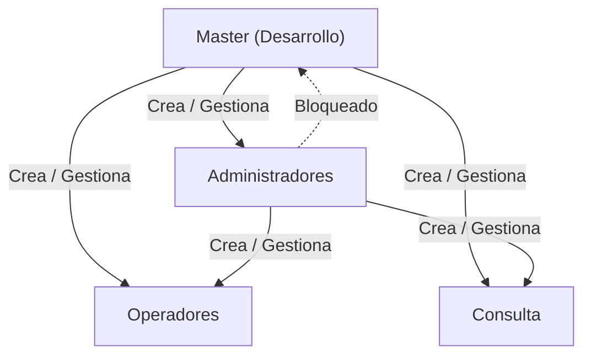
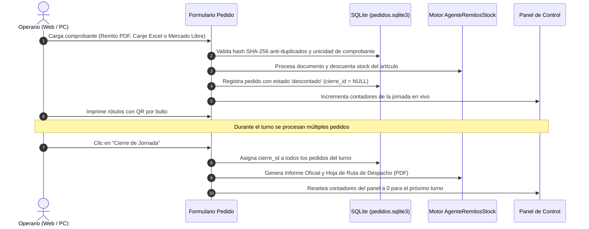

# StockAgent · Manual de Operación y Guía de Arquitectura

**StockAgent** es una plataforma integral para el control, auditoría y descuento de inventario en tiempo real a partir de comprobantes PDF (remitos mayoristas), planillas Excel (canjes) y documentos de Mercado Libre. Funciona tanto en modo escritorio nativo como en **Servidor Web Multi-Equipo (LAN)**, permitiendo que múltiples puestos de trabajo operen coordinadamente sobre el mismo stock sin inconsistencias y sin requerir transferencias manuales en carpetas compartidas.

---

## Índice

1. [Arquitectura y Modos de Ejecución](#1-arquitectura-y-modos-de-ejecución)
   - [Formas de Inicio y Detención](#formas-de-inicio-y-detención)
   - [Icono en la Bandeja del Sistema (System Tray de Windows)](#icono-en-la-bandeja-del-sistema-system-tray-de-windows)
   - [Parámetros de Línea de Comandos y Variables de Entorno](#parámetros-de-línea-de-comandos-y-variables-de-entorno)
   - [Progressive Web App (PWA) y Arquitectura Resiliente Offline-First](#progressive-web-app-pwa-y-arquitectura-resiliente-offline-first)
2. [Manual de Usuario por Roles](#2-manual-de-usuario-por-roles)
   - [Gestión de Perfil de Usuario ("Mi Perfil")](#gestión-de-perfil-de-usuario-mi-perfil)
   - [Autenticación, Seguridad y Bloqueo de Cuentas](#autenticación-seguridad-y-bloqueo-de-cuentas)
   - [Rol Master (`Desarrollo`)](#rol-master-desarrollo)
   - [Rol Administrador](#rol-administrador)
   - [Rol Operador](#rol-operador)
   - [Rol Consulta](#rol-consulta)
3. [Módulo de Carga Directa y Panel de Control de la Jornada](#3-módulo-de-carga-directa-y-panel-de-control-de-la-jornada)
   - [Métricas en Tiempo Real de la Jornada](#métricas-en-tiempo-real-de-la-jornada)
   - [Formulario de Carga y Descuento Individual](#formulario-de-carga-y-descuento-individual)
   - [Módulo de Inventario en Vivo con Escáner Móvil y PC](#módulo-de-inventario-en-vivo-con-escáner-móvil-y-pc)
   - [Ciclo de Cierre de Jornada y Reseteo de Contadores](#ciclo-de-cierre-de-jornada-y-reseteo-de-contadores)
4. [Control de Concurrencia y Navegación Web](#4-control-de-concurrencia-y-navegación-web)
5. [Manual del Programador y Mantenimiento](#5-manual-del-programador-y-mantenimiento)
   - [Estructura del Proyecto](#estructura-del-proyecto)
   - [Esquema de Bases de Datos SQLite](#esquema-de-bases-de-datos-sqlite)
   - [Compilación del Ejecutable (`.exe`)](#compilación-del-ejecutable-exe)
   - [Despliegue e Implementación en Red Local (Servidor LAN sobre HTTPS)](#despliegue-e-implementación-en-red-local-servidor-lan-sobre-https)
   - [Acceso Remoto Seguro desde Fuera de la Oficina (Tailscale VPN)](#acceso-remoto-seguro-desde-fuera-de-la-oficina-tailscale-vpn)
   - [Instalación del Certificado SSL para Eliminar "No es Seguro"](#instalación-del-certificado-ssl-para-eliminar-no-es-seguro)
   - [Protección Integral Contra Ataques Maliciosos y Seguridad del Sistema](#protección-integral-contra-ataques-maliciosos-y-seguridad-del-sistema)
   - [Batería de Pruebas Unitarias y Aseguramiento de Calidad](#batería-de-pruebas-unitarias-y-aseguramiento-de-calidad)

---

## 1. Arquitectura y Modos de Ejecución

StockAgent opera sobre una arquitectura híbrida de alto rendimiento:

* **Motor Web ASGI / Flet:** Servidor web FastAPI / Starlette en el puerto seguro por defecto `8550`.
* **Identidad Visual Web (Favicon y PWA):** La aplicación incluye en `assets/` el isotipo y favicon oficial (`ultratech.png` y `ultratech.ico`), visible en la pestaña del navegador, pantalla de carga y accesos directos instalables PWA.
* **Bases de Datos SQLite (WAL Mode):** Persistencia transaccional concurrente para usuarios, clientes, pedidos y auditoría en `data/`.
* **Plantilla Excel Maestra:** Archivo `Descuentos/Productos.xlsx` sincronizado atómicamente con los registros SQLite.
* **Bandeja del Sistema (System Tray):** Proceso en segundo plano acoplado al área de notificaciones de Windows para control rápido del servidor.

### Formas de Inicio y Detención

1. **Servidor Web Seguro en Red sobre HTTPS (Activo por defecto — Recomendado):**
   * Doble clic en `iniciar_servidor_web.bat` o desde terminal:
     ```powershell
     python main.py --host 0.0.0.0 --port 8550
     ```
   * **Detección Automática de Entorno:** `iniciar_servidor_web.bat` prioriza automáticamente el entorno virtual (`.venv`), entornos corporativos (`ttech`), el Python del sistema o el binario compilado `StockAgent.exe`.
   * **Instancia Única Inteligente (Single-Instance):** Si el servidor ya se encuentra en ejecución en el puerto 8550, el lanzador detecta la sesión activa mediante sondeo directo por socket y abre una nueva pestaña en el navegador predeterminado sin duplicar procesos ni trabarse en pantalla.
   * **Inmunidad a Estados Residuales (`TIME_WAIT`):** A diferencia de comprobaciones basadas en tablas netstat, el sondeo por socket no se bloquea por conexiones TCP cerradas recientemente, permitiendo reiniciar el servidor al instante.
   * En la PC principal se abre automáticamente **una única pestaña limpia** en `https://127.0.0.1:8550`.
   * En las terminales secundarias de la red local se accede mediante la IP local cifrada (ej. `https://192.168.1.50:8550`).
   * Si en algún entorno aislado se requiere desactivar HTTPS y correr en HTTP plano:
     ```powershell
     python main.py --http --host 0.0.0.0 --port 8550
     ```

2. **Ejecución Silenciosa en Segundo Plano:**
   * Doble clic en `iniciar_en_segundo_plano.vbs`: arranca el servidor sin abrir ventana de comandos ni consola en pantalla. El control queda disponible en el icono del System Tray.

3. **Inicio Automático con Windows:**
   * `configurar_inicio_automatico.bat`: registra StockAgent para que el servidor inicie automáticamente en segundo plano cada vez que se enciende o reinicia la PC.
   * `desactivar_inicio_automatico.bat`: remueve el inicio automático cuando ya no se requiera.

4. **Detención Rápida y Limpieza de Procesos:**
   * Doble clic en `detener_servidor.bat`: libera el puerto 8550 y finaliza de inmediato tanto ejecutables nativos `StockAgent.exe` como procesos Python ejecutando `main.py`, filtrando PIDs de sistema para un apagado limpio en segundos.
   * O bien, clic derecho en el icono de la bandeja del sistema $\to$ **"Cerrar y detener servidor"**.

5. **Modo Escritorio Monopuesto:**
   ```powershell
   python main.py --desktop
   ```

6. **Modo Automático por Consola (Headless):**
   ```powershell
   python main.py --auto
   ```

7. **Modo Simulación (Dry-Run):**
   ```powershell
   python main.py --dry-run
   ```

---

### Icono en la Bandeja del Sistema (System Tray de Windows)

Al arrancar el servidor web, StockAgent incorpora un controlador de bandeja del sistema (`src/tray_icon.py`) ejecutado mediante un hilo desacoplado con la biblioteca `pystray`:

* **Indicador Visual de Estado en Tiempo Real:**
  * 🟢 **Verde (Online):** Servidor activo y respondiendo peticiones.
  * 🟡 **Amarillo (Iniciando):** Inicializando dependencias, certificados o bases de datos.
  * 🔴 **Rojo (Error / Detenido):** Servidor sin conectividad o detenido.
* **Menú Contextual (Clic Derecho en el Icono):**
  * **🌐 Abrir StockAgent (Web):** Abre o enfoca la interfaz web en el navegador predeterminado (`https://127.0.0.1:8550`).
  * **📋 Copiar enlace de red (LAN):** Copia al portapapeles la dirección IP local lista para compartir con las demás terminales del depósito (`https://192.168.X.X:8550`).
  * **📁 Abrir carpeta del programa:** Abre el explorador de Windows en el directorio raíz de la aplicación.
  * **📄 Ver registro de eventos (Logs):** Abre de forma directa el archivo `data/logs/stockagent.log`.
  * **🛑 Cerrar y detener servidor:** Envía una notificación emergente de Windows, detiene el loop web y finaliza limpiamente el proceso liberando el puerto.
* **Notificaciones Nativas:** Emite notificaciones emergentes (Globos/Toasts de Windows) al iniciar el servidor, al copiar enlaces al portapapeles o al cerrar la aplicación.

---

### Parámetros de Línea de Comandos y Variables de Entorno

StockAgent permite parametrizar su ejecución tanto por flags de consola como mediante variables de entorno del sistema:

| Parámetro CLI | Variable de Entorno | Valor por Defecto | Descripción |
| :--- | :--- | :--- | :--- |
| `--host <IP>` | `STOCKAGENT_HOST` | `0.0.0.0` | Dirección IP de escucha del servidor web. |
| `--port <N>` | `STOCKAGENT_PORT` | `8550` | Puerto TCP de servicio. |
| `--https` | `STOCKAGENT_HTTPS=1` | Activo | Fuerza el protocolo seguro HTTPS/TLS. |
| `--http` | `STOCKAGENT_HTTPS=0` | Desactivado | Desactiva HTTPS y ejecuta en HTTP plano. |
| `--ssl-cert <RUTA>` | `STOCKAGENT_SSL_CERT` | Autogenerado | Ruta personalizada al certificado X.509 (`.crt` / `.pem`). |
| `--ssl-key <RUTA>` | `STOCKAGENT_SSL_KEY` | Autogenerado | Ruta personalizada a la clave privada (`.key` / `.pem`). |
| `--inactividad <MIN>` | `STOCKAGENT_INACTIVIDAD_MINUTOS` | `720` (12 horas) | Minutos de inactividad antes de cerrar sesión (`0` desactiva el cierre automático). |
| `--desktop` | — | Desactivado | Inicia en ventana nativa de escritorio (Flet App). |
| `--hide-console` | `STOCKAGENT_HIDE_CONSOLE=1` | Desactivado | Oculta la consola de Windows al arrancar. |
| `--no-browser` | `STOCKAGENT_NO_BROWSER=1` | Desactivado | Evita abrir automáticamente el navegador al iniciar. |
| `--no-tray` | `STOCKAGENT_NO_TRAY=1` | Desactivado | Desactiva el icono en la bandeja del sistema. |
| `--auto` / `--all` | — | Desactivado | Ejecuta el procesamiento de lotes por consola sin interfaz. |
| `--dry-run` | — | Desactivado | Simula el procesamiento sin modificar archivos ni bases de datos. |

---

### Progressive Web App (PWA) y Arquitectura Resiliente Offline-First

StockAgent opera como una **Progressive Web App (PWA)** completa de alta resiliencia para terminales móviles y puestos de depósito:
* **Instalación con 1 Clic:** Desde Google Chrome, Microsoft Edge o navegadores móviles (Android/iOS), se puede presionar el botón "Instalar aplicación" en la barra de direcciones para ejecutar StockAgent como aplicación de escritorio/móvil independiente sin barras del navegador.
* **Manifiesto Web (`assets/manifest.json`):** Configurado con el tema corporativo Ultratech (`#D32F2F`), modo de visualización `standalone`, orientación horizontal/vertical adaptativa y accesos directos (*shortcuts*) directos al escáner de códigos de barra (`/scanner.html`) y al panel principal.
* **Iconografía Multi-Resolución:** Iconos oficiales en 192x192, 512x512 y versiones maskable para Android y Windows en `assets/icons/`.
* **Service Worker con Caching Estratégico (`assets/sw.js`):** Implementa estrategias combinadas:
  * **Stale-While-Revalidate:** Carga instantánea de hojas de estilo (`.css`), scripts (`.js`), fuentes e imágenes desde caché mientras se actualizan en segundo plano.
  * **Network-First con Fallback a Caché:** Navegación HTML rápida que prioriza la versión más reciente del servidor y utiliza la copia en caché ante microcortes.
  * **Exclusión de WebSockets (`/ws`):** Tráfico en tiempo real canalizado sin interferencias de la capa de caché.
* **Pantalla de Contingencia Offline (`assets/offline.html`):** Interfaz oscura amigable que se despliega automáticamente ante caídas totales del enlace Wi-Fi, con detección y reconexión desatendida.
* **Búfer de Escaneo Offline para Depósito (`assets/js/scanner.js`):** Cola local persistente en `localStorage` (`stockagent_offline_scan_queue`). Si un operario escanea mercadería en una zona ciega de Wi-Fi, las lecturas se encolan de forma segura con un indicador visual ámbar y se sincronizan atómicamente con el servidor tan pronto como se detecta el evento `online`.
* **Banner de Microcortes de Red (`assets/index.html`):** Indicador superior no bloqueante que informa sobre el estado de la conexión en tiempo real sin entorpecer la operativa.
* **Pantalla de Carga Personalizada (`assets/index.html`):** Animación de carga con isotipo oficial y pre-conexión de tipografías para eliminar destellos en pantalla.

---

## 2. Manual de Usuario por Roles

El acceso está protegido por cuentas locales con contraseñas cifradas en PBKDF2 (SHA-256).



---

### Gestión de Perfil de Usuario ("Mi Perfil")

Todos los usuarios autenticados, sin distinción de su rol, tienen acceso a su ventana de perfil personal:

* **Cómo acceder:** Hacer clic en el avatar / chip con el nombre de usuario ubicado en la barra superior derecha y seleccionar **"Mi Perfil"**.
* **Campos configurables:**
  * **Nombre y Apellido (Identificador en Documentos):** Define el nombre real de la persona (ej. `Juan Carlos Pérez`). Este nombre sustituye al usuario técnico en todos los documentos operativos emitidos por el sistema (remitos descontados, rótulos de despacho con QR, hojas de ruta de transporte y registros de auditoría). Si no se completa, el sistema recurre al nombre de usuario (`username`) como valor por defecto.
  * **Correo Electrónico:** Dirección de correo institucional o personal (ej. `usuario@ultratech.com`), validada contra formato estándar RFC y verificada para garantizar su unicidad en la base de datos.
* **Guardado Inmediato:** Al confirmar, la sesión actual se refresca de inmediato reflejando los nuevos datos tanto en el panel de control como en las operaciones en curso.

---

### Autenticación, Seguridad y Bloqueo de Cuentas

StockAgent incorpora estrictas medidas de seguridad para proteger la integridad de los datos de inventario:

1. **Inicio de Sesión Flexible:**
   * Los usuarios pueden iniciar sesión ingresando indistintamente su **nombre de usuario** (ej. `Desarrollo`, `operario1`) o su **dirección de correo electrónico** (ej. `admin@ultratech.com`), con comparación insensible a mayúsculas y minúsculas (`COLLATE NOCASE`).

2. **Protección contra Fuerza Bruta y Bloqueo Preventivo:**
   * El sistema tolera hasta **5 intentos fallidos consecutivos** dentro de una ventana de **15 minutos**.
   * Al fallar cada intento, el sistema informa con precisión la cantidad de intentos restantes:
     > *"Usuario o contraseña incorrectos (3 intento(s) restante(s))."*
   * Al quinto intento fallido, la cuenta se bloquea automáticamente por **15 minutos**:
     > *"Cuenta bloqueada temporalmente por seguridad. Intentá de nuevo en 15 min."*
   * El mensaje indica en tiempo real los minutos restantes de espera antes de habilitar nuevos intentos.

3. **Política de Cambio Obligatorio de Contraseña:**
   * Los usuarios iniciales con contraseña por defecto (`master1713`) o aquellos cuya clave haya sido restablecida por un administrador están obligados a definir una nueva clave segura (mínimo 10 caracteres) antes de acceder a las funciones del sistema.
   * La nueva contraseña no puede coincidir con la clave por defecto del sistema.

4. **Desbloqueo Administrativo Inmediato:**
   * Tanto el usuario Master como los Administradores pueden desbloquear manualmente cualquier cuenta bloqueada desde la tabla de **Gestión de Usuarios**, limpiando los contadores e historial de fallos sin necesidad de esperar el transcurso de los 15 minutos.

5. **Sesión Continua durante la Jornada (Inactividad de 12 Horas):**
   * Para evitar interrupciones o pérdida de contexto durante el trabajo diario en depósito, la sesión de usuario se mantiene abierta de forma continua durante **12 horas** (720 minutos) de inactividad.
   * Puede ajustarse con el parámetro `--inactividad <minutos>` o la variable de entorno `STOCKAGENT_INACTIVIDAD_MINUTOS` (establecer en `0` desactiva completamente el cierre de sesión por inactividad).

---

### Rol Master (`Desarrollo`) — Seguridad, IAM y Auditoría

Bajo el estándar de **Separación de Funciones (*Separation of Duties - SoD*)** y el **Principio de Menor Privilegio**, el usuario **Master** está enfocado exclusivamente en la **administración técnica, gestión de identidades (IAM), auditoría integral y resguardo del sistema**. Al estar completamente desacoplado de la lógica de negocio y del inventario contable, garantiza imparcialidad y elimina conflictos de interés en las auditorías.

* **Usuario precargado:** `Desarrollo`
* **Contraseña inicial:** `master1713` (con cambio obligatorio en el primer inicio de sesión).
* **Alcance Exclusivo y Atributos Técnicos:**
  * **Gestión de Identidades y Accesos (IAM):** Es el **único rol facultado para crear, modificar, activar, desactivar y resetear contraseñas de cuentas de rol Administrador**. Asimismo, puede gestionar todas las cuentas operativas y desbloquear usuarios bloqueados por fuerza bruta.
  * **Centro de Auditoría Forense y Trazabilidad (Exclusivo Master):** Consulta inmutable y filtrado en tiempo real de todos los eventos del sistema: inicios de sesión, bloqueos por fuerza bruta, anulaciones, altas de usuarios, respaldos y modificaciones de configuración. Por principio de segregación de funciones (*SoD*), el Administrador no accede a este visor para evitar que el auditado audite sus propias operaciones.
  * **Gestión de Identidades y Accesos (IAM Compartida):** Master posee control supremo sobre todos los roles (incluyendo creación, modificación y reseteo de contraseñas de cuentas Administrador). Los Administradores comparten la facultad de crear y gestionar cuentas de Operador y Consulta, pero no pueden alterar cuentas Master ni ver la auditoría forense.
  * **Continuidad del Negocio (Backups / Disaster Recovery):** Generación manual de copias de seguridad `.zip`, configuración de directorios externos y verificación de políticas de rotación.
  * **Configuración del Servidor y Servicios:** Gestión de credenciales SMTP para alertas automáticas, custodia exclusiva de credenciales oficiales de la **API de Mercado Libre** (App ID, Client Secret, Tokens OAuth), monitoreo de certificados SSL/HTTPS y estado de la red.
  * **Protección Inviolable:** La cuenta Master no puede ser desactivada ni degradada de rol por ningún usuario ni por sí misma.
* **Exclusión de la Lógica de Negocio (Protección Operativa y Segregación SoD):**
  * ❌ **Sin Acceso a Pedidos:** Directamente el usuario Master **no visualiza pedidos operativos**. Su panel de control no contiene la tarjeta de pedidos preparados del turno y tiene restringido el acceso al Historial de Pedidos y a la consulta de pedidos individuales.
  * ❌ No procesa remitos, facturas ni comprobantes de Mercado Libre.
  * ❌ No modifica pedidos preparados ni altera cantidades de stock o la planilla `Productos.xlsx`.
  * ❌ No realiza ingresos de fábrica, inventarios físicos ni pedidos a proveedores.
  * ❌ No realiza cierres de jornada operativa ni emite Hojas de Ruta de despacho.
* **Experiencia de Usuario Especializada:**
  * Menú lateral organizado en bloques técnicos: *Seguridad y Accesos*, *Auditoría y Trazabilidad*, *Resguardo y Continuidad* y *Sistema*.
  * Dashboard adaptado con tarjetas KPI de infraestructura: *Usuarios Registrados*, *Cuentas Activas*, *Eventos Auditoría*, *Copias de Respaldo*, *Espacio en Disco* y *Salud Servidor* (diagnóstico en tiempo real de RAM, disco y proceso).
  * Módulo de *Archivado Histórico* para organizar comprobantes antiguos en subcarpetas cronológicas `data/historico/YYYY/MM/`.
  * Configuración de *Alertas Telegram* bajo el bloque de Sistema para pruebas de conectividad y monitoreo de eventos.
  * Panel de actividad que lista en vivo los últimos eventos de auditoría y seguridad.

---

### Rol Administrador

Pensado para jefes de depósito, encargados de logística y gerencia. Posee control total sobre la operación del depósito, estructurado en la barra lateral mediante bloques funcionales ordenados:

* **📦 Stock y Catálogo:** Gestión de catálogo maestro, ajustes de stock físico / ingresos de fábrica, comparativa de discrepancias, sincronización atómica con `Productos.xlsx` y generación automática de pedidos a fábrica.
* **🚚 Ventas y Despachos:** Historial interactivo de pedidos (reimpresión, modificación y desarmado con devolución de stock), directorio de clientes con alta automática, descuentos de Mercado Libre (vía comprobante y vía API oficial REST), Mercado Full y restauración documental.
* **📊 Analítica y Picking:** Dashboard ejecutivo de métricas de rendimiento, estadísticas de salida, radar predictivo de anomalías de demanda y mapa de calor de depósito con matriz de rotación ABC (Slotting).
* **📄 Informes:** Apertura y descarga de reportes, envío directo por correo electrónico y comunicación por WhatsApp Web.
* **🛡️ Sistema y Resguardo:** Copias de seguridad automáticas `.zip`, archivado histórico cronológico y alertas proactivas por Bot de Telegram.
* **👥 Administración de Usuarios (Sección Final):** Gestión de identidades y accesos (IAM) para roles Operador y Consulta (creación, edición, reseteo de claves y desbloqueos).

#### 1. Gestión de Usuarios Operativos
* **Qué hace:** Permite crear, modificar datos de perfil (nombre y email), restablecer contraseñas, desbloquear cuentas y activar o desactivar accesos para roles `Operador` y `Consulta`. Protege la jerarquía del sistema ocultando la cuenta `Master`.
* **Cómo se hace:** 
  1. En la barra superior, hacer clic en el botón de **Gestión de Usuarios** (icono de usuarios).
  2. Para crear una cuenta, completar el nombre de usuario, nombre completo, correo electrónico, contraseña y seleccionar el rol (`Operador` o `Consulta`), luego presionar **"Crear Usuario"**.
  3. Para modificar o dar de baja, ubicar al usuario en la tabla y utilizar los botones de edición de datos, cambio de contraseña, desbloqueo de cuenta o el interruptor para activar/desactivar el acceso.

#### 2. Panel de Métricas y Rendimiento (Dashboard Ejecutivo)
* **Qué hace:** Proporciona visibilidad ejecutiva del depósito mediante tarjetas KPI (total pedidos, bultos procesados, promedio de bultos/pedido y cierres realizados), porcentajes de distribución de envíos por empresa de transporte, productividad por operario/armador y ranking Top 10 de productos con mayor salida. Incluye selector de rango de fechas (`Desde` y `Hasta`).
* **Cómo se hace:**
  1. Hacer clic en la pestaña o botón **"Métricas y Rendimiento"** (Dashboard).
  2. Los indicadores se calculan automáticamente a partir de los datos consolidados en SQLite en horario local.
  3. Presionar **"Actualizar"** para refrescar los datos en cualquier momento de la jornada.

#### 3. Historial de Pedidos: Consulta, Reimpresión de Comprobantes, Modificación y Desarmado
* **Qué hace:** Permite buscar, supervisar y gestionar en detalle todos los pedidos cargados en el sistema (remito, N° de pedido, cliente, logística, bultos, armador y estado de despacho). Faculta a los usuarios para:
  1. **Consulta y Reimpresión del Comprobante Cargado:** Cada pedido presenta un badge interactivo con el ícono de formato del archivo original (PDF, Excel o Word/DOCX). Al hacer clic o presionar el botón de impresora (`🖨️`), el sistema abre o descarga de inmediato el documento para su revisión o reimpresión directa.
  2. **Detalle Completo del Pedido:** Presionando el botón de información (`ℹ️`) se accede a un modal con los datos logísticos, estado de despacho, enlace al informe de descuento asociado, lista de artículos descontados y acceso a rótulos con QR.
  3. **Visualización sin Modificación (Consulta de Pedidos):** El Administrador puede hacer clic en cualquier pedido (tanto en la tarjeta en vivo de la jornada como en el Historial) para abrir la **ventana modal de detalle completo**, consultar los artículos descontados, reimprimir el comprobante original o generar rótulos QR. Sin embargo, **no puede modificar los datos operativos del pedido** (cliente, bultos, logística o fecha), facultad que está estrictamente reservada a los operarios en turno para evitar colisiones con el empaque físico en depósito.
  4. **Desarmar Pedido y Restituir Stock:** En caso de cancelaciones o pedidos desarmados antes o después del despacho, esta opción anula el pedido y reincorpora automáticamente todas las unidades y códigos descontados sumándolos de vuelta al inventario físico tanto en SQLite (`productos.sqlite3`) como en la planilla maestra (`Productos.xlsx`).
  5. **Anular Pedido:** Cancela el comprobante registrando el motivo en auditoría (sin mover stock físico si se requiere anulación administrativa pura).
* **Cómo se hace:**
  1. Ingresar a la sección **"Historial de Pedidos"**.
  2. Filtrar por cliente, número de remito/factura, N° de pedido, fecha (`DD/MM/AAAA`), logística o armador mediante la barra de búsqueda en tiempo real.
  3. **Para Modificar un Pedido (Exclusivo Operador):** La edición directa está reservada a los operarios en turno. El administrador puede consultar el detalle completo con el botón `ℹ️` o proceder al desarme con restitución de stock mediante `Desarmar pedido`.
  4. **Para Desarmar un Pedido:** Presionar el botón ámbar **"Desarmar pedido"** (icono de carrito retirado / reposición), verificar la lista detallada de artículos y cantidades que se devolverán al depósito, ingresar el motivo opcional y presionar **"Desarmar y Devolver Stock"**. El sistema actualizará el stock al instante.
  5. **Para Anular un Pedido:** Presionar el botón rojo **"Anular"** (icono de cancelar), ingresar el motivo y confirmar.

#### 4. Copias de Seguridad y Respaldo Espejo en Red / Nube (NAS / Drive / OneDrive)
* **Qué hace:** Genera un respaldo íntegro comprimido `.zip` en la carpeta `data/backups/`, resguardando las bases SQLite (`pedidos.sqlite3`, `usuarios.sqlite3`, `productos.sqlite3`), usuarios, notificaciones y el catálogo maestro `Productos.xlsx`. Mantiene automáticamente una rotación de las últimas 30 copias.
* **Espejo en Red o Nube Secundario:** Permite configurar y verificar con 1 clic (`Probar y Guardar Espejo`) una carpeta secundaria externa (ej. `\\NAS\Backups_Deposito` o `C:\Users\...\Google Drive\Backups`). Cada respaldo generado se copia atómicamente a dicha ruta para máxima resiliencia ante fallos de disco local.
* **Cómo se hace:**
  1. Presionar el botón **"Copia de Seguridad"** en la barra superior de herramientas (o escribir `/backup` en el Asistente Virtual).
  2. El sistema notificará la generación exitosa del respaldo indicando el nombre del archivo y la fecha/hora exacta.

#### 5. Gestión de Catálogo de Productos (`Productos.xlsx`)
* **Qué hace:** Administra la base de datos maestra de artículos: altas de nuevos productos, edición de descripciones, códigos, precios y definición de umbrales de **Stock Mínimo** y **Stock Máximo** para alertas tempranas de desabastecimiento.
* **Cómo se hace:**
  1. Dirigirse a la pestaña **"Gestionar Productos"**.
  2. Para modificar un artículo existente, buscarlo en la tabla y presionar el botón de edición. Actualizar los campos deseados (descripción, stock de seguridad, etc.) y presionar **"Guardar"**.
  3. Para dar de alta un producto, presionar **"Nuevo Producto"**, completar la ficha técnica y confirmar. El archivo maestro se actualiza automáticamente preservando una copia previa.

#### 6. Ajuste de Stock y Entrada de Fábrica
* **Qué hace:** Procesa remitos o planillas de recepción de mercadería provenientes de fábrica (`.xlsx`, `.xls` o `.pdf`) sumando las cantidades al inventario disponible, o permite realizar ajustes manuales por mermas, roturas o sobrantes.
* **Cómo se hace:**
  1. Acceder a **"Ajustar Stock / Entrada Fábrica"**.
  2. Si se tiene el comprobante digital, presionar **"Seleccionar Archivo"** para que el sistema extraiga automáticamente códigos y cantidades.
  3. Si se realiza un ajuste manual, indicar el código del artículo y la cantidad (+ para ingreso, - para egreso).
  4. Revisar la previsualización del impacto y presionar **"Confirmar Entrada / Ajuste"**.

#### 7. Descuento Mercado Libre Full y Mercado Libre (DOCX)
* **Qué hace:** Procesa comprobantes de Mercado Libre (formato Full o documentos `.docx`), emparejando descripciones con los códigos del catálogo y descontando las unidades del stock general con validación antiduplicados (SHA-256).
* **Cómo se hace:**
  1. Ingresar a **"Descontar Mercado Libre Full"** o **"Descontar Mercado Libre (DOCX)"**.
  2. Seleccionar el comprobante a procesar mediante el selector de archivos.
  3. Revisar el reporte previo en pantalla: el sistema marcará en verde las coincidencias exactas y alertará si hay artículos sin stock suficiente o descripciones no identificadas.
  4. Hacer clic en **"Confirmar Descuento"** para aplicar la rebaja en el catálogo y generar el comprobante PDF.

#### 8. Comparativa de Stock Físico
* **Qué hace:** Contrasta una planilla de recuento físico realizada en las estanterías del depósito contra las existencias registradas en el sistema, clasificando cada producto como `COINCIDE`, `FALTANTE` o `SOBRANTE`.
* **Cómo se hace:**
  1. Abrir la herramienta **"Comparativa de Stock Físico"**.
  2. Subir el archivo Excel con el conteo (`Código` y `Cantidad contada`) mediante el botón de carga.
  3. Presionar **"Comparar Inventario"**.
  4. Inspeccionar la tabla comparativa con las diferencias cuantitativas y exportar el reporte a Excel o PDF.

#### 9. Generar Pedido a Fábrica (Excel de Reposición)
* **Qué hace:** Analiza los artículos cuyo stock actual está por debajo del stock mínimo configurado y genera una planilla formal de pedido a proveedores calculando la cantidad sugerida para alcanzar el nivel óptimo.
* **Cómo se hace:**
  1. Entrar en la sección de reposición (o invocar el comando `/reposicion` en el chat).
  2. El sistema listará todos los productos en quiebre o estado crítico con las cantidades sugeridas.
  3. Revisar y ajustar las cantidades deseadas en la tabla si fuera necesario.
  4. Presionar **"Generar Pedido a Fábrica"** para exportar la planilla Excel oficial de compra.

#### 10. Estadísticas de Salida y Rotación
* **Qué hace:** Procesa el histórico de movimientos para entregar curvas de rotación ABC, promedios de consumo diario/semanal y detección de artículos de baja demanda o alta demanda.
* **Cómo se hace:**
  1. Navegar a **"Estadísticas y Rotación"**.
  2. Definir el período de análisis (últimos 7 días, mes actual, rango personalizado).
  3. Presionar **"Calcular Estadísticas"** para visualizar los gráficos y tablas de rotación.

#### 11. Restauración de Documentos (Rollback de Lotes)
* **Qué hace:** Permite deshacer un lote de descuento completo o una carga previa, recalculando el stock y regresando el catálogo `Productos.xlsx` al estado exacto anterior a dicha operación sin pérdida de datos.
* **Cómo se hace:**
  1. Ingresar a **"Restaurar Documentos"**.
  2. Identificar el lote en la lista histórica por número de operación, fecha y comprobante.
  3. Presionar **"Previsualizar Rollback"** para constatar los productos y unidades que se reincorporarán al inventario.
  4. Confirmar la operación presionando **"Restaurar Catálogo"**.

#### 12. Informes Rápidos (Apertura, Correo con Adjuntos y WhatsApp Web)
* **Qué hace:** Permite seleccionar, inspeccionar y enviar los reportes oficiales generados (PDF de cierre, planillas Excel, hojas de ruta de choferes o pedidos a fábrica) por correo electrónico con los **archivos físicamente adjuntos** (vía Simple MAPI o envío directo SMTP) o compartirlos por WhatsApp Web.
* **Cómo se hace:**
  1. En el menú lateral o tras finalizar un cierre/pedido, hacer clic en **"Compartir por correo"**.
  2. En el cuadro de diálogo desplegado:
     * **Ver archivos adjuntos:** Inspeccionar la lista de archivos que acompañarán el correo con su tamaño y botón para removerlos (`[X]`).
     * **Seleccionar de informes recientes:** Elegir cualquier otro informe generado del menú desplegable y presionar **"Adjuntar"**.
     * **Examinar en PC:** Presionar **"Examinar en mi PC..."** para adjuntar cualquier archivo adicional desde el disco local.
     * **Datos del mensaje:** Confirmar o modificar los destinatarios, el asunto y las notas del mensaje.
     * **Configurar SMTP (opcional):** Hacer clic en el icono de engranaje para configurar credenciales SMTP (Gmail, Outlook 365, etc.) y enviar correos directamente sin necesidad de cliente de escritorio.
  3. Presionar **"Enviar Correo"**. El sistema adjuntará los archivos y despachará el mensaje.
  4. Para compartir por WhatsApp, presionar **"WhatsApp Web"** (abre el navegador con el mensaje de resumen listo y el archivo seleccionado en el Explorador).

#### 13. Buscador Rápido Global y Paleta de Comandos (`Ctrl + K` / `F2`)
* **Qué hace:** Proporciona una ventana modal flotante ultrarrápida accesible desde cualquier pantalla del sistema presionando `Ctrl + K`, `F2` o el botón de lupa en la barra superior.
* **Búsqueda Unificada en Tiempo Real:**
  * **Productos:** Localiza artículos por código, descripción o código de barras, mostrando stock disponible y ubicación en estantería (con copia rápida al portapapeles).
  * **Clientes:** Busca por razón social, código o domicilio.
  * **Pedidos y Remitos:** Filtra en vivo por número de pedido, remito, transporte o N° de guía.
  * **Acciones y Módulos:** Salto inmediato a *Cargar Pedido*, *Inventario Escáner*, *Cierre de Jornada*, *Métricas* o *Backups*.

#### 14. Asistente Virtual Inteligente y Chat de Comunicación Interna
* **Qué hace:** Provee una ventana flotante de doble propósito: un asistente virtual interactivo para consultas y diagnósticos rápidos de inventario, y un **canal de comunicación interna (Chat de Equipo)** que permite a operarios, administradores y encargados enviarse mensajes en tiempo real (tanto al canal general como mensajes privados directos entre usuarios), persistidos en SQLite y sincronizados entre todas las sesiones abiertas.
* **Cómo se hace:**
  1. Hacer clic en el botón flotante **"Asistente"** en la esquina inferior derecha (el botón muestra un indicador numérico en rojo cuando existen mensajes de equipo no leídos).
  2. En el encabezado de la ventana flotante, alternar entre sus dos modos:
     * **🤖 Asistente Bot:** Permite consultar stock, pedir diagnósticos y consultar auditorías mediante comandos rápidos (`/stock`, `/criticos`, `/reposicion`, `/metricas`, `/auditoria`, `/backup`, `/diagnostico`, `/simular`).
     * **💬 Chat Equipo:** Muestra el historial de mensajes de los miembros del equipo en tiempo real.
  3. Para enviar mensajes entre usuarios:
     * En la pestaña **Chat Equipo**, elegir el destinatario en el menú desplegable (`📢 Todos (Canal General)` o un usuario específico `@operario`), redactar el mensaje y presionar **Enter** o el botón de enviar.
     * O desde la pestaña del **Bot**, escribir directamente: `/msg @usuario tu mensaje aquí` o `/msg aviso para todos` y el asistente registrará y enviará el mensaje inmediatamente.

#### 14. Supervisión y Reimpresión de Rótulos de Bulto con Código QR (Formato A4 y Rollo Térmico 100x150 mm)
* **Qué hace:** Genera rótulos de despacho tanto para hojas **A4 estándar (10 por hoja)** como para **impresoras térmicas de etiquetas autoadhesivas continuas (Zebra, Xprinter, etc.)**:
  * **Rótulos Térmicos Continuos (Rollos 100x150 mm / 4"x6"):** Genera un PDF continuo de alta resolución donde cada bulto del pedido (`Bulto X de Y`) conforma una página exacta sin sobrantes de papel. Incluye nombre del cliente en tipografía extra-grande (`15pt bold`), N° de pedido, cuadro destacado de bulto, datos de transporte, N° de guía/tracking y código QR vectorizado para lectura con pistola o celular.
  * **Aprovechamiento Integral de Hoja A4:** Para pedidos individuales con menos de 10 bultos (o cuando la última página de un pedido con múltiples bultos no llena los 10 casilleros), el sistema **completa automáticamente los espacios vacíos** repitiendo proporcionalmente los rótulos del pedido. Esto evita el desperdicio de planchas adhesivas y garantiza que toda hoja A4 impresa se utilice al 100%.
  * **Impresión en Lote de Múltiples Pedidos:** Permite imprimir en un único archivo PDF todos los pedidos filtrados o de la jornada, ordenados consecutivamente a razón de 10 etiquetas por página y completando la última hoja.
* **Cómo se hace:**
  1. Ir a **"Historial de Pedidos"**.
  2. **Para un Pedido Individual:** Presionar el botón de código QR (`🔲`) en la tarjeta del pedido para generar su hoja A4 llena (10 rótulos).
  3. **Para Lote Completo:** Filtrar los pedidos deseados en el buscador y presionar el botón **"Rótulos A4 (Lote)"** en la barra superior. El sistema abrirá el PDF con todas las hojas A4 combinadas listas para imprimir.

#### 15. Archivado Histórico de Comprobantes
* **Qué hace:** Mantiene limpio y optimizado el almacenamiento del servidor organizando comprobantes de pedidos antiguos (PDF, Excel, Word) en subcarpetas cronológicas `data/historico/YYYY/MM/`. Permite seleccionar un umbral de antigüedad (30, 60, 90 o 180 días) y moverlos en bloque sin romper el acceso: el buscador del Historial de Pedidos localiza automáticamente cualquier documento tanto en la carpeta activa como en las subcarpetas del histórico.
* **Cómo se hace:**
  1. En el menú lateral de Administrador (o Master), seleccionar **"Archivado Histórico"**.
  2. Visualizar las estadísticas en tiempo real: volumen ocupado, total de archivos y fecha del comprobante más antiguo.
  3. Seleccionar el rango de antigüedad a archivar y presionar **"Iniciar Archivado Histórico"**. El sistema reportará la cantidad exacta de comprobantes clasificados.

#### 16. Alertas Proactivas en Tiempo Real por Telegram Bot
* **Qué hace:** Conecta el servidor StockAgent con la API oficial de Telegram para despachar notificaciones automáticas inmediatas a los administradores o grupos de depósito ante eventos críticos:
  * **Quiebres de Stock:** Notificación instantánea cuando un producto llega a 0 unidades o cae por debajo de su umbral mínimo de seguridad.
  * **Alertas de Seguridad:** Aviso de bloqueo preventivo de cuenta tras 5 intentos fallidos de inicio de sesión por sospecha de fuerza bruta.
  * **Resumen de Cierre de Jornada:** Mensaje ejecutivo al finalizar el turno con total de pedidos procesados, unidades descontadas y productos críticos.
* **Cómo se hace:**
  1. En el menú lateral, hacer clic en **"Alertas Telegram"**.
  2. Ingresar el **Token del Bot** (obtenido de `@BotFather`) y el **Chat ID** del grupo o canal privado de recepción.
  3. Presionar **"Probar Envío"** para verificar la comunicación en vivo.
  4. Activar o desactivar individualmente los tipos de alerta deseados mediante los interruptores dedicados y presionar **"Guardar Configuración"**.

#### 17. Sincronización Total con Excel (Flush & Decoupling)
* **Qué hace:** Vuelca todos los productos y existencias consolidadas en SQLite directamente hacia la planilla maestra `Productos.xlsx`. Esta herramienta permite operar a ultra-alta velocidad durante el día desacoplando las lecturas directas del archivo Excel, y consolidar o sincronizar manualmente o de forma automática al registrar el Cierre de Jornada.
* **Cómo se hace:**
  1. En el menú lateral, presionar **"Sincronizar con Excel"**.
  2. El sistema leerá todos los saldos vigentes en la base de datos `productos.sqlite3` y actualizará fila por fila la planilla `Productos.xlsx`, informando en pantalla la cantidad de artículos sincronizados.

#### 18. Conector Oficial Mercado Libre API (Sincronización Desatendida)
* **Qué hace:** Permite consultar y sincronizar en tiempo real las órdenes de compra pagadas desde la API REST oficial de Mercado Libre (`/orders/search`), eliminando la necesidad de descargar archivos Word (.docx) o planillas manualmente.
  * **Emparejamiento Inteligente:** Asocia automáticamente los artículos comprados priorizando el **SKU del vendedor** (`seller_sku`) para 100% de precisión y, en caso de no poseerlo, ejecuta matching semántico aproximado del título contra el catálogo.
  * **Comprobación de Stock en Tiempo Real:** Informa si existe stock suficiente antes del descuento o alerta sobre productos en quiebre.
  * **Descuento Atómico y Resguardo Documental:** Con un solo clic (`Descontar Seleccionadas`), actualiza las existencias en SQLite, registra los pedidos en `OrderStore` y crea automáticamente el archivo físico `.docx` en `data/pedidos_archivos/` para trazabilidad y reimpresión.
* **Cómo se hace:**
  1. En el menú lateral, presionar **"Mercado Libre API (Sync)"**.
  2. En la pestaña **Credenciales API**, cargar el *App ID*, *Client Secret* y *Access Token* (con renovación automática mediante *Refresh Token*) y presionar **"Probar Conexión"**.
  3. En la pestaña **Órdenes Sincronizadas**, presionar **"Sincronizar Ahora"** para consultar las órdenes recientes.
  4. Revisar la previsualización del stock, tildar las órdenes a procesar y presionar **"Descontar Seleccionadas"**.

#### 19. Radar de Consumo Anómalo y Detección de Desvíos de Demanda
* **Qué hace:** Aplica análisis estadístico continuo sobre el historial de movimientos de inventario (`stock_movements`) para alertar preventivamente sobre tres tipos de riesgos críticos de demanda:
  * **Picos Anómalos Diarios:** Identifica artículos cuya salida en el día supera la media histórica habitual en más de 2 desviaciones estándar ($C_{\text{hoy}} > \mu + 2\sigma$), permitiendo detectar de inmediato errores de tipeo o picos extraordinarios de compra.
  * **Descuentos Masivos Individuales:** Detecta cualquier remito o pedido individual que consuma de golpe el 50% o más del stock total disponible del producto.
  * **Velocidad Acelerada de Agotamiento (Run-out Run-rate):** Calcula el ritmo de salida diario de los últimos 14 días y proyecta los días de cobertura restantes. Si el stock se agotará en 3 días o menos, genera una alerta temprana de reposición urgente.
* **Cómo se hace:**
  1. En el menú de Administración, presionar **"Radar de anomalías"**.
  2. Visualizar los tres indicadores KPI en el encabezado (*Picos de Demanda*, *Descuentos > 50%*, *Agotamiento < 3d*).
  3. Navegar por las pestañas para inspeccionar los artículos afectados, diagnósticos detallados y días de cobertura.
  4. Presionar **"Notificar por Telegram"** para despachar de inmediato un reporte de advertencia al canal de gerencia/depósito.

#### 20. Mapa de Calor y Matriz de Rotación de Picking (Slotting)
* **Qué hace:** Aplica análisis de Pareto ABC y modelado espacial del depósito para optimizar los recorridos de los operarios y minimizar la fatiga ergonómica:
  * **Clasificación ABC (Pareto 75/15/10):** Agrupa automáticamente los productos en Clase A (*Fast Movers*, alta frecuencia de picking), Clase B (*Medium Movers*) y Clase C (*Slow Movers* / reposición lenta).
  * **Mapa de Calor 2D (Warehouse Heatmap):** Modela visualmente las 48 ubicaciones estándar del depósito (Racks A, B, C y D × Módulos 1-4 × Niveles 1-3) asignando colores térmicos dinámicos según el volumen de picks:
    * 🔴 **Muy Caliente (> 70%):** Altísimo tránsito de operarios.
    * 🟠 **Caliente (40% - 70%):** Tránsito moderado-alto.
    * 🟡 **Medio (15% - 40%):** Tránsito normal.
    * 🔘 **Frío (< 15%):** Zona de almacenamiento de baja rotación.
  * **Zona Dorada Ergonómica (Golden Zone ⭐):** Identifica el Nivel 2 (altura de cintura y pecho: 0.8m a 1.5m) como la posición más rápida y segura sin requerir agacharse al piso ni usar escaleras.
  * **Motor de Recomendaciones de Slotting:** Alerta sobre ineficiencias críticas:
    * *Fast-Mover en Fondo o Altura:* Producto Clase A alojado en Rack D o Nivel 3 (sobre-recorrido y riesgo de fatiga).
    * *Slow-Mover en Zona Dorada:* Producto Clase C ocupando una posición estratégica en Rack A.
  * **Reubicación Atómica con 1 Clic:** Botón directo en la interfaz que actualiza de inmediato la posición física del artículo en SQLite (`products.ubicacion`) y recalcula la eficiencia global del depósito.
* **Cómo se hace:**
  1. En el menú de Administración, presionar **"Heatmap y Picking"**.
  2. Consultar los 4 indicadores KPI superiores (*Eficiencia de Slotting*, *Picks Analizados*, *Distribución A/B/C* y *Reubicaciones Pendientes*).
  3. En la pestaña **"Mapa Térmico (Layout)"**, explorar los estantes visuales y hacer clic en cualquier casilla para ver los artículos almacenados.
  4. En la pestaña **"Matriz Rotación ABC"**, filtrar y ordenar productos por frecuencia de salida y porcentaje acumulado.
  5. En la pestaña **"Plan de Reubicación"**, revisar las sugerencias automáticas y presionar **"Reubicar"** para aplicar el cambio en el sistema.

---

### Rol Operador

Diseñado para el personal de preparación de pedidos, empaquetado y despacho en el depósito. Su interfaz está optimizada para la agilidad operativa:

* **Carga y Armado de Pedidos en Tiempo Real:**
  * Formulario rápido para procesar comprobantes individuales (PDF de remito o Excel de canje).
  * **Campo de Cliente con Buscador y Alta Automática:** Actúa como buscador interactivo en vivo al escribir un nombre; muestra sugerencias coincidentes y si el cliente no aparece, se da de alta automáticamente en el sistema sin interrumpir la carga.
  * Selector de **Logística Estandarizada** (`Domicilio`, `Centro de distribución`, `Transporte`, `Comisionista`, `Mabel`, `Canje`).
  * Asignación de cantidad de bultos y fecha de retiro programada (con calendario).
  * **Descuento Ágil sin Generación de Documentos Individuales:** Cada descuento impacta en el stock y queda registrado en la jornada sin generar archivos PDF o Excel individuales en disco. El documento formal se genera únicamente en el Cierre como un consolidado general.
  * **Protección Antiduplicados (SHA-256):** Bloquea automáticamente la carga si el archivo binario ya fue procesado con anterioridad.
* **Generación de Rótulos de Bulto Compactos (10 por Hoja A4 sin Desperdicio):**
  * Botón directo en cada pedido y botón en lote en el Historial para imprimir etiquetas de despacho en formato estándar A4 (10 por página, disposición 2x5).
  * **Llenado Inteligente de Hoja A4:** Llena siempre los 10 espacios de la hoja A4 sin dejar cuadrículas en blanco mediante replicación proporcional de los bultos del pedido.
  * **Nombre del Cliente Extra Grande y en Negrita:** Resaltado en tipografía grande (`13.5pt bold`) para máxima legibilidad en el depósito, concatenado automáticamente con el número de pedido (ej: `Gregory Rodriguez Nro 3`), con el mismo o mayor impacto visual que el recuadro de `BULTO X DE Y`.
  * Genera una etiqueta por cada bulto (`Bulto 1 de N`, `Bulto 2 de N`) con datos del remito, cliente, transporte, nombre identificador del armador y código QR escaneable por celular o lector.
* **Descuento Mercado Libre (DOCX):**
  * Carga y descuento de remitos de Mercado Libre en formato `.docx`, con previsualización del impacto y protección contra archivos duplicados (sin generación de documentos individuales innecesarios).
* **Sincronización Mercado Libre (API REST):**
  * Botón directo **"Sincronizar Mercado Libre (API)"** para consultar y descontar pedidos pagados en tiempo real directo desde los servidores de Mercado Libre, sin tener que descargar o arrastrar archivos a la plataforma.
* **Historial de Pedidos:**
  * **Despacho Masivo en Lote:** Casillas de verificación (checkboxes) por pedido y botón de 1 clic `Seleccionar Visibles` con barra flotante de acciones:
    - `[ Despachar Seleccionados ]`: Cambia en lote a estado **DESPACHADO** todos los pedidos tildados al subir al transporte.
    - `[ Marcar como Entregados ]`: Cambia en bloque a estado **ENTREGADO**.
  * **N° de Guía / Tracking ID y Notificación WhatsApp:** Cada pedido admite registrar su código de seguimiento del transporte (ej: Andreani, Vía Cargo). Al presionar el botón de WhatsApp (`💬`), el sistema abre WhatsApp Web con el mensaje pre-armado informando al cliente el estado de su pedido, transporte y número de guía.
  * **Filtros Rápidos de 1 Clic:** Selector superior instantáneo con chips temáticos:
    - 🔘 `Todos`: Vista histórica general.
    - 🔘 `Solo Hoy`: Filtra de inmediato los pedidos registrados en la fecha actual sin tener que tipear el día en el buscador.
    - 🔘 `Pendientes de Cierre`: Aísla exclusivamente los pedidos armados en el turno que aguardan el Cierre de Jornada.
    - 🔘 `Despachados`: Muestra únicamente los pedidos entregados al chofer o transporte.
  * **Diseño Espacioso y Jerárquico de Tarjetas:** Tarjetas de 960px con división en 4 niveles semánticos que impiden el solapamiento de información (Cabecera con N° de pedido y badge de estado con borde temático, chips de cliente y transporte con ajuste multi-línea, datos de comprobante y resumen de artículos con elipsis, y barra inferior de acciones operativas).
  * Buscador en tiempo real por cliente, remito/factura, N° de pedido, fecha (`DD/MM/AAAA`), logística o armador.
  * **Botón Rótulos A4 (Lote):** Impresión directa de hojas A4 optimizadas que contienen los rótulos de todos los pedidos filtrados.
  * **Modificación de Pedidos Preparados (Exclusivo Operador):** Capacidad exclusiva para editar directamente cliente, N° de pedido, cantidad de bultos, logística y fecha programada de entrega, tanto desde el panel de pedidos en vivo como desde el Historial. Esta exclusividad operativa previene colisiones y discrepancias con administradores o usuarios master.
  * **Desarmar Pedido y Regresión de Stock:** Opción para desarmar el pedido reincorporando automáticamente los productos y cantidades al stock físico en SQLite y `Productos.xlsx` al instante.
  * Visualización de estados de despacho (`Armado` $\to$ `Despachado` $\to$ `Entregado`) y acceso directo a reimprimir rótulos de bulto.
* **Cierre de Jornada Consolidado:**
  * Agrupa y suma todos los pedidos y descuentos realizados durante el turno de trabajo.
  * **Cálculo Exacto sin Doble Descuento:** Al consolidar los pedidos ya descontados en tiempo real, el motor calcula con precisión el stock original previo y el saldo real vigente en SQLite y `Productos.xlsx`.
  * Genera el **Informe Oficial Consolidado de Cierre (PDF y Excel)** donde se suman todos los descuentos de la jornada (`Cierre_Descuento_*.pdf` y `Cierre_Descuento_*.xls`).
  * **Emisión Modular de Hojas de Ruta de Despacho (PDF):** Permite generar la **Hoja de Ruta General** (todos los pedidos de la jornada) o **Hojas de Ruta Individuales por Transporte / Chofer** (ej: solo *Expreso*, solo *Comisionista* o solo *Canje*), detallando cantidades de bultos y casillero de firma de conformidad para cada transportista.
  * Dispara la **Copia de Seguridad Automática** en `data/backups/`.
  * Detecta y alerta sobre productos en **quiebre ($\le 0$)** o **stock crítico ($1$ a $5$ un.)**.
  * Prepara el borrador de correo electrónico automático para notificar a la administración.
  * **Resetea los contadores del panel principal a 0** para dejar el sistema listo para el próximo turno.
* **Asistente Virtual y Chat de Comunicación de Equipo:**
  * Botones rápidos y comandos contextuales: `/stock <código>`, `/pedidos`, `/cierre`, `/mercadolibre`, `/ayuda`.
  * Canal de comunicación interno directo con compañeros y administración (`/equipo` y `/msg @usuario`). Permite enviar avisos operativos (faltantes de bultos, mercadería recibida o prioridades de despacho) con avisos de mensajes no leídos.

---

### Rol Consulta

Perfil restringido de solo lectura para auditoría externa, vendedores o supervisores:

* **Consulta de Stock en Tiempo Real:** Búsqueda ágil de existencias, código, descripción y ubicación de cualquier artículo.
* **Monitoreo de Catálogo:** Visualización de productos activos sin permisos de edición ni modificación.
* **Historial e Informes:** Lectura de comprobantes generados previamente.
* **Asistente Virtual Restringido:** Comandos permitidos: `/stock`, `/criticos`, `/informes`, `/ayuda`.
* **Restricción Total:** Bloqueado para cargar pedidos, anular, descontar stock, alterar usuarios o ejecutar cierres.

---

## 3. Módulo de Carga Directa y Panel de Control de la Jornada

El sistema funciona con un flujo de trabajo **100% interactivo y en tiempo real**: **no se utilizan cargas por lotes desde carpetas del disco**, sino que los operarios cargan y descuentan cada pedido directamente desde la interfaz web o de escritorio.



### Métricas en Tiempo Real de la Jornada

En la parte superior del panel de control se encuentran las tarjetas de métricas en vivo:

| Tarjeta | Descripción | Fuente de Datos |
| :--- | :--- | :--- |
| **Pedidos descontados** | Cantidad de remitos y facturas en formato PDF procesados en la jornada activa. | SQLite `pedidos` (`tipo_archivo = 'pdf'` y `cierre_id IS NULL`) |
| **Canjes** | Cantidad de planillas de canje en formato Excel procesadas en la jornada activa. | SQLite `pedidos` (`tipo_archivo = 'excel'` y `cierre_id IS NULL`) |
| **Mercado Libre** | Cantidad de pedidos de Mercado Libre (.docx) procesados en la jornada activa. | SQLite `pedidos` (`tipo_archivo = 'docx'` y `cierre_id IS NULL`) |
| **Total jornada** | Total consolidado de pedidos procesados que aguardan el Cierre de Jornada. | Suma acumulada de pedidos pendientes de cierre |
| **Informes** | Total de reportes oficiales disponibles para descarga o visualización. | Archivos generados en `Descuentos/` |
| **Quiebres de stock** *(Admin)* | Artículos que han alcanzado stock cero o negativo, requiriendo reposición urgente. | Análisis de stock en `Productos.xlsx` |

### Panel en Tiempo Real: Pedidos Preparados e Informes de la Jornada

Debajo del formulario de carga, el panel principal organiza la operativa en dos tarjetas estratégicas:

* **Panel Izquierdo — Pedidos Preparados del Turno (Orden Descendente - Exclusivo Operador y Administrador):**
  * **Exclusión de Usuario Master:** Por principio de segregación de funciones (*SoD*), el usuario Master **no visualiza esta tarjeta ni los pedidos**, visualizando en su lugar de forma expandida la consola de eventos de auditoría y salud del servidor.
  * **Encabezado con Fecha y Bultos Acumulados:** Muestra la fecha actual del turno y una insignia destacada con el **total acumulado de bultos preparados hasta el cierre** (`📦 X bultos preparados`), actualizándose reactivamente en vivo cada vez que se descuenta un pedido o se modifica su empaque.
  * **Visualización Descendente (`id DESC`):** Presenta los pedidos preparados en el turno ordenados de forma descendente, dejando siempre los más recientes en la parte superior.
  * **Tarjeta Resumen por Pedido:** Cada elemento muestra de un vistazo el identificador `#id`, número de pedido, comprobante/remito, cliente, logística/transporte, armador, resumen de artículos y cantidad de bultos.
  * **Comportamiento al Hacer Clic según Rol:**
    * **Operador:** Abre de inmediato el diálogo de **modificación rápida** para ajustar bultos, logística, cliente o fecha de retiro.
    * **Administrador:** Abre la **ventana modal de detalle de solo lectura**, permitiendo consultar artículos, reimprimir comprobantes y emitir rótulos QR, sin permisos de alteración de datos.
* **Panel Derecho — Informes Generados:**
  * Conserva la lista y acceso directo a todos los reportes oficiales generados (informes PDF/Excel de cierres consolidados, hojas de ruta de despacho y pedidos a fábrica) para apertura, descarga o reenvío instantáneo por correo o WhatsApp.
* **Optimización Ergonómica de Pantalla:**
  * Se removió la tarjeta técnica de actividad/consola para maximizar el área útil del panel y enfocar la atención del equipo en el flujo continuo de despacho y volumen de bultos de la jornada.

### Formulario de Carga y Descuento Individual

1. **Remito / Factura:** Identificador único del comprobante. Si se intenta ingresar un remito ya registrado, el sistema lo rechaza para evitar duplicaciones.
2. **Cliente (Separación Código/Nombre + Buscador Dinámico + Dirección Geolocalizable):**
   * Al escanear o adjuntar un comprobante PDF, el sistema analiza la cabecera y **separa automáticamente el código numérico de cliente de la razón social limpia** (ej: `00714 - DIETETICA IDEAS Y SABORES` $\to$ Código `00714`, Cliente `DIETETICA IDEAS Y SABORES`), evitando nombres concatenados con números.
   * Extrae automáticamente el domicilio, localidad y provincia del cliente persistiendo la **dirección normalizada** en la base de datos SQLite para futuras funcionalidades (como la visualización de rutas y pines consumiendo la **API de Google Maps**).
   * El buscador en vivo permite filtrar al instante por razón social, código o dirección con autocompletado en un clic. Si el cliente es nuevo, se da de alta automáticamente con su código y dirección al confirmar.
3. **Número de Pedido (Opcional, Numérico):**
   * Campo numérico ubicado debajo del cliente. Si se indica un número de pedido (ej: `3`), se concatena automáticamente con el cliente en los rótulos (ej: `Gregory Rodriguez Nro 3`).
4. **Bultos (Stepper Interactivo `+` / `-`):**
   * Selector interactivo con botones dedicados `[-]` y `[+]` para incrementar o decrementar rápidamente la cantidad de bultos empaquetados (manteniendo un mínimo estricto de 1 bulto) con campo numérico editable centrado.
5. **Logística (Selector Obligatorio sin Valor por Defecto):**
   * El selector inicia deseleccionado (`Seleccionar tipo de logística...`), obligando al operario a elegir deliberadamente la vía de despacho (`Domicilio`, `Centro de distribución`, `Transporte`, `Comisionista`, `Mabel`, `Canje`) antes de confirmar para evitar despachos con logística incorrecta.
6. **Fecha de Retiro (Auto-completada desde Fecha de Despacho):**
   * Al seleccionar un remito, el sistema extrae automáticamente la **Fecha de Despacho** indicada en el documento y la asigna de inmediato como Fecha de Retiro, manteniendo el selector de calendario y botón de limpieza para ajustes manuales.
7. **Armador:** Campo automático y bloqueado que toma el nombre o identificador de la sesión activa (ej. `Juan Pérez`, `Desarrollo`).
8. **Adjuntar Comprobante (con Anti-duplicados SHA-256):** Permite seleccionar archivos `.pdf` (pedidos mayoristas) o `.xlsx`/`.xls` (canjes), verificando que el archivo binario no haya sido procesado previamente.
9. **Descuento Atómico y Sincronización en Tiempo Real con `Productos.xlsx`:** Cada pedido descuenta su stock inmediatamente tanto en la base SQLite (`productos.sqlite3`) como en la planilla maestra `Productos.xlsx`, garantizando que cualquier consulta externa o apertura del Excel refleje el inventario real disponible al instante.
10. **Alerta Preventiva de Stock Insuficiente *Antes* de Descontar:**
    * Mediante simulación previa atómica, el sistema detecta si algún artículo del comprobante quedará en quiebre ($\le 0$ unidades).
    * Si existen discrepancias, despliega un cuadro de advertencia previa con la lista de productos y saldos resultantes, requiriendo autorización explícita (`[ Autorizar y Descontar ]`) o permitiendo cancelar para revisión (`[ Cancelar y Revisar ]`), evitando quiebres accidentales.
11. **Feedback Sonoro Operativo (Web Audio API):**
    * Notificaciones de audio sintetizadas en tiempo real en navegador y escritorio:
      - 🎵 *Beep agudo (880 Hz):* Confirmación de pedido descontado, rótulo generado o despacho en lote exitoso.
      - ⚠️ *Beep grave descendente:* Advertencia preventiva de stock insuficiente, remito duplicado o error de escaneo.
12. **Prompt Instantáneo de Rótulos A4 y Térmicos Continuos:** Al confirmar un pedido con éxito, el sistema despliega el diálogo de confirmación y permite elegir entre `[ Imprimir Rótulos A4 ]` o `[ Rótulo Térmico Rollo (100x150 mm) ]` con un solo clic.
11. **Regresión y Devolución Automática de Stock (Desarme y Anulación):** Si un pedido es desarmado o cancelado porque no saldrá del depósito, el sistema recupera automáticamente sus artículos y cantidades desde `pedido_items` y restituye el stock en tiempo real en SQLite y en `Productos.xlsx`, registrando la trazabilidad en auditoría forense.

### Módulo de Inventario en Vivo con Escáner Móvil y PC

StockAgent incorpora un sistema interactivo de relevamiento físico de stock en tiempo real (`dlg_inventario_vivo.py`) diseñado para agilizar auditorías de depósito y mantener la base de datos limpia de diferencias:

1. **Escaneo Dual Adaptativo y Apertura Multi-Navegador:**
   * **Cámara de Dispositivos Móviles (PWA / Web):** Mediante la interfaz desacoplada `assets/scanner.html` (con estilos en `assets/css/scanner.css` y controlador en `assets/js/scanner.js`), los operarios pueden recorrer las estanterías escaneando códigos de barra EAN-13, Code 128 o QR con la cámara de su teléfono o tablet vía WebRTC y la API nativa `BarcodeDetector`. Incluye pitido sonoro de confirmación (Web Audio API) y guía visual de enfoque. La apertura del escáner cuenta con compatibilidad multi-versión (Flet `UrlLauncher`, navegación nativa y fallback sin bloqueos de popups).
   * **Lectores Ópticos USB / Bluetooth en PC:** Soporta pistolas lectoras que emulan teclado en terminales fijas con detección automática de enter/retorno de carro e ingreso manual por teclado con autocompletado.
2. **Diseño Responsivo Optimizado para Celulares:**
   * **Entrada de Escaneo en Ancho Completo:** El campo de código de barras / SKU cuenta con renglón propio con autofocus y tamaño legible en pantallas táctiles de cualquier tamaño.
   * **Controles Táctiles y Stepper de Cantidad:** Fila de acciones con botones `+` y `-` cómodos para dedos, botón prominente "Sumar" y botón directo de activación de cámara.
   * **Accesos Rápidos de Cantidad:** Chips de selección inmediata (`+1`, `+5`, `+10`, `+24`, `+50`) para agilizar conteos de bultos o cajas cerradas.
   * **Tarjetas de Producto en 3 Niveles:** Cada producto relevado se visualiza con cabecera de SKU/código de barras y etiqueta de coincidencia, descripción completa en renglón intermedio y comparativa de stock digital vs físico con controles de ajuste táctil en el renglón inferior.
3. **Reconocimiento por Código de Barras o SKU:**
   * La tabla de productos en SQLite almacena el campo `cod_barras` con índice rápido `idx_products_cod_barras`.
   * El sistema busca automáticamente el artículo coincidente; al detectarlo, incrementa el conteo físico, muestra la foto/descripción y compara en pantalla las existencias teóricas del sistema contra el conteo real.
   * Si se escanea un código de barras no registrado, se despliega una ventana modal interactiva para asociarlo al instante a cualquier producto existente del catálogo.
4. **Reporte de Discrepancias y Conciliación:**
   * Presenta una tabla interactiva con indicador visual de diferencias (sobrantes en ámbar, faltantes en rojo y coincidencias en verde).
   * Genera el informe comparativo Excel (`Inventario_Escaner_*.xlsx`), notifica automáticamente a los administradores y permite compartir los resultados por correo o WhatsApp.

---

### Ciclo de Cierre de Jornada y Reseteo de Contadores

Cuando finaliza el turno de despacho:
1. El operador ingresa a **"Cierre de Jornada"**.
2. El sistema presenta dos pestañas de trabajo:
   * **Pendientes:** Muestra la lista de todos los pedidos acumulados en la jornada con el total de artículos y bultos pendientes de cierre.
   * **Historial de Cierres:** Permite consultar todos los cierres previos con su ID, cantidad de pedidos, fecha y responsable, incluyendo accesos directos para reimprimir el PDF de descuentos, abrir o regenerar la Hoja de Ruta de Despacho y reenviar los comprobantes por correo electrónico.
3. Al presionar **"Cerrar Jornada e Imprimir"**:
   * Se consolidan y suman **todos los descuentos de todos los pedidos de la jornada**.
   * Se genera el **Informe Oficial Consolidado de Cierre (PDF y Excel)**: `Cierre_Descuento_*.pdf` y `Cierre_Descuento_*.xls` con la suma detallada de productos y remitos de origen.
   * Se sincronizan de forma definitiva las existencias en el catálogo maestro `Productos.xlsx`.
   * Se asigna formalmente un número único de cierre (`cierre_id`) a todos los pedidos del turno en SQLite.
   * Se genera la **Hoja de Ruta de Despacho por Transporte (PDF)** con casilleros de firma para transportistas y se persiste su vinculación en el cierre.
   * Se dispara automáticamente una copia de seguridad en `data/backups/`.
   * Toda la interacción con el usuario (notificaciones de pantalla, envío de correo y descarga/apertura de documentos en el navegador) opera de forma asíncrona segura (`page.run_task`).
   * **Los contadores de la jornada en el panel vuelven a 0**, quedando limpios y listos para el siguiente turno.

---

## 4. Control de Concurrencia y Navegación Web

Para garantizar una experiencia ágil y sin inconsistencias en entornos multi-usuario:

* **Apertura Limpia en Navegador:** Al ejecutar `iniciar_servidor_web.bat`, el sistema inicia el servidor HTTPS en el puerto 8550 y abre **una única pestaña limpia** en el navegador predeterminado.
* **Libre navegación en múltiples pestañas:** Los usuarios pueden tener abiertas varias pestañas para consultar stock, revisar el catálogo o ver el historial de forma simultánea.
* **Bloqueo atómico al procesar:** Cuando una pestaña dispara un descuento o procesamiento, el sistema activa un bloqueo global transitorio (`PROCESAMIENTO_GLOBAL_ACTIVO`). Si otra pestaña o terminal intenta procesar en ese mismo instante, se le notifica amablemente:
  > *"Hay una operación de procesamiento de stock en curso desde otra sesión o pestaña. Por seguridad en los archivos, espera a que finalice."*
* **Single Instance Robusto y Libre de Bloqueos:** Tanto `main.py` como `iniciar_servidor_web.bat` verifican el estado del puerto mediante sondeo TCP directo (`socket.create_connection`), descartando falsos positivos provocados por conexiones cerradas en estado `TIME_WAIT` o `CLOSE_WAIT`. Si ya existe una instancia respondiendo en el puerto 8550, abre inmediatamente el navegador predeterminado hacia ella y finaliza el lanzador en menos de 0.05 segundos sin colgar la consola; en caso contrario, inicia el servicio web y el icono del System Tray con enlace local y de red LAN.

---

## 5. Manual del Programador y Mantenimiento

### Estructura del Proyecto

```text
StockAgent/
├── assets/                            # Assets web (Favicons, logos, manifest PWA)
│   ├── favicon.ico
│   ├── favicon.png
│   ├── manifest.json                  # Manifiesto PWA para instalación de escritorio
│   ├── index.html                     # Splash screen y carga optimizada
│   ├── scanner.html                   # Escáner de código de barras para cámara móvil y web
│   ├── css/                           # Estilos desacoplados del escáner
│   │   └── scanner.css                # Layout, guía de escaneo y animaciones
│   ├── js/                            # Scripts desacoplados del escáner
│   │   └── scanner.js                 # Lógica de cámara WebRTC, BarcodeDetector y audio
│   └── icons/                         # Iconos en múltiples resoluciones y loading
├── data/                              # Bases de datos SQLite y comprobantes
│   ├── usuarios.sqlite3               # Cuentas, perfiles, roles y contraseñas
│   ├── pedidos.sqlite3                # Clientes, pedidos y auditoría en tiempo real
│   ├── productos.sqlite3              # Catálogo sincronizado
│   ├── certs/                         # Certificados SSL X.509 generados (HTTPS)
│   │   ├── stockagent.crt
│   │   └── stockagent.key
│   ├── logs/                          # Registros rotativos de eventos
│   │   └── stockagent.log
│   ├── pedidos_archivos/              # Backups de comprobantes procesados
│   └── backups/                       # Copias de seguridad automáticas y manuales (.zip)
├── Descuentos/                        # Plantillas y reportes generados
│   ├── Productos.xlsx                 # Planilla maestra de inventario
│   ├── Mayoristas/
│   ├── Canjes/
│   └── MercadoLibre/
├── src/                               # Código fuente modular y desacoplado
│   ├── agent.py                       # Orquestador del Agente de Stock
│   ├── flet_gui.py                    # Fachada principal Flet, PWA y orquestación UI
│   ├── tray_icon.py                   # Controlador del icono en bandeja de Windows (pystray)
│   ├── orders_store.py                # DAO SQLite para pedidos, clientes y auditoría
│   ├── user_store.py                  # DAO SQLite para usuarios, perfiles y seguridad
│   ├── product_store.py               # DAO SQLite para catálogo, reposición e inventario físico
│   ├── stock_manager.py               # Fachada central de inventario y manipulación de catálogo
│   ├── remito_parser.py               # Parser de remitos PDF
│   ├── canjes_parser.py               # Parser de canjes Excel
│   ├── mercado_libre_parser.py        # Parser de pedidos DOCX
│   ├── mercado_full_parser.py         # Parser de planillas Mercado Libre Full
│   ├── dispatch_manifest.py           # Generador de Hoja de Ruta por Transporte (PDF)
│   ├── label_generator.py             # Generador de Rótulos con QR (Hojas A4 y Rollo Térmico 100x150 mm)
│   ├── backup_manager.py              # Motor de respaldos comprimidos y restauración verificada
│   ├── email_sender.py                # Envío directo SMTP con adjuntos y credenciales cifradas
│   ├── secretos.py                    # Cifrado local de credenciales (Windows DPAPI / Fernet)
│   ├── alertas_programadas.py         # Planificador en segundo plano de alertas diarias por correo
│   ├── ssl_manager.py                 # Generador automático de certificados X.509 para HTTPS
│   ├── logger_config.py               # Configuración de logs rotativos en data/logs/stockagent.log
│   ├── internal_chat.py               # Bot y Asistente Virtual con chips por rol
│   │
│   ├── stock/                         # Subpaquete modular de dominio de stock e informes
│   │   ├── __init__.py                # Exportaciones públicas del módulo stock
│   │   ├── models.py                  # Dataclasses de descuento (RegistroDescuento, ReporteStock)
│   │   ├── reports.py                 # Exportadores de informes (.xls con xlwt y .pdf con ReportLab)
│   │   ├── replenishment.py           # Sugerencia y generación de pedidos a fábrica en Excel
│   │   └── physical_inventory.py      # Comparación y generación de planillas unificadas de inventario físico
│   │
│   └── ui/                            # Subpaquete modular de interfaz gráfica de usuario (Flet)
│       ├── __init__.py                # Exportaciones públicas de UI
│       ├── theme.py                   # Paleta cromática corporativa, bordes y estilos temáticos
│       ├── components/                # Componentes visuales desacoplados
│       │   ├── __init__.py            # Exportaciones de componentes
│       │   ├── header.py              # Barra superior con selector de modo oscuro, perfil e IP LAN
│       │   ├── sidebar.py             # Drawer lateral de navegación adaptable móvil/escritorio
│       │   ├── floating_chat.py       # Ventana de chat flotante (Asistente IA + chat de equipo)
│       │   └── panels.py              # Paneles de métricas de jornada, pedidos en vivo e informes
│       └── dialogs/                   # Ventanas modulares desacopladas por dominio funcional
│           ├── __init__.py            # Re-exportación unificada de diálogos
│           ├── dlg_auth.py            # Login, cambio obligatorio de clave, edición de perfil y setup
│           ├── dlg_clientes.py        # Alta, edición y administración de clientes
│           ├── dlg_usuarios.py        # Administración de cuentas, roles y reseteo de claves
│           ├── dlg_smtp.py            # Configuración de servidor SMTP y credenciales cifradas
│           ├── dlg_backup.py          # Copias de seguridad y restauración asistida
│           ├── dlg_productos.py       # Catálogo, edición de productos y movimientos de stock
│           ├── dlg_pedidos.py         # Carga, cancelación, desarme y edición de pedidos
│           ├── dlg_historial_pedidos.py # Historial de pedidos con búsqueda y reimpresión de comprobantes
│           ├── dlg_escaner.py         # Escáner QR de despacho y avance de estado logístico
│           ├── dlg_cierre.py          # Cierre de jornada y generación de hoja de ruta
│           ├── dlg_email.py           # Compartir por correo y WhatsApp con selector de adjuntos
│           ├── dlg_analytics.py       # Dashboard analítico, auditoría, estadísticas y notificaciones
│           ├── dlg_stock_ops.py       # Ingreso fábrica, pedido fábrica, ML Full/DOCX y stock físico
│           └── dlg_inventario_vivo.py # Relevamiento de inventario en vivo (cámara móvil y escáner PC)
├── crear_exe.bat                      # Script de compilación a .exe independiente
├── iniciar_servidor_web.bat           # Lanzador del servidor web HTTPS en LAN
├── iniciar_en_segundo_plano.vbs       # Ejecución silenciosa sin ventana de consola
├── detener_servidor.bat               # Detención rápida del servidor y liberación de puerto
├── configurar_inicio_automatico.bat   # Alta de inicio automático con Windows
├── desactivar_inicio_automatico.bat   # Baja de inicio automático con Windows
├── instalar_certificado.bat           # Instalador con 1 clic del certificado SSL en Windows
├── configurar_firewall_red.bat        # Apertura de puerto 8550 en Firewall de Windows
├── main.py                            # Punto de entrada de la aplicación (--https, --port, --host, --desktop)
├── StockAgent.spec                    # Especificación PyInstaller
├── requirements.txt                   # Dependencias de producción
└── requirements-build.txt             # Dependencias de compilación
```
#### Refactorización Modular de la Arquitectura

Para garantizar un código limpio, mantenible y escalable a lo largo del tiempo, la base de código fue descompuesta en módulos cohesivos con responsabilidades bien delimitadas tanto en backend como en frontend:

1. **Subpaquete de Dominio de Stock (`src/stock/`):**
   * **`models.py`:** Define las estructuras de datos inmutables (`RegistroDescuento`, `ReporteStock`).
   * **`reports.py`:** Encapsula la lógica de renderizado y dibujo visual tanto en binario de Excel 97-2003 (`.xls` vía `xlwt`) como en documentos PDF vectoriales (`ReportLab`), separando los detalles de formato de la lógica de negocio.
   * **`replenishment.py`:** Implementa los cálculos de reposición y generación estilizada de pedidos a fábrica según puntos de quiebre y stock máximo.
   * **`physical_inventory.py`:** Administra la reconciliación entre inventario digital e inventario físico relevado por operarios, con generación de documentos unificados de doble solapa (diferencias y catálogo consolidado).

2. **Subpaquete de Interfaz de Usuario (`src/ui/`):**
   * **`theme.py`:** Centraliza las constantes cromáticas institucionales (`ROJO`, `FONDO`, `SUPERFICIE`, `TEXTO`, `SECUNDARIO`, `BORDE`).
   * **`components/`:** Desacopla la barra superior adaptable (`header.py`), el drawer de navegación móvil/escritorio (`sidebar.py`), el panel de indicadores y línea de tiempo (`panels.py`) y la ventana flotante de mensajería (`floating_chat.py`).
   * **`dialogs/`:** Divide las pantallas modales por dominio funcional específico (`dlg_auth.py`, `dlg_clientes.py`, `dlg_usuarios.py`, `dlg_pedidos.py`, `dlg_historial_pedidos.py`, `dlg_productos.py`, `dlg_escaner.py`, `dlg_cierre.py`, `dlg_email.py`, `dlg_analytics.py`, `dlg_stock_ops.py`, `dlg_smtp.py`, `dlg_backup.py`, `dlg_inventario_vivo.py`).

3. **Modularización Frontend Web (`assets/`):**
   * **Separación de Responsabilidades:** Se eliminaron scripts y estilos embebidos en línea.
   * **Estructura Modular:** El escáner web de inventario se descompuso en tres capas independientes:
     - `assets/scanner.html`: Marcado semántico HTML5 puro.
     - `assets/css/scanner.css`: Hoja de estilos con variables CSS, animaciones de escaneo y layout responsive.
     - `assets/js/scanner.js`: Lógica de cámara WebRTC, detección de códigos de barra (`BarcodeDetector`), sintetizador de audio (Web Audio API) y puente de mensajería con la ventana padre de Flet.

4. **Compatibilidad Inversa al 100%:**
   * Tanto `InterfazFlet` como `StockManager` actúan como fachadas limpias que delegan en sus respectivos submódulos, preservando intactos todos los nombres de métodos, firmas de parámetros y contratos de API. Ningún script externo, test ni empaquetado de PyInstaller requiere modificaciones.

5. **Optimización Fast-Path (SQLite-First) y Concurrencia Robusta:**
   * **Carga Inmediata de Catálogo:** `StockManager` comprueba de forma atómica si SQLite ya posee la importación inicial (`is_template_imported()`). De ser así, recupera el catálogo y los metadatos de columnas en `< 2 ms`, sin instanciar `openpyxl` ni bloquear el archivo `Productos.xlsx` en disco.
   * **Cierre Seguro de Descriptores en Parsers:** Se encapsuló la lectura de libros en `canjes_parser.py`, `mercado_full_parser.py` y `factory_parser.py` bajo bloques `try ... finally: wb.close()` garantizando la liberación inmediata de manejadores de archivo en Windows.
   * **Protección de Auditoría Concurrente:** `ProductStore.enrich_latest_movements()` incluye guardas atómicas para evitar sobreescrituras accidentales de metadatos cuando múltiples operarios descuentan inventario en paralelo.

### Esquema de Bases de Datos SQLite

#### `data/productos.sqlite3`

```sql
CREATE TABLE products (
    code TEXT PRIMARY KEY,
    name TEXT NOT NULL,
    stock INTEGER NOT NULL DEFAULT 0,
    stock_minimo INTEGER NOT NULL DEFAULT 5,
    stock_maximo INTEGER NOT NULL DEFAULT 100,
    active INTEGER NOT NULL DEFAULT 1 CHECK (active IN (0, 1)),
    stock_fisico INTEGER DEFAULT NULL,
    cod_barras TEXT DEFAULT '',
    created_at TEXT NOT NULL DEFAULT CURRENT_TIMESTAMP
);

CREATE INDEX IF NOT EXISTS idx_products_cod_barras ON products(cod_barras);

CREATE TABLE product_catalog_rows (
    id INTEGER PRIMARY KEY,
    product_code TEXT NOT NULL REFERENCES products(code),
    display_name TEXT NOT NULL,
    display_order INTEGER NOT NULL,
    template_row INTEGER
);
```

#### `data/usuarios.sqlite3`

```sql
CREATE TABLE users (
    id INTEGER PRIMARY KEY AUTOINCREMENT,
    username TEXT NOT NULL COLLATE NOCASE UNIQUE,
    password_hash TEXT NOT NULL,
    role TEXT NOT NULL CHECK (role IN ('master', 'administrador', 'operador', 'consulta')),
    active INTEGER NOT NULL DEFAULT 1 CHECK (active IN (0, 1)),
    must_change_password INTEGER NOT NULL DEFAULT 0 CHECK (must_change_password IN (0, 1)),
    nombre TEXT NOT NULL DEFAULT '',
    email TEXT NOT NULL DEFAULT '',
    created_at TEXT NOT NULL DEFAULT CURRENT_TIMESTAMP,
    updated_at TEXT NOT NULL DEFAULT CURRENT_TIMESTAMP
);

CREATE TABLE login_attempts (
    username TEXT PRIMARY KEY COLLATE NOCASE,
    failed_count INTEGER NOT NULL DEFAULT 0,
    first_failed_at REAL NOT NULL DEFAULT 0,
    locked_until REAL NOT NULL DEFAULT 0
);
```

#### `data/pedidos.sqlite3`

```sql
CREATE TABLE clientes (
    id INTEGER PRIMARY KEY AUTOINCREMENT,
    nombre TEXT NOT NULL COLLATE NOCASE UNIQUE,
    activo INTEGER NOT NULL DEFAULT 1 CHECK (activo IN (0, 1)),
    created_at TEXT NOT NULL DEFAULT CURRENT_TIMESTAMP,
    codigo TEXT NOT NULL DEFAULT '',
    direccion TEXT NOT NULL DEFAULT ''
);
CREATE INDEX IF NOT EXISTS idx_clientes_codigo ON clientes(codigo);

CREATE TABLE pedidos (
    id INTEGER PRIMARY KEY AUTOINCREMENT,
    nota_pedido TEXT NOT NULL COLLATE NOCASE UNIQUE,
    numero_pedido TEXT NOT NULL DEFAULT '',
    cliente TEXT NOT NULL,
    bultos INTEGER NOT NULL DEFAULT 1 CHECK (bultos >= 1),
    logistica TEXT NOT NULL CHECK (
        logistica IN ('Domicilio', 'Centro de distribución', 'Transporte', 'Comisionista', 'Mabel', 'Canje')
    ),
    armador TEXT NOT NULL,
    tipo_archivo TEXT NOT NULL CHECK (tipo_archivo IN ('pdf', 'excel', 'docx')),
    nombre_archivo TEXT NOT NULL,
    agregado INTEGER NOT NULL DEFAULT 0 CHECK (agregado IN (0, 1)),
    articulos_descontados INTEGER NOT NULL DEFAULT 0,
    resumen_items TEXT,
    created_at TEXT NOT NULL DEFAULT CURRENT_TIMESTAMP,
    estado TEXT NOT NULL DEFAULT 'descontado' CHECK (estado IN ('descontado', 'anulado')),
    fecha_retiro TEXT NOT NULL DEFAULT '',
    archivo_descuento TEXT NOT NULL DEFAULT '',
    cierre_id INTEGER DEFAULT NULL REFERENCES cierres_jornada(id),
    archivo_hash TEXT NOT NULL DEFAULT '',
    estado_despacho TEXT NOT NULL DEFAULT 'armado' CHECK (estado_despacho IN ('armado', 'despachado', 'entregado')),
    despachado_at TEXT NOT NULL DEFAULT '',
    despachado_por TEXT NOT NULL DEFAULT '',
    entregado_at TEXT NOT NULL DEFAULT '',
    entregado_por TEXT NOT NULL DEFAULT ''
);

CREATE TABLE cierres_jornada (
    id INTEGER PRIMARY KEY AUTOINCREMENT,
    usuario TEXT NOT NULL,
    cantidad_pedidos INTEGER NOT NULL,
    articulos_totales INTEGER NOT NULL,
    resumen_pedidos TEXT NOT NULL,
    archivo_pdf TEXT NOT NULL DEFAULT '',
    archivo_excel TEXT NOT NULL DEFAULT '',
    archivo_hoja_ruta TEXT NOT NULL DEFAULT '',
    created_at TEXT NOT NULL DEFAULT CURRENT_TIMESTAMP
);

CREATE TABLE pedido_items (
    id INTEGER PRIMARY KEY AUTOINCREMENT,
    pedido_id INTEGER NOT NULL REFERENCES pedidos(id) ON DELETE CASCADE,
    codigo TEXT NOT NULL,
    descripcion TEXT NOT NULL,
    cantidad INTEGER NOT NULL
);

CREATE TABLE logs_auditoria (
    id INTEGER PRIMARY KEY AUTOINCREMENT,
    usuario TEXT NOT NULL,
    accion TEXT NOT NULL,
    detalle TEXT NOT NULL,
    created_at TEXT NOT NULL DEFAULT CURRENT_TIMESTAMP
);
CREATE INDEX idx_logs_created_at ON logs_auditoria(created_at DESC);
CREATE INDEX idx_logs_usuario ON logs_auditoria(usuario);

CREATE TABLE mensajes_chat (
    id INTEGER PRIMARY KEY AUTOINCREMENT,
    emisor TEXT NOT NULL,
    destinatario TEXT NOT NULL DEFAULT 'Todos',
    mensaje TEXT NOT NULL,
    leido INTEGER NOT NULL DEFAULT 0,
    created_at TEXT NOT NULL DEFAULT CURRENT_TIMESTAMP
);
```

### Compilación del Ejecutable (`.exe`)

Para empaquetar la aplicación en un `.exe` independiente para Windows:

1. Asegúrate de tener instalado el entorno virtual con las dependencias:
   ```powershell
   python -m pip install -r requirements.txt
   python -m pip install -r requirements-build.txt
   ```
2. Ejecuta el script de compilación:
   ```powershell
   .\crear_exe.bat
   ```
3. El resultado se generará en `dist\StockAgent.exe`, acompañado automáticamente de `Descuentos\Productos.xlsx`, la carpeta `assets\`, librerías DLL y los scripts de red.

---

### Despliegue e Implementación en Red Local (Servidor LAN sobre HTTPS)

#### Paso 1: Habilitar el puerto en el Firewall de Windows (en la PC Servidor)
1. En la máquina principal (servidor), ejecuta por única vez como **Administrador**:
   ```powershell
   .\configurar_firewall_red.bat
   ```
   Esto habilita el tráfico entrante TCP en el puerto `8550`.

#### Paso 2: Iniciar el Servidor HTTPS
1. Ejecuta `iniciar_servidor_web.bat` (o `python main.py`).
2. Al iniciar por primera vez, el sistema creará automáticamente la carpeta `data/certs/` con:
   - `data/certs/stockagent.crt` (Certificado público X.509 autofirmado con las IPs de la PC)
   - `data/certs/stockagent.key` (Clave privada RSA 2048 bits)
3. La consola y el System Tray mostrarán las direcciones seguras listas para usar:
   - En la misma PC servidor: `https://127.0.0.1:8550`
   - Desde otras PCs, notebooks, tablets o celulares en la red WiFi/LAN: `https://192.168.X.X:8550`

#### Paso 3: Primer ingreso desde los navegadores (Certificado Autofirmado)
Dado que el certificado es generado localmente por la propia empresa (sin depender de un dominio público en internet), la primera vez que ingreses desde un navegador verás el aviso estándar *"La conexión no es privada"* (`NET::ERR_CERT_AUTHORITY_INVALID`):
- **Acceso Rápido (Bypass temporal en Chrome / Edge / Brave / Opera):**
  1. Haz clic en **"Configuración avanzada"** (o *"Advanced"*).
  2. Haz clic en el enlace inferior **"Continuar a 127.0.0.1 (no seguro)"** o **"Continuar a 192.168.X.X (no seguro)"**.
  3. El navegador recordará la excepción y toda la sesión viajará cifrada de forma segura con TLS/HTTPS.
- **Solución Definitiva (Candado seguro sin advertencias):** Ver la sección siguiente [Instalación del Certificado SSL para Eliminar "No es Seguro"](#instalación-del-certificado-ssl-para-eliminar-no-es-seguro).

#### Paso 4: Primer inicio de sesión y configuración de seguridad
1. Ingresa con el usuario Master precargado (`Desarrollo` / `master1713`).
2. El sistema te solicitará por única vez **definir tu nueva contraseña segura** (mínimo 10 caracteres) debido a la política de cambio obligatorio de clave inicial.
3. Configura tu perfil personal en **Mi Perfil** (nombre y apellido y correo electrónico).
4. *(Opcional)* Desde **Compartir por correo → Configurar SMTP (⚙️)**, guarda la contraseña de aplicación SMTP (quedará cifrada en disco con prefijo `enc:`) y activa las **Alertas Automáticas Diarias**.
5. *(Opcional)* Desde **Copia de Seguridad**, configura una carpeta secundaria externa o de red y genera tu primer respaldo `.zip`.

---

### Instalación del Certificado SSL para Eliminar "No es Seguro"

Para que Google Chrome, Microsoft Edge y Mozilla Firefox muestren el **candado de seguridad verde/activo** sin mostrar la pantalla de *"La conexión no es privada"*:

#### Opción 1: Instalación Automática con 1 Clic (Recomendado en Windows)
1. En la máquina (servidor o cliente donde se acceda), haz clic derecho sobre el archivo:
   ```text
   instalar_certificado.bat
   ```
2. Selecciona **"Ejecutar como administrador"**.
3. El script importará automáticamente `data\certs\stockagent.crt` al almacén de **Entidades de certificación raíz de confianza** de Windows mediante `certutil`.
4. Reinicia tu navegador y navega a `https://127.0.0.1:8550` (o la IP local `https://192.168.X.X:8550`). El sitio cargará de inmediato con el **candado seguro**.

#### Opción 2: Instalación Manual en Windows (Google Chrome, Microsoft Edge, Brave)
1. Localiza el certificado público generado en la máquina servidor:
   ```text
   data\certs\stockagent.crt
   ```
   *(Si vas a configurar una 2da PC cliente, copia este archivo `stockagent.crt` a dicha máquina por red o pendrive).*
2. Haz **doble clic** sobre `stockagent.crt`.
3. Presiona el botón **"Instalar certificado..."**.
4. En el asistente de importación:
   - Selecciona **"Equipo local"** (o *Usuario actual* si no tienes permisos de administrador).
   - Presiona **Siguiente**.
   - Marca la casilla **"Colocar todos los certificados en el siguiente almacén"**.
   - Haz clic en **Examinar...** y selecciona:
     - **"Entidades de certificación raíz de confianza"** (*Trusted Root Certification Authorities*).
   - Haz clic en **Aceptar** y luego en **Siguiente**.
5. Presiona **Finalizar**. Si Windows solicita confirmación de seguridad para confiar en la raíz, pulsa **"Sí"**.
6. **Cierra todas las ventanas de Chrome / Edge** y vuelve a abrirlo navegando a `https://127.0.0.1:8550` (o la IP local `https://192.168.X.X:8550`). El sitio cargará de inmediato con el **candado seguro**.

#### Opción 3: En Mozilla Firefox
Firefox posee su propio almacén de certificados independiente del sistema operativo:
1. En Firefox, ingresa a **Ajustes** (Configuración) → **Privacidad y seguridad**.
2. Desplázate hacia abajo hasta la sección **Seguridad / Certificados** y haz clic en **"Ver certificados..."**.
3. En la pestaña **Autoridades**, haz clic en **"Importar..."**.
4. Selecciona el archivo `data\certs\stockagent.crt`.
5. Marca la casilla **"Confiar en esta CA para identificar sitios web"** y confirma con **Aceptar**.

---

### Acceso Remoto Seguro desde Fuera de la Oficina (Tailscale VPN)

StockAgent permite acceder y operar de forma remota desde cualquier PC, notebook, tablet o teléfono móvil fuera del depósito o la oficina (por ejemplo, desde el hogar o de viaje) sin necesidad de estar conectado a la misma red Wi-Fi o cable.

#### ¿Por qué usar Tailscale y NO abrir puertos en el módem/router?
* ❌ **Abrir puertos en el router (Port Forwarding):** Expone tu computadora a escaneos masivos en Internet, ataques automatizados de fuerza bruta, bots y potenciales vulnerabilidades de ransomware.
* ✅ **Tailscale (Malla VPN WireGuard de Cero Configuración):**
  - **Cero puertos abiertos:** Tu router permanece completamente cerrado al exterior; StockAgent es 100% invisible para el resto de Internet.
  - **Cifrado de Grado Militar:** Todo el tráfico viaja mediante un túnel punto a punto autenticado con **WireGuard** (ChaCha20-Poly1305).
  - **Autenticación Fuerte (MFA/2FA):** Solo los dispositivos que tengan instalada tu cuenta de Tailscale (Google, Microsoft o Apple con segundo factor) pueden conectarse.
  - **Detección Automática en StockAgent:** Al iniciar `iniciar_servidor_web.bat`, el sistema detecta de forma nativa tu dirección Tailscale (`100.x.y.z`) y la expone en la consola y en el menú del System Tray para copiarla con un solo clic.

#### Configuración Paso a Paso de Tailscale:
1. **En la PC Servidor (donde corre StockAgent):**
   - Descarga e instala Tailscale desde [tailscale.com](https://tailscale.com/download/windows).
   - Inicia sesión con tu cuenta preferida (Google, Microsoft o Apple).
   - Haz clic en el icono de Tailscale en la barra de tareas de Windows y anota tu dirección IP (empieza con `100.`, por ejemplo `100.85.120.45`).
2. **En la PC Remota, Notebook o Celular (cliente):**
   - Instala Tailscale en el dispositivo remoto (disponible para Windows, macOS, Linux, Android e iOS).
   - Inicia sesión con la **misma cuenta** que utilizaste en el servidor.
   - Ambos equipos quedarán vinculados de inmediato en tu red privada segura (*tailnet*).
3. **Acceder a la Aplicación:**
   - Abre Google Chrome, Microsoft Edge o cualquier navegador en el equipo remoto e ingresa a:
     ```text
     https://100.x.y.z:8550
     ```
     *(Sustituye `100.x.y.z` por la IP Tailscale real de la PC servidora).*
   - Toda la información de stock, remitos, clientes y pedidos se sincronizará de forma inmediata y en tiempo real.

---

### Protección Integral Contra Ataques Maliciosos y Seguridad del Sistema

StockAgent implementa una arquitectura de seguridad por capas conforme a estándares de la industria (**OWASP Top 10, NIST y CIS Controls**):

1. **Cifrado Obligatorio en Tránsito (TLS / HTTPS):**
   * Todas las comunicaciones web y conexiones WebSocket viajan cifradas con algoritmos criptográficos modernos, garantizando inmunidad total frente a ataques de interceptación (*Man-in-the-Middle* o espionaje en redes Wi-Fi públicas).
2. **Protección Contra Fuerza Bruta y Credential Stuffing:**
   * **Bloqueo preventivo:** Tras 5 intentos fallidos consecutivos de inicio de sesión desde un usuario o IP, la cuenta queda automáticamente bloqueada durante 15 minutos.
   * **Desbloqueo administrativo:** El rol Master o un Administrador pueden desbloquear manualmente al usuario al instante desde el panel de gestión.
   * **Derivación de Claves PBKDF2-HMAC-SHA256:** Las contraseñas se almacenan con salt individual de alta entropía y miles de iteraciones, impidiendo ataques de tablas arcoíris (*rainbow tables*).
   * **Política de Claves Fuertes:** Obligatoriedad de cambio de contraseña por defecto en el primer inicio de sesión con validación de longitud mínima (10 caracteres).
3. **Inmunidad Contra Inyección SQL (SQL Injection):**
   * El 100% de las consultas a SQLite (`pedidos.sqlite3`, `usuarios.sqlite3`, `productos.sqlite3`) se realizan mediante **sentencias parametrizadas** y tipadas. No existe concatenación dinámica de cadenas en consultas SQL.
4. **Segregación de Funciones y Mínimo Privilegio (Separation of Duties - SoD):**
   * **Rol Master (IAM, Auditoría y Seguridad Técnica):** Desacoplado de la lógica comercial para actuar como auditor independiente imparcial. Dispone de un registro inmutable y visor de auditoría forense exclusivo.
   * **Rol Administrador (Gestión Comercial y Operativa):** Supervisa el depósito y comparte la administración de operarios (IAM compartida), pero **no tiene acceso a la auditoría forense de seguridad**, evitando que el personal operativo audite sus propias acciones.
   * **Rol Operador:** Estrictamente acotado a la carga de pedidos y escaneo de inventario, sin acceso a configuraciones críticas.
5. **Control de Concurrencia y Prevención de Corrupción de Archivos:**
   * **Bloqueo atómico transaccional:** Mecanismo `PROCESAMIENTO_GLOBAL_ACTIVO` que impide colisiones si dos usuarios intentan procesar o descontar remitos en el mismo milisegundo.
   * **Bases de datos en modo WAL (Write-Ahead Logging):** Lecturas no bloqueantes y escrituras transaccionales protegidas contra cortes de energía.
   * **Rotación de Backups Automatizada:** 30 copias de seguridad continuas y automáticas en formato comprimido `.zip` verificadas con comprobaciones de integridad `PRAGMA integrity_check`.

---

### Batería de Pruebas Unitarias y Aseguramiento de Calidad

El proyecto cuenta con una cobertura integral de pruebas unitarias automatizadas que validan la persistencia transaccional, el cifrado, el control de concurrencia y los flujos logísticos:

* **Total de pruebas:** 191 pruebas unitarias automatizadas distribuidas en 27 módulos.
* **Tasa de éxito:** 100% aprobadas (`191 passed in 29.89s - OK`).

#### Módulos de Prueba Adicionales
21. `tests/test_realtime_stock_and_cierre.py`:
    - Descuento en tiempo real en SQLite y sincronización instantánea con celdas de `Productos.xlsx`.
    - Restitución y regresión de stock al anular o desarmar pedidos mediante `_restituir_stock_pedido`.
    - Informe de Cierre de Jornada con `descuento_ya_aplicado=True` sin doble descuento en memoria y evaluación precisa de quiebres/críticos.
    - Deduplicación y consolidación de remitos en `OrderStore.obtener_items_pendientes_cierre`.
22. `tests/test_mercadolibre_permissions.py`:
    - Segregación de funciones (SoD): bloqueo y ocultamiento estricto de credenciales de Mercado Libre (`App ID`, `Client Secret`, tokens) para roles Administrador y Operador.
    - Acceso exclusivo a la configuración técnica de la API para el rol Master (`Desarrollo`).
23. `tests/test_operability_enhancements.py`:
    - Generación de Hojas de Ruta de despacho individuales filtradas por empresa de transporte / chofer.
    - Encabezado responsivo con menú desplegable de usuario (*Dropdown* de cuenta, perfil y cierre de sesión).

#### Módulos de Prueba
1. `tests/test_flet_gui.py`:
   - Conteo en tiempo real de pedidos descontados por tipo en el panel (PDF, Canjes, Mercado Libre, Total jornada).
   - Reseteo automático a 0 al registrar el Cierre de Jornada.
   - Permisos por rol, pantalla de login con soporte de username y email, paneles de administración, diálogo de "Mi Perfil", chat flotante y endpoints web.
2. `tests/test_tray_icon.py`:
   - Inicialización, ciclo de vida y detención segura del hilo de System Tray.
   - Generación dinámica de badges de estado con PIL (online, iniciando, error).
   - Resolución de icono base con fallbacks inteligentes (`ultratech.png`, `favicon.png`, sintético).
   - Acciones de copiado de URL LAN al portapapeles y ejecución de callbacks.
3. `tests/test_user_store.py`:
   - Jerarquía de roles e inviolabilidad del Master.
   - Persistencia de campos de perfil (`nombre` y `email`).
   - Validación de formato RFC de correo electrónico y unicidad insensible a mayúsculas/minúsculas.
   - Inicio de sesión dual mediante `@usuario` o `correo@empresa.com`.
   - Fallback de `nombre_identificador` hacia el nombre de usuario si no está configurado el nombre real.
   - Migración automática de bases de datos preexistentes sin pérdida de información ni alteración de registros.
4. `tests/test_nuevas_funcionalidades.py`:
   - Cifrado DPAPI / Fernet de credenciales sensibles.
   - Bloqueo preventivo tras 5 intentos fallidos y reseteo administrativo de clave.
   - Generación de certificados SSL autofirmados con SAN multipropósito.
   - Auditoría de movimientos de stock con usuario, origen y detalle.
   - Máquina de estados de despacho (`armado` → `despachado` → `entregado`) con escáner QR.
   - Dashboard analítico con filtros por fecha y conversión a hora local.
   - Respaldos `.zip` íntegros de las 3 bases SQLite, copia secundaria y restauración verificada con `PRAGMA integrity_check`.
   - Hilo planificador de alertas diarias por correo electrónico.
   - Detección de inactividad de sesión (30 min) y enriquecimiento de menciones `#remito` en chat.
5. `tests/test_nuevas_modificaciones.py`:
   - Opción `Canje` en logística disponible y persistente en SQLite.
   - Descuentos ágiles sin documento individual (acumulados para el cierre).
   - Rótulos y etiquetas compactas A4 para bultos con códigos de barra y QR.
   - Búsqueda y alta automática de clientes al cargar pedidos.
   - Desarmar pedidos y restitución automática de stock a inventario.
   - Flujo de Cierre de Jornada, generación de Hoja de Ruta de Despacho en PDF y persistencia de su vinculación en `OrderStore` sin bloqueos transaccionales.
6. `tests/test_internal_chat.py`: Reconocimiento semántico de intenciones del bot y chat entre operarios y administración.
7. `tests/test_product_store.py`: Persistencia en SQLite, movimientos y cálculo de reposición.
8. `tests/test_stock_manager.py`: Descuentos atómicos, exportación de reportes PDF/Excel, stock físico y Mercado Libre Full.
9. `tests/test_barcode_and_live_inventory.py`: Migración de columna `cod_barras`, búsqueda dual por SKU/código de barras, conteo físico en vivo y generación automática de planillas comparativas de discrepancias.
10. `tests/test_client_code_and_order_fields.py`: Separación automática de código y razón social de cliente al escanear remito, extracción y persistencia de dirección para Google Maps API, auto-poblado de fecha de despacho hacia fecha de retiro, stepper interactivo (+/-) de bultos y validación obligatoria de logística.
11. `tests/test_fast_path_and_parsers.py`: Verificación del mecanismo Fast-Path de `StockManager` (omisión garantizada de `openpyxl.load_workbook` cuando el catálogo ya reside en SQLite) y cierre seguro de descriptores de archivos en todos los parsers Excel.
12. Parsers y Rutas (`test_remito_parser`, `test_mercado_libre_parser`, `test_mercado_full_parser`, `test_factory_parser`, `test_physical_stock_parser`, `test_restoration`, `test_app_paths`).
13. `tests/test_historial_archivos.py`:
    - Detección y resolución de comprobantes originales cargados (PDF, Excel `.xlsx`/`.xls`, Word `.docx`/`.doc`).
    - Apertura y descarga directa mediante `interfaz.abrir_informe(ruta_especifica=...)` tanto en entorno desktop como web.
    - Modal de inspección exhaustiva con desglose de ítems descontados, estado de despacho y chips de formato.
14. `tests/test_master_role_scope.py`:
    - Aislamiento estricto del Rol Master (SoD): panel lateral dedicado exclusivamente a IAM, Auditoría, Backups y SMTP.
    - Bloqueo preventivo en interfaz y chat para tareas de inventario, stock y remitos.
    - Exclusividad de la auditoría forense para Master (denegada al rol Administrador).
    - Preservación de la gestión compartida de usuarios (IAM) para roles Administrador.
15. `tests/test_fase1_features.py`:
    - Telemetría de infraestructura en vivo para el rol Master (monitoreo de espacio en disco, carga de memoria RAM y salud del servidor).
    - Normalización Barcode Wedge y supresión de prefijos AIM para lectores industriales de códigos de barra.
    - Emisión de feedback acústico sin dependencias pesadas (tonos agudo y grave para confirmación y advertencia).
    - Archivado inteligente de comprobantes en subcarpetas cronológicas `data/historico/YYYY/MM/`.
    - Resolución transparente de comprobantes históricos desde el diálogo de Historial de Pedidos.
16. `tests/test_fase2_features.py`:
    - Persistencia y validación segura de configuración de Telegram Bot en `data/config_telegram.json`.
    - Envío no bloqueante y síncrono mediante `urllib.request` con mock de respuestas y control de excepciones.
    - Activación condicional de disparadores proactivos (quiebre de inventario, bloqueo de cuenta por fuerza bruta y reporte de cierre).
    - Desencadenamiento automático de alertas de seguridad en `UserStore.authenticate_detailed` ante ataques de diccionario/fuerza bruta.
    - Sincronización atómica y masiva de catálogo SQLite hacia la planilla maestra `Productos.xlsx` con verificación de celdas.
17. `tests/test_fase3_features.py`:
    - Conector oficial con la API REST de Mercado Libre (`src/mercado_libre_api.py` y `dlg_mercadolibre.py`).
    - Flujo OAuth 2.0: verificación de credenciales en `/users/me` y renovación desatendida mediante `/oauth/token`.
    - Consulta de órdenes pagadas recientes en `/orders/search` con filtrado por rango de fecha y estado.
    - Emparejamiento híbrido inteligente de productos: prioridad por SKU del vendedor y fallback a matching semántico de títulos.
    - Descuento atómico de existencias en SQLite, validación anticolisiones/duplicados y generación documental `.docx` en `data/pedidos_archivos/`.
18. `tests/test_fase4_features.py`:
    - Módulo analítico de detección de consumo anómalo y radar de demanda (`src/anomaly_detector.py` y `dlg_anomalias.py`).
    - Algoritmo de media aritmética muestral (μ), desviación estándar (s) y cálculo de desvíos Z-score.
    - Detección de picos inusuales de demanda diaria (> μ + 2σ) con filtro de significancia para evitar falsos positivos.
    - Detección de comprobantes individuales masivos (≥ 50% de las existencias disponibles).
    - Proyección predictiva de velocidad de agotamiento (run-rate ≤ 3 días de cobertura).
    - Creación de notificaciones en `admin_notifications` y despacho automático de alertas a Telegram.

19. `tests/test_fase5_features.py`:
    - Manifiesto PWA (`assets/manifest.json`): verificación de modo `standalone`, color de tema `#D32F2F`, iconografía y shortcuts directos.
    - Service Worker (`assets/sw.js`): estrategias Stale-While-Revalidate en estáticos, Network-First en páginas HTML y exclusión de WebSockets `/ws`.
    - Contingencia offline (`assets/offline.html`): pantalla amigable de pérdida de señal y reconexión automática por evento de red.
    - Búfer de escaneo offline (`assets/js/scanner.js`): cola `stockagent_offline_scan_queue` en `localStorage`, indicador visual ámbar y vaciado automático al recuperar conexión.
    - Banner de conectividad en `assets/index.html` y rutas PWA dedicadas en `src/flet_gui.py` con cabecera `Service-Worker-Allowed: /`.

20. `tests/test_fase6_features.py`:
    - Matriz de rotación ABC (`src/warehouse_slotting.py`): clasificación de Pareto (75% A, 15% B, 10% C) según frecuencia de picks.
    - Mapa térmico de depósito (`dlg_heatmap.py`): cuadrícula térmica 2D sobre 48 slots (Racks A-D, Módulos 1-4, Niveles 1-3) con gradientes cromáticos (muy caliente, caliente, templado, frío).
    - Detección de Golden Zone (Nivel 2 ergonómico a altura de cintura/pecho).
    - Identificación de desvíos de slotting (Fast Movers en fondo/altura y Slow Movers ocupando espacio dorado).
    - Generador de recomendaciones inteligentes y reubicación persistente atómica en SQLite (`ProductStore.actualizar_ubicacion`).

#### Ejecución de las Pruebas
Para ejecutar la suite completa en cualquier momento desde PowerShell:
```powershell
.\.venv\Scripts\python.exe -m pytest -o pythonpath=.
```
