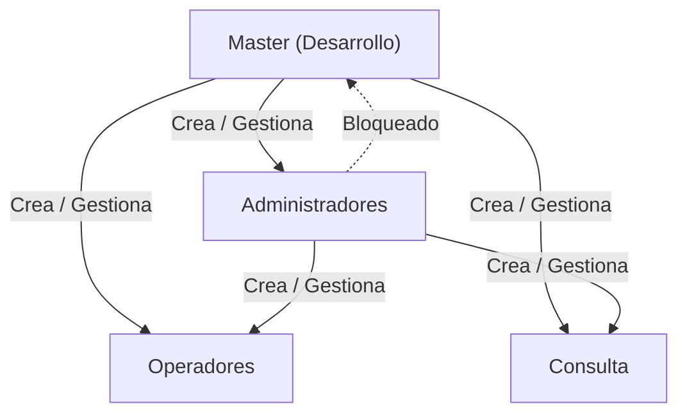
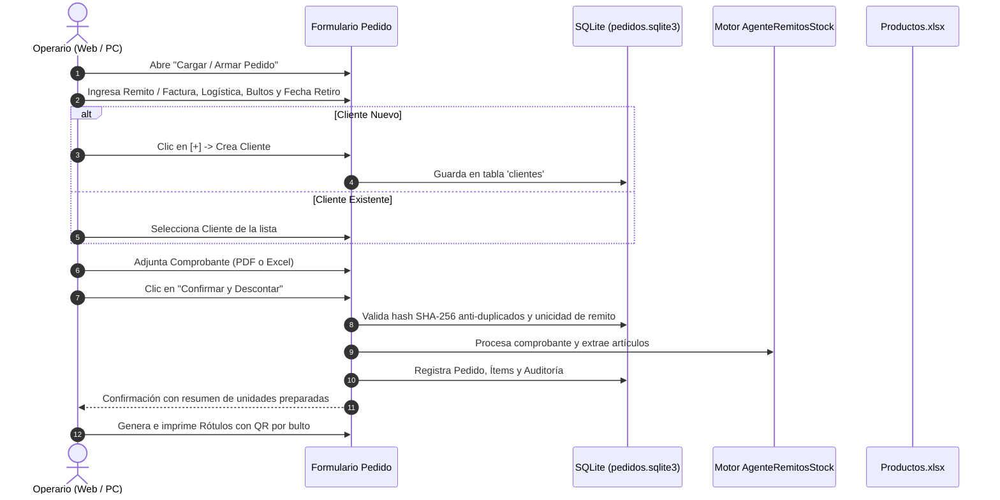

# StockAgent · Manual de Operación y Guía de Arquitectura

**StockAgent** es una plataforma integral para el control, auditoría y descuento de inventario en tiempo real a partir de comprobantes PDF (remitos mayoristas), planillas Excel (canjes) y documentos de Mercado Libre. Funciona tanto en modo escritorio nativo como en **Servidor Web Multi-Equipo (LAN)**, permitiendo que múltiples puestos de trabajo operen coordinadamente sobre el mismo stock sin inconsistencias.

---

## Índice

1. [Arquitectura y Modos de Ejecución](#1-arquitectura-y-modos-de-ejecución)
2. [Manual de Usuario por Roles](#2-manual-de-usuario-por-roles)
   - [Rol Master (`Desarrollo`)](#rol-master-desarrollo)
   - [Rol Administrador](#rol-administrador)
   - [Rol Operador](#rol-operador)
   - [Rol Consulta](#rol-consulta)
3. [Nuevo Módulo: Carga y Armado de Pedidos en Tiempo Real](#3-nuevo-módulo-carga-y-armado-de-pedidos-en-tiempo-real)
4. [Control de Concurrencia y Pestañas en Navegador](#4-control-de-concurrencia-y-pestañas-en-navegador)
5. [Manual del Programador y Mantenimiento](#5-manual-del-programador-y-mantenimiento)
   - [Estructura del Proyecto](#estructura-del-proyecto)
   - [Esquema de Bases de Datos SQLite](#esquema-de-bases-de-datos-sqlite)
   - [Compilación del Ejecutable (`.exe`)](#compilación-del-ejecutable-exe)
   - [Despliegue e Implementación en Red Local (Servidor LAN sobre HTTPS)](#despliegue-e-implementación-en-red-local-servidor-lan-sobre-https)
   - [Instalación del Certificado SSL para Eliminar "No es Seguro"](#instalación-del-certificado-ssl-para-eliminar-no-es-seguro)
   - [Batería de Pruebas Unitarias y Aseguramiento de Calidad](#batería-de-pruebas-unitarias-y-aseguramiento-de-calidad)

---

## 1. Arquitectura y Modos de Ejecución

StockAgent opera sobre una arquitectura híbrida de alto rendimiento:

* **Motor Web ASGI / Flet:** Servidor web FastAPI / Starlette en el puerto por defecto `8550`.
* **Identidad Visual Web (Favicon):** La aplicación incluye en `assets/` el isotipo y favicon oficial (`ultratech.png` y `ultratech.ico`), visible en la pestaña del navegador, pantalla de carga y accesos directos PWA.
* **Bases de Datos SQLite (WAL Mode):** Persistencia transaccional concurrente para usuarios, clientes y pedidos en `data/`.
* **Plantilla Excel Maestra:** Archivo `Descuentos/Productos.xlsx` sincronizado atómicamente con los registros SQLite.

### Formas de Inicio

1. **Servidor Web Seguro en Red sobre HTTPS (Activo por defecto — Recomendado para depósito y administración):**
   * Doble clic en `iniciar_servidor_web.bat` o:
     ```powershell
     python main.py --host 0.0.0.0 --port 8550
     ```
   * En la PC principal se accede desde `https://127.0.0.1:8550`.
   * En las terminales secundarias de la red local se accede mediante la IP local cifrada (ej. `https://192.168.1.50:8550`).
   * Si en algún entorno aislado se requiere desactivar HTTPS y correr en HTTP plano:
     ```powershell
     python main.py --http --host 0.0.0.0 --port 8550
     ```
2. **Modo Escritorio Monopuesto:**
   ```powershell
   python main.py --desktop
   ```
3. **Modo Automático por Consola (Headless):**
   ```powershell
   python main.py --auto
   ```

---

## 2. Manual de Usuario por Roles

El acceso está protegido por cuentas locales con contraseñas cifradas en PBKDF2 (SHA-256).



---

### Rol Master (`Desarrollo`)

El usuario **Master** es la máxima autoridad del sistema. Está precargado por defecto en la base de datos para garantizar la instalación y continuidad operativa.

* **Usuario precargado:** `Desarrollo`
* **Contraseña inicial:** `master1713`
* **Atributos y Seguridad:**
  * **Exclusividad Jerárquica:** Es el **único rol facultado para crear, modificar o desactivar cuentas de rol Administrador**.
  * **Visibilidad Total:** Desde la sesión del Master se visualizan **todos los usuarios existentes** en el sistema (Master, Administradores, Operadores y Consulta).
  * **Protección Inviolable:** El usuario Master no puede ser desactivado ni degradado de rol por ningún usuario ni por sí mismo.
  * **Acceso Total:** Tiene habilitadas todas las funciones operativas, analíticas, de auditoría, catálogos, relevamiento físico y estadísticas.

---

### Rol Administrador

Pensado para jefes de depósito, encargados de logística y gerencia. Posee control total sobre la operación del depósito. A continuación se detallan todas sus funcionalidades, explicando **qué hace** cada una y **cómo se hace** paso a paso:

#### 1. Gestión de Usuarios Operativos
* **Qué hace:** Permite crear, modificar contraseñas y activar o desactivar cuentas con roles `Operador` y `Consulta`. Protege la jerarquía del sistema ocultando la cuenta `Master`.
* **Cómo se hace:** 
  1. En la barra superior, hacer clic en el botón de **Gestión de Usuarios** (icono de usuarios).
  2. Para crear una cuenta, completar el nombre de usuario, contraseña y seleccionar el rol (`Operador` o `Consulta`), luego presionar **"Crear Usuario"**.
  3. Para modificar o dar de baja, ubicar al usuario en la tabla y utilizar el botón de cambio de contraseña o el interruptor para activar/desactivar el acceso.

#### 2. Panel de Métricas y Rendimiento (Dashboard en Tiempo Real)
* **Qué hace:** Proporciona visibilidad ejecutiva y en tiempo real del depósito mediante tarjetas KPI (total pedidos, bultos procesados, promedio de bultos/pedido y cierres realizados), porcentajes de distribución de envíos por empresa de transporte, productividad por operario/armador y ranking Top 10 de productos con mayor salida.
* **Cómo se hace:**
  1. Hacer clic en la pestaña o botón **"Métricas y Rendimiento"** (Dashboard).
  2. Los indicadores se calculan automáticamente a partir de los datos consolidados en SQLite.
  3. Presionar **"Actualizar"** para refrescar los datos en cualquier momento de la jornada.

#### 3. Registro de Auditoría y Trazabilidad
* **Qué hace:** Mantiene un registro cronológico e inmutable de todos los eventos relevantes ocurridos en el sistema (cargas de pedidos, cierres de jornada, altas de clientes, anulaciones y respaldos), garantizando transparencia y control de responsabilidades.
* **Cómo se hace:**
  1. Seleccionar la opción **"Registro de Auditoría"** en el menú de navegación.
  2. Utilizar el cuadro de texto de búsqueda rápida para filtrar al instante por usuario, tipo de acción (`CREAR_PEDIDO`, `CIERRE_JORNADA`, `ANULACION_PEDIDO`, etc.) o palabra clave en el detalle.
  3. Los resultados se actualizan en tiempo real conforme se escribe.

#### 4. Historial de Pedidos y Anulación de Pedidos
* **Qué hace:** Permite buscar y supervisar el detalle de todos los pedidos cargados por los armadores (remito, cliente, transporte, bultos, estado). Faculta al Administrador para anular pedidos erróneos, advirtiendo de forma contextual si el pedido estaba pendiente o si ya formó parte de un cierre, y exigiendo un motivo que queda asentado en la auditoría.
* **Cómo se hace:**
  1. Ingresar a la sección **"Historial de Pedidos"**.
  2. Filtrar por cliente, número de remito/factura, fecha (`DD/MM/AAAA`), logística o armador mediante la barra de búsqueda.
  3. Para anular un pedido, presionar el botón rojo **"Anular"** (icono de papelera) en la fila correspondiente.
  4. Leer la advertencia modal, escribir obligatoriamente el **motivo de anulación** y presionar **"Confirmar Anulación"**.

#### 5. Copias de Seguridad (Backup Manual)
* **Qué hace:** Genera un respaldo íntegro comprimido `.zip` en la carpeta `data/backups/`, resguardando la base de datos SQLite (`pedidos_internos.db`), usuarios, notificaciones y el catálogo maestro `Productos.xlsx`. Mantiene automáticamente una rotación de las últimas 30 copias.
* **Cómo se hace:**
  1. Presionar el botón **"Copia de Seguridad"** en la barra superior de herramientas (o escribir `/backup` en el Asistente Virtual).
  2. El sistema notificará la generación exitosa del respaldo indicando el nombre del archivo y la fecha/hora exacta.

#### 6. Gestión de Catálogo de Productos (`Productos.xlsx`)
* **Qué hace:** Administra la base de datos maestra de artículos: altas de nuevos productos, edición de descripciones, códigos, precios y definición de umbrales de **Stock Mínimo** y **Stock Máximo** para alertas tempranas de desabastecimiento.
* **Cómo se hace:**
  1. Dirigirse a la pestaña **"Gestionar Productos"**.
  2. Para modificar un artículo existente, buscarlo en la tabla y presionar el botón de edición. Actualizar los campos deseados (descripción, stock de seguridad, etc.) y presionar **"Guardar"**.
  3. Para dar de alta un producto, presionar **"Nuevo Producto"**, completar la ficha técnica y confirmar. El archivo maestro se actualiza automáticamente preservando una copia previa.

#### 7. Ajuste de Stock y Entrada de Fábrica
* **Qué hace:** Procesa remitos o planillas de recepción de mercadería provenientes de fábrica (`.xlsx`, `.xls` o `.pdf`) sumando las cantidades al inventario disponible, o permite realizar ajustes manuales por mermas, roturas o sobrantes.
* **Cómo se hace:**
  1. Acceder a **"Ajustar Stock / Entrada Fábrica"**.
  2. Si se tiene el comprobante digital, presionar **"Seleccionar Archivo"** para que el sistema extraiga automáticamente códigos y cantidades.
  3. Si se realiza un ajuste manual, indicar el código del artículo y la cantidad (+ para ingreso, - para egreso).
  4. Revisar la previsualización del impacto y presionar **"Confirmar Entrada / Ajuste"**.

#### 8. Descuento Mercado Libre Full y Mercado Libre (DOCX)
* **Qué hace:** Procesa masivamente lotes de remitos o etiquetas de Mercado Libre (formato Full o documentos `.docx`), emparejando descripciones con los códigos del catálogo y descontando las unidades del stock general con validación antiduplicados (SHA-256).
* **Cómo se hace:**
  1. Ingresar a **"Descontar Mercado Libre Full"** o **"Descontar Mercado Libre (DOCX)"**.
  2. Hacer clic en **"Seleccionar Archivo(s)"** y elegir los comprobantes a procesar.
  3. Revisar el reporte previo en pantalla: el sistema marcará en verde las coincidencias exactas y alertará si hay artículos sin stock suficiente o descripciones no identificadas.
  4. Hacer clic en **"Confirmar Descuento"** para aplicar la rebaja en el catálogo y generar el comprobante PDF.

#### 9. Comparativa de Stock Físico
* **Qué hace:** Contrasta una planilla de recuento físico realizada en las estanterías del depósito contra las existencias registradas en el sistema, clasificando cada producto como `COINCIDE`, `FALTANTE` o `SOBRANTE`.
* **Cómo se hace:**
  1. Abrir la herramienta **"Comparativa de Stock Físico"**.
  2. Subir el archivo Excel con el conteo (`Código` y `Cantidad contada`) mediante el botón de carga.
  3. Presionar **"Comparar Inventario"**.
  4. Inspeccionar la tabla comparativa con las diferencias cuantitativas y exportar el reporte a Excel o PDF para toma de decisiones.

#### 10. Generar Pedido a Fábrica (Excel de Reposición)
* **Qué hace:** Analiza los artículos cuyo stock actual está por debajo del stock mínimo configurado y genera una planilla formal de pedido a proveedores calculando la cantidad sugerida para alcanzar el nivel óptimo.
* **Cómo se hace:**
  1. Entrar en la sección de reposición (o invocar el comando `/reposicion` en el chat).
  2. El sistema listará todos los productos en quiebre o estado crítico con las cantidades sugeridas.
  3. Revisar y ajustar las cantidades deseadas en la tabla si fuera necesario.
  4. Presionar **"Generar Pedido a Fábrica"** para exportar la planilla Excel oficial de compra.

#### 11. Estadísticas de Salida y Rotación
* **Qué hace:** Procesa el histórico de movimientos para entregar curvas de rotación ABC, promedios de consumo diario/semanal y detección de artículos de baja demanda (huesos) o alta demanda.
* **Cómo se hace:**
  1. Navegar a **"Estadísticas y Rotación"**.
  2. Definir el período de análisis (últimos 7 días, mes actual, rango personalizado).
  3. Presionar **"Calcular Estadísticas"** para visualizar los gráficos y tablas de rotación.

#### 12. Restauración de Documentos (Rollback de Lotes)
* **Qué hace:** Permite deshacer un lote de descuento completo o una carga masiva previa, recalculando el stock y regresando el catálogo `Productos.xlsx` al estado exacto anterior a dicha operación sin pérdida de datos.
* **Cómo se hace:**
  1. Ingresar a **"Restaurar Documentos"**.
  2. Identificar el lote en la lista histórica por número de operación, fecha y comprobante.
  3. Presionar **"Previsualizar Rollback"** para constatar los productos y unidades que se reincorporarán al inventario.
  4. Confirmar la operación presionando **"Restaurar Catálogo"**.

#### 13. Informes Rápidos (Apertura, Correo con Adjuntos y WhatsApp Web)
* **Qué hace:** Permite seleccionar, inspeccionar y enviar los reportes oficiales generados (PDF de cierre, planillas Excel, hojas de ruta de choferes o pedidos a fábrica) por correo electrónico con los **archivos físicamente adjuntos** (vía Simple MAPI o envío directo SMTP) o compartirlos por WhatsApp Web.
* **Cómo se hace:**
  1. En el menú lateral o tras finalizar un cierre/pedido, hacer clic en **"Compartir por correo"**.
  2. En el cuadro de diálogo desplegado:
     * **Ver archivos adjuntos:** Inspeccionar la lista de archivos que acompañarán el correo con su tamaño y botón para removerlos (`[X]`).
     * **Seleccionar de informes recientes:** Elegir cualquier otro informe generado del menú desplegable y presionar **"Adjuntar"**.
     * **Examinar en PC:** Presionar **"Examinar en mi PC..."** para adjuntar cualquier archivo adicional desde el disco local.
     * **Datos del mensaje:** Confirmar o modificar los destinatarios, el asunto y las notas del mensaje.
     * **Configurar SMTP (opcional):** Hacer clic en el icono de engranaje para configurar credenciales SMTP (Gmail, Outlook 365, etc.) y enviar correos directamente sin necesidad de cliente de escritorio.
  3. Presionar **"Enviar Correo"**. El sistema adjuntará los archivos y despachará el mensaje.
  4. Para compartir por WhatsApp, presionar **"WhatsApp Web"** (abre el navegador con el mensaje de resumen listo y el archivo seleccionado en el Explorador).

#### 14. Asistente Virtual Inteligente y Chat de Comunicación Interna
* **Qué hace:** Provee una ventana flotante de doble propósito: un asistente virtual interactivo para consultas y diagnósticos rápidos de inventario, y un **canal de comunicación interna (Chat de Equipo)** que permite a operarios, administradores y encargados enviarse mensajes en tiempo real (tanto al canal general como mensajes privados directos entre usuarios), persistidos en SQLite y sincronizados entre todas las sesiones abiertas.
* **Cómo se hace:**
  1. Hacer clic en el botón flotante **"Asistente"** en la esquina inferior derecha (el botón muestra un indicador numérico en rojo cuando existen mensajes de equipo no leídos).
  2. En el encabezado de la ventana flotante, alternar entre sus dos modos:
     * **🤖 Asistente Bot:** Permite consultar stock, pedir diagnósticos y consultar auditorías mediante comandos rápidos (`/stock`, `/criticos`, `/reposicion`, `/metricas`, `/auditoria`, `/backup`, `/diagnostico`, `/simular`).
     * **💬 Chat Equipo:** Muestra el historial de mensajes de los miembros del equipo en tiempo real.
  3. Para enviar mensajes entre usuarios:
     * En la pestaña **Chat Equipo**, elegir el destinatario en el menú desplegable (`📢 Todos (Canal General)` o un usuario específico `@operario`), redactar el mensaje y presionar **Enter** o el botón de enviar.
     * O desde la pestaña del **Bot**, escribir directamente: `/msg @usuario tu mensaje aquí` o `/msg aviso para todos` y el asistente registrará y enviará el mensaje inmediatamente.

#### 15. Supervisión y Reimpresión de Rótulos de Bulto con Código QR
* **Qué hace:** Permite supervisar y reimprimir en cualquier momento las etiquetas normalizadas de despacho (10x15 cm) generadas para cada bulto de cualquier pedido del depósito (`Bulto 1 de N`), incluyendo su código QR para trazabilidad en expedición.
* **Cómo se hace:**
  1. Ir a **"Historial de Pedidos"** y localizar el pedido deseado.
  2. Presionar el botón **"Imprimir Rótulos"** en la fila del pedido.
  3. El sistema generará y abrirá inmediatamente el documento PDF con todas las etiquetas listas para ser enviadas a la impresora térmica o estándar.

---

### Rol Operador

Diseñado para el personal de preparación de pedidos, empaquetado y despacho en el depósito. Su interfaz está optimizada para la agilidad operativa:

* **Carga y Armado de Pedidos en Tiempo Real:**
  * Formulario rápido para procesar comprobantes individuales (PDF de remito o Excel de canje).
  * Validación de unicidad de **Remito / Factura** y selector con alta rápida de cliente (`[+]`).
  * Asignación de cantidad de bultos, logística estandarizada y fecha de retiro programada (con calendario).
  * **Protección Antiduplicados (SHA-256):** Bloquea automáticamente la carga si el archivo binario ya fue procesado con anterioridad.
* **Generación de Rótulos de Bulto con Código QR:**
  * Botón directo en cada pedido para imprimir etiquetas de despacho en formato estándar (10x15 cm).
  * Genera una etiqueta por cada bulto (`Bulto 1 de N`, `Bulto 2 de N`) con datos del remito, cliente, transporte, armador y código QR escaneable por celular o lector.
* **Descuento Mercado Libre (DOCX):**
  * Carga y descuento de remitos de Mercado Libre en formato `.docx`, con previsualización del impacto y protección contra archivos duplicados.
* **Historial de Pedidos:**
  * Buscador en tiempo real por cliente, remito/factura, fecha (`DD/MM/AAAA`), logística o armador.
  * Visualización de estados, bultos y acceso directo a reimprimir rótulos de bulto.
* **Imprimir Descuento:**
  * Acceso directo al último comprobante PDF generado y lista de pedidos descontados con botón de impresión individual y etiquetas.
* **Cierre de Jornada Consolidado:**
  * Agrupa todos los pedidos armados pendientes.
  * Descuenta de forma atómica y definitiva las unidades en el archivo maestro `Productos.xlsx`.
  * Genera el **Informe Oficial de Cierre (PDF y Excel)**.
  * Genera la **Hoja de Ruta de Despacho por Transporte (PDF)** con casilleros de firma para los choferes y transportistas.
  * Dispara la **Copia de Seguridad Automática** en `data/backups/`.
  * Detecta y alerta sobre productos en **quiebre ($\le 0$)** o **stock crítico ($1$ a $5$ un.)**.
  * Prepara el borrador de correo electrónico automático para notificar a la administración.
* **Asistente Virtual y Chat de Comunicación de Equipo:**
  * Botones rápidos y comandos contextuales: `/stock <código>`, `/pedidos`, `/cierre`, `/mercadolibre`, `/ayuda`.
  * Canal de comunicación interno directo con compañeros y administración (`/equipo` y `/msg @usuario`). Permite enviar avisos operativos (faltantes de bultos, mercadería recibida o prioridades de despacho) con avisos de mensajes no leídos.

---

### Rol Consulta

Perfil restringido de solo lectura para auditoría externa, vendedores o supervisores:

* **Consulta de Stock en Tiempo Real:** Búsqueda ágil de existencias, código, descripción y ubicación de cualquier artículo.
* **Monitoreo de Catálogo:** Visualización de productos activos sin permisos de edición ni modificación.
* **Historial e Informes:** Lectura de comprobantes generados previamente.
* **Asistente Virtual Restringido:** Comandos permitidos: `/stock`, `/criticos`, `/informes`, `/ayuda`.
* **Restricción Total:** Bloqueado para cargar pedidos, anular, descontar stock, alterar usuarios o ejecutar cierres.

---

## 3. Nuevo Módulo: Carga y Armado de Pedidos en Tiempo Real

Este módulo elimina la necesidad de transferir archivos manualmente entre carpetas compartidas de red, permitiendo que cualquier operario conectado al sistema web procese un comprobante de inmediato.



### Campos del Formulario

1. **Remito / Factura:** Identificador único del comprobante. Si se intenta ingresar un remito ya registrado, el sistema lo rechaza para evitar duplicaciones.
2. **Cliente (Selector + Alta Rápida `[+]`):**
   * Desplegable con todos los clientes registrados.
   * Si es un cliente nuevo, se pulsa el botón `+`, se escribe el nombre y se guarda en el acto, quedando seleccionado de inmediato.
3. **Bultos:** Cantidad de bultos empaquetados (numérico, mínimo 1).
4. **Logística (Selector Estandarizado Enum):**
   * `Domicilio`
   * `Centro de distribución`
   * `Transporte`
   * `Comisionista`
   * `Mabel`
5. **Fecha de Retiro / Despacho (Opcional):** Permite programar la fecha de retiro mediante un calendario interactivo.
6. **Armador:** Campo automático y bloqueado que toma el nombre de usuario de la sesión activa (ej. `Operario`, `Desarrollo`).
7. **Adjuntar Comprobante (con Anti-duplicados SHA-256):** Permite seleccionar archivos `.pdf` (pedidos mayoristas) o `.xlsx`/`.xls` (canjes), verificando que el archivo no haya sido procesado previamente.

Al confirmar, el pedido se registra con sus ítems en la base de datos central, queda disponible en el **Historial de Pedidos**, permite imprimir sus **Rótulos con QR** por bulto y se acumula automáticamente para el impacto consolidado en `Productos.xlsx` al realizar el **Cierre de Jornada**.

---

## 4. Control de Concurrencia y Pestañas en Navegador

Para garantizar la integridad transaccional del inventario en entornos multi-usuario web:

* **Libre navegación en múltiples pestañas:** Los usuarios pueden tener abiertas varias pestañas para consultar stock, revisar el catálogo o ver el historial de forma simultánea.
* **Bloqueo atómico al procesar (Opción D):** Cuando una pestaña dispara un descuento o procesamiento, el sistema activa un bloqueo global (`PROCESAMIENTO_GLOBAL_ACTIVO`). Si otra pestaña o terminal intenta procesar en ese mismo instante, se le notifica amablemente:
  > *"Hay una operación de procesamiento de stock en curso desde otra sesión o pestaña. Por seguridad en los archivos, espera a que finalice."*
  >
* **Single Instance en Servidor:** Al iniciar el servidor web, si ya hay una instancia escuchando en el puerto, no abre pestañas duplicadas innecesarias.

---

## 5. Manual del Programador y Mantenimiento

### Estructura del Proyecto

```text
StockAgent/
├── assets/                       # Assets web (Favicons, logos, manifest PWA)
│   ├── favicon.ico
│   ├── favicon.png
│   ├── manifest.json
│   └── icons/                    # Iconos en múltiples resoluciones y loading
├── data/                         # Bases de datos SQLite y comprobantes
│   ├── usuarios.sqlite3          # Cuentas, roles y contraseñas
│   ├── pedidos.sqlite3           # Clientes, pedidos y auditoría en tiempo real
│   ├── productos.sqlite3         # Catálogo sincronizado
│   ├── pedidos_archivos/         # Backups de comprobantes procesados
│   └── backups/                  # Copias de seguridad automáticas y manuales (.zip)
├── Descuentos/                   # Plantillas y lotes tradicionales
│   ├── Productos.xlsx            # Planilla maestra de inventario
│   ├── Mayoristas/
│   ├── Canjes/
│   └── MercadoLibre/
├── src/                          # Código fuente modular
│   ├── agent.py                  # Orquestador del Agente de Stock
│   ├── flet_gui.py               # Interfaz gráfica Flet y endpoints web
│   ├── orders_store.py           # DAO SQLite para pedidos, clientes y auditoría
│   ├── user_store.py             # DAO SQLite para usuarios y seguridad
│   ├── stock_manager.py          # Gestor de stock y manipulación Excel
│   ├── remito_parser.py          # Parser de remitos PDF
│   ├── canjes_parser.py          # Parser de canjes Excel
│   ├── mercado_libre_parser.py   # Parser de pedidos DOCX
│   ├── dispatch_manifest.py      # Generador de Hoja de Ruta por Transporte (PDF)
│   ├── label_generator.py        # Generador de Rótulos de Bultos con QR (PDF)
│   ├── backup_manager.py         # Motor de respaldos comprimidos, carpeta secundaria y restauración verificada
│   ├── email_sender.py           # Envío directo SMTP con adjuntos y credenciales cifradas
│   ├── secretos.py               # Cifrado local de credenciales (Windows DPAPI / Fernet)
│   ├── alertas_programadas.py    # Planificador en segundo plano de alertas diarias por correo
│   ├── ssl_manager.py            # Generador automático de certificados X.509 autofirmados para HTTPS
│   ├── logger_config.py          # Configuración de logs rotativos en data/logs/stockagent.log
│   └── internal_chat.py          # Bot y Asistente Virtual con chips por rol
├── crear_exe.bat                 # Script de compilación a .exe independiente
├── iniciar_servidor_web.bat      # Lanzador del servidor web en LAN
├── configurar_firewall_red.bat   # Apertura de puerto 8550 en Firewall de Windows
├── main.py                       # Punto de entrada de la aplicación (--https, --port, --host, --desktop)
├── StockAgent.spec               # Especificación PyInstaller
└── requirements.txt              # Dependencias de Python
```

### Esquema de Bases de Datos SQLite

#### `data/usuarios.sqlite3`

```sql
CREATE TABLE users (
    id INTEGER PRIMARY KEY,
    username TEXT NOT NULL COLLATE NOCASE UNIQUE,
    password_hash TEXT NOT NULL,
    role TEXT NOT NULL CHECK (role IN ('master', 'administrador', 'operador', 'consulta')),
    active INTEGER NOT NULL DEFAULT 1 CHECK (active IN (0, 1)),
    must_change_password INTEGER NOT NULL DEFAULT 0 CHECK (must_change_password IN (0, 1)),
    created_at TEXT NOT NULL DEFAULT CURRENT_TIMESTAMP
);

CREATE TABLE login_attempts (
    username TEXT PRIMARY KEY COLLATE NOCASE,
    failed_count INTEGER NOT NULL DEFAULT 0,
    locked_until TEXT DEFAULT NULL,
    last_attempt_at TEXT NOT NULL DEFAULT CURRENT_TIMESTAMP
);
```

#### `data/pedidos.sqlite3`

```sql
CREATE TABLE clientes (
    id INTEGER PRIMARY KEY AUTOINCREMENT,
    nombre TEXT NOT NULL COLLATE NOCASE UNIQUE,
    activo INTEGER NOT NULL DEFAULT 1 CHECK (activo IN (0, 1)),
    created_at TEXT NOT NULL DEFAULT CURRENT_TIMESTAMP
);

CREATE TABLE pedidos (
    id INTEGER PRIMARY KEY AUTOINCREMENT,
    nota_pedido TEXT NOT NULL COLLATE NOCASE UNIQUE,
    numero_pedido TEXT NOT NULL DEFAULT '',
    cliente TEXT NOT NULL,
    bultos INTEGER NOT NULL DEFAULT 1 CHECK (bultos >= 1),
    logistica TEXT NOT NULL CHECK (
        logistica IN ('Domicilio', 'Centro de distribución', 'Transporte', 'Comisionista', 'Mabel')
    ),
    armador TEXT NOT NULL,
    tipo_archivo TEXT NOT NULL CHECK (tipo_archivo IN ('pdf', 'excel', 'docx')),
    nombre_archivo TEXT NOT NULL,
    agregado INTEGER NOT NULL DEFAULT 0 CHECK (agregado IN (0, 1)),
    articulos_descontados INTEGER NOT NULL DEFAULT 0,
    resumen_items TEXT,
    created_at TEXT NOT NULL DEFAULT CURRENT_TIMESTAMP,
    estado TEXT NOT NULL DEFAULT 'descontado' CHECK (estado IN ('descontado', 'anulado')),
    fecha_retiro TEXT NOT NULL DEFAULT '',
    archivo_descuento TEXT NOT NULL DEFAULT '',
    cierre_id INTEGER DEFAULT NULL REFERENCES cierres_jornada(id),
    archivo_hash TEXT NOT NULL DEFAULT '',
    estado_despacho TEXT NOT NULL DEFAULT 'armado' CHECK (estado_despacho IN ('armado', 'despachado', 'entregado')),
    despachado_at TEXT NOT NULL DEFAULT '',
    despachado_por TEXT NOT NULL DEFAULT '',
    entregado_at TEXT NOT NULL DEFAULT '',
    entregado_por TEXT NOT NULL DEFAULT ''
);

CREATE TABLE cierres_jornada (
    id INTEGER PRIMARY KEY AUTOINCREMENT,
    usuario TEXT NOT NULL,
    cantidad_pedidos INTEGER NOT NULL,
    articulos_totales INTEGER NOT NULL,
    resumen_pedidos TEXT NOT NULL,
    archivo_pdf TEXT NOT NULL DEFAULT '',
    archivo_excel TEXT NOT NULL DEFAULT '',
    archivo_hoja_ruta TEXT NOT NULL DEFAULT '',
    created_at TEXT NOT NULL DEFAULT CURRENT_TIMESTAMP
);

CREATE TABLE pedido_items (
    id INTEGER PRIMARY KEY AUTOINCREMENT,
    pedido_id INTEGER NOT NULL REFERENCES pedidos(id) ON DELETE CASCADE,
    codigo TEXT NOT NULL,
    descripcion TEXT NOT NULL,
    cantidad INTEGER NOT NULL
);

CREATE TABLE logs_auditoria (
    id INTEGER PRIMARY KEY AUTOINCREMENT,
    usuario TEXT NOT NULL,
    accion TEXT NOT NULL,
    detalle TEXT NOT NULL,
    created_at TEXT NOT NULL DEFAULT CURRENT_TIMESTAMP
);
CREATE INDEX idx_logs_created_at ON logs_auditoria(created_at DESC);
CREATE INDEX idx_logs_usuario ON logs_auditoria(usuario);

CREATE TABLE mensajes_chat (
    id INTEGER PRIMARY KEY AUTOINCREMENT,
    emisor TEXT NOT NULL,
    destinatario TEXT NOT NULL DEFAULT 'Todos',
    mensaje TEXT NOT NULL,
    leido INTEGER NOT NULL DEFAULT 0,
    created_at TEXT NOT NULL DEFAULT CURRENT_TIMESTAMP
);
```

### Características Operativas Avanzadas y Mejoras Integradas

1. **Protección de Credenciales y Cambio Obligatorio de Clave Inicial (`src/secretos.py`, `src/user_store.py`):**
   - La contraseña o token de aplicación SMTP en `data/email_config.json` se cifra automáticamente en reposo mediante **Windows DPAPI (`CryptProtectData`)** o clave simétrica Fernet local (prefijo `enc:`), y también soporta la variable de entorno `STOCKAGENT_SMTP_PASSWORD`.
   - La cuenta `Desarrollo` (rol `master`) exige obligatoriamente cambiar la contraseña por defecto en su primer inicio de sesión (`must_change_password`), y todos los usuarios cuentan con el botón **"Cambiar mi contraseña"** en el encabezado.
2. **Control de Acceso, Bloqueo por Intentos Fallidos e Inactividad:**
   - Bloqueo temporal automático de cuenta por **15 minutos** tras **5 intentos fallidos consecutivos** de inicio de sesión (`login_attempts`).
   - En **Gestionar usuarios**, los administradores pueden **Desbloquear cuentas** al instante y **Restablecer contraseñas** (con opción de exigir cambio en el próximo ingreso).
   - Cierre automático de sesión tras **30 minutos de inactividad** (`LOGOUT_INACTIVIDAD`), registrando en auditoría todos los eventos `LOGIN_EXITOSO`, `LOGIN_FALLIDO`, `CUENTA_BLOQUEADA`, `LOGOUT`, `CAMBIO_CLAVE` y `RESET_CLAVE`.
3. **Servidor Web Seguro sobre HTTPS Activo por Defecto (`src/ssl_manager.py`):**
   - El servidor web inicia **por defecto en modo HTTPS** (`https://127.0.0.1:8550` y `https://<IP_LAN>:8550`). Si se desea forzar HTTP sin cifrado, puede usarse `--http` o `STOCKAGENT_HTTPS=0`.
   - Si no se especifican certificados propios (`--ssl-cert` y `--ssl-key`), genera automáticamente en el primer arranque un certificado X.509 autofirmado (válido por 10 años con SAN para `localhost`, nombre de host, `127.0.0.1` y la IP LAN detectada) en `data/certs/stockagent.crt` y `data/certs/stockagent.key`.
4. **Trazabilidad Completa de Movimientos de Stock en SQLite (`src/product_store.py`):**
   - Cada variación de stock registra en `stock_movements` el código, producto, diferencia (`+` / `-`), tipo de movimiento, **usuario responsable** y **detalle/origen**.
   - Desde **Gestionar productos**, el botón **"Historial movimientos"** (o el ícono de reloj en cada artículo) abre el visor interactivo de movimientos filtrable por producto y tipo.
5. **Estados de Despacho (`armado` → `despachado` → `entregado`) con Escáner QR:**
   - Cada pedido muestra su insignia de estado logístico (`📦 ARMADO`, `🚚 DESPACHADO`, `✔ ENTREGADO`) en el **Historial de Pedidos** y permite avanzar de estado con un clic.
   - Incluye el modal **"Escanear QR / Cambiar Estado"**, donde al escanear con lector USB/cámara la etiqueta QR del bulto (`REMITO:...|CLIENTE:...`) o ingresar el número de remito, el pedido avanza automáticamente al siguiente estado y registra quién y cuándo lo despachó o entregó.
6. **Chat de Equipo en Tiempo Real + Vínculos Automáticos a Pedidos (`#remito`):**
   - Notificación instantánea emergente (*Toast / SnackBar*) en las sesiones activas de los destinatarios apenas se envía un mensaje en el **Chat Equipo**.
   - Al escribir `#<numero_remito>` en cualquier mensaje (ej. `#0001-00012345`), el sistema busca el pedido en SQLite y adjunta automáticamente su tarjeta de resumen (cliente, bultos, logística y estado de despacho).
7. **Alertas Automáticas Programadas por Correo (`src/alertas_programadas.py`):**
   - Hilo planificador en segundo plano que envía diariamente a la hora configurada un reporte consolidado de **productos en quiebre / stock crítico** y el **resumen de pedidos y cierres del día**.
   - Configurable desde **Configuración SMTP** (activar/desactivar, hora `HH:MM`, destinatarios y botón *"Enviar resumen de prueba ahora"*).
8. **Copias de Seguridad Integrales y Restauración Verificada (`src/backup_manager.py`):**
   - Respalda de forma transaccional las **3 bases SQLite** (`pedidos.sqlite3`, `productos.sqlite3`, `usuarios.sqlite3`), configuraciones y `Productos.xlsx`.
   - Permite configurar una **carpeta secundaria/externa** (ej. unidad de red o disco externo) para duplicar cada backup automáticamente.
   - Incluye **Restaurar Backup (`.ZIP`)** desde la interfaz, verificando previamente `PRAGMA integrity_check` en todas las bases SQLite antes de aplicar la restauración.
9. **Dashboard Mejorado con Filtro por Fechas, Estados y Exportación a Excel:**
   - Filtro por rango de fechas (`Desde` / `Hasta`), indicadores de pedidos `Armados`, `Despachados` y `Entregados`, gráfico de barras de evolución diaria de pedidos/bultos y botón **"Exportar Excel"** para descargar el reporte ejecutivo completo.
10. **Logs Persistentes con Rotación Automática (`src/logger_config.py`):**
    - Todos los eventos operativos, advertencias y errores se registran en `data/logs/stockagent.log` mediante `RotatingFileHandler` (hasta 2 MB por archivo y 5 copias históricas).

### Compilación del Ejecutable (`.exe`)

Para empaquetar la aplicación en un `.exe` independiente para Windows:

1. Asegúrate de tener instalado el entorno virtual con las dependencias:
   ```powershell
   python -m pip install -r requirements.txt
   python -m pip install -r requirements-build.txt
   ```
2. Ejecuta el script de compilación:
   ```powershell
   .\crear_exe.bat
   ```
3. El resultado se generará en `dist\StockAgent.exe`, acompañado automáticamente de `Descuentos\Productos.xlsx`, la carpeta `assets\` y los scripts de red.

### Despliegue e Implementación en Red Local (Servidor LAN sobre HTTPS)

#### Paso 1: Instalar o actualizar dependencias (si se ejecuta desde código fuente)
```powershell
.\ttech\Scripts\python.exe -m pip install -r requirements.txt
```
*(Si utilizas el ejecutable compilado `StockAgent.exe`, vuelve a ejecutar `.\crear_exe.bat` para empaquetar los nuevos módulos y el soporte criptográfico).*

#### Paso 2: Habilitar el puerto en el Firewall de Windows (en la PC Servidor)
1. En la máquina principal (servidor), ejecuta por única vez como **Administrador**:
   ```powershell
   .\configurar_firewall_red.bat
   ```
   Esto habilita el tráfico entrante TCP en el puerto `8550`.

#### Paso 3: Iniciar el Servidor HTTPS
1. Ejecuta `iniciar_servidor_web.bat` (o `python main.py`).
2. Al iniciar por primera vez, el sistema creará automáticamente la carpeta `data/certs/` con:
   - `data/certs/stockagent.crt` (Certificado público X.509 autofirmado con las IPs de la PC)
   - `data/certs/stockagent.key` (Clave privada RSA 2048 bits)
3. La consola mostrará las direcciones seguras listas para usar:
   - En la misma PC servidor: `https://127.0.0.1:8550`
   - Desde otras PCs, notebooks, tablets o celulares en la red WiFi/LAN: `https://192.168.X.X:8550`

#### Paso 4: Primer ingreso desde los navegadores (Certificado Autofirmado)
Dado que el certificado es generado localmente por la propia empresa (sin depender de un dominio público en internet), la primera vez que ingreses desde un navegador verás el aviso estándar *"La conexión no es privada"* (`NET::ERR_CERT_AUTHORITY_INVALID`):
- **Acceso Rápido (Bypass temporal en Chrome / Edge / Brave / Opera):**
  1. Haz clic en **"Configuración avanzada"** (o *"Advanced"*).
  2. Haz clic en el enlace inferior **"Continuar a 127.0.0.1 (no seguro)"** o **"Continuar a 192.168.X.X (no seguro)"**.
  3. El navegador recordará la excepción y toda la sesión viajará cifrada de forma segura con TLS/HTTPS.
- **Solución Definitiva (Candado seguro sin advertencias):** Ver la sección siguiente [Instalación del Certificado SSL para Eliminar "No es Seguro"](#instalación-del-certificado-ssl-para-eliminar-no-es-seguro).

#### Paso 5: Primer inicio de sesión y configuración de seguridad
1. Ingresa con el usuario Master precargado (`Desarrollo` / `master1713`).
2. El sistema te solicitará por única vez **definir tu nueva contraseña segura** (mínimo 6 caracteres) debido a la política de cambio obligatorio de clave inicial.
3. *(Opcional)* Desde **Compartir por correo → Configurar SMTP (⚙️)**, guarda la contraseña de aplicación SMTP (quedará cifrada en disco con prefijo `enc:`) y activa las **Alertas Automáticas Diarias**.
4. *(Opcional)* Desde **Copia de Seguridad**, configura una carpeta secundaria externa o de red y genera tu primer respaldo `.zip`.

---

### Instalación del Certificado SSL para Eliminar "No es Seguro"

Para que Google Chrome, Microsoft Edge y Mozilla Firefox muestren el **candado de seguridad verde/activo** sin mostrar la pantalla de *"La conexión no es privada"*:

#### En Windows (Google Chrome, Microsoft Edge, Brave)
1. Localiza el certificado público generado en la máquina servidor:
   ```text
   data\certs\stockagent.crt
   ```
   *(Si vas a configurar una 2da PC cliente, copia este archivo `stockagent.crt` a dicha máquina por red o pendrive).*
2. Haz **doble clic** sobre `stockagent.crt`.
3. Presiona el botón **"Instalar certificado..."**.
4. En el asistente de importación:
   - Selecciona **"Equipo local"** (o *Usuario actual* si no tienes permisos de administrador).
   - Presiona **Siguiente**.
   - Marca la casilla **"Colocar todos los certificados en el siguiente almacén"**.
   - Haz clic en **Examinar...** y selecciona:
     - **"Entidades de certificación raíz de confianza"** (*Trusted Root Certification Authorities*).
   - Haz clic en **Aceptar** y luego en **Siguiente**.
5. Presiona **Finalizar**. Si Windows solicita confirmación de seguridad para confiar en la raíz, pulsa **"Sí"**.
6. **Cierra todas las ventanas de Chrome / Edge** y vuelve a abrirlo navegando a `https://127.0.0.1:8550` (o la IP local `https://192.168.X.X:8550`). El sitio cargará de inmediato con el **candado seguro**.

#### En Mozilla Firefox
Firefox posee su propio almacén de certificados independiente del sistema operativo:
1. En Firefox, ingresa a **Ajustes** (Configuración) → **Privacidad y seguridad**.
2. Desplázate hacia abajo hasta la sección **Seguridad / Certificados** y haz clic en **"Ver certificados..."**.
3. En la pestaña **Autoridades**, haz clic en **"Importar..."**.
4. Selecciona el archivo `data\certs\stockagent.crt`.
5. Marca la casilla **"Confiar en esta CA para identificar sitios web"** y confirma con **Aceptar**.

---

### Batería de Pruebas Unitarias y Aseguramiento de Calidad

El proyecto cuenta con una cobertura integral de pruebas unitarias automatizadas que validan la persistencia transaccional, el cifrado, el control de concurrencia y los flujos logísticos:

* **Total de pruebas:** 98 pruebas unitarias automatizadas distribuidas en 13 módulos.
* **Tasa de éxito:** 100% aprobadas (`Ran 98 tests in 16.89s - OK`).

#### Módulos de Prueba
1. `tests/test_nuevas_funcionalidades.py`:
   - Cifrado DPAPI / Fernet de credenciales sensibles.
   - Bloqueo preventivo tras 5 intentos fallidos y reseteo administrativo de clave.
   - Generación de certificados SSL autofirmados con SAN multipropósito.
   - Auditoría de movimientos de stock con usuario, origen y detalle.
   - Máquina de estados de despacho (`armado` → `despachado` → `entregado`) con escáner QR.
   - Dashboard analítico con filtros por fecha.
   - Respaldos `.zip` íntegros de las 3 bases SQLite, copia secundaria y restauración verificada con `PRAGMA integrity_check`.
   - Hilo planificador de alertas diarias por correo electrónico.
   - Detección de inactividad de sesión (30 min) y enriquecimiento de menciones `#remito` en chat.
2. `tests/test_flet_gui.py`: Permisos por rol, pantalla de login, paneles de administración, chat flotante y endpoints web.
3. `tests/test_internal_chat.py`: Reconocimiento semántico de intenciones del bot y chat entre operarios y administración.
4. `tests/test_product_store.py`: Persistencia en SQLite, movimientos y cálculo de reposición.
5. `tests/test_stock_manager.py`: Descuentos atómicos, exportación de reportes PDF/Excel, stock físico y Mercado Libre Full.
6. `tests/test_user_store.py`: Jerarquía de usuarios, roles protegidos e inviolabilidad del Master.
7. Parsers y Rutas (`test_remito_parser`, `test_mercado_libre_parser`, `test_mercado_full_parser`, `test_factory_parser`, `test_physical_stock_parser`, `test_restoration`, `test_app_paths`).

#### Ejecución de las Pruebas
Para ejecutar la suite completa en cualquier momento desde PowerShell:
```powershell
.\ttech\Scripts\python.exe -m unittest discover -s tests -v
```
