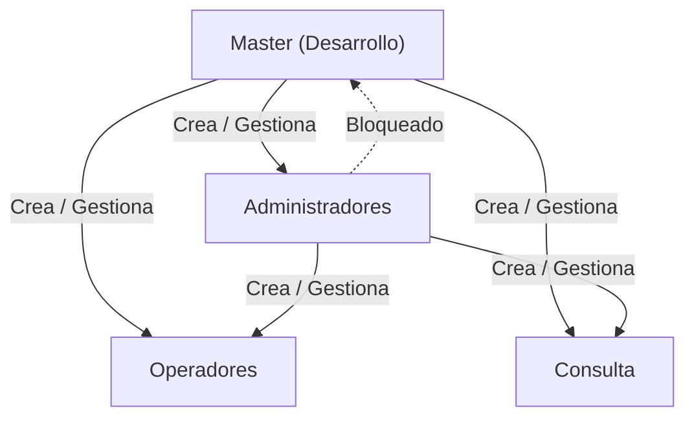
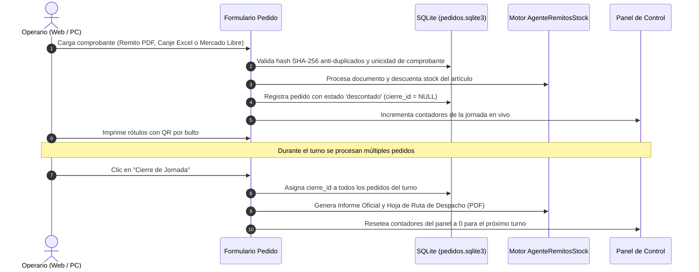

# StockAgent · Manual de Operación y Guía de Arquitectura

**StockAgent** es una plataforma integral para el control, auditoría y descuento de inventario en tiempo real a partir de comprobantes PDF (remitos mayoristas), planillas Excel (canjes) y documentos de Mercado Libre. Funciona tanto en modo escritorio nativo como en **Servidor Web Multi-Equipo (LAN)**, permitiendo que múltiples puestos de trabajo operen coordinadamente sobre el mismo stock sin inconsistencias y sin requerir transferencias manuales en carpetas compartidas.

---

## Índice

1. [Arquitectura y Modos de Ejecución](#1-arquitectura-y-modos-de-ejecución)
   - [Formas de Inicio y Detención](#formas-de-inicio-y-detención)
   - [Icono en la Bandeja del Sistema (System Tray de Windows)](#icono-en-la-bandeja-del-sistema-system-tray-de-windows)
   - [Parámetros de Línea de Comandos y Variables de Entorno](#parámetros-de-línea-de-comandos-y-variables-de-entorno)
   - [Progressive Web App (PWA) e Identidad Visual](#progressive-web-app-pwa-e-identidad-visual)
2. [Manual de Usuario por Roles](#2-manual-de-usuario-por-roles)
   - [Gestión de Perfil de Usuario ("Mi Perfil")](#gestión-de-perfil-de-usuario-mi-perfil)
   - [Autenticación, Seguridad y Bloqueo de Cuentas](#autenticación-seguridad-y-bloqueo-de-cuentas)
   - [Rol Master (`Desarrollo`)](#rol-master-desarrollo)
   - [Rol Administrador](#rol-administrador)
   - [Rol Operador](#rol-operador)
   - [Rol Consulta](#rol-consulta)
3. [Módulo de Carga Directa y Panel de Control de la Jornada](#3-módulo-de-carga-directa-y-panel-de-control-de-la-jornada)
   - [Métricas en Tiempo Real de la Jornada](#métricas-en-tiempo-real-de-la-jornada)
   - [Formulario de Carga y Descuento Individual](#formulario-de-carga-y-descuento-individual)
   - [Ciclo de Cierre de Jornada y Reseteo de Contadores](#ciclo-de-cierre-de-jornada-y-reseteo-de-contadores)
4. [Control de Concurrencia y Navegación Web](#4-control-de-concurrencia-y-navegación-web)
5. [Manual del Programador y Mantenimiento](#5-manual-del-programador-y-mantenimiento)
   - [Estructura del Proyecto](#estructura-del-proyecto)
   - [Esquema de Bases de Datos SQLite](#esquema-de-bases-de-datos-sqlite)
   - [Compilación del Ejecutable (`.exe`)](#compilación-del-ejecutable-exe)
   - [Despliegue e Implementación en Red Local (Servidor LAN sobre HTTPS)](#despliegue-e-implementación-en-red-local-servidor-lan-sobre-https)
   - [Instalación del Certificado SSL para Eliminar "No es Seguro"](#instalación-del-certificado-ssl-para-eliminar-no-es-seguro)
   - [Batería de Pruebas Unitarias y Aseguramiento de Calidad](#batería-de-pruebas-unitarias-y-aseguramiento-de-calidad)

---

## 1. Arquitectura y Modos de Ejecución

StockAgent opera sobre una arquitectura híbrida de alto rendimiento:

* **Motor Web ASGI / Flet:** Servidor web FastAPI / Starlette en el puerto seguro por defecto `8550`.
* **Identidad Visual Web (Favicon y PWA):** La aplicación incluye en `assets/` el isotipo y favicon oficial (`ultratech.png` y `ultratech.ico`), visible en la pestaña del navegador, pantalla de carga y accesos directos instalables PWA.
* **Bases de Datos SQLite (WAL Mode):** Persistencia transaccional concurrente para usuarios, clientes, pedidos y auditoría en `data/`.
* **Plantilla Excel Maestra:** Archivo `Descuentos/Productos.xlsx` sincronizado atómicamente con los registros SQLite.
* **Bandeja del Sistema (System Tray):** Proceso en segundo plano acoplado al área de notificaciones de Windows para control rápido del servidor.

### Formas de Inicio y Detención

1. **Servidor Web Seguro en Red sobre HTTPS (Activo por defecto — Recomendado):**
   * Doble clic en `iniciar_servidor_web.bat` o desde terminal:
     ```powershell
     python main.py --host 0.0.0.0 --port 8550
     ```
   * En la PC principal se abre automáticamente **una única pestaña limpia** en `https://127.0.0.1:8550`.
   * En las terminales secundarias de la red local se accede mediante la IP local cifrada (ej. `https://192.168.1.50:8550`).
   * Si en algún entorno aislado se requiere desactivar HTTPS y correr en HTTP plano:
     ```powershell
     python main.py --http --host 0.0.0.0 --port 8550
     ```

2. **Ejecución Silenciosa en Segundo Plano:**
   * Doble clic en `iniciar_en_segundo_plano.vbs`: arranca el servidor sin abrir ventana de comandos ni consola en pantalla. El control queda disponible en el icono del System Tray.

3. **Inicio Automático con Windows:**
   * `configurar_inicio_automatico.bat`: registra StockAgent para que el servidor inicie automáticamente en segundo plano cada vez que se enciende o reinicia la PC.
   * `desactivar_inicio_automatico.bat`: remueve el inicio automático cuando ya no se requiera.

4. **Detención Rápida del Servidor:**
   * Doble clic en `detener_servidor.bat` para liberar el puerto 8550 y detener de inmediato cualquier instancia activa de StockAgent.
   * O bien, clic derecho en el icono de la bandeja del sistema $\to$ **"Cerrar y detener servidor"**.

5. **Modo Escritorio Monopuesto:**
   ```powershell
   python main.py --desktop
   ```

6. **Modo Automático por Consola (Headless):**
   ```powershell
   python main.py --auto
   ```

7. **Modo Simulación (Dry-Run):**
   ```powershell
   python main.py --dry-run
   ```

---

### Icono en la Bandeja del Sistema (System Tray de Windows)

Al arrancar el servidor web, StockAgent incorpora un controlador de bandeja del sistema (`src/tray_icon.py`) ejecutado mediante un hilo desacoplado con la biblioteca `pystray`:

* **Indicador Visual de Estado en Tiempo Real:**
  * 🟢 **Verde (Online):** Servidor activo y respondiendo peticiones.
  * 🟡 **Amarillo (Iniciando):** Inicializando dependencias, certificados o bases de datos.
  * 🔴 **Rojo (Error / Detenido):** Servidor sin conectividad o detenido.
* **Menú Contextual (Clic Derecho en el Icono):**
  * **🌐 Abrir StockAgent (Web):** Abre o enfoca la interfaz web en el navegador predeterminado (`https://127.0.0.1:8550`).
  * **📋 Copiar enlace de red (LAN):** Copia al portapapeles la dirección IP local lista para compartir con las demás terminales del depósito (`https://192.168.X.X:8550`).
  * **📁 Abrir carpeta del programa:** Abre el explorador de Windows en el directorio raíz de la aplicación.
  * **📄 Ver registro de eventos (Logs):** Abre de forma directa el archivo `data/logs/stockagent.log`.
  * **🛑 Cerrar y detener servidor:** Envía una notificación emergente de Windows, detiene el loop web y finaliza limpiamente el proceso liberando el puerto.
* **Notificaciones Nativas:** Emite notificaciones emergentes (Globos/Toasts de Windows) al iniciar el servidor, al copiar enlaces al portapapeles o al cerrar la aplicación.

---

### Parámetros de Línea de Comandos y Variables de Entorno

StockAgent permite parametrizar su ejecución tanto por flags de consola como mediante variables de entorno del sistema:

| Parámetro CLI | Variable de Entorno | Valor por Defecto | Descripción |
| :--- | :--- | :--- | :--- |
| `--host <IP>` | `STOCKAGENT_HOST` | `0.0.0.0` | Dirección IP de escucha del servidor web. |
| `--port <N>` | `STOCKAGENT_PORT` | `8550` | Puerto TCP de servicio. |
| `--https` | `STOCKAGENT_HTTPS=1` | Activo | Fuerza el protocolo seguro HTTPS/TLS. |
| `--http` | `STOCKAGENT_HTTPS=0` | Desactivado | Desactiva HTTPS y ejecuta en HTTP plano. |
| `--ssl-cert <RUTA>` | `STOCKAGENT_SSL_CERT` | Autogenerado | Ruta personalizada al certificado X.509 (`.crt` / `.pem`). |
| `--ssl-key <RUTA>` | `STOCKAGENT_SSL_KEY` | Autogenerado | Ruta personalizada a la clave privada (`.key` / `.pem`). |
| `--inactividad <MIN>` | `STOCKAGENT_INACTIVIDAD_MINUTOS` | `720` (12 horas) | Minutos de inactividad antes de cerrar sesión (`0` desactiva el cierre automático). |
| `--desktop` | — | Desactivado | Inicia en ventana nativa de escritorio (Flet App). |
| `--hide-console` | `STOCKAGENT_HIDE_CONSOLE=1` | Desactivado | Oculta la consola de Windows al arrancar. |
| `--no-browser` | `STOCKAGENT_NO_BROWSER=1` | Desactivado | Evita abrir automáticamente el navegador al iniciar. |
| `--no-tray` | `STOCKAGENT_NO_TRAY=1` | Desactivado | Desactiva el icono en la bandeja del sistema. |
| `--auto` / `--all` | — | Desactivado | Ejecuta el procesamiento de lotes por consola sin interfaz. |
| `--dry-run` | — | Desactivado | Simula el procesamiento sin modificar archivos ni bases de datos. |

---

### Progressive Web App (PWA) e Identidad Visual

StockAgent está preparado para operar como una **Progressive Web App (PWA)** completa:
* **Instalación con 1 Clic:** Desde Google Chrome, Microsoft Edge o navegadores móviles, se puede presionar el botón "Instalar aplicación" en la barra de direcciones para tener StockAgent como programa de escritorio independiente con su propia ventana.
* **Manifiesto Web (`assets/manifest.json`):** Configurado con el tema corporativo Ultratech (`#D32F2F`), modo de visualización `standalone` y orientación horizontal/vertical adaptativa.
* **Iconografía Multi-Resolución:** Iconos oficiales en 192x192, 512x512 y versiones maskable para Android y Windows en `assets/icons/`.
* **Pantalla de Carga Personalizada (`assets/index.html`):** Animación de carga con isotipo oficial y pre-conexión de tipografías para eliminar destellos en pantalla.

---

## 2. Manual de Usuario por Roles

El acceso está protegido por cuentas locales con contraseñas cifradas en PBKDF2 (SHA-256).



---

### Gestión de Perfil de Usuario ("Mi Perfil")

Todos los usuarios autenticados, sin distinción de su rol, tienen acceso a su ventana de perfil personal:

* **Cómo acceder:** Hacer clic en el avatar / chip con el nombre de usuario ubicado en la barra superior derecha y seleccionar **"Mi Perfil"**.
* **Campos configurables:**
  * **Nombre y Apellido (Identificador en Documentos):** Define el nombre real de la persona (ej. `Juan Carlos Pérez`). Este nombre sustituye al usuario técnico en todos los documentos operativos emitidos por el sistema (remitos descontados, rótulos de despacho con QR, hojas de ruta de transporte y registros de auditoría). Si no se completa, el sistema recurre al nombre de usuario (`username`) como valor por defecto.
  * **Correo Electrónico:** Dirección de correo institucional o personal (ej. `usuario@ultratech.com`), validada contra formato estándar RFC y verificada para garantizar su unicidad en la base de datos.
* **Guardado Inmediato:** Al confirmar, la sesión actual se refresca de inmediato reflejando los nuevos datos tanto en el panel de control como en las operaciones en curso.

---

### Autenticación, Seguridad y Bloqueo de Cuentas

StockAgent incorpora estrictas medidas de seguridad para proteger la integridad de los datos de inventario:

1. **Inicio de Sesión Flexible:**
   * Los usuarios pueden iniciar sesión ingresando indistintamente su **nombre de usuario** (ej. `Desarrollo`, `operario1`) o su **dirección de correo electrónico** (ej. `admin@ultratech.com`), con comparación insensible a mayúsculas y minúsculas (`COLLATE NOCASE`).

2. **Protección contra Fuerza Bruta y Bloqueo Preventivo:**
   * El sistema tolera hasta **5 intentos fallidos consecutivos** dentro de una ventana de **15 minutos**.
   * Al fallar cada intento, el sistema informa con precisión la cantidad de intentos restantes:
     > *"Usuario o contraseña incorrectos (3 intento(s) restante(s))."*
   * Al quinto intento fallido, la cuenta se bloquea automáticamente por **15 minutos**:
     > *"Cuenta bloqueada temporalmente por seguridad. Intentá de nuevo en 15 min."*
   * El mensaje indica en tiempo real los minutos restantes de espera antes de habilitar nuevos intentos.

3. **Política de Cambio Obligatorio de Contraseña:**
   * Los usuarios iniciales con contraseña por defecto (`master1713`) o aquellos cuya clave haya sido restablecida por un administrador están obligados a definir una nueva clave segura (mínimo 10 caracteres) antes de acceder a las funciones del sistema.
   * La nueva contraseña no puede coincidir con la clave por defecto del sistema.

4. **Desbloqueo Administrativo Inmediato:**
   * Tanto el usuario Master como los Administradores pueden desbloquear manualmente cualquier cuenta bloqueada desde la tabla de **Gestión de Usuarios**, limpiando los contadores e historial de fallos sin necesidad de esperar el transcurso de los 15 minutos.

5. **Sesión Continua durante la Jornada (Inactividad de 12 Horas):**
   * Para evitar interrupciones o pérdida de contexto durante el trabajo diario en depósito, la sesión de usuario se mantiene abierta de forma continua durante **12 horas** (720 minutos) de inactividad.
   * Puede ajustarse con el parámetro `--inactividad <minutos>` o la variable de entorno `STOCKAGENT_INACTIVIDAD_MINUTOS` (establecer en `0` desactiva completamente el cierre de sesión por inactividad).

---

### Rol Master (`Desarrollo`)

El usuario **Master** es la máxima autoridad del sistema. Está precargado por defecto en la base de datos para garantizar la instalación y continuidad operativa.

* **Usuario precargado:** `Desarrollo`
* **Contraseña inicial:** `master1713`
* **Atributos y Seguridad:**
  * **Exclusividad Jerárquica:** Es el **único rol facultado para crear, modificar o desactivar cuentas de rol Administrador**.
  * **Visibilidad Total:** Desde la sesión del Master se visualizan **todos los usuarios existentes** en el sistema (Master, Administradores, Operadores y Consulta).
  * **Protección Inviolable:** El usuario Master no puede ser desactivado ni degradado de rol por ningún usuario ni por sí mismo.
  * **Acceso Total:** Tiene habilitadas todas las funciones operativas, analíticas, de auditoría, catálogos, relevamiento físico y estadísticas.

---

### Rol Administrador

Pensado para jefes de depósito, encargados de logística y gerencia. Posee control total sobre la operación del depósito:

#### 1. Gestión de Usuarios Operativos
* **Qué hace:** Permite crear, modificar datos de perfil (nombre y email), restablecer contraseñas, desbloquear cuentas y activar o desactivar accesos para roles `Operador` y `Consulta`. Protege la jerarquía del sistema ocultando la cuenta `Master`.
* **Cómo se hace:** 
  1. En la barra superior, hacer clic en el botón de **Gestión de Usuarios** (icono de usuarios).
  2. Para crear una cuenta, completar el nombre de usuario, nombre completo, correo electrónico, contraseña y seleccionar el rol (`Operador` o `Consulta`), luego presionar **"Crear Usuario"**.
  3. Para modificar o dar de baja, ubicar al usuario en la tabla y utilizar los botones de edición de datos, cambio de contraseña, desbloqueo de cuenta o el interruptor para activar/desactivar el acceso.

#### 2. Panel de Métricas y Rendimiento (Dashboard Ejecutivo)
* **Qué hace:** Proporciona visibilidad ejecutiva del depósito mediante tarjetas KPI (total pedidos, bultos procesados, promedio de bultos/pedido y cierres realizados), porcentajes de distribución de envíos por empresa de transporte, productividad por operario/armador y ranking Top 10 de productos con mayor salida. Incluye selector de rango de fechas (`Desde` y `Hasta`).
* **Cómo se hace:**
  1. Hacer clic en la pestaña o botón **"Métricas y Rendimiento"** (Dashboard).
  2. Los indicadores se calculan automáticamente a partir de los datos consolidados en SQLite en horario local.
  3. Presionar **"Actualizar"** para refrescar los datos en cualquier momento de la jornada.

#### 3. Registro de Auditoría y Trazabilidad
* **Qué hace:** Mantiene un registro cronológico e inmutable de todos los eventos relevantes ocurridos en el sistema (cargas de pedidos, cierres de jornada, altas de clientes, anulaciones y respaldos), garantizando transparencia y control de responsabilidades.
* **Cómo se hace:**
  1. Seleccionar la opción **"Registro de Auditoría"** en el menú de navegación.
  2. Utilizar el cuadro de texto de búsqueda rápida para filtrar al instante por usuario, tipo de acción (`CREAR_PEDIDO`, `CIERRE_JORNADA`, `ANULACION_PEDIDO`, etc.) o palabra clave en el detalle.
  3. Los resultados se actualizan en tiempo real conforme se escribe.

#### 4. Historial de Pedidos: Modificación, Desarmado con Restitución de Stock y Anulación
* **Qué hace:** Permite buscar, supervisar y gestionar en detalle todos los pedidos cargados en el sistema (remito, N° de pedido, cliente, logística, bultos, armador y estado de despacho). Faculta a los usuarios para:
  1. **Modificar Pedido:** Corregir o actualizar datos de cabecera de pedidos activos (cliente, N° de pedido, cantidad de bultos, logística y fecha de retiro programada) sin necesidad de recargar comprobantes. Si el nombre del cliente es nuevo, se incorpora automáticamente a la base de datos de clientes para futuras búsquedas.
  2. **Desarmar Pedido y Restituir Stock:** En caso de cancelaciones o pedidos desarmados antes o después del despacho, esta opción anula el pedido y reincorpora automáticamente todas las unidades y códigos descontados sumándolos de vuelta al inventario físico tanto en SQLite (`productos.sqlite3`) como en la planilla maestra (`Productos.xlsx`).
  3. **Anular Pedido:** Cancela el comprobante registrando el motivo en auditoría (sin mover stock físico si se requiere anulación administrativa pura).
* **Cómo se hace:**
  1. Ingresar a la sección **"Historial de Pedidos"**.
  2. Filtrar por cliente, número de remito/factura, N° de pedido, fecha (`DD/MM/AAAA`), logística o armador mediante la barra de búsqueda en tiempo real.
  3. **Para Modificar un Pedido:** Presionar el botón azul **"Modificar pedido"** (icono de lápiz) en la fila correspondiente, editar los campos en la ventana emergente y presionar **"Guardar Cambios"**.
  4. **Para Desarmar un Pedido:** Presionar el botón ámbar **"Desarmar pedido"** (icono de carrito retirado / reposición), verificar la lista detallada de artículos y cantidades que se devolverán al depósito, ingresar el motivo opcional y presionar **"Desarmar y Devolver Stock"**. El sistema actualizará el stock al instante.
  5. **Para Anular un Pedido:** Presionar el botón rojo **"Anular"** (icono de cancelar), ingresar el motivo y confirmar.

#### 5. Copias de Seguridad (Backup Manual)
* **Qué hace:** Genera un respaldo íntegro comprimido `.zip` en la carpeta `data/backups/`, resguardando las bases SQLite (`pedidos.sqlite3`, `usuarios.sqlite3`, `productos.sqlite3`), usuarios, notificaciones y el catálogo maestro `Productos.xlsx`. Mantiene automáticamente una rotación de las últimas 30 copias.
* **Cómo se hace:**
  1. Presionar el botón **"Copia de Seguridad"** en la barra superior de herramientas (o escribir `/backup` en el Asistente Virtual).
  2. El sistema notificará la generación exitosa del respaldo indicando el nombre del archivo y la fecha/hora exacta.

#### 6. Gestión de Catálogo de Productos (`Productos.xlsx`)
* **Qué hace:** Administra la base de datos maestra de artículos: altas de nuevos productos, edición de descripciones, códigos, precios y definición de umbrales de **Stock Mínimo** y **Stock Máximo** para alertas tempranas de desabastecimiento.
* **Cómo se hace:**
  1. Dirigirse a la pestaña **"Gestionar Productos"**.
  2. Para modificar un artículo existente, buscarlo en la tabla y presionar el botón de edición. Actualizar los campos deseados (descripción, stock de seguridad, etc.) y presionar **"Guardar"**.
  3. Para dar de alta un producto, presionar **"Nuevo Producto"**, completar la ficha técnica y confirmar. El archivo maestro se actualiza automáticamente preservando una copia previa.

#### 7. Ajuste de Stock y Entrada de Fábrica
* **Qué hace:** Procesa remitos o planillas de recepción de mercadería provenientes de fábrica (`.xlsx`, `.xls` o `.pdf`) sumando las cantidades al inventario disponible, o permite realizar ajustes manuales por mermas, roturas o sobrantes.
* **Cómo se hace:**
  1. Acceder a **"Ajustar Stock / Entrada Fábrica"**.
  2. Si se tiene el comprobante digital, presionar **"Seleccionar Archivo"** para que el sistema extraiga automáticamente códigos y cantidades.
  3. Si se realiza un ajuste manual, indicar el código del artículo y la cantidad (+ para ingreso, - para egreso).
  4. Revisar la previsualización del impacto y presionar **"Confirmar Entrada / Ajuste"**.

#### 8. Descuento Mercado Libre Full y Mercado Libre (DOCX)
* **Qué hace:** Procesa comprobantes de Mercado Libre (formato Full o documentos `.docx`), emparejando descripciones con los códigos del catálogo y descontando las unidades del stock general con validación antiduplicados (SHA-256).
* **Cómo se hace:**
  1. Ingresar a **"Descontar Mercado Libre Full"** o **"Descontar Mercado Libre (DOCX)"**.
  2. Seleccionar el comprobante a procesar mediante el selector de archivos.
  3. Revisar el reporte previo en pantalla: el sistema marcará en verde las coincidencias exactas y alertará si hay artículos sin stock suficiente o descripciones no identificadas.
  4. Hacer clic en **"Confirmar Descuento"** para aplicar la rebaja en el catálogo y generar el comprobante PDF.

#### 9. Comparativa de Stock Físico
* **Qué hace:** Contrasta una planilla de recuento físico realizada en las estanterías del depósito contra las existencias registradas en el sistema, clasificando cada producto como `COINCIDE`, `FALTANTE` o `SOBRANTE`.
* **Cómo se hace:**
  1. Abrir la herramienta **"Comparativa de Stock Físico"**.
  2. Subir el archivo Excel con el conteo (`Código` y `Cantidad contada`) mediante el botón de carga.
  3. Presionar **"Comparar Inventario"**.
  4. Inspeccionar la tabla comparativa con las diferencias cuantitativas y exportar el reporte a Excel o PDF.

#### 10. Generar Pedido a Fábrica (Excel de Reposición)
* **Qué hace:** Analiza los artículos cuyo stock actual está por debajo del stock mínimo configurado y genera una planilla formal de pedido a proveedores calculando la cantidad sugerida para alcanzar el nivel óptimo.
* **Cómo se hace:**
  1. Entrar en la sección de reposición (o invocar el comando `/reposicion` en el chat).
  2. El sistema listará todos los productos en quiebre o estado crítico con las cantidades sugeridas.
  3. Revisar y ajustar las cantidades deseadas en la tabla si fuera necesario.
  4. Presionar **"Generar Pedido a Fábrica"** para exportar la planilla Excel oficial de compra.

#### 11. Estadísticas de Salida y Rotación
* **Qué hace:** Procesa el histórico de movimientos para entregar curvas de rotación ABC, promedios de consumo diario/semanal y detección de artículos de baja demanda o alta demanda.
* **Cómo se hace:**
  1. Navegar a **"Estadísticas y Rotación"**.
  2. Definir el período de análisis (últimos 7 días, mes actual, rango personalizado).
  3. Presionar **"Calcular Estadísticas"** para visualizar los gráficos y tablas de rotación.

#### 12. Restauración de Documentos (Rollback de Lotes)
* **Qué hace:** Permite deshacer un lote de descuento completo o una carga previa, recalculando el stock y regresando el catálogo `Productos.xlsx` al estado exacto anterior a dicha operación sin pérdida de datos.
* **Cómo se hace:**
  1. Ingresar a **"Restaurar Documentos"**.
  2. Identificar el lote en la lista histórica por número de operación, fecha y comprobante.
  3. Presionar **"Previsualizar Rollback"** para constatar los productos y unidades que se reincorporarán al inventario.
  4. Confirmar la operación presionando **"Restaurar Catálogo"**.

#### 13. Informes Rápidos (Apertura, Correo con Adjuntos y WhatsApp Web)
* **Qué hace:** Permite seleccionar, inspeccionar y enviar los reportes oficiales generados (PDF de cierre, planillas Excel, hojas de ruta de choferes o pedidos a fábrica) por correo electrónico con los **archivos físicamente adjuntos** (vía Simple MAPI o envío directo SMTP) o compartirlos por WhatsApp Web.
* **Cómo se hace:**
  1. En el menú lateral o tras finalizar un cierre/pedido, hacer clic en **"Compartir por correo"**.
  2. En el cuadro de diálogo desplegado:
     * **Ver archivos adjuntos:** Inspeccionar la lista de archivos que acompañarán el correo con su tamaño y botón para removerlos (`[X]`).
     * **Seleccionar de informes recientes:** Elegir cualquier otro informe generado del menú desplegable y presionar **"Adjuntar"**.
     * **Examinar en PC:** Presionar **"Examinar en mi PC..."** para adjuntar cualquier archivo adicional desde el disco local.
     * **Datos del mensaje:** Confirmar o modificar los destinatarios, el asunto y las notas del mensaje.
     * **Configurar SMTP (opcional):** Hacer clic en el icono de engranaje para configurar credenciales SMTP (Gmail, Outlook 365, etc.) y enviar correos directamente sin necesidad de cliente de escritorio.
  3. Presionar **"Enviar Correo"**. El sistema adjuntará los archivos y despachará el mensaje.
  4. Para compartir por WhatsApp, presionar **"WhatsApp Web"** (abre el navegador con el mensaje de resumen listo y el archivo seleccionado en el Explorador).

#### 14. Asistente Virtual Inteligente y Chat de Comunicación Interna
* **Qué hace:** Provee una ventana flotante de doble propósito: un asistente virtual interactivo para consultas y diagnósticos rápidos de inventario, y un **canal de comunicación interna (Chat de Equipo)** que permite a operarios, administradores y encargados enviarse mensajes en tiempo real (tanto al canal general como mensajes privados directos entre usuarios), persistidos en SQLite y sincronizados entre todas las sesiones abiertas.
* **Cómo se hace:**
  1. Hacer clic en el botón flotante **"Asistente"** en la esquina inferior derecha (el botón muestra un indicador numérico en rojo cuando existen mensajes de equipo no leídos).
  2. En el encabezado de la ventana flotante, alternar entre sus dos modos:
     * **🤖 Asistente Bot:** Permite consultar stock, pedir diagnósticos y consultar auditorías mediante comandos rápidos (`/stock`, `/criticos`, `/reposicion`, `/metricas`, `/auditoria`, `/backup`, `/diagnostico`, `/simular`).
     * **💬 Chat Equipo:** Muestra el historial de mensajes de los miembros del equipo en tiempo real.
  3. Para enviar mensajes entre usuarios:
     * En la pestaña **Chat Equipo**, elegir el destinatario en el menú desplegable (`📢 Todos (Canal General)` o un usuario específico `@operario`), redactar el mensaje y presionar **Enter** o el botón de enviar.
     * O desde la pestaña del **Bot**, escribir directamente: `/msg @usuario tu mensaje aquí` o `/msg aviso para todos` y el asistente registrará y enviará el mensaje inmediatamente.

#### 15. Supervisión y Reimpresión de Rótulos de Bulto con Código QR
* **Qué hace:** Permite supervisar y reimprimir en cualquier momento las etiquetas normalizadas de despacho en formato **A4 (6 etiquetas por hoja en cuadrícula 2x3)** generadas para cada bulto de cualquier pedido del depósito (`Bulto 1 de N`), con el **nombre del cliente destacado en gran tamaño** (igual de visible que el número de bulto), identificación del armador mediante su nombre real, compactas, optimizadas para corte y con código QR para trazabilidad en expedición.
* **Cómo se hace:**
  1. Ir a **"Historial de Pedidos"** y localizar el pedido deseado.
  2. Presionar el botón **"Imprimir Rótulos"** en la fila del pedido.
  3. El sistema generará y abrirá inmediatamente el documento PDF con todas las etiquetas (6 por hoja A4) listas para ser enviadas a la impresora térmica o estándar.

---

### Rol Operador

Diseñado para el personal de preparación de pedidos, empaquetado y despacho en el depósito. Su interfaz está optimizada para la agilidad operativa:

* **Carga y Armado de Pedidos en Tiempo Real:**
  * Formulario rápido para procesar comprobantes individuales (PDF de remito o Excel de canje).
  * **Campo de Cliente con Buscador y Alta Automática:** Actúa como buscador interactivo en vivo al escribir un nombre; muestra sugerencias coincidentes y si el cliente no aparece, se da de alta automáticamente en el sistema sin interrumpir la carga.
  * Selector de **Logística Estandarizada** (`Domicilio`, `Centro de distribución`, `Transporte`, `Comisionista`, `Mabel`, `Canje`).
  * Asignación de cantidad de bultos y fecha de retiro programada (con calendario).
  * **Descuento Ágil sin Generación de Documentos Individuales:** Cada descuento impacta en el stock y queda registrado en la jornada sin generar archivos PDF o Excel individuales en disco. El documento formal se genera únicamente en el Cierre como un consolidado general.
  * **Protección Antiduplicados (SHA-256):** Bloquea automáticamente la carga si el archivo binario ya fue procesado con anterioridad.
* **Generación de Rótulos de Bulto Compactos (6 por Hoja A4):**
  * Botón directo en cada pedido para imprimir etiquetas de despacho en formato estándar A4 (6 por página, disposición 2x3).
  * **Nombre del Cliente Extra Grande y en Negrita:** Resaltado en tipografía grande (`13.5pt bold`) para máxima legibilidad en el depósito, concatenado automáticamente con el número de pedido (ej: `Gregory Rodriguez Nro 3`), con el mismo o mayor impacto visual que el recuadro de `BULTO X DE Y`.
  * Genera una etiqueta por cada bulto (`Bulto 1 de N`, `Bulto 2 de N`) con datos del remito, cliente, transporte, nombre identificador del armador y código QR escaneable por celular o lector.
* **Descuento Mercado Libre (DOCX):**
  * Carga y descuento de remitos de Mercado Libre en formato `.docx`, con previsualización del impacto y protección contra archivos duplicados (sin generación de documentos individuales innecesarios).
* **Historial de Pedidos:**
  * Buscador en tiempo real por cliente, remito/factura, N° de pedido, fecha (`DD/MM/AAAA`), logística o armador.
  * **Modificación de Pedido:** Edición directa de cliente, N° de pedido, bultos, logística y fecha de entrega.
  * **Desarmar Pedido:** Opción para desarmar el pedido reincorporando automáticamente los productos y cantidades al stock disponible.
  * Visualización de estados de despacho (`Armado` $\to$ `Despachado` $\to$ `Entregado`) y acceso directo a reimprimir rótulos de bulto.
* **Cierre de Jornada Consolidado:**
  * Agrupa y suma todos los pedidos y descuentos realizados durante el turno de trabajo.
  * Descuenta de forma atómica y definitiva las unidades en el archivo maestro `Productos.xlsx`.
  * Genera el **Informe Oficial Consolidado de Cierre (PDF y Excel)** donde se suman todos los descuentos de la jornada (`Cierre_Descuento_*.pdf` y `Cierre_Descuento_*.xls`).
  * Genera la **Hoja de Ruta de Despacho por Transporte (PDF)** con casilleros de firma para los choferes y transportistas.
  * Dispara la **Copia de Seguridad Automática** en `data/backups/`.
  * Detecta y alerta sobre productos en **quiebre ($\le 0$)** o **stock crítico ($1$ a $5$ un.)**.
  * Prepara el borrador de correo electrónico automático para notificar a la administración.
  * **Resetea los contadores del panel principal a 0** para dejar el sistema listo para el próximo turno.
* **Asistente Virtual y Chat de Comunicación de Equipo:**
  * Botones rápidos y comandos contextuales: `/stock <código>`, `/pedidos`, `/cierre`, `/mercadolibre`, `/ayuda`.
  * Canal de comunicación interno directo con compañeros y administración (`/equipo` y `/msg @usuario`). Permite enviar avisos operativos (faltantes de bultos, mercadería recibida o prioridades de despacho) con avisos de mensajes no leídos.

---

### Rol Consulta

Perfil restringido de solo lectura para auditoría externa, vendedores o supervisores:

* **Consulta de Stock en Tiempo Real:** Búsqueda ágil de existencias, código, descripción y ubicación de cualquier artículo.
* **Monitoreo de Catálogo:** Visualización de productos activos sin permisos de edición ni modificación.
* **Historial e Informes:** Lectura de comprobantes generados previamente.
* **Asistente Virtual Restringido:** Comandos permitidos: `/stock`, `/criticos`, `/informes`, `/ayuda`.
* **Restricción Total:** Bloqueado para cargar pedidos, anular, descontar stock, alterar usuarios o ejecutar cierres.

---

## 3. Módulo de Carga Directa y Panel de Control de la Jornada

El sistema funciona con un flujo de trabajo **100% interactivo y en tiempo real**: **no se utilizan cargas por lotes desde carpetas del disco**, sino que los operarios cargan y descuentan cada pedido directamente desde la interfaz web o de escritorio.



### Métricas en Tiempo Real de la Jornada

En la parte superior del panel de control se encuentran las tarjetas de métricas en vivo:

| Tarjeta | Descripción | Fuente de Datos |
| :--- | :--- | :--- |
| **Pedidos descontados** | Cantidad de remitos y facturas en formato PDF procesados en la jornada activa. | SQLite `pedidos` (`tipo_archivo = 'pdf'` y `cierre_id IS NULL`) |
| **Canjes** | Cantidad de planillas de canje en formato Excel procesadas en la jornada activa. | SQLite `pedidos` (`tipo_archivo = 'excel'` y `cierre_id IS NULL`) |
| **Mercado Libre** | Cantidad de pedidos de Mercado Libre (.docx) procesados en la jornada activa. | SQLite `pedidos` (`tipo_archivo = 'docx'` y `cierre_id IS NULL`) |
| **Total jornada** | Total consolidado de pedidos procesados que aguardan el Cierre de Jornada. | Suma acumulada de pedidos pendientes de cierre |
| **Informes** | Total de reportes oficiales disponibles para descarga o visualización. | Archivos generados en `Descuentos/` |
| **Quiebres de stock** *(Admin)* | Artículos que han alcanzado stock cero o negativo, requiriendo reposición urgente. | Análisis de stock en `Productos.xlsx` |

### Formulario de Carga y Descuento Individual

1. **Remito / Factura:** Identificador único del comprobante. Si se intenta ingresar un remito ya registrado, el sistema lo rechaza para evitar duplicaciones.
2. **Cliente (Buscador Dinámico + Alta Automática):**
   * El campo actúa como un buscador interactivo en vivo a medida que se escribe el nombre del cliente, mostrando las opciones existentes para seleccionarlas con un solo clic.
   * Si el cliente ingresado no aparece en la base de datos, el sistema muestra una opción directa para crearlo en el acto o **lo agrega automáticamente al confirmar el pedido**, eliminando fricciones operativas.
   * También se mantiene el botón `+` para alta manual si se prefiere.
3. **Número de Pedido (Opcional, Numérico):**
   * Campo numérico ubicado debajo del cliente. Si se indica un número de pedido (ej: `3`), se concatena automáticamente con el cliente en los rótulos (ej: `Gregory Rodriguez Nro 3`).
4. **Bultos:** Cantidad de bultos empaquetados (numérico, mínimo 1).
5. **Logística (Selector Estandarizado Enum):**
   * `Domicilio`
   * `Centro de distribución`
   * `Transporte`
   * `Comisionista`
   * `Mabel`
   * `Canje`
6. **Fecha de Retiro / Despacho (Opcional):** Permite programar la fecha de retiro mediante un calendario interactivo.
7. **Armador:** Campo automático y bloqueado que toma el nombre o identificador de la sesión activa (ej. `Juan Pérez`, `Desarrollo`).
8. **Adjuntar Comprobante (con Anti-duplicados SHA-256):** Permite seleccionar archivos `.pdf` (pedidos mayoristas) o `.xlsx`/`.xls` (canjes), verificando que el archivo binario no haya sido procesado previamente.
9. **Sin Generación de Documento Individual:** Cada pedido descuenta su stock en la base transaccional sin generar archivos Excel o PDF individuales en disco, manteniendo el espacio de trabajo limpio.

### Ciclo de Cierre de Jornada y Reseteo de Contadores

Cuando finaliza el turno de despacho:
1. El operador ingresa a **"Cierre de Jornada"**.
2. El sistema presenta dos pestañas de trabajo:
   * **Pendientes:** Muestra la lista de todos los pedidos acumulados en la jornada con el total de artículos y bultos pendientes de cierre.
   * **Historial de Cierres:** Permite consultar todos los cierres previos con su ID, cantidad de pedidos, fecha y responsable, incluyendo accesos directos para reimprimir el PDF de descuentos, abrir o regenerar la Hoja de Ruta de Despacho y reenviar los comprobantes por correo electrónico.
3. Al presionar **"Cerrar Jornada e Imprimir"**:
   * Se consolidan y suman **todos los descuentos de todos los pedidos de la jornada**.
   * Se genera el **Informe Oficial Consolidado de Cierre (PDF y Excel)**: `Cierre_Descuento_*.pdf` y `Cierre_Descuento_*.xls` con la suma detallada de productos y remitos de origen.
   * Se sincronizan de forma definitiva las existencias en el catálogo maestro `Productos.xlsx`.
   * Se asigna formalmente un número único de cierre (`cierre_id`) a todos los pedidos del turno en SQLite.
   * Se genera la **Hoja de Ruta de Despacho por Transporte (PDF)** con casilleros de firma para transportistas y se persiste su vinculación en el cierre.
   * Se dispara automáticamente una copia de seguridad en `data/backups/`.
   * Toda la interacción con el usuario (notificaciones de pantalla, envío de correo y descarga/apertura de documentos en el navegador) opera de forma asíncrona segura (`page.run_task`).
   * **Los contadores de la jornada en el panel vuelven a 0**, quedando limpios y listos para el siguiente turno.

---

## 4. Control de Concurrencia y Navegación Web

Para garantizar una experiencia ágil y sin inconsistencias en entornos multi-usuario:

* **Apertura Limpia en Navegador:** Al ejecutar `iniciar_servidor_web.bat`, el sistema inicia el servidor HTTPS en el puerto 8550 y abre **una única pestaña limpia** en el navegador predeterminado.
* **Libre navegación en múltiples pestañas:** Los usuarios pueden tener abiertas varias pestañas para consultar stock, revisar el catálogo o ver el historial de forma simultánea.
* **Bloqueo atómico al procesar:** Cuando una pestaña dispara un descuento o procesamiento, el sistema activa un bloqueo global transitorio (`PROCESAMIENTO_GLOBAL_ACTIVO`). Si otra pestaña o terminal intenta procesar en ese mismo instante, se le notifica amablemente:
  > *"Hay una operación de procesamiento de stock en curso desde otra sesión o pestaña. Por seguridad en los archivos, espera a que finalice."*
* **Single Instance en Servidor:** Al iniciar el servidor web, si ya hay una instancia escuchando en el puerto 8550, se conecta directamente a ella sin generar procesos duplicados.

---

## 5. Manual del Programador y Mantenimiento

### Estructura del Proyecto

```text
StockAgent/
├── assets/                            # Assets web (Favicons, logos, manifest PWA)
│   ├── favicon.ico
│   ├── favicon.png
│   ├── manifest.json                  # Manifiesto PWA para instalación de escritorio
│   ├── index.html                     # Splash screen y carga optimizada
│   └── icons/                         # Iconos en múltiples resoluciones y loading
├── data/                              # Bases de datos SQLite y comprobantes
│   ├── usuarios.sqlite3               # Cuentas, perfiles, roles y contraseñas
│   ├── pedidos.sqlite3                # Clientes, pedidos y auditoría en tiempo real
│   ├── productos.sqlite3              # Catálogo sincronizado
│   ├── certs/                         # Certificados SSL X.509 generados (HTTPS)
│   │   ├── stockagent.crt
│   │   └── stockagent.key
│   ├── logs/                          # Registros rotativos de eventos
│   │   └── stockagent.log
│   ├── pedidos_archivos/              # Backups de comprobantes procesados
│   └── backups/                       # Copias de seguridad automáticas y manuales (.zip)
├── Descuentos/                        # Plantillas y reportes generados
│   ├── Productos.xlsx                 # Planilla maestra de inventario
│   ├── Mayoristas/
│   ├── Canjes/
│   └── MercadoLibre/
├── src/                               # Código fuente modular y desacoplado
│   ├── agent.py                       # Orquestador del Agente de Stock
│   ├── flet_gui.py                    # Fachada principal Flet, PWA y orquestación UI
│   ├── tray_icon.py                   # Controlador del icono en bandeja de Windows (pystray)
│   ├── orders_store.py                # DAO SQLite para pedidos, clientes y auditoría
│   ├── user_store.py                  # DAO SQLite para usuarios, perfiles y seguridad
│   ├── product_store.py               # DAO SQLite para catálogo, reposición e inventario físico
│   ├── stock_manager.py               # Fachada central de inventario y manipulación de catálogo
│   ├── remito_parser.py               # Parser de remitos PDF
│   ├── canjes_parser.py               # Parser de canjes Excel
│   ├── mercado_libre_parser.py        # Parser de pedidos DOCX
│   ├── mercado_full_parser.py         # Parser de planillas Mercado Libre Full
│   ├── dispatch_manifest.py           # Generador de Hoja de Ruta por Transporte (PDF)
│   ├── label_generator.py             # Generador de Rótulos de Bultos con QR (PDF)
│   ├── backup_manager.py              # Motor de respaldos comprimidos y restauración verificada
│   ├── email_sender.py                # Envío directo SMTP con adjuntos y credenciales cifradas
│   ├── secretos.py                    # Cifrado local de credenciales (Windows DPAPI / Fernet)
│   ├── alertas_programadas.py         # Planificador en segundo plano de alertas diarias por correo
│   ├── ssl_manager.py                 # Generador automático de certificados X.509 para HTTPS
│   ├── logger_config.py               # Configuración de logs rotativos en data/logs/stockagent.log
│   ├── internal_chat.py               # Bot y Asistente Virtual con chips por rol
│   │
│   ├── stock/                         # Subpaquete modular de dominio de stock e informes
│   │   ├── __init__.py                # Exportaciones públicas del módulo stock
│   │   ├── models.py                  # Dataclasses de descuento (RegistroDescuento, ReporteStock)
│   │   ├── reports.py                 # Exportadores de informes (.xls con xlwt y .pdf con ReportLab)
│   │   ├── replenishment.py           # Sugerencia y generación de pedidos a fábrica en Excel
│   │   └── physical_inventory.py      # Comparación y generación de planillas unificadas de inventario físico
│   │
│   └── ui/                            # Subpaquete modular de interfaz gráfica de usuario (Flet)
│       ├── __init__.py                # Exportaciones públicas de UI
│       ├── theme.py                   # Paleta cromática corporativa, bordes y estilos temáticos
│       ├── components/                # Componentes visuales desacoplados
│       │   ├── __init__.py            # Exportaciones de componentes
│       │   ├── header.py              # Barra superior con selector de modo oscuro, perfil e IP LAN
│       │   ├── sidebar.py             # Drawer lateral de navegación adaptable móvil/escritorio
│       │   ├── floating_chat.py       # Ventana de chat flotante (Asistente IA + chat de equipo)
│       │   └── panels.py              # Paneles de métricas de jornada e historial de actividad
│       └── dialogs/                   # Ventanas modulares desacopladas por dominio funcional
│           ├── __init__.py            # Re-exportación unificada de diálogos
│           ├── dlg_auth.py            # Login, cambio obligatorio de clave, edición de perfil y setup
│           ├── dlg_clientes.py        # Alta, edición y administración de clientes
│           ├── dlg_usuarios.py        # Administración de cuentas, roles y reseteo de claves
│           ├── dlg_smtp.py            # Configuración de servidor SMTP y credenciales cifradas
│           ├── dlg_backup.py          # Copias de seguridad y restauración asistida
│           ├── dlg_productos.py       # Catálogo, edición de productos y movimientos de stock
│           ├── dlg_pedidos.py         # Carga, cancelación, desarme y edición de pedidos
│           ├── dlg_historial_pedidos.py # Historial de pedidos con búsqueda y reimpresión de comprobantes
│           ├── dlg_escaner.py         # Escáner QR de despacho y avance de estado logístico
│           ├── dlg_cierre.py          # Cierre de jornada y generación de hoja de ruta
│           ├── dlg_email.py           # Compartir por correo y WhatsApp con selector de adjuntos
│           ├── dlg_analytics.py       # Dashboard analítico, auditoría, estadísticas y notificaciones
│           └── dlg_stock_ops.py       # Ingreso fábrica, pedido fábrica, ML Full/DOCX y stock físico
├── crear_exe.bat                      # Script de compilación a .exe independiente
├── iniciar_servidor_web.bat           # Lanzador del servidor web HTTPS en LAN
├── iniciar_en_segundo_plano.vbs       # Ejecución silenciosa sin ventana de consola
├── detener_servidor.bat               # Detención rápida del servidor y liberación de puerto
├── configurar_inicio_automatico.bat   # Alta de inicio automático con Windows
├── desactivar_inicio_automatico.bat   # Baja de inicio automático con Windows
├── instalar_certificado.bat           # Instalador con 1 clic del certificado SSL en Windows
├── configurar_firewall_red.bat        # Apertura de puerto 8550 en Firewall de Windows
├── main.py                            # Punto de entrada de la aplicación (--https, --port, --host, --desktop)
├── StockAgent.spec                    # Especificación PyInstaller
├── requirements.txt                   # Dependencias de producción
└── requirements-build.txt             # Dependencias de compilación
```
#### Refactorización Modular de la Arquitectura

Para garantizar un código limpio, mantenible y escalable, la base de código fue descompuesta en módulos cohesivos con responsabilidades bien delimitadas:

1. **Subpaquete de Dominio de Stock (`src/stock/`):**
   * **`models.py`:** Define las estructuras de datos inmutables (`RegistroDescuento`, `ReporteStock`).
   * **`reports.py`:** Encapsula la lógica de renderizado y dibujo visual tanto en binario de Excel 97-2003 (`.xls` vía `xlwt`) como en documentos PDF vectoriales (`ReportLab`), separando los detalles de formato de la lógica de negocio.
   * **`replenishment.py`:** Implementa los cálculos de reposición y generación estilizada de pedidos a fábrica según puntos de quiebre y stock máximo.
   * **`physical_inventory.py`:** Administra la reconciliación entre inventario digital e inventario físico relevado por operarios, con generación de documentos unificados de doble solapa (diferencias y catálogo consolidado).

2. **Subpaquete de Interfaz de Usuario (`src/ui/`):**
   * **`theme.py`:** Centraliza las constantes cromáticas institucionales (`ROJO`, `FONDO`, `SUPERFICIE`, `TEXTO`, `SECUNDARIO`, `BORDE`).
   * **`components/`:** Desacopla la barra superior adaptable (`header.py`), el drawer de navegación móvil/escritorio (`sidebar.py`), el panel de indicadores y línea de tiempo (`panels.py`) y la ventana flotante de mensajería (`floating_chat.py`).
   * **`dialogs/`:** Divide las pantallas modales por dominio funcional específico (`dlg_auth.py`, `dlg_clientes.py`, `dlg_usuarios.py`, `dlg_pedidos.py`, `dlg_historial_pedidos.py`, `dlg_productos.py`, `dlg_escaner.py`, `dlg_cierre.py`, `dlg_email.py`, `dlg_analytics.py`, `dlg_stock_ops.py`, `dlg_smtp.py`, `dlg_backup.py`).

3. **Compatibilidad Inversa al 100%:**
   * Tanto `InterfazFlet` como `StockManager` actúan como fachadas limpias que delegan en sus respectivos submódulos, preservando intactos todos los nombres de métodos, firmas de parámetros y contratos de API. Ningún script externo, test ni empaquetado de PyInstaller requiere modificaciones.

### Esquema de Bases de Datos SQLite

#### `data/usuarios.sqlite3`

```sql
CREATE TABLE users (
    id INTEGER PRIMARY KEY AUTOINCREMENT,
    username TEXT NOT NULL COLLATE NOCASE UNIQUE,
    password_hash TEXT NOT NULL,
    role TEXT NOT NULL CHECK (role IN ('master', 'administrador', 'operador', 'consulta')),
    active INTEGER NOT NULL DEFAULT 1 CHECK (active IN (0, 1)),
    must_change_password INTEGER NOT NULL DEFAULT 0 CHECK (must_change_password IN (0, 1)),
    nombre TEXT NOT NULL DEFAULT '',
    email TEXT NOT NULL DEFAULT '',
    created_at TEXT NOT NULL DEFAULT CURRENT_TIMESTAMP,
    updated_at TEXT NOT NULL DEFAULT CURRENT_TIMESTAMP
);

CREATE TABLE login_attempts (
    username TEXT PRIMARY KEY COLLATE NOCASE,
    failed_count INTEGER NOT NULL DEFAULT 0,
    first_failed_at REAL NOT NULL DEFAULT 0,
    locked_until REAL NOT NULL DEFAULT 0
);
```

#### `data/pedidos.sqlite3`

```sql
CREATE TABLE clientes (
    id INTEGER PRIMARY KEY AUTOINCREMENT,
    nombre TEXT NOT NULL COLLATE NOCASE UNIQUE,
    activo INTEGER NOT NULL DEFAULT 1 CHECK (activo IN (0, 1)),
    created_at TEXT NOT NULL DEFAULT CURRENT_TIMESTAMP
);

CREATE TABLE pedidos (
    id INTEGER PRIMARY KEY AUTOINCREMENT,
    nota_pedido TEXT NOT NULL COLLATE NOCASE UNIQUE,
    numero_pedido TEXT NOT NULL DEFAULT '',
    cliente TEXT NOT NULL,
    bultos INTEGER NOT NULL DEFAULT 1 CHECK (bultos >= 1),
    logistica TEXT NOT NULL CHECK (
        logistica IN ('Domicilio', 'Centro de distribución', 'Transporte', 'Comisionista', 'Mabel', 'Canje')
    ),
    armador TEXT NOT NULL,
    tipo_archivo TEXT NOT NULL CHECK (tipo_archivo IN ('pdf', 'excel', 'docx')),
    nombre_archivo TEXT NOT NULL,
    agregado INTEGER NOT NULL DEFAULT 0 CHECK (agregado IN (0, 1)),
    articulos_descontados INTEGER NOT NULL DEFAULT 0,
    resumen_items TEXT,
    created_at TEXT NOT NULL DEFAULT CURRENT_TIMESTAMP,
    estado TEXT NOT NULL DEFAULT 'descontado' CHECK (estado IN ('descontado', 'anulado')),
    fecha_retiro TEXT NOT NULL DEFAULT '',
    archivo_descuento TEXT NOT NULL DEFAULT '',
    cierre_id INTEGER DEFAULT NULL REFERENCES cierres_jornada(id),
    archivo_hash TEXT NOT NULL DEFAULT '',
    estado_despacho TEXT NOT NULL DEFAULT 'armado' CHECK (estado_despacho IN ('armado', 'despachado', 'entregado')),
    despachado_at TEXT NOT NULL DEFAULT '',
    despachado_por TEXT NOT NULL DEFAULT '',
    entregado_at TEXT NOT NULL DEFAULT '',
    entregado_por TEXT NOT NULL DEFAULT ''
);

CREATE TABLE cierres_jornada (
    id INTEGER PRIMARY KEY AUTOINCREMENT,
    usuario TEXT NOT NULL,
    cantidad_pedidos INTEGER NOT NULL,
    articulos_totales INTEGER NOT NULL,
    resumen_pedidos TEXT NOT NULL,
    archivo_pdf TEXT NOT NULL DEFAULT '',
    archivo_excel TEXT NOT NULL DEFAULT '',
    archivo_hoja_ruta TEXT NOT NULL DEFAULT '',
    created_at TEXT NOT NULL DEFAULT CURRENT_TIMESTAMP
);

CREATE TABLE pedido_items (
    id INTEGER PRIMARY KEY AUTOINCREMENT,
    pedido_id INTEGER NOT NULL REFERENCES pedidos(id) ON DELETE CASCADE,
    codigo TEXT NOT NULL,
    descripcion TEXT NOT NULL,
    cantidad INTEGER NOT NULL
);

CREATE TABLE logs_auditoria (
    id INTEGER PRIMARY KEY AUTOINCREMENT,
    usuario TEXT NOT NULL,
    accion TEXT NOT NULL,
    detalle TEXT NOT NULL,
    created_at TEXT NOT NULL DEFAULT CURRENT_TIMESTAMP
);
CREATE INDEX idx_logs_created_at ON logs_auditoria(created_at DESC);
CREATE INDEX idx_logs_usuario ON logs_auditoria(usuario);

CREATE TABLE mensajes_chat (
    id INTEGER PRIMARY KEY AUTOINCREMENT,
    emisor TEXT NOT NULL,
    destinatario TEXT NOT NULL DEFAULT 'Todos',
    mensaje TEXT NOT NULL,
    leido INTEGER NOT NULL DEFAULT 0,
    created_at TEXT NOT NULL DEFAULT CURRENT_TIMESTAMP
);
```

### Compilación del Ejecutable (`.exe`)

Para empaquetar la aplicación en un `.exe` independiente para Windows:

1. Asegúrate de tener instalado el entorno virtual con las dependencias:
   ```powershell
   python -m pip install -r requirements.txt
   python -m pip install -r requirements-build.txt
   ```
2. Ejecuta el script de compilación:
   ```powershell
   .\crear_exe.bat
   ```
3. El resultado se generará en `dist\StockAgent.exe`, acompañado automáticamente de `Descuentos\Productos.xlsx`, la carpeta `assets\`, librerías DLL y los scripts de red.

---

### Despliegue e Implementación en Red Local (Servidor LAN sobre HTTPS)

#### Paso 1: Habilitar el puerto en el Firewall de Windows (en la PC Servidor)
1. En la máquina principal (servidor), ejecuta por única vez como **Administrador**:
   ```powershell
   .\configurar_firewall_red.bat
   ```
   Esto habilita el tráfico entrante TCP en el puerto `8550`.

#### Paso 2: Iniciar el Servidor HTTPS
1. Ejecuta `iniciar_servidor_web.bat` (o `python main.py`).
2. Al iniciar por primera vez, el sistema creará automáticamente la carpeta `data/certs/` con:
   - `data/certs/stockagent.crt` (Certificado público X.509 autofirmado con las IPs de la PC)
   - `data/certs/stockagent.key` (Clave privada RSA 2048 bits)
3. La consola y el System Tray mostrarán las direcciones seguras listas para usar:
   - En la misma PC servidor: `https://127.0.0.1:8550`
   - Desde otras PCs, notebooks, tablets o celulares en la red WiFi/LAN: `https://192.168.X.X:8550`

#### Paso 3: Primer ingreso desde los navegadores (Certificado Autofirmado)
Dado que el certificado es generado localmente por la propia empresa (sin depender de un dominio público en internet), la primera vez que ingreses desde un navegador verás el aviso estándar *"La conexión no es privada"* (`NET::ERR_CERT_AUTHORITY_INVALID`):
- **Acceso Rápido (Bypass temporal en Chrome / Edge / Brave / Opera):**
  1. Haz clic en **"Configuración avanzada"** (o *"Advanced"*).
  2. Haz clic en el enlace inferior **"Continuar a 127.0.0.1 (no seguro)"** o **"Continuar a 192.168.X.X (no seguro)"**.
  3. El navegador recordará la excepción y toda la sesión viajará cifrada de forma segura con TLS/HTTPS.
- **Solución Definitiva (Candado seguro sin advertencias):** Ver la sección siguiente [Instalación del Certificado SSL para Eliminar "No es Seguro"](#instalación-del-certificado-ssl-para-eliminar-no-es-seguro).

#### Paso 4: Primer inicio de sesión y configuración de seguridad
1. Ingresa con el usuario Master precargado (`Desarrollo` / `master1713`).
2. El sistema te solicitará por única vez **definir tu nueva contraseña segura** (mínimo 10 caracteres) debido a la política de cambio obligatorio de clave inicial.
3. Configura tu perfil personal en **Mi Perfil** (nombre y apellido y correo electrónico).
4. *(Opcional)* Desde **Compartir por correo → Configurar SMTP (⚙️)**, guarda la contraseña de aplicación SMTP (quedará cifrada en disco con prefijo `enc:`) y activa las **Alertas Automáticas Diarias**.
5. *(Opcional)* Desde **Copia de Seguridad**, configura una carpeta secundaria externa o de red y genera tu primer respaldo `.zip`.

---

### Instalación del Certificado SSL para Eliminar "No es Seguro"

Para que Google Chrome, Microsoft Edge y Mozilla Firefox muestren el **candado de seguridad verde/activo** sin mostrar la pantalla de *"La conexión no es privada"*:

#### Opción 1: Instalación Automática con 1 Clic (Recomendado en Windows)
1. En la máquina (servidor o cliente donde se acceda), haz clic derecho sobre el archivo:
   ```text
   instalar_certificado.bat
   ```
2. Selecciona **"Ejecutar como administrador"**.
3. El script importará automáticamente `data\certs\stockagent.crt` al almacén de **Entidades de certificación raíz de confianza** de Windows mediante `certutil`.
4. Reinicia tu navegador y navega a `https://127.0.0.1:8550` (o la IP local `https://192.168.X.X:8550`). El sitio cargará de inmediato con el **candado seguro**.

#### Opción 2: Instalación Manual en Windows (Google Chrome, Microsoft Edge, Brave)
1. Localiza el certificado público generado en la máquina servidor:
   ```text
   data\certs\stockagent.crt
   ```
   *(Si vas a configurar una 2da PC cliente, copia este archivo `stockagent.crt` a dicha máquina por red o pendrive).*
2. Haz **doble clic** sobre `stockagent.crt`.
3. Presiona el botón **"Instalar certificado..."**.
4. En el asistente de importación:
   - Selecciona **"Equipo local"** (o *Usuario actual* si no tienes permisos de administrador).
   - Presiona **Siguiente**.
   - Marca la casilla **"Colocar todos los certificados en el siguiente almacén"**.
   - Haz clic en **Examinar...** y selecciona:
     - **"Entidades de certificación raíz de confianza"** (*Trusted Root Certification Authorities*).
   - Haz clic en **Aceptar** y luego en **Siguiente**.
5. Presiona **Finalizar**. Si Windows solicita confirmación de seguridad para confiar en la raíz, pulsa **"Sí"**.
6. **Cierra todas las ventanas de Chrome / Edge** y vuelve a abrirlo navegando a `https://127.0.0.1:8550` (o la IP local `https://192.168.X.X:8550`). El sitio cargará de inmediato con el **candado seguro**.

#### Opción 3: En Mozilla Firefox
Firefox posee su propio almacén de certificados independiente del sistema operativo:
1. En Firefox, ingresa a **Ajustes** (Configuración) → **Privacidad y seguridad**.
2. Desplázate hacia abajo hasta la sección **Seguridad / Certificados** y haz clic en **"Ver certificados..."**.
3. En la pestaña **Autoridades**, haz clic en **"Importar..."**.
4. Selecciona el archivo `data\certs\stockagent.crt`.
5. Marca la casilla **"Confiar en esta CA para identificar sitios web"** y confirma con **Aceptar**.

---

### Batería de Pruebas Unitarias y Aseguramiento de Calidad

El proyecto cuenta con una cobertura integral de pruebas unitarias automatizadas que validan la persistencia transaccional, el cifrado, el control de concurrencia y los flujos logísticos:

* **Total de pruebas:** 122 pruebas unitarias automatizadas distribuidas en 15 módulos.
* **Tasa de éxito:** 100% aprobadas (`122 passed in 19.99s - OK`).

#### Módulos de Prueba
1. `tests/test_flet_gui.py`:
   - Conteo en tiempo real de pedidos descontados por tipo en el panel (PDF, Canjes, Mercado Libre, Total jornada).
   - Reseteo automático a 0 al registrar el Cierre de Jornada.
   - Permisos por rol, pantalla de login con soporte de username y email, paneles de administración, diálogo de "Mi Perfil", chat flotante y endpoints web.
2. `tests/test_tray_icon.py`:
   - Inicialización, ciclo de vida y detención segura del hilo de System Tray.
   - Generación dinámica de badges de estado con PIL (online, iniciando, error).
   - Resolución de icono base con fallbacks inteligentes (`ultratech.png`, `favicon.png`, sintético).
   - Acciones de copiado de URL LAN al portapapeles y ejecución de callbacks.
3. `tests/test_user_store.py`:
   - Jerarquía de roles e inviolabilidad del Master.
   - Persistencia de campos de perfil (`nombre` y `email`).
   - Validación de formato RFC de correo electrónico y unicidad insensible a mayúsculas/minúsculas.
   - Inicio de sesión dual mediante `@usuario` o `correo@empresa.com`.
   - Fallback de `nombre_identificador` hacia el nombre de usuario si no está configurado el nombre real.
   - Migración automática de bases de datos preexistentes sin pérdida de información ni alteración de registros.
4. `tests/test_nuevas_funcionalidades.py`:
   - Cifrado DPAPI / Fernet de credenciales sensibles.
   - Bloqueo preventivo tras 5 intentos fallidos y reseteo administrativo de clave.
   - Generación de certificados SSL autofirmados con SAN multipropósito.
   - Auditoría de movimientos de stock con usuario, origen y detalle.
   - Máquina de estados de despacho (`armado` → `despachado` → `entregado`) con escáner QR.
   - Dashboard analítico con filtros por fecha y conversión a hora local.
   - Respaldos `.zip` íntegros de las 3 bases SQLite, copia secundaria y restauración verificada con `PRAGMA integrity_check`.
   - Hilo planificador de alertas diarias por correo electrónico.
   - Detección de inactividad de sesión (30 min) y enriquecimiento de menciones `#remito` en chat.
5. `tests/test_nuevas_modificaciones.py`:
   - Opción `Canje` en logística disponible y persistente en SQLite.
   - Descuentos ágiles sin documento individual (acumulados para el cierre).
   - Rótulos y etiquetas compactas A4 para bultos con códigos de barra y QR.
   - Búsqueda y alta automática de clientes al cargar pedidos.
   - Desarmar pedidos y restitución automática de stock a inventario.
   - Flujo de Cierre de Jornada, generación de Hoja de Ruta de Despacho en PDF y persistencia de su vinculación en `OrderStore` sin bloqueos transaccionales.
6. `tests/test_internal_chat.py`: Reconocimiento semántico de intenciones del bot y chat entre operarios y administración.
7. `tests/test_product_store.py`: Persistencia en SQLite, movimientos y cálculo de reposición.
8. `tests/test_stock_manager.py`: Descuentos atómicos, exportación de reportes PDF/Excel, stock físico y Mercado Libre Full.
9. Parsers y Rutas (`test_remito_parser`, `test_mercado_libre_parser`, `test_mercado_full_parser`, `test_factory_parser`, `test_physical_stock_parser`, `test_restoration`, `test_app_paths`).

#### Ejecución de las Pruebas
Para ejecutar la suite completa en cualquier momento desde PowerShell:
```powershell
.\.venv\Scripts\python.exe -m pytest -o pythonpath=.
```
