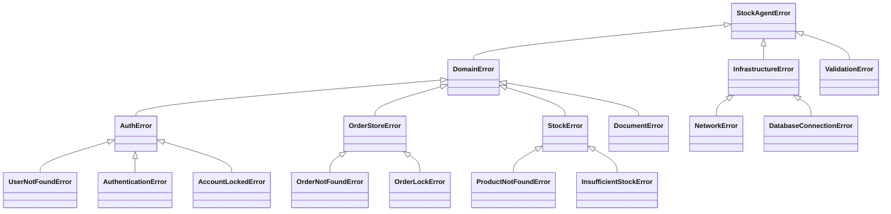

# Arquitectura Modular del Backend y Frontend (src/)

Este directorio contiene el código fuente principal de **StockAgent**, estructurado bajo principios de arquitectura limpia, separación de responsabilidades (SRP) y alta mantenibilidad.

---

## 🏛️ Visión General de la Arquitectura

```
src/
├── core/                       # Núcleo de excepciones y contratos de dominio
│   ├── __init__.py             # Exportaciones públicas de excepciones
│   └── exceptions.py           # Jerarquía unificada de errores tipados
│
├── auth/                       # Dominio de autenticación, seguridad y usuarios
│   ├── __init__.py             # Exportaciones del paquete auth
│   ├── models.py               # Modelos inmutables (User, ApiKey, UserRole)
│   ├── password.py             # Hashing PBKDF2-HMAC-SHA256 y validación de políticas
│   └── store.py                # Repositorio SQLite UserStore (usuarios, API keys, sesiones)
│
├── orders/                     # Dominio de pedidos, clientes y trazabilidad
│   ├── __init__.py             # Exportaciones del paquete orders
│   ├── models.py               # Modelos de datos (Pedido, Cliente, MensajeChat, LogAuditoria)
│   ├── client_repo.py          # Mixin de gestión de clientes y códigos automáticos
│   ├── chat_repo.py            # Mixin de canal colaborativo y menciones inteligentes
│   ├── concurrency_repo.py     # Mixin de soft-locking temporal (TTL) e idempotencia SHA-256
│   ├── audit_repo.py           # Mixin de registro transaccional y auditoría forense
│   ├── closure_repo.py         # Mixin de cierres de turno y consolidación documental
│   └── store.py                # Repositorio SQLite OrderStore unificado
│
├── stock/                      # Dominio de stock, reposición e inventario
│   ├── __init__.py             # Exportaciones de stock
│   ├── models.py               # Dataclasses de descuento (RegistroDescuento, ReporteStock)
│   ├── reports.py              # Exportadores binarios Excel (.xls) y vectoriales PDF
│   ├── replenishment.py        # Algoritmos de sugerencia y armado de pedidos a fábrica
│   └── physical_inventory.py   # Reconciliación de inventario físico vs. digital
│
├── ui/                         # Capa de presentación gráfica y vistas (Flet)
│   ├── __init__.py             # Exportaciones de UI
│   ├── theme.py                # Paleta de colores corporativos Ultratech y tokens visuales
│   ├── dashboard_presenter.py  # Presentador desacoplado del Dashboard reactivo
│   ├── mixins/                 # Mixins modulares para la orquestación de la GUI
│   │   ├── __init__.py         # Re-exportación de mixins
│   │   ├── responsive.py       # Detección y adaptación a pantallas móviles y tablets
│   │   ├── document_viewer.py  # Apertura de informes, manuales PDF y compartición
│   │   ├── session_sync.py     # Sincronización en tiempo real entre sesiones y chat
│   │   └── dialog_dispatcher.py# Despachador central de vistas modales e impresión
│   ├── components/             # Componentes visuales desacoplados
│   │   ├── header.py           # Encabezado superior y selector de perfil / IP
│   │   ├── sidebar.py          # Barra lateral / drawer responsivo
│   │   ├── floating_chat.py    # Ventana flotante de chat (asistente + equipo)
│   │   ├── audio_manager.py    # Motor acústico Web Audio API / winsound
│   │   ├── network_heartbeat.py# Demonio de sondeo LAN y semáforo visual de latencia
│   │   ├── mobile_nav.py       # Barra ergonómica inferior para dispositivos móviles
│   │   └── print_labels.py     # Despacho de rótulos térmicos (100x150 mm) y A4
│   └── dialogs/                # Vistas modulares por caso de uso
│       ├── dlg_auth.py         # Autenticación, reseteo de claves y perfil
│       ├── dlg_pedidos.py      # Carga, cancelación y desarme de pedidos
│       ├── dlg_historial_pedidos.py # Historial con paginación y búsqueda
│       ├── dlg_cierre/         # Asistente de cierre de jornada y hoja de ruta
│       ├── dlg_stock_ops.py    # Operaciones de fábrica, ML Full y stock físico
│       └── ...                 # Demás diálogos especializados
│
├── user_store.py               # Fachada retrocompatible hacia src.auth
├── orders_store.py             # Fachada retrocompatible hacia src.orders
├── flet_gui.py                 # Orquestador UI ensamblado con mixins
├── product_store.py            # DAO SQLite para catálogo de productos
├── stock_manager.py            # Gestor central de inventario y sincronización Excel
└── server.py                   # Servidor ASGI / FastAPI, middleware PWA y OTA
```

---

## 🛡️ 1. Jerarquía Unificada de Excepciones (`src/core/exceptions.py`)

Para evitar capturas genéricas silenciosas y mejorar la resiliencia operativa, se implementó una jerarquía estructurada de excepciones de dominio:



### Características Principales:
* **`code`:** Código de error estandarizado (ej: `AUTH_ACCOUNT_LOCKED`, `ORDER_LOCKED_BY_USER`).
* **`status_code`:** Código HTTP equivalente (400, 401, 403, 404, 409, 500) para mapeo inmediato en la API REST.
* **`context`:** Diccionario de metadatos contextuales (usuario, SKU, ID de pedido, IP) que se incluye automáticamente en los registros de auditoría y logs.

---

## 🔐 2. Paquete de Autenticación y Seguridad (`src/auth/`)

Reemplaza el antiguo archivo monolítico `user_store.py` (anteriormente de más de 1,000 líneas), separando responsabilidades:

* **`models.py`:** Define los modelos de datos tipados:
  * `User`: Información de cuenta, rol (`operador`, `picker`, `administrador`, `master`, `consulta`), estado, bloqueo por intentos y preferencias de UI.
  * `ApiKey`: Token de acceso para la API REST con permisos granulares y fecha de expiración.
* **`password.py`:** Seguridad criptográfica:
  * Algoritmo `PBKDF2-HMAC-SHA256` con sal aleatoria de 32 bytes y 100,000 iteraciones.
  * Verificación en tiempo constante `hmac.compare_digest` para mitigar ataques de temporización (*timing attacks*).
  * Validación estricta de políticas de longitud mínima y complejidad.
* **`store.py`:** Repositorio transaccional `UserStore`:
  * Gestión en SQLite con modo WAL (`usuarios.sqlite3`).
  * Conteo de intentos fallidos y bloqueo temporal tras 5 fallos consecutivos.
  * Registro de sesiones activas concurrentes y auditoría de accesos.
* **`src/user_store.py` (Fachada):** Proporciona retrocompatibilidad del 100% para todo el código y tests existentes.

---

## 📦 3. Paquete de Pedidos, Auditoría y Concurrencia (`src/orders/`)

Reemplaza el antiguo archivo monolítico `orders_store.py` (anteriormente de más de 1,690 líneas), organizando las operaciones en repositorios mixin especializados:

* **`models.py`:** Define las entidades centrales: `Pedido`, `Cliente`, `MensajeChat`, `LogAuditoria`, `CierreJornada`.
* **`client_repo.py` (`ClientRepositoryMixin`):** CRUD de clientes mayoristas y minoristas, gestión de teléfonos, direcciones y autogeneración de códigos únicos (`CLI-XXXXXX`).
* **`chat_repo.py` (`ChatRepositoryMixin`):** Mensajería interna de equipo, conteo de mensajes no leídos por usuario y enriquecimiento automático de referencias a pedidos (`#PED-1234`).
* **`concurrency_repo.py` (`ConcurrencyRepositoryMixin`):**
  * Soft-locking temporal (Lease/TTL de 5 minutos) en edición de pedidos para evitar colisiones entre operarios.
  * Registro de idempotencia con tokens SHA-256 para prevenir procesamientos duplicados por microcortes de red.
* **`audit_repo.py` (`AuditRepositoryMixin`):** Bitácora transaccional inmutable (`pedidos_auditoria`) con trazabilidad completa de usuario, rol, IP y detalles del cambio.
* **`closure_repo.py` (`ClosureRepositoryMixin`):** Consolidación de cierres de turno, cálculo de métricas de bultos y archivo seguro de informes.
* **`store.py` (`OrderStore`):** Repositorio central que compone todos los mixins y garantiza la inicialización de esquemas y migraciones automáticas.
* **`src/orders_store.py` (Fachada):** Mantiene retrocompatibilidad transparente.

---

## 🎨 4. Mixins de Interfaz de Usuario (`src/ui/mixins/`)

La clase `InterfazFlet` en `src/flet_gui.py` fue desacoplada mediante herencia múltiple de mixins especializados:

1. **`ResponsiveLayoutMixin` (`src/ui/mixins/responsive.py`):**
   * Detección precisa de viewports móviles y tablets (< 768px).
   * Cálculo dinámico de ancho y alto adaptable respetando márgenes de seguridad.
   * Gestión del ciclo de vida del `NavigationDrawer` móvil y diálogo de fallback ante demoras.
   * Manejador de eventos de redimensionamiento de ventana (`_al_redimensionar`).

2. **`DocumentViewerMixin` (`src/ui/mixins/document_viewer.py`):**
   * Apertura nativa de informes generados y previsualización inline en nueva pestaña web.
   * Generación y visualización bajo demanda de manuales de usuario oficiales en PDF según el rol activo.
   * Exploración en carpetas del sistema operativo (Windows Explorer / macOS / Linux).
   * Compartición por correo electrónico y enlace directo a WhatsApp.

3. **`SessionSyncMixin` (`src/ui/mixins/session_sync.py`):**
   * Notificación reactiva en tiempo real entre múltiples pestañas y terminales conectadas a la LAN.
   * Emisión de *toasts* colaborativos ante cierres, despachos o actualizaciones de stock.
   * Sincronización del badge contador de mensajes no leídos en el canal de equipo.
   * Carga y despacho de mensajes enriquecidos en el chat interno.

4. **`DialogDispatcherMixin` (`src/ui/mixins/dialog_dispatcher.py`):**
   * Centraliza los métodos de despacho y apertura de todas las ventanas modales de la aplicación.
   * Desacopla la lógica de impresión de rótulos térmicos continuos y hojas A4.

---

## 🧪 5. Verificación y Cobertura de Pruebas

Toda la arquitectura modular ha sido verificada contra la suite completa de pruebas automatizadas:
* **Total de pruebas:** 302 pruebas unitarias y de integración.
* **Tasa de éxito:** 100% pasando (`302 passed`).
* **Retrocompatibilidad:** Cero rupturas de contratos, importaciones existentes preservadas sin cambios.
